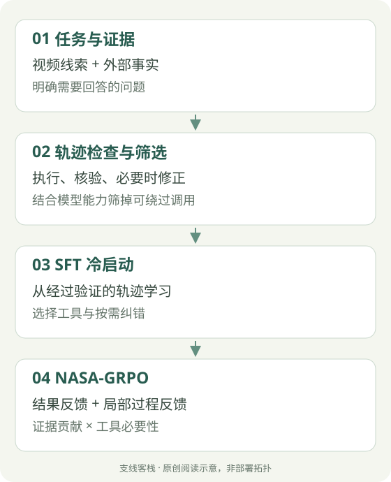

# AdaVDR：让视频 Agent 学会获取必要的证据

> **先理解一句话：AdaVDR 学习的是“什么时候用工具、结果不可靠时怎样纠正”，NASA-GRPO 则把训练反馈细化到取得证据的工具动作。**

本文围绕 **AdaVDR: Adaptive Tool Use and Reflection for Video Deep Research**，固定阅读 **arXiv:2608.25559v2，2026-10-14**，作者单位为 Alibaba Accio Team 与北京理工大学。整理日期：2026-11-03。论文结果、本站教学例子与 Infra 延伸判断分别标注；本文没有复现训练。

[论文 v2](https://arxiv.org/abs/2608.25559v2) · [PDF](https://arxiv.org/pdf/2608.25559v2) · [官方项目页](https://accio-lab.github.io/AdaVDR/) · [官方仓库](https://github.com/Accio-Lab/AdaVDR)

**阅读路线：** 先看第 1、2 章建立概念，再看第 3–5 章理解训练与实验；面试前用第 7 章练一分钟口述。NASA-GRPO 的三个易错点是：**正确证据不等于工具必要；可绕过的动作仍可获半权重；减少冗余不等于总调用数下降。**

## 第 1 章 问题：为什么视频理解还要搜索

### 1.1 视频提供线索，外部信息补全答案

截图、人物、事件的视觉信息往往不足以直接回答外部事实问题。AdaVDR 将视频定位和外部检索组合起来，并在中间证据不可靠时修正路径。[论文 §3](https://arxiv.org/html/2608.25559v2#S3)

**本站教学例子：** 用户给了一段展会视频，问“台上展示的这款设备是哪一年发布的？”视频帮助确定设备身份，发布年份需要另外核验。

| 当前情况 | 可以采取的动作 | 应检查的结果 |
| --- | --- | --- |
| 看不清设备出现在哪一段 | 定位时间区间，再选清晰帧 | 帧内确实有目标设备 |
| 画面里有多个设备 | 定位目标区域，必要时裁剪 | 裁剪保留了可识别特征 |
| 设备已经能直接辨认 | 跳过不必要的识别链，查询发布信息 | 查询对象与视频目标一致 |
| 搜索命中了相似型号 | 回查型号或重新选择视觉证据 | 新证据能排除误匹配 |

这个例子不来自论文实验。它说明：每个动作都应该对应一个尚未解决的信息缺口。继续调用工具可以获得新证据，也可能引入新的误导。

### 1.2 三个问题要分开

**答案对不对、证据有没有用、工具是否必要，是三个不同判断。** 例如，某次搜索返回了正确的设备名称，但模型原本已能辨认；该观察是正确的，却不能充分证明这次搜索不可省略。反过来，第一次搜索失败，也不意味着整个纠错过程没有价值。

## 第 2 章 数据：先教会怎样行动与纠错

### 2.1 从问答到可执行轨迹

论文的数据流程包含问答构造、轨迹执行检查、失败后的修正，以及按目标模型能力过滤可绕过的工具链。SFT 使用约 **2.9K** 条已验证轨迹；目标模型为 **Qwen3.5-9B**。[官方数据与训练介绍](https://accio-lab.github.io/AdaVDR/)

### 2.2 为什么要保留有意义的失败过程

如果示范只留下完美的最后一条搜索路径，模型能看到“成功时做什么”，却看不到“怎样发现先前的证据有问题”。在上面的设备例子中，值得学习的过程包括：发现相似型号不匹配、回到视频检查铭牌、换搜索词、再次核验。

这里的关键是纠错有依据。不能为了展示“会反思”而在每一步后增加一段空泛自检，也不能把一次错误搜索永久当成无效样本。这是对数据构造方式的学习解释，具体轨迹筛选以作者实现为准。

## 第 3 章 NASA-GRPO：把反馈分配给具体动作

### 3.1 从整条轨迹的结果到局部贡献

NASA-GRPO 同时考虑最终答案与中间证据。它把轨迹分成证据获取片段：片段得到正确且尚未计分的线索后，再结合动作必要性给予过程奖励。[论文 §5.2](https://arxiv.org/html/2608.25559v2#S5.SS2)

**式 1 · 原始过程奖励：证据贡献乘以必要性权重**

$$R_t^{\mathrm{proc}}=S_{s(t)}^{\mathrm{evid}}\,w_t^{\mathrm{nec}}$$

这里 $t$ 表示工具动作，$s(t)$ 表示它所在的证据片段；$S^{\mathrm{evid}}$ 是该片段是否取得可计分线索的指示值。必要性权重 $w_t^{\mathrm{nec}}$ 对不能绕过的动作取 **1**，对能绕过的动作取 **0.5**。这是论文式 8–10 的简化阅读顺序，不是把所有工具回包都自动算作奖励。

### 3.2 数据过滤与在线奖励不是同一个步骤

| 环节 | 比较对象 | 可绕过时怎样处理 |
| --- | --- | --- |
| SFT 数据准备 | 初始化训练的基座模型 | 从示范轨迹中移除相应冗余调用 |
| RL 必要性评估 | 当前迭代的旧策略快照 | 降低过程奖励权重，而非直接改写已采样轨迹 |

必要性评估期间保持策略快照固定，下一次 RL 迭代再刷新。这样，“模型能不能不借助这个工具取得信息”的判断会随模型能力变化。[官方训练说明](https://accio-lab.github.io/AdaVDR/)

### 3.3 工具类型归一化与 token 归因

过程奖励先按工具类型做均方根缩放，再与结果优势的平均幅度对齐；最后，结果优势覆盖生成 token，局部过程优势只加在对应工具动作的 token 上。[论文式 11–13](https://arxiv.org/html/2608.25559v2#S5.SS2)

**式 2 · 工具类型内缩放：注意没有减均值**

$$\widetilde R_t^{\mathrm{proc}}=\frac{R_t^{\mathrm{proc}}}{\sqrt{\operatorname{mean}_{j\in\mathcal B_{k(t)}}[(R_j^{\mathrm{proc}})^2]+\varepsilon}}$$

$k(t)$ 是动作类型，$\mathcal B_{k(t)}$ 是同一批次里该类型的动作集合，$\varepsilon$ 是数值稳定项。因此这里不能套用“减均值再除标准差”的口述。最终组合如下，其中 $A_t^{\mathrm{proc}}$ 已包含幅度对齐，$m_{t,i}$ 标记 token $i$ 是否属于动作 $t$。

**式 3 · 结果与局部过程优势的组合**

$$A_i=A^{\mathrm{out}}(\tau)+\lambda\sum_t m_{t,i}A_t^{\mathrm{proc}},\qquad\lambda=0.3$$

这些公式描述奖励和优势的构造，不能仅凭它们推断完整优化器实现、采样调度或所有 loss mask 的代码细节。

## 第 4 章 一个手算例子：有用与必要怎样区分

### 4.1 先看未归一化的过程奖励

**以下为本站自编教学数据，不是论文中的样例或实验结果。** 假设设备问答产生三个片段；每个片段只列一个待观察的动作。

| 动作 | 线索正确且首次计分？ | 可绕过该动作？ | 原始过程奖励 |
| --- | --- | --- | --- |
| 图像搜索取得设备身份 | 是，$S=1$ | 否，$w=1$ | $1\times1=1$ |
| 网页搜索再次取得同一身份 | 否，已计分，$S=0$ | 否，$w=1$ | $0\times1=0$ |
| 查询取得发布年份 | 是，$S=1$ | 是，$w=0.5$ | $1\times0.5=0.5$ |

第二行动作即使返回正确内容，也不会因为重复取得同一线索而再次获得证据分。第三行有新信息，但能力测试认为可绕过，因此得到较低权重。

### 4.2 别把原始分直接当作最终梯度权重

假设一类工具的批内原始分只有 $[1,0]$，忽略稳定项时，均方根为 $\sqrt{(1^2+0^2)/2}\approx0.707$，缩放结果约为 $[1.414,0]$。后面还需要幅度对齐和结果优势。

所以，“动作得了 0.5 分”只描述中间量，不能直接推出该动作 token 的最终优势是正还是负。若整条轨迹的结果优势为负，过程项只是改变相应动作受到的总反馈。

**练习：** 如果第二行取回的是一个此前没有的新线索，且必须使用该动作，原始过程奖励是多少？答案是 1；但仍需后续归一化，不能直接当作最终 $A_i$。

## 第 5 章 结果：能力提高，但交互轮数未必减少

### 5.1 在相同 Agentic 设置下比较

下表为作者报告的准确率；改进量用**百分点**表示。基座到最终模型的收益包含 SFT 与 RL，两者不能合并说成“RL 单独带来”。[官方结果表](https://github.com/Accio-Lab/AdaVDR#results)

| 模型阶段 | VideoDR | VDR-EE |
| --- | --- | --- |
| Qwen3.5-9B 基座 | 37.00% | 40.00% |
| AdaVDR-9B-SFT | 52.00% | 48.00% |
| AdaVDR-9B，加入 NASA-GRPO | 66.00% | 55.20% |
| 最终相对 SFT | +14.00 个百分点 | +7.20 个百分点 |
| 最终相对基座 | +29.00 个百分点 | +15.20 个百分点 |

官方介绍的 VDR-EE 包含 **250** 个人工核验问题，覆盖实体和事件两类，并涉及 **7** 个领域。评测中的正确答案判断仍需结合判分协议理解，不能直接外推为任意真实视频任务的成功率。[官方基准介绍](https://accio-lab.github.io/AdaVDR/)

### 5.2 v2 的轮数结果值得单独记住

| 平均交互轮数 | SFT | RL |
| --- | --- | --- |
| VideoDR | 10.18 | 11.67 |
| VDR-EE | 10.81 | 13.26 |

v2 中部分 grounding 调用减少，但检索及网页访问增加。**不能从“减少冗余”推导出“总调用数、总时延或总费用下降”。** [论文 Table 3](https://arxiv.org/html/2608.25559v2#S6.SS3)

这是读实验的一个通用方法：先明确优化的是哪类行为，再分别核对准确率、调用分布、token 消耗与端到端时间。某些低价值操作减少，同时高价值操作增加，是完全可能的。

## 第 6 章 从 post-training Infra 角度看

### 6.1 下面是工程推演，不是作者已披露的部署方案

| 系统问题 | 值得测量什么 | 为什么与这类训练有关 |
| --- | --- | --- |
| 多轮 rollout 的长尾 | 生成、工具等待、重试分别占多少时间 | 同一轮中不同任务可能有不同长度和外部等待 |
| 视频与长上下文开销 | 视觉编码、prefill、KV cache 峰值 | 多轮观察会改变输入长度与缓存需求 |
| 必要性评估的额外成本 | 验证调用次数、批处理效率、重复输入比例 | 奖励构造本身也会消耗推理与工具资源 |
| 策略版本一致性 | rollout、验证及训练记录使用的版本 ID | 能力判断随策略变化，需要能追溯使用的快照 |
| token 级奖励映射 | action ID 到 token span 的映射准确率 | 工具输出、推理文本和工具动作不能混成同一归因范围 |

论文附录列出的 RL 配置使用 Megatron，16 张 GPU，训练 TP=4、rollout TP=1，且启用动态批处理。这些是实验配置，不能据此推断 Accio 的全部算力、GPU 型号或其他项目配置。[附录 A](https://arxiv.org/html/2608.25559v2#A1)

### 6.2 如果要做一次性能分析

建议将单次迭代拆为五段：采样生成、外部工具、必要性验证、奖励聚合、训练更新。各段同时记录墙钟时间和资源占用，再确认关键路径；有重叠执行时不能简单把每段总和当成迭代耗时。

进一步可做三个对照：验证请求逐条执行与合批执行；同组共享输入是否复用；不同长尾任务如何分桶。每个对照都应同时检查训练样本分布和版本一致性，不能只看吞吐。这些是本站提出的实验方向，尚未执行，也不预设一定带来收益。

## 第 7 章 面试表达：先讲观点，再讲证据

### 7.1 一分钟介绍

> 我关注 AdaVDR，是因为它把工具调用从固定流程变成了可训练的决策。它先用经过检查和筛选的轨迹做 SFT，再通过 NASA-GRPO，把有效证据和工具必要性转成局部训练反馈。我觉得最值得注意的是，它并不等于让工具越少越好：v2 的准确率提高了，但总交互轮数也增加了。从 Infra 角度，我会进一步关注多轮采样的长尾、必要性验证成本，以及策略快照与 token 归因的一致性。

这是本站基于公开材料组织的口述示例。读过论文可以说“阅读后我的理解是”，实际跑过实验才能说“复现过”。

### 7.2 三个值得继续问的问题

1. 必要性验证在完整训练迭代中占多少成本，哪些请求能在保持口径的前提下共享或合批？
2. 工具轨迹变长后，训练系统如何处理外部等待和 rollout 长尾，收益最终怎样衡量？
3. 工具动作与 token span 怎样关联，失败重试和恢复路径是否都有可追溯记录？

这些问题用于延伸交流，不代表论文缺少这些实现，也不暗示团队当前一定存在相关问题。

## 第 8 章 版本、资源与阅读边界

### 8.1 固定版本再比较

本文固定 **2026-10-14 的 v2**。官方仓库在 10 月更新中将 NASA-GRPO 列为主要变化，因此不要把早期摘要中的训练描述或旧版结果混入当前表格。检索日期为 2026-11-03。[版本记录](https://arxiv.org/abs/2608.25559v2) · [仓库更新说明](https://github.com/Accio-Lab/AdaVDR#-news)

### 8.2 原始资料入口

- [论文 v2 HTML](https://arxiv.org/html/2608.25559v2)：方法、公式、主实验、附录配置。
- [论文 v2 PDF](https://arxiv.org/pdf/2608.25559v2)：适合连续阅读与核对图表。
- [官方项目页](https://accio-lab.github.io/AdaVDR/)：方法总览、图示与资源入口。
- [官方 GitHub](https://github.com/Accio-Lab/AdaVDR)：项目介绍、更新与资源发布进度。
- [评测代码目录](https://github.com/Accio-Lab/AdaVDR/tree/main/eval)：评测相关实现入口。

本次核对时，官方已宣布发布 VDR-EE 和评测代码；模型权重、训练数据及训练代码仍列为待发布。**仓库可访问不等于训练全链路已经开源。** [发布进度](https://github.com/Accio-Lab/AdaVDR#todo-list)

本文中的设备例子、手算数据、阅读图和 Infra 实验建议由本站编写；作者报告的准确率与轮数未在此独立复现。可以继续对照站内 [Occamy](./occamy.html)、[SAO](./sao.html) 与 [训练推理数值一致性](./rl-infra-numerics.html) 阅读。
