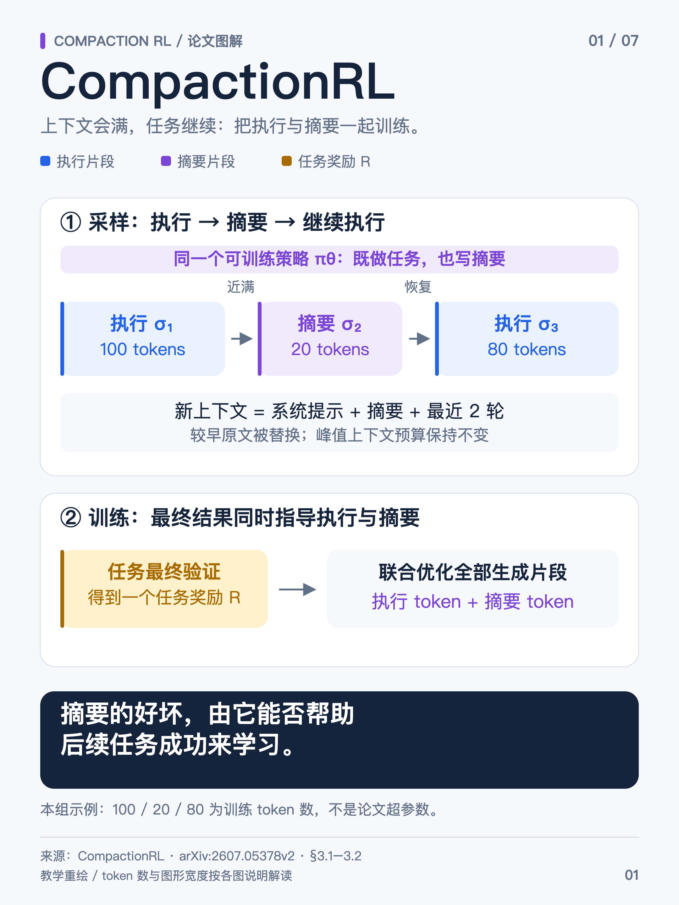
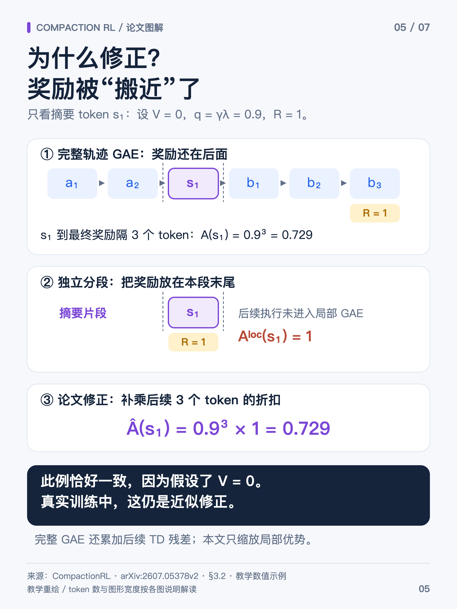

# CompactionRL：把摘要也作为动作来训练

> **主线：上下文将满 → 生成摘要 → 根据摘要继续执行 → 用最终结果共同训练执行与摘要。**

本文整合你整理的 7 张技术图，对照 [CompactionRL 论文 v2](https://arxiv.org/html/2607.05378v2)。核心不只是“让长任务继续”，而是让模型学会**保留真正有助于完成任务的信息**。本篇采用 v2；现有 [Occamy笔记](./occamy.html)按其原报告口径引用 v1，实验配置应分别阅读。

## 第 1 章 为什么要把 compaction 纳入训练

Agent 不断读文件、调工具、收到报错，历史会逐渐填满上下文。**Compaction（上下文压缩）**把较早历史变成摘要，保留必要的近期交互，随后继续任务；文件、数据库等环境状态不会因此回滚。

仅在推理时压缩，模型未必会写出适合继续工作的摘要。比如修复 CSV 解析器，摘要记住“改过文件”，却漏了“转义引号仍报错、不得改测试”，后续就可能重复尝试或违反约束。

**CompactionRL 用同一个可训练策略生成执行动作和摘要，再让整次任务的最终奖励共同评价它们。** 没有额外手工定义“摘要写得漂亮”的奖励；有用的摘要应帮助后续任务成功。[论文 §3.1](https://arxiv.org/html/2607.05378v2#S3.S1)

## 第 2 章 什么时候压缩，压缩后还剩什么

**式 1 · 压缩触发条件**

$$
C-|h_t|<T_{\mathrm{comp}}
$$

$C$ 是工作上下文预算，$h_t$ 是第 $t$ 轮后的历史，$|h_t|$ 是其 token 长度，$T_{\mathrm{comp}}$ 是预留阈值。剩余空间低于阈值时触发，**不是固定每若干轮就压缩**。

系统追加摘要指令，让策略生成摘要 $S_t$，再按固定恢复模板组装上下文：系统提示 + 摘要 + 最近 $k$ 轮原始交互。论文默认 $k=2$，空间不足时可减少；一轮包含助手动作和相应工具观察，避免把调用与返回拆开。原始任务要求需要在摘要提示与恢复内容中保留。

**递归例子：** 第 10 轮压缩，把第 1–8 轮总结为 $S_1$，保留第 9、10 轮原文。到第 16 轮再次压缩，当前历史中的 $S_1$ 与第 9–14 轮进展合成 $S_2$，保留第 15、16 轮。更早原文已不在当前视野中，遗漏的信息不会因“再摘要一次”自动找回。轮数是教学假设，实际仍按空间触发。

摘要应保留任务目标、约束、已完成操作、关键观察、未解决错误和下一步线索。例如“已修改 parser.py；普通引号通过，转义引号失败；测试不可改”，比“已完成部分修复”更能支持继续工作。[论文 §3.1、附录 A.3](https://arxiv.org/html/2607.05378v2#A1.S3)

## 第 3 章 一条轨迹为什么需要分段 forward

压缩后，模型真正看到的前缀发生变化。下面是一条任务尝试的三个训练片段：

| 片段 | 生成时看到的上下文 | 新生成、可训练的内容 |
| --- | --- | --- |
| 执行段 $\sigma_1$ | 原任务 + 当时已有的交互历史 | 读文件、写补丁等模型输出 |
| 摘要段 $\sigma_2$ | 摘要请求实际包含的历史 + 摘要指令 | 摘要 $S$ |
| 继续执行段 $\sigma_3$ | 恢复模板中的 $S$ + 最近交互 | 根据摘要继续生成的动作 |

**训练时分别还原这些真实上下文，forward 得到各自输出 token 的 log-prob，再按训练目标汇总。** 不能把所有旧历史和新输出直接接成普通因果序列，否则压缩后动作会看到采样时已移除的内容。

分段 forward 本身只决定条件概率怎么重算；**它不会自动产生新奖励或新优势，也不要求每段等权。** 三个片段仍属于同一次任务尝试。第 4–5 章介绍的是这篇论文另外选择的损失汇总和优势计算方法。

### 3.1 摘要 token 的 mask 到底是多少

| 位置 | 本文所述 CompactionRL 的策略 loss mask |
| --- | --- |
| 策略新生成的执行输出 | 1 |
| 策略新生成的摘要输出 | 1：摘要本身也是被训练的动作 |
| 摘要被复制到后续片段，作为输入前缀 | 0：不在这个位置重复监督生成 |
| 系统提示、用户输入、工具返回、padding | 0 |

**同一份摘要，作为输出时可训练，作为后续输入时可读取。mask=0不等于从上下文删除。** 若摘要由固定外部服务生成、且不属于本轮待优化策略的采样动作，则通常只作上下文；这与论文“联合训练摘要”的设置不同。

## 第 4 章 Loss：PPO 单项与 token 汇总

论文采用**每个 prompt 一条轨迹的 PPO**，用 Critic 提供上下文相关的价值估计，减少等待同题整组完成造成的策略滞后。单轨迹仍可组成训练 batch；这里的 PPO目标不要直接替换成 [SAO 的 DIS公式](./sao.html#chapter-3)。

**式 2 · token 概率比**

$$
\rho_{s,i}=\frac{\pi_\theta(y_{s,i}\mid h_{s,i})}{\pi_{\mathrm{rollout}}(y_{s,i}\mid h_{s,i})}
$$

$s$ 是片段编号，$i$ 是段内可训练 token 位置；$y_{s,i}$ 是实际生成的 token，$h_{s,i}$ 是它当时的真实前缀。$\pi_\theta$ 是当前策略，$\pi_{\mathrm{rollout}}$ 是采样策略（论文记作旧策略）；分母来自采样行为，训练时固定。

**式 3 · 单个 token 的 PPO 损失**

$$
\ell_{s,i}=-\min\!\left(\rho_{s,i}\widehat A_{s,i},\operatorname{clip}(\rho_{s,i},1-\epsilon,1+\epsilon)\widehat A_{s,i}\right)
$$

$\widehat A_{s,i}$ 是第 5 章修正后的优势，策略更新时固定；$\epsilon$ 是裁剪幅度，$\operatorname{clip}$ 把概率比截到给定区间。负号把最大化收益改写成最小化 loss。正优势鼓励提高动作概率，负优势提供相反方向的信号，裁剪限制继续沿有利方向扩大更新的激励。

**式 4 · 全批次训练 token 统一平均**

$$
L_\pi=\frac{1}{|\mathcal M|}\sum_{(s,i)\in\mathcal M}\ell_{s,i}
$$

$\mathcal M$ 是 batch 中所有参与策略训练的助手 token 位置集合，含执行和摘要；$|\mathcal M|$ 是其总数，须大于 0。前两个式子定义每项怎么算，本式定义怎样汇总；合起来对应论文式 5。

**手算：** 一段执行有 1,000 个训练 token，一段摘要有 100 个，统一用 1,100 作分母。每个 token 的基础系数都是 $1/1100$；不是先把两段各自平均，再让两段各占一半。只要 token 及其损失不变，仅改变分段方式不改变结果。

这只是论文明确选择的 **token 等权**目标，不是“分段必然改变权重”。如果你的实现原本就按整条轨迹汇总，分段不会凭空多算一份；token 等权也不意味着每条轨迹等权。[论文 §3.2，式 5](https://arxiv.org/html/2607.05378v2#S3.S2)

## 第 5 章 跨段 GAE：修正什么，为什么只是近似

### 5.1 先区分终局奖励与局部优势

一条轨迹最终得到任务奖励 $R$。论文把同一个 $R$ 分配给各个训练片段，在局部计算中放到该段末尾，再分别计算 GAE。**这不是环境真的发了多次奖励，也不是给摘要单独打了质量分。** 共享奖励不代表各 token 的优势相同，Critic 和所在位置仍会影响优势。

**式 5 · 片段内的 TD 残差与局部 GAE**

$$
\delta_{s,i}=r_{s,i}+\gamma V_\phi(h_{s,i+1})-V_\phi(h_{s,i}),\qquad A^{\mathrm{loc}}_{s,i}=\sum_{l=0}^{n_s-i}(\gamma\lambda)^l\delta_{s,i+l}
$$

$r_{s,i}$ 是局部计算使用的奖励；只用终局奖励时，非末位置为 0、段末为 $R$。$V_\phi$ 是 Critic，$n_s$ 是该段训练 token 数，$l$ 是向后累加的偏移，$\gamma$ 为奖励折扣，$\lambda$ 为 GAE 衰减参数。段末后继价值的处理属于局部计算的边界约定；下例统一设价值为 0，以便看清距离项。

**问题在于：对早期片段，把最终奖励放在本段末尾，相当于把它“搬近了”。** 这是上述局部优势算法的结果，不是分开 forward 必然导致的问题。

### 5.2 按后续训练 token 数补一个系数

**式 6 · 论文的跨段位置修正**

$$
N_{>s}=\sum_{j>s}n_j,\qquad \widehat A_{s,i}=(\gamma\lambda)^{N_{>s}}A^{\mathrm{loc}}_{s,i}
$$

$j$ 遍历同一轨迹的后续片段，$N_{>s}$ 是它们的训练 token 总数，只计被优化的执行与摘要输出，不计输入和工具观察。$\widehat A$ 是修正后的优势。同一段乘同一系数，但原局部优势可以不同；最后一段的系数为 1。

| 教学片段 | 训练 token 数 | 后续训练 token 数 | 该段统一乘的系数 |
| --- | ---: | ---: | --- |
| 执行 $\sigma_1$ | 100 | 20 + 80 = 100 | $(\gamma\lambda)^{100}$ |
| 摘要 $\sigma_2$ | 20 | 80 | $(\gamma\lambda)^{80}$ |
| 执行 $\sigma_3$ | 80 | 0 | 1 |

### 5.3 六个 token 的手算

顺序是 `a₁ → a₂ → s₁ → b₁ → b₂ → b₃`，其中 `s₁` 是一个摘要 token，`b₃` 后任务结束并得到 $R=1$。设所有价值预测为 0，$\gamma\lambda=0.9$：

- 沿完整动作顺序算，`s₁` 距最终奖励还有 3 个训练 token，优势为 $0.9^3=0.729$。
- 单独算摘要段，并把奖励放在 `s₁` 后面，局部优势就变成 1。
- 乘上后续距离系数 $0.9^3$ 后，得到 $0.729$。

**为什么只是近似？** 完整 GAE 还会把后续片段的 TD 残差递推回来；论文这里只缩放本段的局部优势，没有补回那些残差和全部价值边界关系。v2 明确说明这是一种保留片段并行计算便利的位置修正，不是精确重建完整轨迹 GAE。示例中的 0.9 也不是论文固定超参数。[论文 §3.2，式 6–10](https://arxiv.org/html/2607.05378v2#S3.S2)

## 第 6 章 实验：怎样区分压缩与摘要训练的收益

v2 使用 slime 训练，每个 prompt 1 条，global batch 128；两个模型的工作窗口分别为 64k、80k，最多压缩 3 次。评测使用 Harbor 与 Terminus-KIRA；**SWE-bench Verified 是随机抽取的 200 题子集**，Terminal-Bench 2.0 使用全量，结果取三次评测均值。

| GLM-4.7-Flash 的设置 | SWE 子集 Pass@1 | Terminal-Bench 2.0 Pass@1 |
| --- | ---: | ---: |
| 基础模型，仅推理时压缩 | 50.5% | 13.5% |
| 训练与推理均压缩，但摘要输出 mask=0 | 54.5% | 12.4% |
| 完整 CompactionRL，摘要也训练 | 56.0% | 20.2% |

第二行到第三行用于观察**直接优化摘要**的增益；第一行到第三行包含整个训练方案，不能全部归功于某一个公式。更大模型 GLM-4.5-Air 的完整方法达到 66.4% 和 26.2%，同样是该论文协议下的结果。[v2 Table 2](https://arxiv.org/html/2607.05378v2#S4.S2)

工作窗口没有变大，增加的是能够持续交互的总跨度。旧摘要可能遗失关键事实，再压缩会传播这种遗漏；因此既要看任务成功率，也要检查约束、文件路径、错误状态和已尝试方案是否被保留。论文结果不等于无限长度任务都能稳定解决。

## 第 7 章 和 SAO 怎样配合，面试怎样回答

| 层面 | SAO | CompactionRL |
| --- | --- | --- |
| 主要问题 | 异步数据陈旧与价值估计稳定性 | 有限上下文下的持续执行与摘要学习 |
| 关键设计 | 单轨迹、DIS、更可靠的 Critic | 策略生成摘要、token 汇总、跨段优势修正 |
| 共同点 | 每个 prompt 一条，用 Critic 估计优势 | 每个 prompt 一条，用 Critic 估计优势 |

两者可以组合，但要区分**单 token 的策略目标、优势估计、全批次汇总**这三件事。不能把“用 SAO”当作已经解决上下文重建，也不能把“有 compaction”当作已经做了 DIS。[SAO笔记](./sao.html)给出了对应公式。

**一分钟参考答案：** “CompactionRL 把压缩纳入 RL 采样，让同一策略既执行任务也写摘要，用最终任务奖励联合训练。训练时按每段真实上下文重新计算 log-prob；摘要生成位置参与 loss，复制到后续输入时只作上下文。它使用单轨迹 PPO，并按训练 token 统一平均。对每段独立计算的局部 GAE，再乘以后续训练 token 数对应的折扣，修正奖励距离。这个修正是近似，不是完整跨段 GAE 的精确递推。评测要把仅推理压缩、训练中压缩和直接训练摘要分开对比。”

来源：你整理的 **CompactionRL 7 张技术图解**；[论文 v2 全文](https://arxiv.org/html/2607.05378v2)与 [PDF](https://arxiv.org/pdf/2607.05378v2)。图示沿用原稿，数值手算与论文实验已分别标注。核对日期：2026-10-20。
