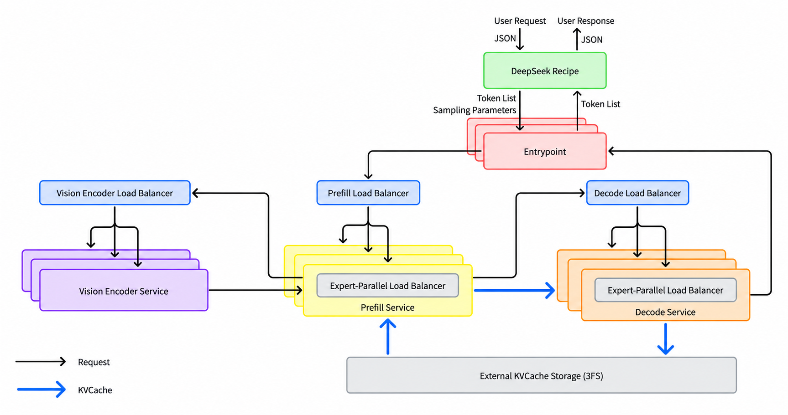
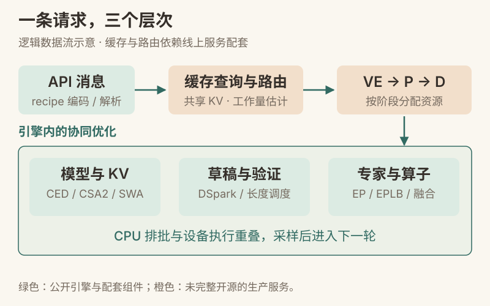
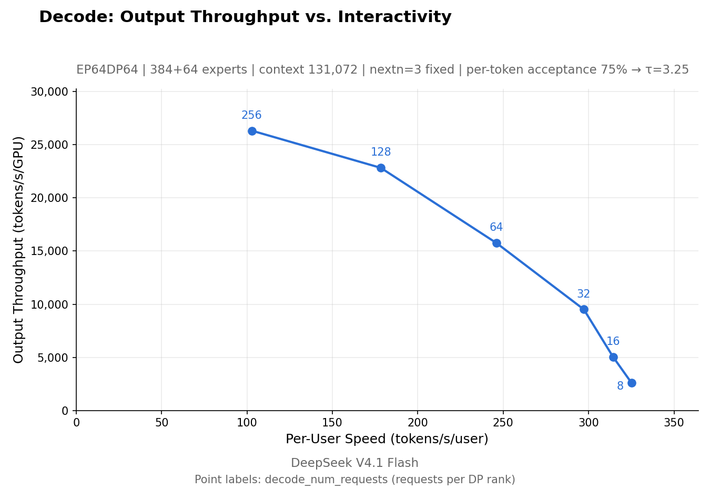
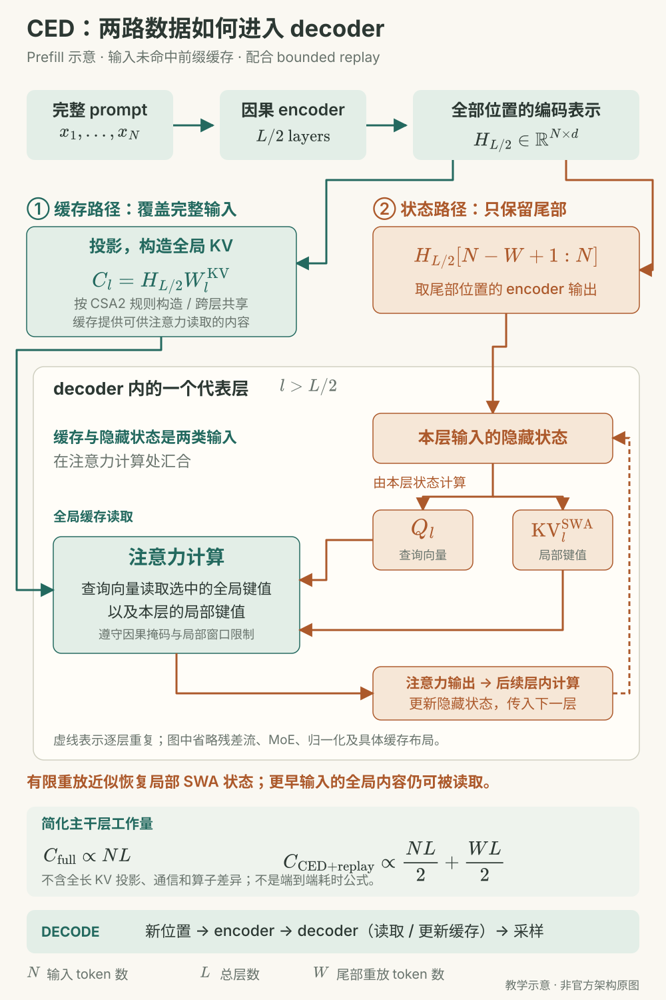
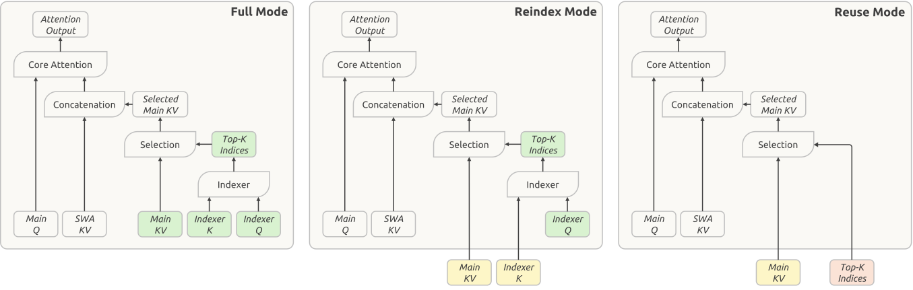
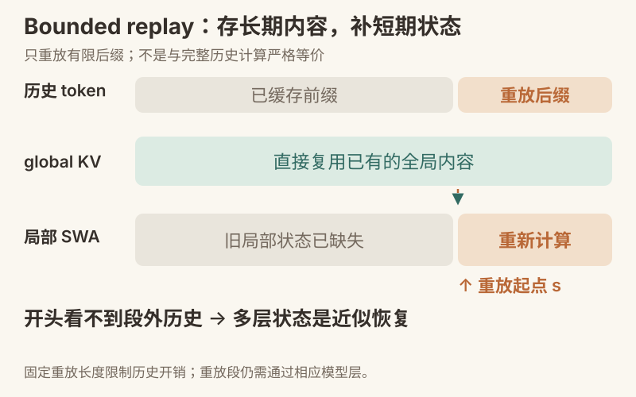
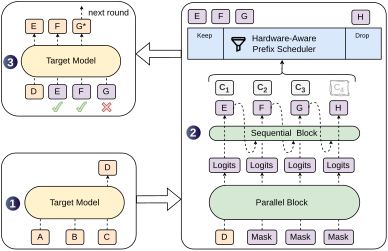
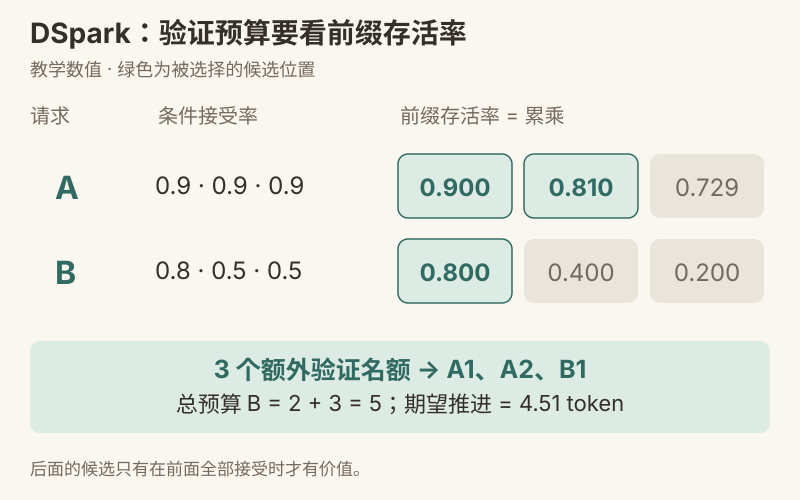
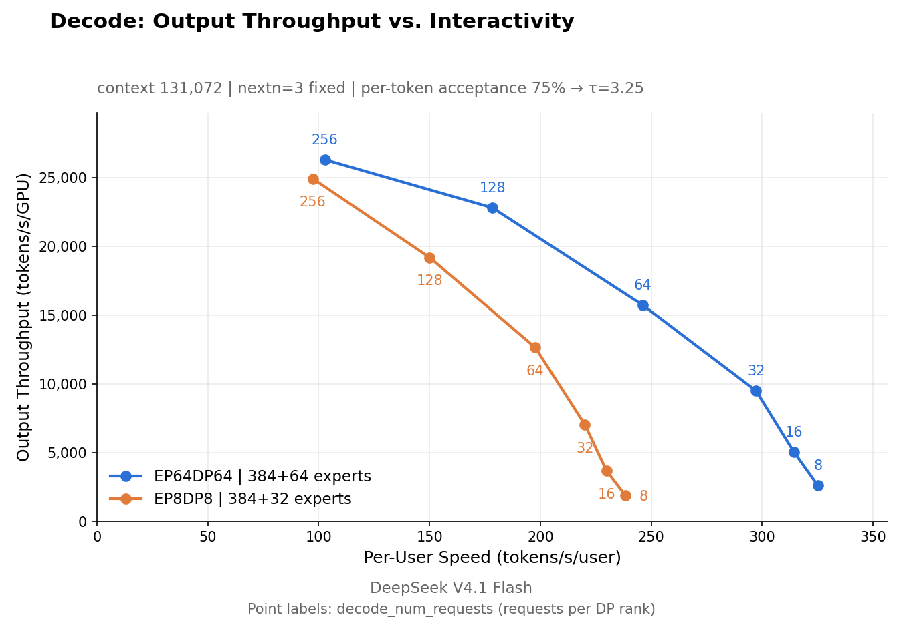
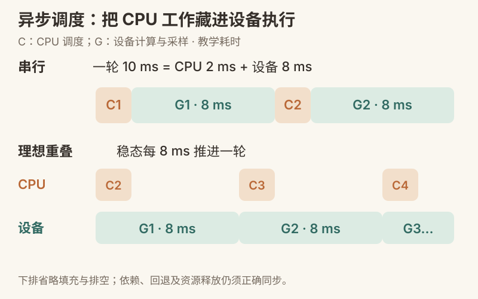

# DeepInfer：模型、缓存与大规模推理系统

> 一条主线：**少算重复历史 → 少存重复 KV → 少验低收益草稿 → 少让设备等待。**

DeepInfer 是 DeepSeek 面向自家模型的大规模推理框架。理解它，不能只记住几个 kernel 名称：模型结构决定哪些计算可以省，缓存系统决定旧计算能否复用，调度器决定有限算力先给谁，通信和算子再把计划高效执行出来。

本文沿用 Occamy 笔记的讲解方式：**为什么需要、具体怎么做、用例子算一遍、哪些结论不能直接推广。** 场景统一为一个持续调用工具的编程 Agent：它带着越来越长的对话读取仓库、修改代码、运行测试，再携带测试结果请求下一轮生成。

**资料基线：2026-10-22；官图补充：2026-10-23。** 代码固定在 DeepInfer 提交 `9bd9cf243fc53ef9afbf8f04d391d989117d6ab9`；论文使用 DSpark `2607.05147v1` 与 DeepSeek-V4.1-Flash `2609.19969v1`。已阅读 DeepSeek 官方知乎部署文章，并检索 CSDN、小红书技术解读。核心机制回查原文与代码；下文数值手算是教学示例，性能数据注明官方口径，没有做 GPU 集群复现。

**配图说明：** 本文包含 8 张官方原图（官图 A–H）与 5 张本站教学图（图 1–5）。官图来自固定提交的 DeepInfer 仓库及两篇论文 v1，未重绘；每张图下附原始出处和读图说明。手机上可点“查看原图”放大查看。

**关于“原论文”：** 本次未找到以这个 DeepInfer 推理框架为题的独立 arXiv 论文，官方 README 的引用指向 GitHub 项目。最相关的原始论文是上述两篇；网上同名的神经网络前置条件推断、智能合约类型推断论文与本框架无关。[官方仓库](https://github.com/deepseek-ai/DeepInfer)

**阅读路线：** 首次读第 1–7 章建立技术地图；做推理工程时加读第 8–10 章；复习时看第 11–12 章。注意力和 KV Cache 基础可结合本站 [推理基础设施笔记](./inference-infra.html) 阅读。

## 第 1 章 先分清模型、引擎与在线系统

### 1.1 DeepInfer 到底是什么

模型权重回答“下一 token 的分布是什么”；推理引擎回答“怎样组织一批请求，把这个分布算出来”；在线系统还要处理请求路由、跨机器缓存、扩缩容和故障恢复。**这三个层次互相配合，但发布一个引擎不等于发布整套生产服务。**

在当前版本中，DeepInfer 支持 DeepSeek-V4.1-Flash，官方列出的硬件是 NVIDIA SM100 与华为 Ascend 950。公开入口以离线推理为主；跨请求的完整 KVCache 服务、VE/Prefill/Decode 分离部署和跨 DP 副本负载均衡没有完整包含在这次发布中。仓库里已有相关引擎能力和接口，不能反过来说“完全没有 KV 管理或分离执行能力”。[固定版本 README](https://github.com/deepseek-ai/DeepInfer/blob/9bd9cf243fc53ef9afbf8f04d391d989117d6ab9/README.md)

| 层次 | 代表内容 | 阅读时要问什么 |
| --- | --- | --- |
| 模型架构 | CED、CSA2、SWA、MoE、DSpark 草稿头 | 为什么这种模型允许跳过、共享或压缩计算？ |
| 推理引擎 | batch 调度、KV 内存、采样、图执行、kernel | 一个请求怎样经过执行与验证得到输出？ |
| 在线服务 | VE/P/D 分离、跨副本路由、持久缓存、容错 | 请求在整个集群里如何流动和复用？ |
| 协议组件 | deepseek-recipe | API 消息怎样可靠地变成 token，再变回事件？ |

### 1.2 为什么编程 Agent 特别需要这套系统

设第一轮有 20,000 个输入 token，模型输出 500 个 token；工具返回 1,500 个 token。第二轮可能带着约 22,000 个 token 再请求模型。大部分输入是旧前缀，若每次全部重新 prefill，就反复支付相同计算。

更麻烦的是，Agent 可能隔几分钟甚至几小时再继续。只把缓存留在当前 GPU，既昂贵，又容易因进程回收而丢失。因此需要同时回答：**历史 KV 有多大、在哪里保存、谁能命中、缺一部分状态时怎样继续。**

与此同时，输出阶段要按依赖顺序生成。即使一次只生成几百 token，也可能反复发生“读权重 → 做少量计算 → 同步 → 再读权重”。DSpark、Wide-EP 和异步调度分别从减少串行轮次、提高专家计算效率、隐藏 CPU 空隙三个方向处理它。

### 1.3 从官方部署图建立阅读地图



来源：[DeepInfer 官方部署 Q&A](https://github.com/deepseek-ai/DeepInfer/blob/9bd9cf243fc53ef9afbf8f04d391d989117d6ab9/doc/inference_deployment_qa.md) · [官方原始图片](https://github.com/deepseek-ai/DeepInfer/blob/9bd9cf243fc53ef9afbf8f04d391d989117d6ab9/doc/images/architecture_overview.png)。

**读图顺序：** 从顶部 JSON 请求进入 `DeepSeek Recipe`，编码为 token 和采样参数，再交给 `Entrypoint`。中间三组服务分别负责视觉编码、Prefill 和 Decode；它们各有负载均衡器，P/D 服务内部又各有 Expert-Parallel Load Balancer。底部 `External KVCache Storage (3FS)` 与服务之间的蓝线说明 KV 可以跨阶段流转并进入独立存储。注意：图中底部画出的不是“所有层的所有缓存都写 SSD”；global KV 与局部 SWA 的存储策略在第 8 章分别解释。

**这张图回答的是完整生产系统怎样协作。** 它的组件范围大于当前开源引擎；不要把图上每个服务框都理解成仓库已有一个可直接启动的服务。下面的教学图再把这些组件与本文各章对应起来。



**先认清名称，再看它们各自节省什么：** 这里的 prompt 指输入给模型的提示内容；KV 指注意力计算中的 Key（键）与 Value（值），KV Cache 就是把这些中间结果缓存起来，供后续生成复用。

- **CED — Causal Encoder-Decoder，因果编码器—解码器架构。** 它把模型分为前半部的编码器和后半部的解码器；“因果”表示每个位置只能使用当前及之前的信息。处理长输入时，前半部先计算整段输入的表示，后半部所需的全局 KV 可由这些表示投影得到，从而减少需要在后半部逐层处理的输入 token 数量。后半部仍需处理一小段输入尾部，正式生成时也仍会执行前后两部分。详见[第 3.1 节](#section-3-1)。
- **CSA2 — Compressed Sparse Attention 2，压缩稀疏注意力第二版；FP4 — 4-bit Floating Point，4 位浮点表示。** 前者通过压缩和跨层共享减少需要保存的 KV，后者减少每个数值占用的位数，两者一起降低缓存存储成本。
- **Bounded replay，有限长度重放。** 只重新计算有限的一段历史，近似恢复滑动窗口注意力（Sliding-Window Attention，SWA）的局部状态，减少保存这些状态和完整恢复它们的成本。
- **DSpark，论文中的投机解码方案名称。** 先便宜地产生候选 token，再让目标模型验证；根据候选被接受的可能性分配验证预算，减少低收益计算。
- **EP — Expert Parallelism，专家并行；EPLB — Expert Parallel Load Balancing，专家并行负载均衡。** EP 把专家计算分布到多个设备，EPLB 调整专家副本与放置来缓解热点。配合融合 kernel（把多个计算步骤合并执行的算子实现），提高设备利用率。
- **持久缓存（Persistent Cache）。** 将可复用的计算结果保存更久，使下一轮请求能够继续利用之前的工作。

## 第 2 章 先会读指标，再判断“快”

### 2.1 TTFT、TBT 与吞吐各自回答什么

**TTFT（Time To First Token）** 是从请求进入到首 token 返回的时间，可能包含排队、协议编码、缓存查询和搬运、prefill。**TBT（Time Between Tokens）** 是相邻输出 token 的时间间隔；投机解码一次返回多个 token 时，还要区分引擎步耗时、平均 token 间隔和用户看到的突发输出。

吞吐通常表示单位时间完成多少 token，但必须注明分母是整个集群、单卡还是单用户，也要注明分子是新算的输入 token、包含命中的输入 token，还是输出 token。**每卡吞吐高，不代表单个用户生成更快。**

教学例子：系统 A 同时服务 100 人，每人 30 token/s，总输出约 3,000 token/s；系统 B 服务 30 人，每人 70 token/s，总输出约 2,100 token/s。A 的吞吐高，B 的交互快，不能只取一个数字宣布全面胜出。

### 2.2 缓存命中为什么会放大“输入吞吐”

**式 1 · 已处理输入与新算输入的简化关系**

$$
T_{\mathrm{new}}=(1-h)T_{\mathrm{all}}
$$

这里 $h$ 是按输入 token 计的命中比例，不是“有命中的请求占比”。若教学上取 $h=0.96$，每秒处理 100 万输入 token 中约 4 万需要新算，二者相差 25 倍。这不意味着单个矩阵乘法快了 25 倍；也忽略了命中查询、搬运、局部重放等额外开销。

缓存命中率依赖重复前缀、留存时间、模板稳定性和请求分布。只测完全相同的 prompt 会夸大收益；只测全新随机 prompt 又会抹掉真实 Agent 工作负载的复用价值。正式压测应分别报告冷缓存、热缓存和混合流量。

### 2.3 用同一延迟要求比较吞吐

比较系统时先固定模型版本、硬件数、精度、输入/输出长度分布、缓存条件和采样参数，再看满足目标 TTFT/TBT 的有效吞吐。官方 README 的两张基准图分别使用 4 张 SM100 做 prefill、64 张做 decode，均在一个 scale-up 域内；它们不是普通单卡电脑的运行结果。[基准入口](https://github.com/deepseek-ai/DeepInfer/blob/9bd9cf243fc53ef9afbf8f04d391d989117d6ab9/examples/sweep/run_sweep.sh)

所谓 Pareto 前沿，是不能在不牺牲另一项的条件下继续改善的边界。把高吞吐但很慢的配置，与低吞吐但交互快的配置放在同一张图上，才看得出系统提供了什么可选区间。


来源：[官方 README 基准说明](https://github.com/deepseek-ai/DeepInfer/blob/9bd9cf243fc53ef9afbf8f04d391d989117d6ab9/README.md#performance-benchmarks) · [官方原图](https://github.com/deepseek-ai/DeepInfer/blob/9bd9cf243fc53ef9afbf8f04d391d989117d6ab9/doc/images/prefill_pareto.png)。

**横轴是一次 prefill step 的延迟，纵轴是每 GPU 每秒新计算的输入 token；点旁数字是每 DP rank 的 prefill batch token 数。** 它们不是请求数，也不是不同的上下文长度。增大 batch 能摊薄开销，但右侧吞吐逐渐趋平、单步耗时仍增加。选运行点应同时考虑排队和首 token 延迟；横轴本身并非完整请求的 TTFT。纵轴明确排除了缓存命中的输入，因此也不能与包含命中量的“输入吞吐”直接比较。



来源：[官方 README](https://github.com/deepseek-ai/DeepInfer/blob/9bd9cf243fc53ef9afbf8f04d391d989117d6ab9/README.md#performance-benchmarks) · [绘图换算代码](https://github.com/deepseek-ai/DeepInfer/blob/9bd9cf243fc53ef9afbf8f04d391d989117d6ab9/examples/sweep/plot_pareto.py) · [官方原图](https://github.com/deepseek-ai/DeepInfer/blob/9bd9cf243fc53ef9afbf8f04d391d989117d6ab9/doc/images/decode_pareto.png)。

**横轴越右表示单用户越快，纵轴越高表示每卡总吞吐越大；点旁数字是每 DP rank 的并发请求数。** 并发上升时，总吞吐提高，单用户速度却下降。比较服务能力应在同一用户速度要求下横向找点，而不是分别拿曲线两端的最大值拼成一个运行配置。

图中的 `τ=3.25` 来自绘图脚本的 `1 + 3 × 0.75`：在测得的 step 速度上，按平均每轮交付 token 数换算两条坐标轴。这里的 75% 是整段草稿平均被接受的比例，**不能当成第 6 章“每个位置的条件接受率都是 0.75”再累乘**。这也是固定长度、给定接受率口径的离线基准，不是动态验证策略在真实请求上的普遍保证。

## 第 3 章 CED 与 CSA2：从模型结构开始省

### 3.1 CED 为什么能减少 prefill

**先跟着一个小模型走一遍：** [8 个位置、6 层的连贯动画（可手动翻页）](./deepinfer-walkthrough.html#input)。它用同一段 prompt 和固定人工权重，连续展示每层隐藏状态、两路 KV、索引与注意力输出；可以改重放长度，逐项对照完整计算。数字是教学模型真实算出的结果，不是 DeepSeek 权重或模型性能。

CED 的全称是 **Causal Encoder-Decoder（因果编码器—解码器）**。在这里，前 20 层是 encoder，后 20 层是 decoder；每个位置都只能使用当前及之前的信息。**投影的起点是 encoder 末层的 hidden state（隐藏状态，即每个输入位置的向量表示），不是把 encoder 已有的 KV Cache 原封不动交给 decoder。** Decoder 所需的 global KV 由这些表示通过相应投影权重构造，跨层共享规则见下一节。[V4.1 论文 §2.2](https://arxiv.org/html/2609.19969v1#S2.S2)

**KV 怎样进入 decoder？要分清“逐层向前传的隐藏状态”和“注意力读取的缓存”两路数据：** encoder 的输出继续作为 decoder 第一层的隐藏状态输入；投影得到的 global KV 则写入注意力缓存，decoder 各层用自己当前的隐藏状态产生 Q（Query，查询向量），选取并读取其中的 KV，与本层局部 SWA KV 一起完成注意力计算。KV 充当被查询的历史内容，并不代替 decoder 的隐藏状态输入。[论文 §2.3](https://arxiv.org/html/2609.19969v1#S2.S3) · [实现：全长 KV 写入与 Q/SWA 计算](https://github.com/deepseek-ai/DeepInfer/blob/9bd9cf243fc53ef9afbf8f04d391d989117d6ab9/deepinfer/model_executor/models/v4_modules/attn.py#L668)

**“decoder 还需要 prompt 尾部”具体指：把尾部那些位置的 encoder 输出继续送过 decoder 各层，准备各层自己的局部 SWA KV。** 结合 bounded replay 优化后，长 prompt 的全局 KV 仍由完整范围的 encoder 表示构造，但只有短尾部的隐藏状态继续做 decoder 前向。以没有前缀缓存命中的情况为例，按论文的 128-token 窗口理解，8,192 个输入位置经过 encoder 后，末尾 128 个位置的编码结果继续经过 decoder；更早位置的全局信息仍可通过 global KV 被读取。因此省去的是更早位置在 decoder 中的逐层前向，不是丢掉它们的全局信息。[论文 §3.2.2](https://arxiv.org/html/2609.19969v1#S3.S2.S2) · [官方知乎：Decoder SWA Bounded Replay](https://zhuanlan.zhihu.com/p/2095560295930508953)

这里必须保留一个边界：**短尾部重放得到的局部 SWA 状态是近似恢复，与完整 decoder 前向不严格等价**，论文报告其质量影响很小；公开引擎的保留长度还包含回退余量，详见第 4.3 节。进入后续生成阶段，每个新位置仍经过 encoder 和 decoder。


来源：[DeepSeek-AI，V4.1-Flash 论文 Figure 3](https://arxiv.org/html/2609.19969v1#S1.F3)。

**先沿底部输入向上读左半，再沿 CED 连线看右半。** 模型共有 40 层，encoder 和 decoder 各 20 层；左侧最初两层使用 SWA，之后出现 `CSA2(2, Full/Reuse)`，右侧使用压缩比为 1 的 Full、Reindex、Reuse 组合。括号外的 `×2/×3/×4/×5` 表示层组重复次数，不是运行时动态选择的专家数。

图上的 `Enc. Hidden States → CED` 是理解 global KV 提前构造的关键；右侧 `Candidate Pool` 则把首个 Full 层与后续 Reindex 层连起来。顶部 DSpark 接入草稿生成，底部 Engram、视觉编码与 mHC 是模型的其他组成部分。**这是模型结构图，不是 GPU 放置图**；不能从左右两个大框推断必须使用两组物理设备。

**式 2 · 用 token-layer 工作量理解 prefill 节省**

$$
C_{\mathrm{full}}\propto NL,\qquad C_{\mathrm{CED}}\propto \frac{NL}{2}+\frac{WL}{2}
$$

$N$ 是 prompt 长度，$L$ 是总层数，$W$ 是保留的尾部重放长度。该式描述 **CED 配合 bounded replay** 的简化主干层计算量，不包含从全部 encoder 表示构造 global KV 的额外投影，也没有计入各层算子差别与通信成本。教学上取 $N=8192,L=40,W=128$：完整路径为 327,680 个 token-layer，简化路径为 166,400，约 50.8%。**工作量约减半，不能直接承诺端到端延迟减半。**



### 3.2 CSA2 把“存什么”和“读哪里”分开

CSA2 是 Compressed Sparse Attention 2。理解它先区分两个对象：**global KV 是历史内容的表示；Top-K indices 是本层这次准备读取的地址。** 地址复用可以省索引计算，却不自动省内容存储；KV 复用可以省存储，却不要求每一层读取完全相同的位置。

| 模式 | global KV 与 indexer K | 稀疏索引 | 本层仍要做什么 |
| --- | --- | --- | --- |
| Full | 构造新的 | 重新选择 | 本层 query、SWA 和 attention |
| Reindex | 复用前面的 | 用本层 indexer query 重新评分 | 可以在共享内容上换一组关注位置 |
| Reuse | 复用前面的 | 复用此前选择 | 仍计算本层 attention 输出，不是跳过整层 |

这些模式按层静态配置。它们在“缓存内容是否共享”和“关注地址是否共享”之间留出不同自由度。[V4.1 论文 §2.3](https://arxiv.org/html/2609.19969v1#S2.S3) · [模型执行代码](https://github.com/deepseek-ai/DeepInfer/blob/9bd9cf243fc53ef9afbf8f04d391d989117d6ab9/deepinfer/model_executor/models/deepseek.py)



来源：[DeepSeek-AI，V4.1-Flash 论文 Figure 4](https://arxiv.org/html/2609.19969v1#S2.F4)。

**从下往上跟着箭头读三个面板。** Full 先构造内容与索引表示，再选择 Top-K；Reindex 接收黄色共享 KV，但仍保留自己的绿色 `Indexer Q`，所以能重新选址；Reuse 连红色 Top-K 地址也沿用，省去本层重新索引。三个面板都保留 `Main Q`、`SWA KV` 与最上方的 Core Attention，说明“复用缓存/地址”不等于“不再做注意力”。颜色是在标记数据来源，不是在区分数值精度。

教学类比：几位研究者共读一份档案。Full 重新准备档案并挑页；Reindex 复用档案但重新挑页；Reuse 连页码都复用，但每位研究者仍按自己的问题理解内容。这个类比帮助区分“数据、地址、计算”，并不意味着层的语义完全相同。

### 3.3 分层索引还省了什么

如果每个需要索引的层都扫描百万长度的候选，光“找要读的内容”就会变贵。分层索引先由较浅的 decoder 索引层形成候选池，后续 Reindex 层在池内重新选择。

**候选池不等于最终 Top-K。** 候选池可以很大，供后续层独立筛选；真正进入 attention 的集合更小。首个扫描仍要覆盖完整可见范围，不能写成整套模型对任何上下文长度都严格 O(1)。论文在训练中也施加相应限制，属于训练与推理协同设计。


来源：[DeepSeek-AI，V4.1-Flash 论文 Figure 5](https://arxiv.org/html/2609.19969v1#S2.F5)。

**重点比较左端与右端的评分范围。** 左端 Full Mode Indexer 在完整位置范围上评分，既选自己的 Top-512，又把选中的块组成共享候选池。后续 Reindex 面板只在池内评分，各自选出 Top-512。右侧绿色位置可以不同，说明共享候选池没有强制每层关注同一组 token；蓝色候选池也不能直接当成最终进入 attention 的 512 个位置。

### 3.4 FP4、mHC、Engram 在地图上的位置

**需要把前面的 CED / CSA2 串起来时：** [打开连贯动画，可逐页查看或自动放映](./deepinfer-walkthrough.html#input)。

低精度减少每条 KV 和部分专家权重占用的字节数，但还有 scale、对齐和元数据成本，不能只用“4 bit”算全部显存。该模型论文给出的 global KV 约 890 B/token，指特定架构的全局 KV 口径，**不包含权重、局部 SWA、激活、通信缓冲等全部内存**。

Single-Pass mHC 与 Mega-mHC 关注残差流混合及融合执行；Engram 是条件记忆模块。它们属于模型及其执行路径，不能把所有模型创新都记成 DeepInfer 引擎新发明的算法。读引擎时可继续沿 `v4_modules` 找具体实现。[V4.1 论文 §2](https://arxiv.org/html/2609.19969v1#S2) · [模型模块目录](https://github.com/deepseek-ai/DeepInfer/tree/9bd9cf243fc53ef9afbf8f04d391d989117d6ab9/deepinfer/model_executor/models/v4_modules)

## 第 4 章 SWA bounded replay：用短重放换长期存储

### 4.1 一层只看 128，不等于多层只依赖 128

**接着看同一个例子的差异传播：** [完整计算与尾部重放逐层对照](./deepinfer-walkthrough.html#replay)。默认例子中，第 8 个位置在 decoder 第一层的输出仍然相同，第二层却开始不同；图中沿着“下层隐藏状态 → 上层局部 KV → 注意力输出”追踪原因。之后继续展示第 9 个位置的增量 decode，以及下一次请求命中全局缓存时的局部状态恢复。

SWA（Sliding-Window Attention）只在局部窗口内做注意力。但上层的一个 key/value 来自下层 hidden state，下层又融合了更早信息。多层叠加后，**间接依赖范围会继续向历史扩展**。

因此“窗口外的 token 已完全没用，删掉一定等价”是错误推论。精确重建多层局部状态可能需要按“层数 × 窗口”量级重放更长后缀。bounded replay 主动截断这条依赖，接受近似状态以减少恢复成本。[V4.1 论文 §3.2.2](https://arxiv.org/html/2609.19969v1#S3.S2.S2)

### 4.2 两种重放分别解决什么

| 路径 | 触发问题 | 重放结果 |
| --- | --- | --- |
| Encoder SWA 重放 | 全局 block KV 命中，局部 SWA 状态缺失 | 重建局部状态，已命中的 block KV 原样复用 |
| Decoder SWA 重放 | CED 不想为全部 prompt 执行后半层 | 只为短后缀准备后半层局部状态，供随后 decode 使用 |

**式 3 · 重放段里的可见范围**

$$
\max(s,i-W+1)\leq j\leq i
$$

$s$ 是重放起点，$i$ 是当前 query 的位置，$j$ 是可见 key 的位置，$W=128$ 是讨论中的窗口。靠近重放起点的 query 看不到段外历史；这正是近似发生的位置。短后缀仍要经过相应层，不能把“重放 token 数不随历史增长”说成“计算不再依赖层数”。



### 4.3 128、134、140 为什么同时出现

这三个数描述不同对象：128 是窗口和讨论中的 block 粒度；134 是官方部署状态环的 128 加 6 个回退余量；README 的 `KEEP_TOKENS=140` 是公开 decoder 截断示例的保留长度。**不能把它们都叫“窗口长度”。**

公开配置要求保留长度至少覆盖 `window_size + DEEPINFER_MAX_BACKTRACKING_TOKENS`。投机验证失败后会回退，少留状态可能让后续读取越过有效范围。[环境变量约束](https://github.com/deepseek-ai/DeepInfer/blob/9bd9cf243fc53ef9afbf8f04d391d989117d6ab9/deepinfer/environ.py) · [官方部署说明](https://github.com/deepseek-ai/DeepInfer/blob/9bd9cf243fc53ef9afbf8f04d391d989117d6ab9/doc/inference_deployment_qa.md)

```bash
# 官方针对默认 V4.1 的配置示例，不是对任意模型通用的参数
export DEEPINFER_YOCO_PREFILL_TRUNCATION_MODE=compact
export DEEPINFER_YOCO_PREFILL_KEEP_TOKENS=140
```

`mask` 保留完整 query 张量，只缩窄可见范围；`compact` 真正移除截断区域的 query，才进一步减少后半层执行工作。仓库有比较两种模式的验证入口。**mask 与 compact 等价，不代表它们与未截断的完整历史路径等价**：这是两组不同的比较。[元数据变换](https://github.com/deepseek-ai/DeepInfer/blob/9bd9cf243fc53ef9afbf8f04d391d989117d6ab9/deepinfer/model_executor/input_metadata/yoco.py) · [等价性检查范围](https://github.com/deepseek-ai/DeepInfer/blob/9bd9cf243fc53ef9afbf8f04d391d989117d6ab9/examples/yoco/README.md)

## 第 5 章 DSpark：先把草稿写得便宜且连贯

### 5.1 投机解码的基本账本

普通自回归每轮主要推进一个 token。投机解码先由较小的 drafter 提议一串候选，再用目标模型批量验证：接受连续前缀，到首个拒绝位置按规则修正，后面的候选不直接交付。若全接受，还可从目标分布追加一个 token。

**式 4 · 标准投机采样的接受与纠正**

$$
\alpha(x)=\min\!\left(1,\frac{p(x)}{q(x)}\right),\qquad p_{\mathrm{res}}(x)=\frac{[p(x)-q(x)]_+}{\sum_y[p(y)-q(y)]_+}
$$

$q$ 是实际产生草稿的分布，$p$ 是目标分布；拒绝时从归一化的正残差中采样。若没有拒绝事件，就不需要使用可能为零的残差分母。**接受率不是比较两个模型输出文字是否相同，也不是目标模型“打个分觉得不错”。** 该机制在正确实现及相应假设下保持目标采样分布。[投机采样原论文](https://arxiv.org/abs/2211.17192) · [DeepInfer 采样实现](https://github.com/deepseek-ai/DeepInfer/blob/9bd9cf243fc53ef9afbf8f04d391d989117d6ab9/deepinfer/model_executor/layers/tilelang_ops/sampler.py)

教学例子：只有 A、B 两个 token，目标 $p=(0.7,0.3)$，草稿 $q=(0.5,0.5)$。草稿 A 总接受，草稿 B 以 0.6 概率接受；整体接受概率为 $0.5+0.5\times0.6=0.8$。拒绝质量为 0.2，残差全在 A 上，最终仍得到 A 的概率 0.7、B 的概率 0.3。

### 5.2 为什么完全并行的草稿会越写越不可靠

若一个并行 drafter 同时独立预测块内多个位置，后面的候选不知道前面实际采样了什么，可能组合出互不协调的短语。目标分布里“打开文件”和“运行测试”都合理，但独立位置可能混成“打开测试”。这只是教学例子，实际 token 切分未必对应汉字。

DSpark 先用并行骨干产生各位置的基础表示，再加很轻的串行模块，让后一个位置知道前一个位置实际选了什么。昂贵部分仍并行，便宜部分补上局部依赖。[DSpark 论文 §3.1](https://arxiv.org/html/2607.05147v1#S3.S1)



来源：[Xin Cheng 等，DSpark 论文 Figure 1](https://arxiv.org/html/2607.05147v1#S3.F1)，[CC BY 4.0](https://creativecommons.org/licenses/by/4.0/)。保留官方原图，中文解读另写在下方。

**① 左下：** 目标模型读入 A、B、C，生成 D，作为本轮草稿的起点。**② 右侧：** Parallel Block 以 D 和 mask 位置为输入并行产生表示，Sequential Block 补上轻量的顺序依赖，提出 E、F、G、H 及置信度；上方调度器选 EFG，提前裁去 H。**③ 左上：** 目标模型并行验证保留的前缀，接受 E、F，拒绝 G，并采样纠正 token G*，进入下一轮。

这里有两个不同的决定：**H 是调度阶段决定不花验证预算，G 是验证后被拒绝。** 因而 confidence 再高也不能取代目标模型验证；低置信度裁剪负责节约计算，采样接受/纠正规则负责维持目标分布。

**式 5 · Markov 头的低秩修正**

$$
q_k=\operatorname{softmax}\!\left(z_k+W_1[x_{k-1}]W_2\right)
$$

$z_k$ 是并行骨干给出的基础 logits；$W_1$ 是词表到低维的嵌入表，$W_2$ 把低维向量投影回词表。它避免显式保存完整的“词表 × 词表”转移矩阵。上一候选 token 改变后，下一位置的分布随之调整。

论文也讨论 RNN 头，能携带更长的块内历史；读当前引擎应看实际 checkpoint 与代码。文件名 `dflash.py` 仍含历史命名，但实现里有 DSpark 配置、Markov 特征和 ConfidenceHead，不能只看文件名认定这里运行的就是未经修改的 DFlash。[当前草稿实现](https://github.com/deepseek-ai/DeepInfer/blob/9bd9cf243fc53ef9afbf8f04d391d989117d6ab9/deepinfer/model_executor/models/mtp/dflash.py)

### 5.3 草稿头怎样训练，和训练主模型有什么区别

论文的草稿训练冻结目标模型以及共享的 embedding、LM head，训练草稿骨干、轻量顺序模块和置信度头。目标包含预测 token 的交叉熵、贴近目标分布的距离项，以及接受率监督。块前部位置更重要，因为前面拒绝会使后面的草稿失去价值。

**DSpark 是加速生成的草稿与验证方案，不是用 RL 让主模型更会推理。** 这里的 confidence 衡量草稿通过目标验证的概率，不是答案事实正确率。一个事实错误的续写也可能很符合目标模型的分布。[DSpark 论文 §3.3](https://arxiv.org/html/2607.05147v1#S3.S3)

## 第 6 章 DSpark 调度：把验证算力给更值得的前缀

### 6.1 条件接受率要累乘

假设某请求三个候选的条件接受率为 0.9、0.8、0.5。第三个候选只有在前两个都接受时才能被保留，因此其前缀存活率是 $0.9\times0.8\times0.5=0.36$，不是 0.5。

**式 6 · 前缀存活率与期望推进长度**

$$
a_{r,j}=\prod_{i=1}^{j}c_{r,i},\qquad \tau_r(\ell_r)=1+\sum_{j=1}^{\ell_r}a_{r,j}
$$

$c_{r,i}$ 是前面都接受条件下第 $i$ 个候选通过的估计概率；$\ell_r$ 是这轮验证的草稿前缀长度。加 1 对应标准轮次中的目标采样 token，忽略 EOS 等提前终止情况。上例验证三枚草稿时，期望推进 $1+0.9+0.72+0.36=2.98$ 个 token。

ConfidenceHead 的概率需要校准，因为系统用它估计绝对收益，不只是排序。论文用顺序温度校准处理前缀累乘的误差。[论文 §3.2](https://arxiv.org/html/2607.05147v1#S3.S2) · [置信度计算代码](https://github.com/deepseek-ai/DeepInfer/blob/9bd9cf243fc53ef9afbf8f04d391d989117d6ab9/deepinfer/model_executor/layers/tilelang_ops/dflash.py)

### 6.2 为什么并发高时往往应该少验一些

**式 7 · 用硬件步耗时计算预期吞吐**

$$
B=R+\sum_{r=1}^{R}\ell_r,\qquad \Theta=\frac{\sum_{r=1}^{R}\tau_r(\ell_r)}{t(B)}
$$

$R$ 是活跃请求数，$B$ 是验证 query token 数，$t(B)$ 是相应执行规模的实测或估计步耗时。多验一个候选，分子只增加它的前缀存活概率，分母却可能因为更大的 batch、图执行档位或硬件饱和而跳升。

固定总预算时，把草稿位置按前缀存活率排序分配；同一请求越靠后的存活率不增，因此可以保持前缀关系。代码中的参考实现直接展示了 `cumprod → stable sort → 每请求计数 → 加一个基础 token`。[GPU 分配的参考实现](https://github.com/deepseek-ai/DeepInfer/blob/9bd9cf243fc53ef9afbf8f04d391d989117d6ab9/deepinfer/model_executor/layers/tilelang_ops/schedule_mtp_varlen.py)



教学例子：A 的条件率为 `(0.9,0.9,0.9)`，B 为 `(0.8,0.5,0.5)`。若总共只给三个额外验证名额，就选 A1、A2、B1；两个请求各有一个基础 token，总 query 预算为 5，期望推进为 $2+0.9+0.81+0.8=4.51$。

| 验证方案 | 期望推进 token | 假设步耗时 | 预期吞吐 |
| --- | --- | --- | --- |
| A 验 2、B 验 1 | 4.51 | 2 ms | 2,255 token/s |
| A、B 都验 3 | 5.839 | 3 ms | 约 1,946 token/s |

这些耗时是为说明权衡而设定的，不是 DeepInfer benchmark。第二种方案每步接受更多，但每秒更少；这正是不能只优化“平均接受长度”的原因。

### 6.3 非预知性：不能看完未来再回头决定是否验证

投机采样的无偏性还依赖验证长度的选择规则。若先看见后面的候选，再决定是否验证前面的候选，就可能产生选择偏差。**“最后仍由大模型验证”不足以自动保证分布不变。**

论文理论算法在收益不再改善时立即停止，并说明全局最优还依赖目标函数形状。真实硬件的图执行档位不平滑，公开引擎采用历史置信度确定总预算，再用较新的信息分配每个请求的长度。代码明确区分相邻轮次的 `accept_rates` 与 `prev_accept_rates`，并更新 forward/sampler 耗时估计。不要把“任意置信度排序 + 全局搜索”当成无条件无损算法。[论文 §5.2](https://arxiv.org/html/2607.05147v1#S5.S2) · [MTPVarlen 调度源码](https://github.com/deepseek-ai/DeepInfer/blob/9bd9cf243fc53ef9afbf8f04d391d989117d6ab9/csrc/engine/mtp_varlen.hpp)

### 6.4 为什么不能把几个加速百分比加起来

DSpark 论文比较的是 DSpark 与 MTP-1 等基线；部署 Q&A 的动态长度实验比较的是“动态验证”与“已经会生成 5 枚草稿的固定验证”。后一个数字只是整个方案里的增量收益。

固定版本 Q&A 中，约 60 个序列/rank 时估计吞吐由 13,730 变成 14,466 token/s/rank，约增加 5.4%；16 个序列/rank 时反而约为 −1.5%。**动态策略也有适用负载区间。** 不把这组数字与论文在另一模型、另一 SLA 下的整套方案收益混用。[官方动态验证表](https://github.com/deepseek-ai/DeepInfer/blob/9bd9cf243fc53ef9afbf8f04d391d989117d6ab9/doc/inference_deployment_qa.md)

## 第 7 章 Wide-EP 与 EPLB：让专家吃饱，又不让热点拖慢全组

### 7.1 Attention DP 与 MoE EP 可以同时存在

Attention DP 把不同请求分给不同 rank，各自处理相应请求的注意力；进入 MoE 后，token 根据路由送往持有相应专家权重的 rank，专家计算后再 combine 返回。**一个模型的不同子层可以采用不同并行策略。**

EP64 表示 64 个专家并行 rank，不表示模型恰好只有 64 个专家。Wide-EP 在更大的高速互联域内分布专家：各 rank 少放一些权重，并汇聚多请求的 token，提高专家计算的批量和权重复用。但通信域更大，负载不均、故障和尾部请求的影响也更明显。[专家参数与计数](https://github.com/deepseek-ai/DeepInfer/blob/9bd9cf243fc53ef9afbf8f04d391d989117d6ab9/deepinfer/model_executor/models/v4_modules/moe.py) · [通信与计算路径](https://github.com/deepseek-ai/DeepInfer/blob/9bd9cf243fc53ef9afbf8f04d391d989117d6ab9/deepinfer/model_executor/models/v4_modules/mlp.py)



来源：[官方部署 Q&A：Wide-EP](https://github.com/deepseek-ai/DeepInfer/blob/9bd9cf243fc53ef9afbf8f04d391d989117d6ab9/doc/inference_deployment_qa.md) · [官方原图](https://github.com/deepseek-ai/DeepInfer/blob/9bd9cf243fc53ef9afbf8f04d391d989117d6ab9/doc/images/wide_ep_decode_pareto.png)。

**轴与官图 C 相同，先固定交互速度，再比较每卡吞吐。** 在图示配置下，蓝线把可选的吞吐—速度边界推向右上方；配合同样的点标签，也能观察同一每 rank 并发下的变化。这支持“更宽的 EP 在合适互联和负载下能提高效率”，不意味着卡数增加八倍就有八倍单卡收益。

图同时改变了 EP/DP 规模和冗余专家数（`+32` 与 `+64`），因此不是只改一个变量的严格消融；上下文、固定草稿数、75% 接受比例换算条件则写在图上。它也没有单独隔离 EPLB 的收益。评估自己的部署时，还须把互联带宽、专家偏斜和成本一起纳入。

### 7.2 EPLB 调整物理放置，不重新训练路由器

逻辑专家是模型定义的函数；物理专家是设备上实际存放的一份权重，可以有副本。EPLB 统计近期各专家处理的 token 数，为热点分配冗余副本，再重新布局各 rank 的物理槽位。

教学例子：4 个专家负载为 `(80,40,20,20)`，两张卡各放两个。若布局为 `(80+40)` 与 `(20+20)`，一轮由 120 的那张卡拖住；改成 `(80+20)` 与 `(40+20)`，峰值降到 100。若另外增加热点专家副本，还可分担 80 的负载，但需要额外权重空间和迁移开销。

**式 8 · 观察 rank 负载不均衡**

$$
\rho_{\mathrm{load}}=\frac{\max_g n_g}{\frac{1}{G}\sum_{g=1}^{G}n_g}
$$

$n_g$ 是同一统计口径下 rank $g$ 的工作量代理，例如 token 数。上例初始比例是 $120/80=1.5$，重排后为 $100/80=1.25$。token 数并不总等于真实耗时，实际仍要看通信、kernel 和 profiler。

公开策略先确定副本，再按历史逐步负载贪心放置，目标考虑每步最繁忙 rank，而不只是把所有时间的平均值摊平。权重重排必须同步更新逻辑/物理映射，否则可能把 token 发给错误专家。[重排策略](https://github.com/deepseek-ai/DeepInfer/blob/9bd9cf243fc53ef9afbf8f04d391d989117d6ab9/deepinfer/model_executor/eplb/policy.py) · [EPLB 运行状态](https://github.com/deepseek-ai/DeepInfer/blob/9bd9cf243fc53ef9afbf8f04d391d989117d6ab9/deepinfer/model_executor/eplb/__init__.py)

### 7.3 Balanced CP 是支持能力，不等于生产默认

CP（Context Parallelism）把上下文相关计算分摊到多设备；DP 更偏向分请求。长 prompt 的因果 attention 工作量不均时，单纯等分 token 不一定等分工作，需要结合布局和通信。

DeepInfer README 支持 balanced CP，示例也有 `--cp`；而当前部署 Q&A 写明其介绍的生产方案暂不使用 TP、CP。两者不矛盾：**库能做什么，与一次生产部署选择做什么，是两张表。** [CP 通信代码](https://github.com/deepseek-ai/DeepInfer/blob/9bd9cf243fc53ef9afbf8f04d391d989117d6ab9/deepinfer/model_executor/parallel_utils/cp.py) · [示例配置](https://github.com/deepseek-ai/DeepInfer/blob/9bd9cf243fc53ef9afbf8f04d391d989117d6ab9/examples/README.md)

## 第 8 章 缓存与负载均衡：让下一轮复用今天的计算

### 8.1 global block KV 和局部 SWA 生命周期不同

编程 Agent 的仓库说明和历史对话可能几天后再次出现，global block KV 有长期复用价值。局部 SWA 则更像“当前读到哪里”的短期工作状态。把两者都按数天保存，会让短命状态挤占昂贵的持久存储。

官方生产设计把 global block KV 放在独立的 3FS 存储集群，SWA 放在生成它的机器内存中；跨机目录帮助找到 SWA，缺失时 bounded replay 恢复。运行中的状态仍在推理设备显存里。**持久缓存和正在计算的 KV 不是互斥的两种模式，而是不同阶段的数据位置。** [DeepSeek 官方知乎：KVCache Storage](https://zhuanlan.zhihu.com/p/2095560295930508953)

### 8.2 为什么独立存储能改变请求路由

如果只有机器 A 保存某个前缀，让请求继续去 A 可以命中，但 A 可能已经拥塞。独立共享存储使其他机器也能取得此前结果，减轻“追随缓存”与“均衡负载”的冲突。代价是远端读取、网络、目录一致性和故障管理。

命中大致经历三个环节：查元数据确定前缀 → 异步取回 KV 到主机 → 换入设备并与计算重叠。命中长度决定剩余工作量，因此查询不一定能从关键路径隐藏；“缓存命中”绝不等于“零时间完成”。

**式 9 · 缓存复用是否划算的教学判据**

$$
T_{\mathrm{lookup}}+T_{\mathrm{transfer}}+T_{\mathrm{replay}}<T_{\mathrm{recompute}}
$$

这是忽略重叠后的简单判据。若重新算需 300 ms，查询、搬运、短重放分别需 5、30、10 ms，复用约付 45 ms；若 prefix 很短而远端拥塞，也可能不划算。实际应按关键路径上的剩余耗时估计，而不是直接把所有阶段相加。

### 8.3 四种负载均衡器不是同一件事

| 对象 | 要均衡的负载 | 只看请求数会怎样 |
| --- | --- | --- |
| Prefill | 未命中 token 与已有上下文决定的计算代价 | 1 个超长请求可能重于几十个短请求 |
| Decode | 活跃序列数与总 KV 长度 | 同样 20 个请求，attention 代价仍可能不同 |
| Vision encoder | 图像 patch 工作量 | 一张大图不能等同一张小图 |
| Expert | 模型路由到各专家的 token | 请求均衡后专家仍可能很不均衡 |

官方 prefill 策略用总长分桶、计算配额和预算反解 chunk 长度；decode 同时考虑请求数与 KV 总长。这里描述的是生产架构，不把未公开的服务实现写成仓库中可直接运行的模块。[官方知乎：负载均衡](https://zhuanlan.zhihu.com/p/2095560295930508953)

### 8.4 分离部署带来收益，也带来迁移成本

VE/P/D 分离让视觉编码、prefill、decode 可以分别扩容。输入激增时增加 P，持续生成请求多时增加 D，无需让三阶段被同一资源配比绑住。但阶段间需要传输 embedding 或 KV，流量波动还要依靠备用容量、排队控制和故障重路由吸收。

Wide-EP 中一个 rank 出故障可能影响整个通信域；缩容时长尾请求也可能拖住很多卡。因此不能把“卡数更多”直接等同“线上容量线性增加”。应把迁移、重启、请求完成率与尾延迟放进同一个评估。

## 第 9 章 异步调度、融合 kernel 与双平台

### 9.1 零开销调度到底藏掉了什么

同步执行时，CPU 排好 batch，GPU forward/sample，再同步回 CPU 做结果处理，之后才准备下一批。GPU 在 CPU 排批和处理时可能空等。异步方案让 CPU 在 GPU 工作时准备后续 batch，把两条流水线重叠。

**式 10 · 重叠的理想收益上界直觉**

$$
T_{\mathrm{serial}}\approx T_C+T_G,\qquad T_{\mathrm{overlap}}\gtrsim\max(T_C,T_G)
$$

教学例子：CPU 2 ms、设备 8 ms，同步一轮约 10 ms，理想重叠后约 8 ms，吞吐约提升 25%。CPU 仍实际花了 2 ms；如果 CPU 变成 12 ms，它就会成为新的瓶颈。依赖、同步和边界处理还会使真实结果偏离理想值。



预排下一批时，本轮采样结果可能尚未返回，因此取消、EOS、释放 KV、投机回退和置信度更新都要维护正确时序。公开代码还把待释放资源的 collect/release 拆开，避免资源尚被设备使用就提前回收。[引擎生命周期](https://github.com/deepseek-ai/DeepInfer/blob/9bd9cf243fc53ef9afbf8f04d391d989117d6ab9/deepinfer/engine/llm_engine.py) · [调度器](https://github.com/deepseek-ai/DeepInfer/blob/9bd9cf243fc53ef9afbf8f04d391d989117d6ab9/csrc/engine/scheduler.hpp)

### 9.2 算子库分别负责哪段工作

| 组件 | 在执行链路中的作用 | 应该观察的代价 |
| --- | --- | --- |
| FlashMLA | MLA/稀疏注意力相关 kernel | KV 读取、稀疏布局、attention 执行 |
| DeepGEMM | 矩阵乘、低精度专家计算及 MegaMoE 路径 | 分组矩阵利用率、中间结果读写 |
| DeepEP | 专家 dispatch/combine 与通信协作 | 通信延迟、带宽、计算重叠 |
| DeepSelect | 选择相关基础操作 | 稀疏候选筛选的成本 |
| TileKernels / TileLang | 基础与定制融合 kernel | 小操作串联、启动和搬运开销 |

表格说明分工，不表示每条模型路径都同时调用全部库。具体看 profile 和执行分支。MegaMoE 把专家通信和计算路径协同组织，减少中间结果往返；收益要在相同硬件拓扑下评估。[MoE 执行分支](https://github.com/deepseek-ai/DeepInfer/blob/9bd9cf243fc53ef9afbf8f04d391d989117d6ab9/deepinfer/model_executor/models/v4_modules/mlp.py) · [官方依赖链接](https://github.com/deepseek-ai/DeepInfer/blob/9bd9cf243fc53ef9afbf8f04d391d989117d6ab9/README.md)

### 9.3 NVIDIA 与昇腾是分别适配的执行路径

跨平台不只是把 `cuda` 字符串替换成 `npu`。同一逻辑操作在不同设备上可能采用不同布局、精度格式、通信原语和图执行方式。公开目录能看到 `tilelang_ops/cuda` 与 `tilelang_ops/asc` 两条实现路径，以及平台选择和不同依赖。

例如置信度调度有共同的 Python 包装与参考实现，再选择 GPU/NPU kernel。这种组织使算法语义可以对照，同时允许平台专门优化。**双平台支持不代表任意 NVIDIA 卡、任意昇腾型号都已支持，也不代表两条路径所有特性完全相同。** [算子目录](https://github.com/deepseek-ai/DeepInfer/tree/9bd9cf243fc53ef9afbf8f04d391d989117d6ab9/deepinfer/model_executor/layers/tilelang_ops) · [构建入口](https://github.com/deepseek-ai/DeepInfer/blob/9bd9cf243fc53ef9afbf8f04d391d989117d6ab9/build.sh)

## 第 10 章 输出可控：确定性、结构化与协议编码

### 10.1 相同随机种子为什么还不够

浮点加法不满足严格结合律。batch 大小、归约方式或 kernel 选择变化，可能改变末位数值，随后在接近采样边界或相近 logits 时产生不同 token；一旦第一个 token 分叉，后续上下文也不同。

Batch-invariant 关注计算结果不随 batch 组成改变；deterministic sampling 还要控制请求自身的随机序列与采样路径。官方当前 NVIDIA 配方是：打开 batch-invariant、关闭 MTP 变长验证，并为 `SamplingParams` 指定固定 `seq_seed`。不是只设一个全局 seed 就承诺跨硬件、跨版本、跨精度逐 bit 相同。[确定性配置](https://github.com/deepseek-ai/DeepInfer/blob/9bd9cf243fc53ef9afbf8f04d391d989117d6ab9/README.md) · [采样参数](https://github.com/deepseek-ai/DeepInfer/blob/9bd9cf243fc53ef9afbf8f04d391d989117d6ab9/deepinfer/sampling_params.py)

```bash
export DEEPINFER_BATCH_INVARIANT=1
export DEEPINFER_ENABLE_MTP_VARLEN=0
# 同时给每个请求的 SamplingParams 指定固定 seq_seed
```

这对 Agent 评测很有价值：换 batch 后失败样本仍可稳定重跑，才能较清楚地判断差异来自模型、工具还是调度。确定性保证可复现，不保证回答正确。

### 10.2 结构化输出是在生成中约束

JSON schema、正则或 EBNF 可编译成语法状态；每一步根据已生成前缀计算合法 token 集合，再把不合法的候选屏蔽。它不是等输出完了再“修一下 JSON”。

教学例子：schema 要求 `{"count": 整数}`，约束可以阻止键外乱写一段散文，但不会替你验证 count 是否真的等于库存缺口。**格式正确、工具参数有效、业务事实正确是三层验证。** 当前代码使用 XGrammar 相关 matcher/compiler 与逐步 bitmask。[结构化输出模块](https://github.com/deepseek-ai/DeepInfer/tree/9bd9cf243fc53ef9afbf8f04d391d989117d6ab9/deepinfer/structure_output) · [示例](https://github.com/deepseek-ai/DeepInfer/blob/9bd9cf243fc53ef9afbf8f04d391d989117d6ab9/examples/_structured_output.py)

### 10.3 deepseek-recipe 为什么也影响推理体验

recipe 是配套的协议编解码组件，不应与核心引擎混成同一库。它把不同 API 消息转成统一对话格式，再使用对应模型模板编码；输出则转成正文、思考和工具调用等流式事件。

两类边界特别重要。第一，用户文本中出现形似角色分隔符的字符串，不应自动获得真正 special token 的控制含义。第二，一段 UTF-8 字符或工具调用标记可能跨 chunk，解析器要保留中间状态，不能逐片段孤立解析。分词、流式解析与工具调用首片段延迟，都是用户感受到的端到端成本。[官方 recipe 仓库](https://github.com/deepseek-ai/deepseek-recipe) · [官方知乎：DeepSeek Recipe](https://zhuanlan.zhihu.com/p/2095560295930508953)

## 第 11 章 源码阅读与最小实验路线

### 11.1 从一次离线调用读到采样

先看输入和返回结构，再往内追，避免一开始陷进 kernel。

| 顺序 | 文件入口 | 想回答的问题 |
| --- | --- | --- |
| 1 | `examples/offline_inference.py`、`examples/_config.py` | 模型、并行参数、prompt 和采样参数怎样传入？ |
| 2 | `deepinfer/engine/llm_engine.py` | 请求怎样入队、执行、后处理、释放资源？ |
| 3 | `csrc/engine/scheduler.hpp`、`mtp_varlen.hpp` | batch 与验证预算怎样确定？ |
| 4 | `worker/model_runner.py`、`model_executor/input_metadata/yoco.py` | 调度结果如何转换为张量与缓存地址？ |
| 5 | `model_executor/models/deepseek.py`、`model_executor/models/mtp/dflash.py` | 主模型与草稿头怎样协作？ |
| 6 | `model_executor/layers/tilelang_ops/sampler.py`、同目录 `schedule_mtp_varlen.py` | 怎样验证、接受和分配长度？ |
| 7 | `model_executor/eplb/policy.py`、`model_executor/models/v4_modules/mlp.py` | 专家怎样放置、分发和计算？ |

除 `examples/` 与 `csrc/` 外，上表简写路径均位于 `deepinfer/` 下。[固定提交代码树](https://github.com/deepseek-ai/DeepInfer/tree/9bd9cf243fc53ef9afbf8f04d391d989117d6ab9/)

### 11.2 没有集群也可以先学会验证什么

可以在普通电脑上做三个小练习：手算第 6 章的预算分配；画出两个 rank 的专家负载并比较最大值；对一个模拟多轮 Agent 统计总输入、新增输入和可复用前缀。这些练习检验概念，不伪装成 DeepInfer 性能测试。

真正运行官方离线引擎前要具备支持的设备和环境。固定版本 README 要求 Linux、Python 3.12、GCC 13+，NVIDIA 路径为 CUDA 13，Ascend 路径为 CANN 9.2；默认 checkpoint 是 `DeepSeek-V4.1-Flash-1017`，首次可能下载大规模权重。[环境与启动说明](https://github.com/deepseek-ai/DeepInfer/blob/9bd9cf243fc53ef9afbf8f04d391d989117d6ab9/README.md)

本笔记只研究和阅读代码，没有在当前电脑安装推理依赖或下载模型权重。网页本身仍按本站静态阅读器运行。

### 11.3 有设备后怎样做有意义的消融

| 实验 | 固定什么 | 观察什么 |
| --- | --- | --- |
| 固定草稿长度 vs 动态验证 | checkpoint、采样与请求集 | 各并发下吞吐、延迟、接受长度和验证长度 |
| 同步 vs 异步调度 | 模型、batch、kernel | CPU 空隙是否减少、设备是否仍等待、正确性 |
| `mask` vs `compact` | 同一截断规则与全部其余配置 | log-prob/Top-K 与元数据是否一致、工作量是否下降 |
| 完整重建 vs bounded replay | 测试集与生成协议 | 质量、长上下文任务表现及恢复成本 |
| EPLB 开/关 | 同一 token 路由与并行规模 | 最大 rank 负载、迁移成本、端到端收益 |
| 冷缓存 vs 热缓存 | 真实多轮请求分布 | 新算 token、命中率、搬运量、TTFT 尾部 |

每次只改一组因素，并报告代价。`mask/compact` 验证通过，不能代替“近似重放会不会损害任务效果”的质量评估；平均吞吐改善，也不能替代 p95/p99 延迟和失败率检查。

官方 `eval/` 将生成与评分分开。AIME 多次采样后计算平均单次准确率的 Pass@1，不是“32 次中至少对一次”的 Pass@32。[评估口径](https://github.com/deepseek-ai/DeepInfer/blob/9bd9cf243fc53ef9afbf8f04d391d989117d6ab9/eval/README.md)

## 第 12 章 口述复习与易错点

### 12.1 90 秒讲清 DeepInfer

“DeepInfer 是 DeepSeek 针对 V4.1-Flash 的推理执行框架。我的理解是它把模型、调度、通信和缓存一起优化。模型侧用 CED 减少长 prompt 的后半层计算，用 CSA2 共享 global KV 和部分稀疏索引；部署侧通过 bounded replay 近似恢复局部 SWA 状态，减少持久存储和重算。生成侧用 DSpark 的半自回归草稿与置信度调度，把验证预算给更可能被接受的前缀。执行侧用 Wide-EP、EPLB、融合 kernel 和 CPU/GPU 重叠，改善批量效率与等待。最后，生产系统还需要跨机器缓存、路由、扩缩容和协议编解码，其中有些只有设计公开，没有完整包含在当前开源版本。”

### 12.2 十个追问及回答要点

| 追问 | 回答要点 |
| --- | --- |
| CED 为什么能跳过部分 prefill？ | 后半层 global KV 从 encoder 末层表示构造；局部 SWA 仍要准备。 |
| CSA2 只共享 Top-K 吗？ | 还共享 global KV/indexer K；Reindex 将缓存共享与重新选址分开。 |
| 窗口只有 128，为什么重放 128 不精确？ | 多层间接依赖扩展；截断重放丢失段外信息。 |
| DSpark 为什么不是普通并行 MTP？ | 并行骨干后补轻量顺序依赖，并用置信度调节验证预算。 |
| confidence 是答案正确概率吗？ | 是草稿通过目标验证的估计，不评价事实正确性。 |
| 候选接受长度越大越好吗？ | 要除以整步耗时；低收益候选可能占掉更有价值的验证容量。 |
| 动态选长度为什么还可能有偏？ | 决策若依赖未来候选会形成选择偏差，需保持非预知性。 |
| EPLB 会改变模型专家函数吗？ | 主要复制和移动物理权重、维护映射，不通过重新训练换函数。 |
| batch-invariant 加 seed 就跨平台一致吗？ | 不做这种扩大保证；遵循具体平台、版本和采样配置边界。 |
| 缓存命中率高就是 GPU 算得快吗？ | 高复用减少新算工作；要拆分输入口径与缓存搬运成本。 |

### 12.3 从 Occamy 连到 DeepInfer

Occamy 关心 Agent 如何从可信交互中学习；DeepInfer 关心同一个 Agent 在服务时怎样便宜、快速地生成。训练轨迹重放恢复的是学习所需的上下文与事件；SWA bounded replay 恢复的是推理模型内部的局部 KV，且允许近似。**两者都叫 replay，但对象、目标和正确性要求不同。**

对后训练系统而言，推理吞吐提升只有在得到更多可用轨迹、保持所需 log-prob/版本一致性时才有价值。不能只因某服务路径支持“确定性”或“高吞吐”，就跳过 rollout 与 learner 输入一致性的验证。可回看 [Occamy 笔记](./occamy.html) 的可信记录与 replay 章节。

## 第 13 章 来源、社区解读与版本边界

### 13.1 原始资料怎么对应章节

1. [DeepInfer 官方仓库，固定提交](https://github.com/deepseek-ai/DeepInfer/tree/9bd9cf243fc53ef9afbf8f04d391d989117d6ab9/)：支持范围、执行代码、环境与示例；本文代码核对基准。
2. [DeepSeek 官方知乎《DeepSeek V4.1 Flash 大规模推理部署实践》](https://zhuanlan.zhihu.com/p/2095560295930508953)：通过 Safari 登录后阅读正文；生产架构、缓存和路由设计。
3. [官方 Inference Deployment Q&A，固定版本](https://github.com/deepseek-ai/DeepInfer/blob/9bd9cf243fc53ef9afbf8f04d391d989117d6ab9/doc/inference_deployment_qa.md)：部署细节与动态验证数据；与知乎正文可能有更新差异，引用数字时不混合口径。
4. [DeepSeek-V4.1-Flash 原论文 v1](https://arxiv.org/html/2609.19969v1)：CED、CSA2、FP4 与 SWA 重放的模型和实验依据。
5. [DSpark 原论文 v1](https://arxiv.org/html/2607.05147v1)：半自回归草稿、置信度训练、调度及非预知性。
6. [Fast Inference from Transformers via Speculative Decoding](https://arxiv.org/abs/2211.17192)：投机采样接受/纠正机制的基础。
7. [DeepSpec](https://github.com/deepseek-ai/DeepSpec)：草稿训练与评估相关项目，与 DeepInfer 执行引擎区分。
8. [deepseek-recipe](https://github.com/deepseek-ai/deepseek-recipe)：协议转换与 token 编解码组件。
9. [3FS](https://github.com/deepseek-ai/3FS)：独立存储底座；不能把有文件系统代码等同于有完整线上 KV 服务。

### 13.2 社区文章提供问题，原始资料裁定结论

| 已查看的来源 | 值得带回原文的问题 | 本文处理 |
| --- | --- | --- |
| CSDN，光依旧：[《一个后端老兵看 DeepInfer》](https://hwcomputing.csdn.net/6ad8910d536f457592b15f2a.html) | 开源引擎与生产系统的距离；确定性到底要求什么 | 用 README 限定范围和开关，不沿用“单机引擎”等容易误导的简写 |
| CSDN，Besproma_：[《昇腾适配与计算架构分析》](https://hwcomputing.csdn.net/6ad8b05b49ed150a32d9215f.html) | balanced CP、专家通信和平台后端如何协同 | 回查代码；纠正“窗口外已经不影响输出，因此重放天然等价”的理解 |
| 小红书，BBuf：[《拆解 DeepSeek 开源推理框架 DeepInfer》](https://www.xiaohongshu.com/explore/6ad777240000000027035ff0) | 缓存命中口径、动态验证、公开范围 | 已读文字说明；视频未逐帧转录。技术与数据回查官方资料，不引用热度或收入作性能结论 |

社区内容用于发现问题和组织阅读路线，不用浏览量替代证据。尤其留意三种混淆：把模型改进算成引擎单项收益，把命中输入算成新生成 token，把理论无偏采样与近似 KV 恢复说成同一种“无损”。

### 13.3 这份笔记的边界

这是截至整理日的技术学习笔记。源码链接固定提交，论文固定 v1，动态网页标明访问日期。官图保留原始坐标、图例与条件，中文解释另写；本站原创示意图与手算仅用于解释，不是官方性能图；未复现 SM100/Ascend 集群，也未验证内部缓存与负载均衡服务。后续版本新增模型、硬件或服务组件时，应重新核对这些边界。
