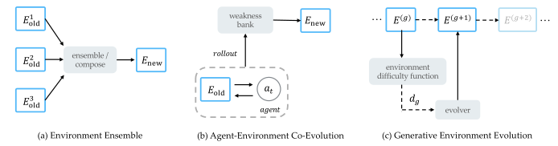
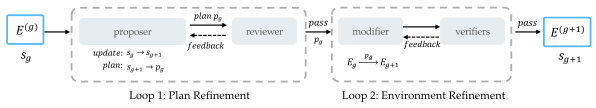
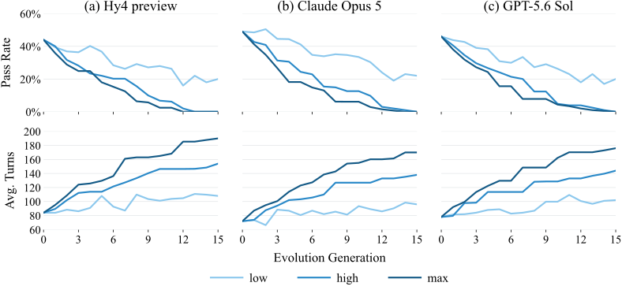
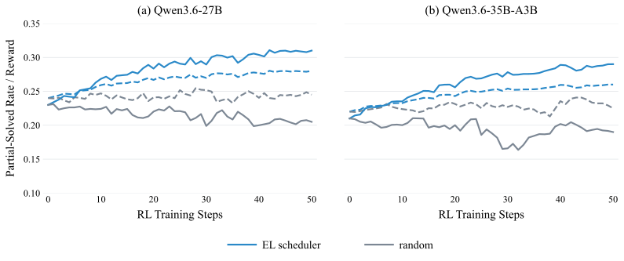
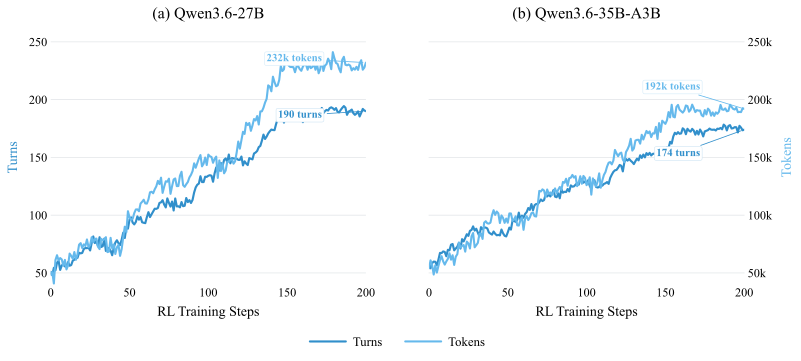
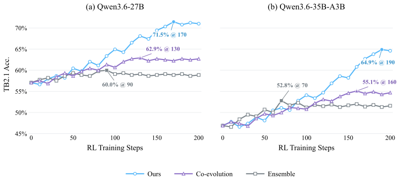

# Environment Evolution：让终端 Agent 的训练环境逐步变难

> 终端 Agent 能在命令行里运行程序、读取结果，再决定下一步。用同一道任务的多次尝试来训练它时，如果所有尝试都失败，就很难区分哪一次做得更好。腾讯混元先把可验证任务逐代变难，再根据当前模型的通过率安排出题，让训练更常遇到有成有败的一组尝试。

本文依据腾讯混元团队的预印本 *Environment Evolution for Terminal Agents*（arXiv 2609.04128v1，2026 年 9 月提交）。先用八次尝试算清楚训练信号，再看任务怎么改、训练怎么排，以及两个模型的对照实验。 [论文原文](https://arxiv.org/html/2609.04128v1)

## 第 1 章 一道什么样的任务能让 GRPO 学到东西

### 1.1 环境、轨迹和奖励各是什么

**终端 Agent** 是能在命令行环境里连续行动的模型。它可以读文件、运行程序和检查结果，再根据得到的观察决定下一步。例如，收到「修复报表里的重复记录」后，模型可能先定位导入脚本，再复现重复、修改实现、运行测试。

一项**训练环境**包含任务指令、可执行的隔离运行空间，以及判定任务是否完成的程序 **verifier（验证器）**。模型根据已经看到的历史决定下一步做什么，这个行为规则叫**策略（policy）**。一次 **rollout（采样执行）** 是策略从同一个任务起点开始的一次完整尝试，它产生的动作与观察序列称为**轨迹**。在本文解释的二元奖励设置里，任务末尾通过验证记为 1，失败记为 0。相同任务可以重置后采样多次。

### 1.2 八次尝试的手算

**GRPO（Group Relative Policy Optimization，组相对策略优化）** 用同组尝试的奖励构造**优势**，即一次尝试相对同组参考水平的表现。设一组共有 $B$ 条轨迹，$r_b$ 是第 $b$ 条的终局奖励，$\bar r$ 是组内平均奖励，$a_b$ 是做标准差缩放之前的中心化信号。用这一项就能看出为什么同奖组没有区分信号。

**式 1 · 组内平均奖励与中心化信号**

$$
\bar r=\frac{1}{B}\sum_{b=1}^{B}r_b,\qquad a_b=r_b-\bar r
$$

| 八条轨迹的结果 | 组均奖 | 成功轨迹的中心化信号 | 失败轨迹的中心化信号 |
| --- | ---: | ---: | ---: |
| 0 条通过 | 0 | — | 0 |
| 2 条通过、6 条失败 | 0.25 | +0.75 | −0.25 |
| 8 条通过 | 1 | 0 | — |

中间这一行里，更新有信号去提高成功行动序列的概率、降低较差序列的概率。首尾两行的组内偏差全部为零。论文把八条里有 **1–7 条通过**的组叫作**部分解出组**。后文的「部分解出组占比」数的是整批中有多少个这样的组，「平均训练奖励」则数每条轨迹平均有多大机会通过。两项可以走势不同。 [论文图 5 与 §5.4](https://arxiv.org/html/2609.04128v1#S5.SS4)

## 第 2 章 难度来自步骤数、场景和技能

### 2.1 用一条高层解法描述环境

原始终端轨迹包含许多细碎命令。作者先把预期解法提升到便于编辑的层次。**场景（scenario）** 是执行时所处的具体情境，**技能（skill）** 是在该情境下完成一段工作的能力。例如，报表工具在没有网络的环境中运行是一个场景，从多个离线文件中识别重复记录是一项技能。一个高层步骤可以包含很多条终端命令。

设目标为 $q$（对应论文难度推导中的 $g$），预期的高层解法为 $\xi$，它有 $L$ 个步骤。第 $t$ 步进入的场景记为 $\sigma_{t-1}$，在其中需要的技能记为 $\kappa_t$。$\mathcal T$ 是从领域知识出发的参考分布。$p_{\mathcal T}(\sigma_{t-1}\mid q)$ 表示该目标下相应场景的典型程度，$p_{\mathcal T}(\kappa_t\mid\sigma_{t-1},q)$ 表示在该场景中应用相应技能的典型程度。$D_{\mathcal T}(\xi)$ 是作者为这条预期解法写下的参考难度。

**式 2 · 一条高层解法的参考难度**

$$
D_{\mathcal T}(\xi)=\sum_{t=1}^{L}\left[-\log p_{\mathcal T}(\sigma_{t-1}\mid q)-\log p_{\mathcal T}(\kappa_t\mid\sigma_{t-1},q)\right]
$$

概率越小，负对数越大。按这个分解，要构造更难的任务，可以在预期解法中加入必须完成的步骤，换成更少见的场景，或在原场景里要求更少见的技能。实际演化由模型按照这三个方向编辑任务，论文用后续的执行通过率和交互轮数检查难度变化。读公式时，可把它理解为**选择编辑方向的依据**。 [论文 §3 与 §4.1](https://arxiv.org/html/2609.04128v1#S3)

### 2.2 三种编辑怎样改变同一个报表任务

下表是教学示例。每个方向都从同一个种子任务单独出发。

| 方向 | 改动重点 | 报表例子 |
| --- | --- | --- |
| Length · 拉长执行链 | 加入有前后依赖的高层步骤 | 先根据归档恢复漏掉的输入，再去重，最后核对报表合计 |
| Scenario · 换场景 | 保留配对技能，换它发生的情境 | 仍做去重，数据改由多份离线分片提供 |
| Skill · 换技能 | 在原场景里替换所需技能 | 仍在同一导入流程中，改为处理重复运行导致的非幂等写入，也就是同一输入跑两次会写入两份结果 |

**离策略（off-policy）环境合成**在本文里指每代任务的改法无需等待待训练 Agent 的失败轨迹。实际训练仍会让策略去执行任务、收集奖励，后面的课程调度也会读取策略表现。把环境合成独立出来，可以让同一条已构造的任务谱系被多个待训练模型使用。**谱系（lineage）** 指同一个种子任务经过多代编辑得到的环境序列。 [论文图 1 与 §3](https://arxiv.org/html/2609.04128v1#S1.F1)

图 1 用 $E_{\mathrm{old}}$ 和 $E_{\mathrm{new}}$ 标记输入环境与新环境，$a_i$ 是参与采样的 Agent，$d_i$ 是给演化模块的难度指引。右图的 $E^{(g)}$ 表示第 $g$ 代环境。

## 第 3 章 一代任务怎样生成并验收

图 2 的两个回路分别检查「准备怎么改」和「改出来的环境是否合格」。图里的 $g$ 是环境代数，$E^{(g)}$ 是第 $g$ 代环境，$s_g$ 是其预期的执行步骤序列，$p_g$ 是这次修改计划，$E_g^\Delta$ 是改过、尚待验证的候选环境。

1. **计划回路。** 提案角色从已验收的环境提取「场景—技能」序列，选定长度、场景或技能方向，按目标序列与原序列的差异写出修改计划。计划审查角色按质量条目逐轮反馈。
2. **环境回路。** 修改角色按通过的计划编辑隔离环境及相关任务材料。候选环境并行过三项检查，反馈用于返修，通过后才进入谱系的下一代。

| 验收项 | 检查什么 |
| --- | --- |
| Oracle verifier · 参考解检查 | 参考解能在沙箱执行，并通过任务验证。 |
| Invalid-test verifier · 无效解检查 | 空解或没有实际操作的解会失败，拦住过宽的测试。 |
| General-rubrics verifier · 质量准则检查 | 按可更新的评分项评估环境质量。论文开发时用人工复查发现遗漏，再补充检查项。 |

**修改力度（evolution effort）** 决定一次编辑可以动多少预期步骤。low 限一个「场景—技能」对，high 限一段连续步骤，max 不限编辑所覆盖的序列范围。每代随机排序三个编辑方向，一个方向遭拒或耗尽返修预算时，从同一上一代环境试下个方向，三个都失败才结束该分支。实验先从公开的非基准任务中筛选，要求参考解可执行、任务具备一定难度，再补充合成任务并按领域均匀抽样，得到 500 个种子环境。 [论文图 2 与 §4.1](https://arxiv.org/html/2609.04128v1#S4.SS1)

### 3.1 怎么确定改出来的环境更难

三种模型分别执行同一批演化任务。图 3 上排读通过率，下排读平均交互轮数，横轴是环境代数。high 和 max 下，多代任务的通过率整体降至 0，所需交互也变长。low 的通过率波动且后期仍有成功。作者选择 high 做默认设置，在变化幅度和可控性之间折中。三个探测模型是 **Hy4 preview、Claude Opus 5、GPT-5.6 Sol**，它们承担的是难度检测角色。

通过率压到 0 后，曲线触底，很难再用它给更难的任务排序。论文表 1 也显示两种难度指标要分别读。在高力度的单步对照里，长度方向使通过率平均下降 **7.1 个百分点**，大于场景和技能方向的 **4.7** 和 **4.0** 个百分点。但实际多跑出的交互轮数，场景和技能平均增加 **13.5** 与 **12.5** 轮，超过长度方向的 **9.4** 轮。编辑预期的必需步骤数、测量模型实际上花的轮数，由此得到的是两个量。 [论文 §5.2–5.3 与表 1](https://arxiv.org/html/2609.04128v1#S5.SS2)

## 第 4 章 通过几次才给下一道题

**EL Scheduler（Evolution-Lineage Scheduler，演化谱系调度器）** 从每条谱系较早的一代开始。设 $E$ 为当前环境，$u$ 为训练更新编号，$r_{u,b}$ 为在本次更新用环境 $E$ 执行的第 $b$ 条轨迹的二元奖励。每组采样次数是 $B$，$\widehat p_u(E)$ 是该组观测通过率。只有通过率**严格大于**阈值 $\tau$ 才推进。

**式 3 · 调度器的通过率与推进条件**

$$
\widehat p_u(E)=\frac{1}{B}\sum_{b=1}^{B}r_{u,b},\qquad \widehat p_u(E)>\tau
$$

论文取 $B=8$、$\tau=6/8$。所以 **6 条通过会留在当前环境，7 或 8 条通过才推进**。如果同一代还有排在后面的环境，先切到同代的下一个。如果刚通过这一代的最后一个，下一次才从新一代的第一个环境开始。调度阈值与 GRPO 信号是两件事。7 胜 1 负时，一组既有学习信号，也触发推进。8 胜时没有组内区分信号，调度器仍会推进。

### 4.1 图 5 怎样检验调度器

论文把两种实际接受强化学习更新的模型放进对照。**Qwen3.6-27B** 是 270 亿参数的稠密模型，每次计算使用完整的网络层，前馈部分没有按输入选取少数专家的机制。**Qwen3.6-35B-A3B** 是混合专家模型（Mixture of Experts，MoE），共 350 亿参数，每个 token（模型处理的文本单元）通过路由只选用一部分专家，约激活 30 亿参数。

谱系调度与随机调度使用**匹配的 rollout 预算**，比较前 50 步。图 5 中**颜色区分方法**，蓝线是谱系调度、灰线是随机。**线型区分指标**，实线是部分解出组占比，虚线是平均训练奖励。两个模型上，蓝实线随后都高于灰实线。这个对照直接支持「同样数量的尝试里，按谱系能找到更多有组内差异的例子」。它衡量的是训练信号出现的频率，后面的基准曲线才衡量最终任务能力。

另一个值得跟踪的量是**每次尝试的成本**。图 6 的两条曲线分别读左轴的交互轮数和右轴的 token 数。到第 200 步，27B 的平均轨迹约 **190 轮、23.2 万 token**，35B-A3B 约 **174 轮、19.2 万 token**。图 5 对齐的是 rollout 数，图 6 说明在难度提升时，单条轨迹也会变长。若要回答「每 GPU 小时获得多少有效组」，还需要训练耗时和算力数据。 [论文图 5–6](https://arxiv.org/html/2609.04128v1#S5.SS4)

## 第 5 章 27B 的对照结果能说明什么

### 5.1 训练从哪个检查点开始

每个模型先做 **RFT（rejection sampling fine-tuning，拒绝采样微调）**。作者从基座模型生成的轨迹中，保留通过验证且符合 Claude Code 工具协议的样本，再调整数据构成以保留多样性。得到的检查点是每个模型自己在图 7 的第 0 步，也是该模型各方法的共同起点。随后用同一个工具交互框架 **Claude Code harness（规定任务执行和工具协议的运行壳）** 采样，做 200 步 GRPO。训练的上下文预算为 256K token，剩余可用空间达到 16K 时触发摘要，摘要作为一次动作参与多轮训练。 [论文 §5.1 与 §5.4](https://arxiv.org/html/2609.04128v1#S5.SS1)

### 5.2 读峰值时先看比较对象

作者把环境合成模型固定为 **Claude Opus 5**，并控制三种方案的训练环境总数。**环境组合（Ensemble）** 从待训练 Agent 解不出的种子里选任务，每次合并两到三个环境。**共同演化（Co-evolution）** 根据待训练 Agent 的失败轨迹生成环境，每训 50 步再进行一轮。**环境演化（Environment Evolution）** 从种子逐代演化，并用谱系调度引入难度。留出的 **Terminal-Bench 2.1 Verified** 是检验终端 Agent 任务完成能力的基准。作者每 10 步评测一次，图 7 标记各方法的最高检查点分数。评测设置报告五次评测运行的平均。 [论文 §5.1、§5.5 和图 7](https://arxiv.org/html/2609.04128v1#S5.SS5)

| 方法 | 27B 稠密模型峰值 | 35B-A3B 峰值 |
| --- | ---: | ---: |
| 环境演化 | **71.5%（第 170 步）** | **64.9%（第 190 步）** |
| 共同演化 | 62.9%（第 130 步） | 55.1%（第 160 步） |
| 环境组合 | 60.0%（第 90 步） | 52.8%（第 70 步） |

摘要里 **+14.4、+18.0 个百分点** 是两种模型相对各自第 0 步到环境演化峰值的增长。横向与共同演化的峰值比较，两者分别高 **8.6、9.8 个百分点**。三种方法的峰值出现在不同训练步，读数反映的是各自的最好检查点。在同一留出基准上看到两种架构都有收益，也仍需更广泛的基准和多次独立训练来判断跨任务、跨随机种子的稳定性。

## 第 6 章 和 mentor 可以讨论什么

- **先讲现象。** 同题八次采样，只有有成有败的组能靠相对奖励区分轨迹。先预生成难度谱系，再按七胜门槛推进，可以把更多尝试放到模型仍有机会学习的任务上。
- **再讲因果边界。** 图 5 的短程对照单独比较课程调度。图 7 比较的是包含环境构造与调度的完整方案。想分开测两项贡献，可以在同一个预算下交叉比较不同环境来源和不同调度方式。
- **最后讲工程问题。** 长任务每条 rollout 很贵。这篇报告有信号的组占比及轨迹长度，[QwenGyre 笔记](./qwengyre.html) 可以接着看怎样减少 rollout 等待，[LVRL 笔记](./lvrl.html) 可以接着看如何把信号分到轨迹里的中间动作。

原文图 1、2、3、5、6、7 为 Fan 等的论文配图，采用 CC BY 4.0。本站使用论文 HTML 原始 SVG，仅更改了文件名并添加中文图解。 [论文版本](https://arxiv.org/html/2609.04128v1) · [许可](https://creativecommons.org/licenses/by/4.0/) · [图源记录](../assets/environment-evolution-figures/SOURCES.md)
