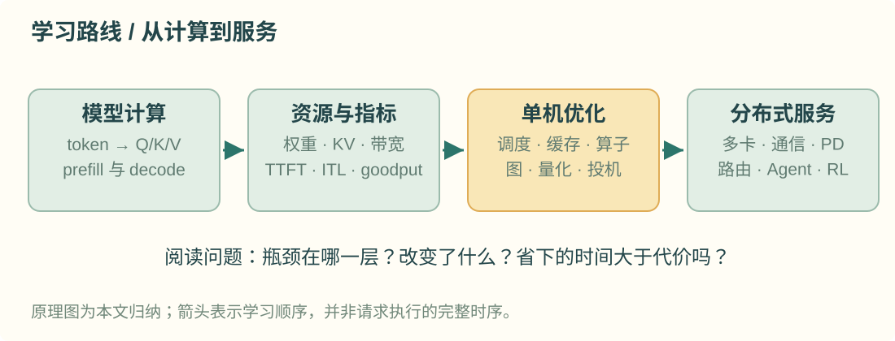
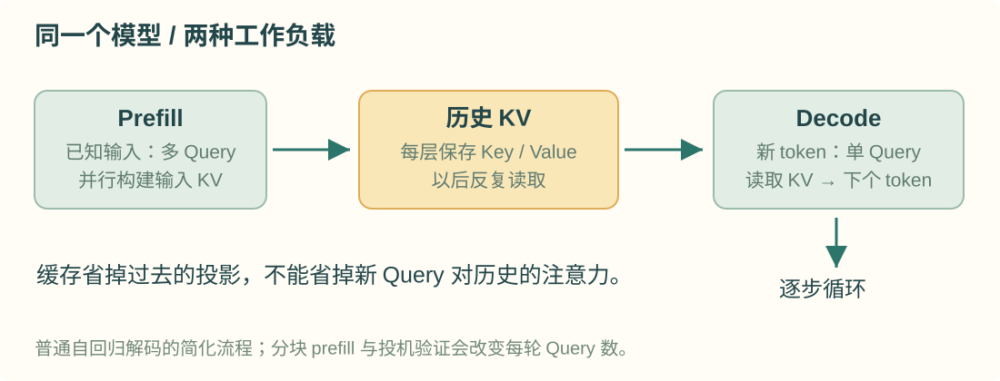
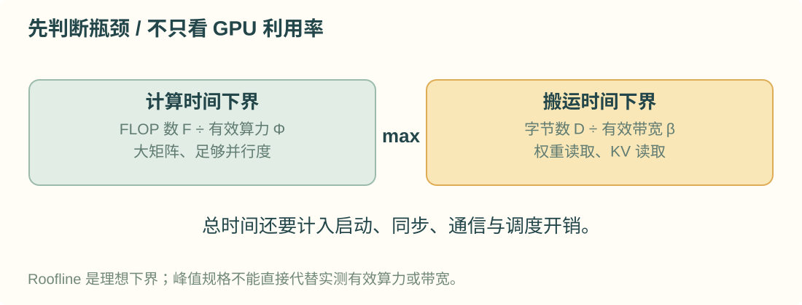
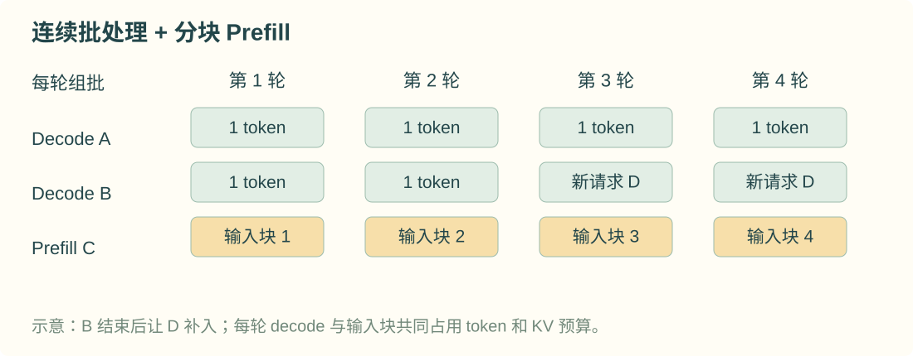
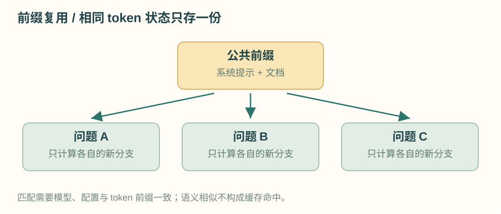
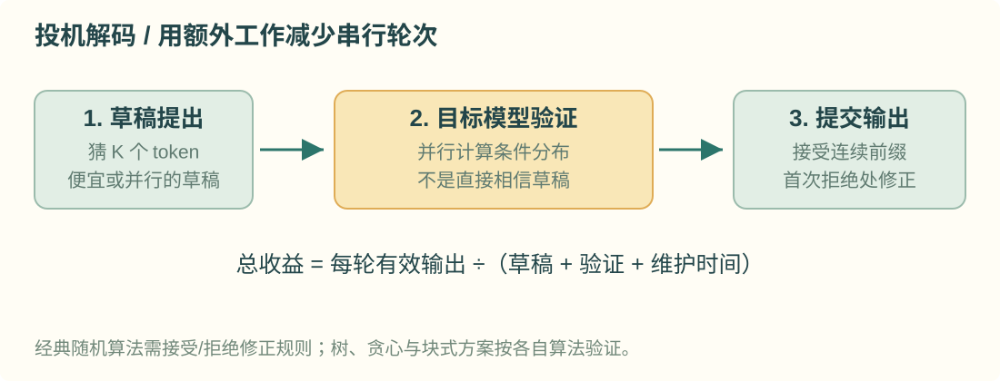
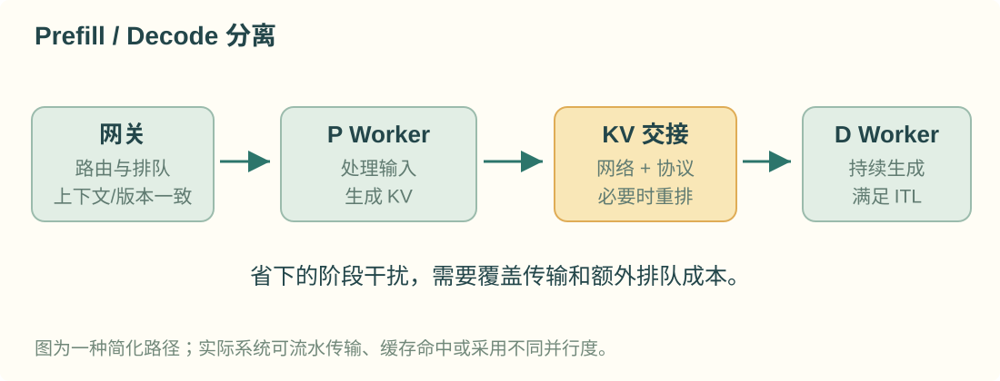
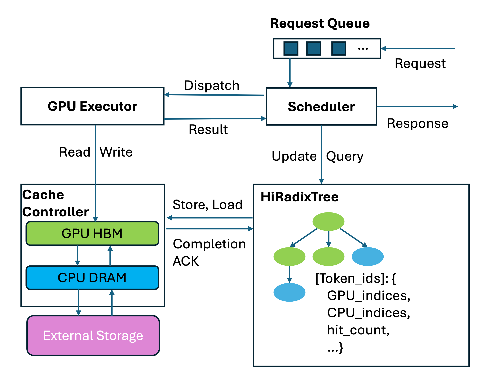
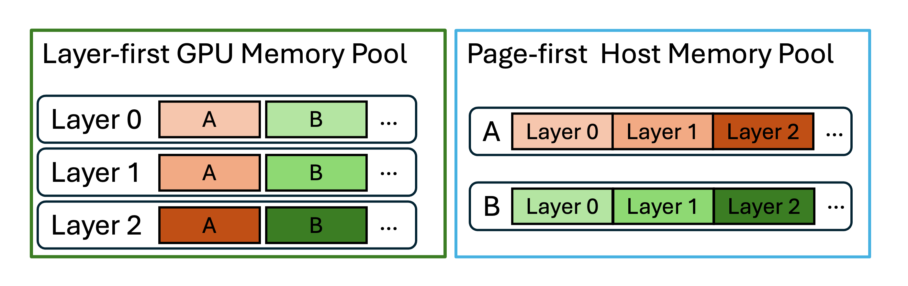
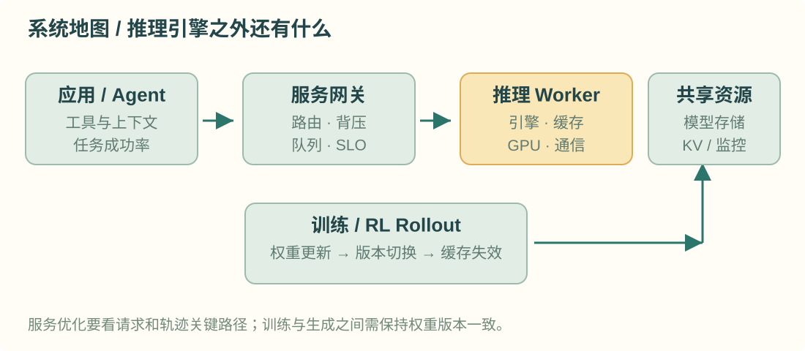

# vLLM、SGLang 与大模型推理基础设施

> 从一个 token 怎样被计算出来开始，理解显存为什么不够、请求为什么排队，以及推理引擎如何把同一块 GPU 用得更好。

这是一篇独立的系统学习笔记。阅读顺序是：**模型计算 → 指标与资源 → 单机优化 → 分布式优化 → 服务与实验**。先理解瓶颈，再看 vLLM 和 SGLang 怎样实现对应技术。两者的能力已大量重叠，不能把它们简单概括为“一个只管吞吐，一个只管 Agent”。

资料核对截至 **2026 年 10 月 15 日**。基础原理相对稳定；框架参数、后端支持和默认行为会随版本变化。文中的命令是起步示例，不代表已经在你的机器上运行或测得性能。近期内容优先引用论文、作者文章与官方文档；“高频技术”表示在代表性实现中反复出现，不表示做过文献频次统计。



## 第 1 章 先建立系统地图

### 1.1 模型、推理引擎与 AI Infra 分别负责什么

**模型**规定计算图与参数：多少层、怎样做注意力、是否使用 MoE、怎样表示 KV 状态。**推理引擎**把这个计算图变成可高效执行的请求处理流程：管理缓存、组批、调度、选算子、运行分布式通信。**AI Infra**还包括模型分发、GPU 集群、网络、请求网关、监控、伸缩和训练系统对接。

| 层次 | 解决的问题 | 典型对象 |
| --- | --- | --- |
| 应用与 Agent | 什么时候调用模型，怎样组织工具和上下文 | 对话、RAG、工具循环、RL rollout |
| 服务与路由 | 请求发给谁，何时排队或拒绝 | 网关、限流、缓存感知路由 |
| 推理运行时 | 每步执行哪些请求，KV 放在哪里 | vLLM、SGLang |
| 算子与编译 | 怎样高效计算注意力、矩阵乘法和采样 | FlashAttention、FlashInfer、CUDA Graph |
| 分布式通信 | 多卡怎样交换张量和专家 token | NCCL、DeepEP、KV 传输库 |
| 硬件与资源 | 算力、显存、带宽和机器拓扑 | GPU、HBM、NVLink、RDMA、CPU 内存 |

FlashInfer 是算子库，NCCL 是通信库，Dynamo 是集群服务组件体系；它们与 vLLM、SGLang 所处层次不同，可以协作。[R01](https://docs.vllm.ai/en/latest/design/arch_overview/) · [R02](https://arxiv.org/abs/2501.01005) · [R03](https://docs.nvidia.com/dynamo/)

### 1.2 两个框架的出发点与今天的关系

vLLM 的代表性起点是 **PagedAttention**：像分页一样管理 KV 内存，缓解碎片和动态分配问题。SGLang 的代表性起点是结构化语言程序与 **RadixAttention**：利用程序和请求之间的公共前缀复用计算。[R04](https://arxiv.org/abs/2309.06180) · [R05](https://arxiv.org/abs/2312.07104)

今天二者都具备连续批处理、前缀缓存、量化、投机解码、多卡与结构化输出等能力。选择时应问：**我的模型、GPU、请求分布和所需功能组合，在这个具体版本中是否稳定且划算？** 起源解释设计倾向，不能代替当前版本的实测。

### 1.3 本文统一使用的符号与单位

| 符号 | 固定含义 |
| --- | --- |
| $L, d, d_h$ | Transformer 层数、隐藏维度、每个注意力头的维度 |
| $H_q, H_{\mathrm{kv}}$ | Query 头数、Key/Value 头数；常规模型常有 $d=H_qd_h$ |
| $N$ | 稠密模型存储的权重参数量；FLOP 估算会近似忽略嵌入等非主要矩阵乘部分 |
| $P_i, O_i, S_i$ | 请求 $i$ 的输入 token 数、输出 token 数、当前缓存的 token 数 |
| $B, C, \tau$ | 活跃请求数、每个 KV 块的 token 容量、一次调度的 query token 预算 |
| $b_w, b_{\mathrm{kv}}$ | 每个权重元素、每个 KV 元素的**字节数** |
| $M, D, F$ | 内存容量或占用、搬运的字节数、浮点运算次数 |
| $\Phi, \beta$ | 有效计算能力，单位 FLOP/s；有效带宽，单位 byte/s |
| $p, q, K, \alpha$ | 目标分布、草稿分布、草稿窗口长度、平均接受概率 |
| $t, T$ | 时间；下标区分具体阶段或统计量 |

**单位约定：** GB 为 $10^9$ byte，GiB 为 $2^{30}$ byte；KiB 为 $2^{10}$ byte。BF16/FP16 通常每元素 2 byte，FP8/INT8 通常 1 byte；打包低比特还要计入 scale、零点、对齐等元数据。小写 $p$ 是概率分布，大写 $P_i$ 是输入长度，$B$ 始终是请求数，带宽始终用 $\beta$。

后续每个编号公式仍会就地解释符号，不要求读者反复回查这张表。局部中间变量在第一次出现处定义。

## 第 2 章 一个 token 怎样被生成

### 2.1 自回归生成：为什么长输出天然有串行依赖

输入文本先被 tokenizer 转成 token ID；模型处理的是这些 ID 对应的向量，而不是直接处理汉字或英文单词。相同文本在不同 tokenizer 下长度可能不同，性能比较必须固定 tokenizer。

**式 1 自回归分解**

$$
p_\theta(y\mid x)=\prod_{j=1}^{O}p_\theta(y_j\mid x,y_{<j})
$$

这里 $x$ 是输入 token 序列，$y$ 是输出序列，$O$ 是输出长度，$y_j$ 是第 $j$ 个输出 token，$y_{<j}$ 是此前输出，$\theta$ 是模型参数。公式表示：整段输出的概率是逐 token 条件概率的乘积。

怎样使用这个认识？第 $j+1$ 步通常需要知道第 $j$ 步实际选了什么，所以普通解码不能把所有未来 token 当作已知输入一次生成。投机解码可以并行**验证猜测**，但仍需保证因果关系和正确的接受规则。[R06](https://arxiv.org/abs/1706.03762) · [R07](https://arxiv.org/abs/2211.17192)

模型最后产生 logits，再经过采样或贪心选出 token。温度、top-p、约束规则都可能改变实际输出分布。本文谈“保持分布”时，指与配置相同的目标解码过程一致。

### 2.2 Q、K、V 与注意力

先看一个头的投影，暂时省略 batch 和层编号。

**式 2 注意力投影**

$$
Q=XW_Q,\qquad K_{\mathrm{mat}}=XW_K,\qquad V=XW_V
$$

$X$ 是当前参与计算的 token 表示矩阵，每行是一个 token；$W_Q,W_K,W_V$ 是该头的投影权重；$Q,K_{\mathrm{mat}},V$ 分别为 Query、Key、Value 矩阵。这里特意写 $K_{\mathrm{mat}}$，避免与后文的草稿长度 $K$ 混淆。实现中多个头通常融合投影，GQA 下 Q 与 KV 的头数不同。

例如 prefill 有 $P$ 个 token，$X$ 为 $P\times d$，一个头的 Q/K/V 通常为 $P\times d_h$。普通 decode 本轮 $X$ 为 $1\times d$，新 Q 为 $1\times d_h$；历史 K/V 从缓存取出。这里 $P$ 为当前输入长度，$d$ 为隐藏维度，$d_h$ 为头维度。

**式 3 缩放点积注意力**

$$
A=\operatorname{softmax}\!\left(\frac{QK_{\mathrm{mat}}^{\mathsf T}}{\sqrt{d_h}}+U\right)V
$$

$A$ 是注意力输出，$d_h$ 是头维度，$U$ 是掩码矩阵：可见位置为 0，不可见位置为负无穷；softmax 沿 Key 位置归一化。一个 Query 先与可见 Key 打分，再用分数加权 Value。因果掩码禁止读取未来 token。式 2 只投影本轮输入；式 3 在 decode 时使用的 $K_{\mathrm{mat}},V$ 包含可见历史缓存与本轮新增状态。[R06](https://arxiv.org/abs/1706.03762)

窄屏版将括号内的分数矩阵记作 $Z$，只是为换行阅读引入的中间量。

这解释了两类优化的分工：KV Cache 保存过去的 Key/Value，避免重复投影；FlashAttention 改变计算与搬运方式，避免在 HBM 中写出完整分数矩阵。两者解决不同问题。

### 2.3 注意力之外：FFN、归一化与采样

许多现代模型使用带门控的 FFN；下面是常见 SwiGLU 形式，不代表所有模型结构相同。

**式 4 门控前馈网络**

$$
\operatorname{FFN}(X)=\left[\operatorname{SiLU}(XW_1)\odot(XW_3)\right]W_2
$$

$W_1,W_3$ 把隐藏维度映射到中间维度，$W_2$ 映射回来；$\odot$ 表示逐元素相乘，SiLU 是激活函数，$X$ 仍是 token 表示。门控分支调节另一个分支的信息。窄屏版将方括号内的门控结果记作 $G$。矩阵乘法、RMSNorm/LayerNorm、RoPE、残差、logits 与采样都需要时间，不能把端到端推理视为只有注意力。[R08](https://arxiv.org/abs/2002.05202)

RMSNorm/LayerNorm 调整特征的数值尺度；RoPE 通过旋转 Q/K 表示注入位置信息；残差将子层输入加回输出。一个 Transformer 层通常由注意力和 FFN 等子层组成，并重复堆叠 $L$ 次，所以每一层都需要保存自己的 KV。最后将隐藏表示投影到词表，得到每个候选 token 的 logit，再按解码配置选择输出。

### 2.4 Prefill 与 Decode：同一个模型的两种工作负载

**Prefill** 处理已知输入，生成这段输入的 KV，并从末尾的表示得到首个输出 token 的分布。输入中的多个位置已知，因此可以并行计算其 Query。

**Decode** 通常每个请求每步输入一个新 token，让它查询已有 KV，然后得到下一个 token。对长度为 $S_i$ 的历史，不必重新计算过去每个 token 的整个网络，但当前 Query 仍需访问历史 KV。**有缓存不等于不再读历史。**



输入越长，prefill 的注意力与 KV 写入压力越大；输出越长，串行 decode 次数越多。长上下文 decode 也可能由 KV 读取主导。所谓“prefill 算力受限、decode 带宽受限”是常见趋势，后文会给出判断条件，而不是把它当作不变定律。

## 第 3 章 先定义“快”是什么意思

### 3.1 TTFT、ITL、TPOT 与端到端时间

令 $t_{\mathrm{arr}}$ 为服务端或客户端约定的到达时刻，$t_1$ 为首个输出 token 到达时刻，$t_O$ 为最后一个输出 token 到达时刻。必须固定观测位置，否则网络和客户端缓冲会污染比较。

**式 5 延迟指标**

$$
\begin{aligned}
\operatorname{TTFT}&=t_1-t_{\mathrm{arr}},\\
\operatorname{TPOT}&=\frac{t_O-t_1}{O-1},\\
T_{\mathrm{E2E}}&=\operatorname{TTFT}+(O-1)\operatorname{TPOT}
\end{aligned}
$$

$O$ 是输出 token 数。TTFT 是首 token 延迟，通常包含排队、预处理与 prefill；TPOT 是首 token 之后的平均每 token 时间，仅在 $O>1$ 时定义；$T_{\mathrm{E2E}}$ 是完整请求耗时。ITL 则是相邻 token 的间隔，不能用平均 TPOT 替代 ITL 的尾部波动。

流式接口可能一次返回多个 token，事件间隔未必就是精确 token 间隔。监控必须声明采样方法。平均值之外，交互服务通常还关心 p95/p99。[R09](https://docs.vllm.ai/en/latest/usage/metrics/) · [R10](https://docs.vllm.ai/en/latest/cli/bench/serve/)

### 3.2 吞吐与 Goodput：完成得多，还要按时

**式 6 吞吐与满足约束的请求吞吐**

$$
\begin{aligned}
R_{\mathrm{out}}&=\frac{\sum_{i\in\mathcal C}O_i}{T_{\mathrm{wall}}},\\
G_{\mathrm{req}}&=\frac{\sum_{i\in\mathcal C}\mathbf 1[\text{请求 }i\text{ 满足 SLO}]}{T_{\mathrm{wall}}}
\end{aligned}
$$

$\mathcal C$ 是测量窗口内按预先约定计入的完成请求集合，$O_i$ 是其输出 token 数，$T_{\mathrm{wall}}$ 是墙钟测量时长，$\mathbf 1$ 是条件成立为 1 的指示函数。$R_{\mathrm{out}}$ 单位为 token/s，$G_{\mathrm{req}}$ 单位为 request/s。SLO 可以同时约束 TTFT、TPOT 和错误率；窄屏版以 $\mathrm{SLO}_i$ 简写请求 $i$ 满足约束这一条件。

大 batch 可能提高 token/s，却让排队与交互延迟恶化；goodput 用来区分“GPU 很忙”和“用户按时得到结果”。也可定义 good-token/s，但必须明确按请求整体合格还是按 token 合格计数。[R11](https://arxiv.org/abs/2401.09670)

### 3.3 到达率、并发与排队

**式 7 Little 定律**

$$
\bar n=\lambda\bar T
$$

$\bar n$ 是同一系统边界内的平均在途请求数，$\lambda$ 是长期平均有效到达率，$\bar T$ 是平均逗留时间。它适用于稳定、统计口径一致的系统。例如每秒到达 4 个请求、平均耗时 5 秒，平均在途约 20 个。

这里的在途数可能包含排队，不能直接等同于 GPU 上活跃的 $B$。定律也不能从平均值推导 p99，过载且队列持续增长时更不能拿它当稳定容量公式。

### 3.4 成本与质量也属于目标

**式 8 按合格输出摊销 GPU 成本**

$$
c_{\mathrm{good}}=\frac{r_{\mathrm{GPU}}\,n_{\mathrm{GPU}}\,T_{\mathrm{wall}}}{N_{\mathrm{good\ token}}}
$$

$r_{\mathrm{GPU}}$ 是每卡每秒价格，$n_{\mathrm{GPU}}$ 是用卡数，$N_{\mathrm{good\ token}}$ 是窗口内满足既定质量和服务约束的输出 token 数。结果为货币/token；分母为零时不可用。空闲和 prefill 时间同样计入 GPU 占用时间。

这是 GPU 部分的简化成本，不含 CPU、网络、存储与运维。比较量化或投机方案时，还应验证质量、任务成功率和重试成本，否则“便宜的 token”可能对应更贵的有效答案。

## 第 4 章 显存：权重、KV 与临时状态

### 4.1 为什么权重装得下，服务仍会 OOM

**式 9 单卡显存预算**

$$
M_w+M_{\mathrm{KV}}+M_{\mathrm{act}}+M_{\mathrm{work}}+M_{\mathrm{graph}}+M_{\mathrm{runtime}}\leq M_{\mathrm{budget}}
$$

$M_w$ 为该卡的权重，$M_{\mathrm{KV}}$ 为 KV 缓存，$M_{\mathrm{act}}$ 为活跃激活，$M_{\mathrm{work}}$ 为算子临时工作区，$M_{\mathrm{graph}}$ 为图捕获相关内存，$M_{\mathrm{runtime}}$ 为通信和运行时等其余占用，$M_{\mathrm{budget}}$ 为引擎实际可用预算。

窄屏版用 $M_{\mathrm{total}}$ 表示左侧各项之和。这是预算分类，实测时要避免把同一块共享或复用内存重复计数。峰值激活随 prefill 大小变化，CUDA Graph 捕获也可能增加占用；KV 不能占满“权重以外全部剩余空间”。不同框架的内存比例参数统计口径并不完全相同。[R12](https://docs.vllm.ai/en/latest/configuration/optimization/) · [R13](https://docs.sglang.io/docs/advanced_features/server_arguments)

### 4.2 权重的最初估算

**式 10 稠密权重存储估算**

$$
M_w\approx Nb_w
$$

$N$ 是存储的权重元素数量，$b_w$ 为每元素字节数。8 billion 个 BF16 权重约为 16 GB，即约 14.90 GiB。4-bit 理想打包约 0.5 byte/元素，但真实量化权重还需要 scale、零点、部分高精度层和对齐空间。

这只能估权重，不是运行整个模型需要的显存。TP/PP 会改变每卡所持权重；MoE 即使每 token 只激活部分专家，也通常仍需存储或分布式托管全部专家。

### 4.3 KV Cache 的核心公式与贯穿全文的例子

对均匀的全注意力 Transformer，未做 TP 分片、未计块尾和元数据时：

**式 11 KV 存储量**

$$
M_{\mathrm{KV}}=2LH_{\mathrm{kv}}d_hb_{\mathrm{kv}}\sum_{i=1}^{B}S_i
$$

$L$ 是层数，$H_{\mathrm{kv}}$ 是每层 KV 头数，$d_h$ 是头维度，$b_{\mathrm{kv}}$ 是每个 KV 元素的字节数，$S_i$ 是请求 $i$ 当前缓存长度，$B$ 是活跃请求数。系数 2 来自 Key 和 Value 两份状态。这里假设不同请求不共享前缀，所有层缓存结构相同。

**式 12 每个缓存 token 的字节开销**

$$
\begin{aligned}
m_{\mathrm{token}}&=2LH_{\mathrm{kv}}d_hb_{\mathrm{kv}}\\
&=2\times32\times8\times128\times2\\
&=131072\ \mathrm{byte}=128\ \mathrm{KiB}
\end{aligned}
$$

本例有 32 层、8 个 KV 头、头维度 128，KV 用 BF16。一个 8192-token 序列占 **1 GiB KV**；16 个同长度、无共享的请求占 **16 GiB KV**。这只是 KV 部分，不是整卡占用。

长度预算通常保守取输入加最大输出，但最后采样出的 token 可能尚未经过下一次 forward 写入缓存；精确占用以引擎已处理 token 数为准。这个细节不影响容量规划时使用保守上界。

### 4.4 MHA、MQA、GQA 与 MLA 不是同一件事

| 结构 | KV 头或状态 | 对缓存的影响 | 怎样得到 |
| --- | --- | --- | --- |
| MHA | $H_{\mathrm{kv}}=H_q$ | 每个 Q 头有对应 KV | 模型结构决定 |
| MQA | $H_{\mathrm{kv}}=1$ | 所有 Q 头共享一组 KV | 模型训练或专门转换 |
| GQA | $1<H_{\mathrm{kv}}<H_q$ | 一组 Q 头共享 KV | 模型训练或 uptraining |
| MLA | 缓存压缩潜变量及位置相关状态 | 不适用普通 KV 头公式 | 专门的模型结构与算子 |

对于 $H_q=32$，其余条件沿用本例，MHA 的缓存是 8-KV-head GQA 的 4 倍；MQA 更小。但这些不是给任意已训练模型加一个启动参数就能无损切换的服务策略。[R14](https://arxiv.org/abs/1911.02150) · [R15](https://arxiv.org/abs/2305.13245)

**式 13 MLA 的一种缓存表示估算**

$$
M_{\mathrm{MLA}}\approx L(d_c+d_r)b_{\mathrm{kv}}\sum_{i=1}^{B}S_i
$$

$d_c$ 为缓存的压缩 KV 潜变量维度，$d_r$ 为另存的位置编码 Key 分量维度，其余符号同前。这个式子对应只缓存这两类状态的表示，不能再机械乘一个 2。实际后端可能采用不同表示、对齐或额外状态，应读取模型配置和缓存实现。[R16](https://arxiv.org/abs/2412.19437)

### 4.5 滑动窗口与混合架构

滑动窗口层只保留最近窗口所需 KV，全注意力层仍需长历史；Mamba 等状态空间层保存的是另一类状态。混合模型应按层类型分别核算，不能给式 11 换一个平均长度就保证正确。

vLLM 的 Hybrid KV Cache Manager 按缓存规格组织不同层组。前缀复用也要满足各层状态边界条件：一个历史前缀“文本相同”，并不自动说明所有混合层的状态都可直接恢复。[R17](https://docs.vllm.ai/en/latest/design/hybrid_kv_cache_manager/)

## 第 5 章 GPU 为什么忙，又为什么不够快

### 5.1 算力、带宽与 Roofline

GPU 有寄存器、片上共享内存和容量更大的 HBM。算得快但喂不进数据，仍然会慢；频繁写回可避免的中间张量也会消耗带宽。

**式 14 Roofline 时间下界**

$$
I=\frac{F}{D},\qquad t\geq\max\!\left(\frac{F}{\Phi},\frac{D}{\beta_{\mathrm{HBM}}}\right)
$$

$F$ 是所考察计算的 FLOP 数，$D$ 是与 HBM 之间搬运的字节数，$I$ 是算术强度，单位 FLOP/byte；$\Phi$ 为对应精度和形状下的有效 FLOP/s，$\beta_{\mathrm{HBM}}$ 为有效 HBM 带宽。两项分别是纯计算和纯搬运的理想耗时。

这只是下界：启动、同步、通信、访存不规则、低占用率都会增加时间。不要把设备宣传的峰值直接作为一定能达到的 $\Phi$。判断一个优化是否有效，要看它减少了瓶颈那一项，还是仅减少了非瓶颈工作。[R18](https://docs.nvidia.com/cuda/cuda-c-best-practices-guide/index.html)



### 5.2 Prefill 的 FLOP 量级

对稠密 decoder 的主要线性层，用参数规模估算：

**式 15 Prefill 的主要计算规模**

$$
F_{\mathrm{prefill}}\approx2NP,\qquad F_{\mathrm{attn,prefill}}=\Theta(LH_qd_hP^2)
$$

$P$ 是一个输入序列的长度，$N$ 是模型权重参数量，在这里用主要线性层占主导的近似，$L,H_q,d_h$ 如前。乘加按 2 FLOP 计，得到第一项；第二项表示全注意力随输入长度平方增长的量级。总计算需同时考虑二者，第一项**未包含**第二项的 Query-Key、分数-Value 乘法。

因果掩码、padding、滑动窗口和算子实现会改变常数或增长方式。短序列可能主要受线性层或启动影响，超长序列的注意力更突出。FlashAttention 降低 IO，并未把一般稠密全注意力的数学运算量改成线性。

### 5.3 Decode 为什么受 batch 与上下文共同影响

忽略 logits、归一化和临时写入，用理想化的批量稠密 decode 估算：

**式 16 一步 Decode 的计算与主要读取量**

$$
\begin{aligned}
F_{\mathrm{decode}}&\approx2BN+4LH_qd_h\sum_iS_i,\\
D_{\mathrm{decode}}&\approx Nb_w+2LH_{\mathrm{kv}}d_hb_{\mathrm{kv}}\sum_iS_i
\end{aligned}
$$

$B$ 是本步请求数，$S_i$ 是各请求历史长度；$N,b_w$ 为权重数量与字节数。第一行包含主要线性层和注意力计算的粗估；第二行假设一次 batch 能共享权重读取，历史 KV 至少需要被注意力访问。实际读写量会因缓存命中、重复加载和融合发生变化。

增大 batch 让同一份权重服务更多 token，可能提高算术强度；但 KV 读取也随总历史长度增加。当长上下文 KV 主导时，只压低权重精度未必有明显效果。注意 GQA 减少的是存储的 KV 头，注意力仍需为多个 Query 头完成相应计算。

### 5.4 三类证据比“GPU 利用率很高”更有用

先看请求指标：队列、TTFT、ITL、完成率。再看引擎指标：活跃序列、调度 token、KV 使用、命中、抢占。最后看 profiler：GEMM、attention、通信、CPU gap、同步和内存读写。

利用率高只说明设备经常有工作，不能说明工作有效、带宽接近上限或 SLO 达标。相反，低利用率也可能来自到达率不足，而不是算子写得差。

## 第 6 章 调度与分页：先让请求能高效共存

### 6.1 静态批处理与连续批处理

静态批处理等一批请求一起完成，短请求结束后可能留下空槽。连续批处理在**迭代边界**移除结束请求、加入新请求，使不同长度请求共用 GPU。ORCA 的 iteration-level scheduling 是这一方向的重要早期工作。[R19](https://www.usenix.org/conference/osdi22/presentation/yu)

“连续”并不等于正在运行的 GPU kernel 可以随意插入新任务。调度器仍要处理依赖、缓存容量、请求取消和公平性。离线统一长度任务与在线混合流量的最佳策略也可能不同。

### 6.2 Chunked Prefill：把大输入拆成可调度的块

长 prefill 一次占用很多计算，会让已在 decode 的请求等待。分块后，调度器可以把一部分 prefill token 与 decode token 放入同一轮，改善延迟隔离。

vLLM V1 在适用条件下使用 chunked prefill，通常先安排 decode，再用剩余 token 预算处理 prefill。减小每轮预算可能改善 ITL，但增加长输入完成 prefill 所需轮数；增大预算有利于大矩阵效率，却可能拉长单轮执行。[R12](https://docs.vllm.ai/en/latest/configuration/optimization/)



### 6.3 PagedAttention：逻辑连续，物理分块

将每个序列的 KV 分成固定 token 容量的块。逻辑块号通过 block table 指向物理块，不要求整个序列的 KV 在显存中连续。序列增长时增加块；结束时释放引用；公共前缀可共享块，修改共享尾部时使用 copy-on-write。[R04](https://arxiv.org/abs/2309.06180)

**式 17 块分配与尾部浪费**

$$
n_i=\left\lceil\frac{S_i}{C}\right\rceil,\qquad w_i=n_iC-S_i,\qquad 0\leq w_i<C
$$

$n_i$ 是请求 $i$ 所需逻辑块数，$S_i$ 为其缓存 token 数，$C$ 为每块 token 容量，$w_i$ 为最后一块未用的 token 槽数。取 $C=16,S_i=35$，需 3 块，共 48 槽，尾部空 13 槽。

分页降低连续内存预留和外部碎片问题，但块表有开销、尾部仍有内部碎片，缓存的已结束前缀也可能占用块。它没有减少模型对历史 token 做注意力所需的数学工作，也不等同于 CPU 虚拟内存的自动磁盘换页。

### 6.4 两种预算与抢占

**式 18 调度必须同时满足 token 与缓存预算**

$$
\sum_i q_i\leq\tau,\qquad n_{\mathrm{physical,after}}\leq n_{\mathrm{capacity}}
$$

$q_i$ 是本轮给请求 $i$ 安排的 query token 数：普通 decode 通常为 1，分块 prefill 可为多个；$\tau$ 是每轮 token 上限。$n_{\mathrm{physical,after}}$ 是执行本轮分配和必要驱逐后实际占用的物理块数，$n_{\mathrm{capacity}}$ 是缓存块容量。共享块只能计一次。

即使第一个预算没满，缓存不足也可能阻止调度。反之，显存还有空间也不代表应无限增大单轮工作。vLLM V1 内存压力下的默认抢占路径是重新计算，而不能把旧版“默认换出 CPU”经验直接套用。[R12](https://docs.vllm.ai/en/latest/configuration/optimization/)

要区分：**驱逐无活跃引用的缓存前缀**，只是丢掉可重算的加速材料；**抢占活跃请求**，会改变其等待和重算成本。频繁抢占会放大尾延迟。

## 第 7 章 前缀缓存：复用已经做过的计算

### 7.1 什么内容可以复用

如果两个请求在相同模型、权重版本、位置和影响计算的配置下具有相同 token 前缀，就可以复用此前 prefill 生成的 KV。常见场景是固定系统提示、同一文档的多轮问答、共享工具说明以及分支采样。

它是**计算状态复用**：语义相似、汉字看起来相同、或者 JSON 字段顺序变化，都不保证 tokenizer 得到完全相同的序列。LoRA、模型更新、多模态内容与位置处理也可能使缓存不可复用。[R20](https://docs.vllm.ai/en/latest/design/prefix_caching/) · [R21](https://docs.vllm.ai/en/latest/features/automatic_prefix_caching/)

### 7.2 vLLM 的块哈希与 SGLang 的 RadixAttention

vLLM 按块维护带父前缀关联的哈希，结合 token 和额外影响状态的标识区分缓存。SGLang 用 radix tree 表示多个 token 序列的公共前缀，匹配可复用路径，并管理节点引用和驱逐。[R20](https://docs.vllm.ai/en/latest/design/prefix_caching/) · [R05](https://arxiv.org/abs/2312.07104)

哈希方案与树方案都要回答：如何识别相同前缀、如何定位物理 KV、哪些节点仍被请求使用、怎样回收空间。不能由数据结构名称直接推出哪个引擎对所有 Agent 更快。



### 7.3 命中率和显存节省要分别计算

**式 19 按 token 统计的前缀命中率**

$$
h_{\mathrm{token}}=\frac{\sum_i P_{i,\mathrm{cached}}}{\sum_iP_i}
$$

$P_i$ 是请求输入长度，$P_{i,\mathrm{cached}}$ 是实际由前缀缓存复用的输入 token 数。分母需大于零；统计窗口、是否含重复提交和块边界取整要固定。一个请求只命中 1 个 token 和命中 8000 个 token，在“请求命中率”中都可能被算作命中，性能意义却完全不同。

**式 20 共享前缀的理想 KV 节省量**

$$
\Delta M=(B-1)P_{\mathrm{shared}}m_{\mathrm{token}}
$$

$B$ 个请求共享同一长度为 $P_{\mathrm{shared}}$ 的前缀，$m_{\mathrm{token}}$ 是式 12 的每 token KV 开销。未共享时前缀存 $B$ 份，共享后存 1 份，所以节省 $B-1$ 份；实际还受块边界、状态格式和引用管理约束。

沿用 128 KiB/token 的例子，16 个 8192-token 请求若共享其中 2048-token 前缀，理想节省 $15\times2048\times128$ KiB，即 **3.75 GiB**；总 KV 从 16 GiB 降为 12.25 GiB。这里不能再把共享部分按 16 份计数。

### 7.4 命中后仍然需要做什么

命中主要省下已经完成的 prefill。后续 decode 的新 Query 仍会读取前缀 KV，非共享的新输入仍要计算，缓存查找与状态恢复也不是免费。[R21](https://docs.vllm.ai/en/latest/features/automatic_prefix_caching/)

实践上应把稳定公共内容放在输入前部；不断变化的时间戳、随机 ID 放在前面可能破坏长前缀复用。模型或 adapter 更新必须隔离缓存命名空间；跨租户共享需采用服务明确支持的隔离策略，不能仅用“文本相同”作为授权依据。

## 第 8 章 注意力算子：减少搬运，组织并行

### 8.1 FlashAttention 为什么不必写出完整分数矩阵

普通实现容易把 Query-Key 分数矩阵写到 HBM，再读取做 softmax 和 Value 聚合。FlashAttention 将 Q/K/V 分块搬入片上存储，使用在线 softmax 更新统计量，避免保存完整的大分数矩阵。[R22](https://arxiv.org/abs/2205.14135)

**式 21 一个 Query 的在线 Softmax 合并**

$$
\begin{aligned}
m'&=\max(m,\max_j z_j),\\
\ell'&=e^{m-m'}\ell+\sum_j e^{z_j-m'},\\
u'&=e^{m-m'}u+\sum_j e^{z_j-m'}v_j,\\
a&=u'/\ell'
\end{aligned}
$$

$z_j$ 是**新处理的一个 Key 块**中位置 $j$ 的缩放注意力分数，$v_j$ 是对应 Value 向量；$m$ 为旧块累计最大分数，$\ell$ 为旧归一化分母，$u$ 为旧的未归一化 Value 加权和；带撇号的是合并后的统计量，$a$ 为当前注意力输出。

关键在 $e^{m-m'}$：遇到更大的新分数时，把旧统计量重缩放到新的最大值坐标系。对各块反复执行即可得到与一次完整 softmax 对应的结果，只有浮点运算顺序差异。实现必须专门处理初始空状态和全掩码块，不能对负无穷减负无穷直接求指数。

**怎样用：** 一般通过引擎的 attention backend 选择合适算子，不是手动在提示词里开启。它解决 IO 与工作区问题，不会消除因果依赖，也不自动保证服务吞吐提高同样倍数。

### 8.2 FlashAttention 1、2、3、4 分别在推进什么

| 代际 | 主要方向 | 阅读时的边界 |
| --- | --- | --- |
| FA1 | 分块与在线 softmax，减少 HBM IO | 稠密注意力运算规模仍在 |
| FA2 | 更好的线程块/warp 工作划分，减少非矩阵乘开销 | 形状、精度和设备决定收益 |
| FA3 | 面向 Hopper 的异步流水与低精度路径 | 依赖相应硬件能力 |
| FA4，2026 | 面向 Blackwell 进一步协调矩阵乘、softmax 与数据搬运 | 不等于所有 GPU 或引擎已默认使用 |

FA4 作者资料强调新的硬件不平衡：矩阵乘能力增长后，softmax、共享内存和流水协调可能变得更突出；其设计包括 TMEM 相关数据组织、条件重缩放和指数计算优化。[R23](https://arxiv.org/abs/2307.08691) · [R24](https://arxiv.org/abs/2407.08608) · [R25](https://tridao.me/blog/2026/flash4/)

阅读 kernel benchmark 时检查它测的是 prefill 还是 decode、什么序列形状、是否因果、什么精度，以及是否包含布局转换。算子 TFLOP/s 不能直接换算为整个服务 token/s。

### 8.3 Decode Attention、Split-KV 与 FlashInfer

decode 中 Query 很少，历史 Key 很长。可以把一个 Query 的 Key 范围分给多个线程块并行处理，再合并各块的 softmax 统计量与 Value 结果。这类 split-KV 思路增加并行度，却引入额外工作区、归约和 kernel；短历史或大 batch 下未必值得。

FlashInfer 提供适配不同 KV 布局、请求形状与硬件的注意力算子，并处理不均匀序列和图执行等需求。引擎负责挑请求、分配块和提供索引，算子负责根据这些索引高效读取与计算。[R02](https://arxiv.org/abs/2501.01005)

### 8.4 三种常被混淆的技术

| 技术 | 主要改变 | 不应误认为 |
| --- | --- | --- |
| PagedAttention | KV 的分配、共享和间接访问 | 把全注意力复杂度降为线性 |
| FlashAttention | 注意力计算中的 IO 与并行组织 | 保存所有历史 KV 的缓存系统 |
| Prefix Cache | 跨请求复用相同前缀的已算状态 | 后续 decode 不再读取历史 |

三者可以叠加：分块存储 KV，复用公共块，再用合适的 IO 高效算子执行注意力。

## 第 9 章 执行开销：图、融合与 CPU/GPU 重叠

### 9.1 CUDA Graph 降低什么开销

普通执行需要 CPU 逐个提交 kernel；小 batch decode 的 GPU 工作短，提交与同步空隙可能占明显比例。CUDA Graph 预先捕获一组稳定的执行与依赖关系，后续 replay，降低重复提交开销。

动态请求不总有相同形状，框架会使用若干捕获尺寸、padding、分段图或 eager fallback。vLLM 文档区分 FULL、PIECEWISE 等图模式，不同模型和 attention backend 支持不同。[R26](https://docs.vllm.ai/en/latest/design/cuda_graphs/)

**代价：** 预热/捕获耗时、额外内存、维护不同尺寸，以及 padding 带来的额外计算。长 prefill 本来已由大 kernel 主导时，减少提交的相对收益可能很小。抓 profiler 看 CPU gap，比只看到“已启用 graph”更有意义。

### 9.2 算子融合与编译

将连续的小操作融合，可能避免中间张量写回、读取与额外启动，例如归一化加量化、残差相关操作、部分激活与采样流程。编译器可以根据图和形状生成更合适的实现。

但融合也可能增加寄存器压力，降低 occupancy，或受动态形状和不支持算子限制。需要检查实际编译日志、命中路径与 profiler，不能把某个开关的名字等同于成功执行了预期融合。[R18](https://docs.nvidia.com/cuda/cuda-c-best-practices-guide/index.html) · [R26](https://docs.vllm.ai/en/latest/design/cuda_graphs/)

### 9.3 SGLang 的 Overlap Scheduling 怎样理解

CPU 为下一轮准备调度、元数据和索引时，GPU 可以执行当前轮。通过事件与延迟读取输出组织依赖，尽量避免每轮都阻塞 CPU 等 GPU。[R27](https://www.lmsys.org/blog/2024-12-04-sglang-v0-4/)

**式 22 理想流水的稳态步时**

$$
t_{\mathrm{serial}}=t_{\mathrm{CPU}}+t_{\mathrm{GPU}},\qquad t_{\mathrm{overlap}}\approx\max(t_{\mathrm{CPU}},t_{\mathrm{GPU}})
$$

$t_{\mathrm{CPU}}$ 是本轮 CPU 侧可重叠准备时间，$t_{\mathrm{GPU}}$ 是 GPU 执行时间。第一项为完全串行，第二项是依赖允许、流水已填满且无其他瓶颈时的理想近似。

“零开销调度”通常表示 CPU 工作被隐藏，不表示 CPU 没有工作。第一轮、最后一轮、采样依赖、请求取消和同步都会破坏完美重叠。更换投机算法或后端后，也要重新核对 overlap 是否兼容。

## 第 10 章 量化：分别看权重、激活与 KV

### 10.1 三个位置，三种收益

| 量化对象 | 主要节省 | 常见代价与条件 |
| --- | --- | --- |
| 权重 W | 模型存储、权重读取带宽 | 解包/反量化；需高效对应 GEMM |
| 激活 A | 激活搬运与低精度矩阵乘成本 | 激活离群值、动态 scale |
| KV Cache | 长上下文和并发的 KV 容量/带宽 | scale、精度误差、后端支持 |

W4A16 表示权重约 4-bit、激活约 16-bit；W8A8 则二者约 8-bit。FP8 并不等于 INT8，两者数值编码和缩放方式不同。权重低比特不代表 KV 也变成低比特。[R28](https://arxiv.org/abs/2306.00978) · [R29](https://arxiv.org/abs/2211.10438) · [R30](https://docs.vllm.ai/en/latest/features/quantization/quantized_kvcache/)

### 10.2 最简单的对称均匀量化

**式 23 量化与重建**

$$
\begin{aligned}
Q_{\max}&=2^{n_b-1}-1,\\
x_{\mathrm{int}}&=\operatorname{clip}\!\left(\operatorname{round}(x/s),-Q_{\max},Q_{\max}\right),\\
\hat x&=s\,x_{\mathrm{int}}
\end{aligned}
$$

$x$ 为原浮点值，$n_b$ 为整数位宽，$s>0$ 为 scale，$x_{\mathrm{int}}$ 为量化整数，$\hat x$ 为重建近似。这里选择对称整数范围，不使用有符号表示中额外的一个负端点。FP8 不适用这个整数编码公式。窄屏版用 $r_x$ 表示 $\operatorname{round}(x/s)$，即缩放后四舍五入的整数中间值。

scale 太大，小值区分度差；太小，大值被截断。实际按张量、通道、组或 token 设 scale，既影响精度也影响元数据与算子效率。怎样选，需要校准数据和下游质量验证。

### 10.3 AWQ 与 SmoothQuant 分别做什么

**AWQ** 利用激活信息识别敏感权重通道，通过缩放等方式减轻低比特权重量化误差；重点是 weight-only 推理路径，而不是“把激活一并量化到 4-bit”。[R28](https://arxiv.org/abs/2306.00978)

**式 24 SmoothQuant 的等价缩放**

$$
XW=(XD_s^{-1})(D_sW)
$$

$X$ 是激活，$W$ 是线性层权重，$D_s$ 是对角元素为正缩放因子的对角矩阵。浮点理想运算下等式成立：把一部分激活动态范围转移到权重侧，之后再分别量化，缓解激活离群值问题。[R29](https://arxiv.org/abs/2211.10438)

这不表示量化后的运算仍严格相等。缩放选择、校准样本和硬件 kernel 决定最终误差与速度；只看到模型文件更小，不能推断在线延迟一定下降。

### 10.4 FP8 KV 的容量收益与质量检查

在式 11 中把 $b_{\mathrm{kv}}$ 从 2 降到 1，理想数据部分减半；本例每 token 从 128 KiB 降到 64 KiB。真实还需 scale 和布局开销。

vLLM 的 KV 量化路径对数据格式、缩放和后端有明确要求。先验证当前模型与硬件支持，再检查长文检索、跨长上下文依赖、生成稳定性和任务指标。[R30](https://docs.vllm.ai/en/latest/features/quantization/quantized_kvcache/)

容量翻倍并不等于 token/s 翻倍：如果当前是计算或网络瓶颈，减少 KV 字节不会同比减少总时间。量化后缓存与权重版本应有一致的元数据，不能混用不兼容状态。

## 第 11 章 投机解码：用猜测换取更少串行目标步

### 11.1 草稿与验证的基本闭环

便宜的草稿过程猜一串 token；目标模型在一次较大的 forward 中验证这些 token。接受一个连续前缀，在首次拒绝处修正，然后进入下一轮。核心收益来自：目标模型一次处理多个已猜定位置，比逐个单 token forward 更划算。[R07](https://arxiv.org/abs/2211.17192)

它额外消耗草稿计算、验证计算、状态维护和显存。高负载下 GPU 已经被大量请求填满，新增验证工作可能降低总体吞吐。因此不能把单请求速度收益直接推广到饱和服务。



### 11.2 为什么接受率不能随便写成“答对就收下”

下面给出经典随机投机采样的单步规则；树验证、贪心与其他变体需要各自对应算法。

**式 25 草稿 token 的接受概率**

$$
a(v\mid h)=\min\!\left(1,\frac{p(v\mid h)}{q(v\mid h)}\right)
$$

$h$ 是当前已确认历史，$v$ 是草稿从 $q(\cdot\mid h)$ 采出的 token；$p$ 是目标分布，$q$ 是草稿分布。草稿实际采到的 token 具有 $q(v\mid h)>0$。按这个概率接受，而不是只比较 argmax。[R07](https://arxiv.org/abs/2211.17192)

**式 26 首次拒绝时的修正分布**

$$
r(v\mid h)=\frac{[p(v\mid h)-q(v\mid h)]_+}{\sum_u[p(u\mid h)-q(u\mid h)]_+}
$$

$[z]_+=\max(z,0)$；$u$ 遍历词表，$r$ 是拒绝后重采样的分布。分母大于零时使用该式；若 $p=q$，拒绝事件概率为零，无需这条分支。接受与修正共同保证输出与目标分布一致，前提是实现和所比较的采样配置满足算法条件。

“无损”指相对于**当前目标模型及解码配置**。把目标模型量化后，投机采样保证的是这个量化目标的分布，不会自动恢复原 BF16 模型的分布；浮点和具体实现也需验证。

### 11.3 速度取决于接受长度和每轮代价

**式 27 理想接受产出与速度估算**

$$
\begin{aligned}
\mathbb E[m]&=\sum_{j=0}^{K}\alpha^j=\frac{1-\alpha^{K+1}}{1-\alpha},\\
S_{\mathrm{spec}}&\approx\frac{\mathbb E[m]t_{\mathrm{base}}}{t_{\mathrm{draft}}+t_{\mathrm{verify}}+t_{\mathrm{extra}}}
\end{aligned}
$$

$K$ 是草稿 token 数，$\alpha$ 是简化假设下每步相同且独立的接受概率，$m$ 是一轮输出 token 数，包含经典算法的修正或额外 token；$\alpha=1$ 时第一式取极限 $K+1$。$t_{\mathrm{base}}$ 为基线生成一个 token 的时间；其余三项分别为草稿、验证和额外维护时间。

真实接受概率依赖历史，树型与 block 方案也未必符合这个几何模型。它的用途是理解权衡。例如 $K=4,\alpha=0.8$，理想每轮约产出 3.36 token；只有整轮代价小于 3.36 个基线单步，才有速度收益。

### 11.4 常见路线：小模型、N-gram、EAGLE、MTP

| 路线 | 草稿怎样来 | 实际使用前先检查 |
| --- | --- | --- |
| 小模型草稿 | 用更小的自回归模型提出 token | tokenizer/词表、加载成本、草稿与目标匹配 |
| N-gram / lookup | 从上下文或历史匹配后续片段 | 文本重复度，非重复任务收益可能很弱 |
| EAGLE / EAGLE-3 | 训练专门草稿模块，利用目标侧特征等信息 | 对应 checkpoint、特征接口和验证实现 |
| MTP | 使用模型设计或训练中提供的多 token 预测能力 | 并非任意模型自带可用 MTP 头 |

EAGLE-3 属于专门训练与推理协作的方案，不能拿任意小模型权重直接冒充。MTP 同样依赖具体模型与服务支持。[R31](https://arxiv.org/abs/2503.01840) · [R16](https://arxiv.org/abs/2412.19437) · [R32](https://docs.sglang.io/docs/advanced_features/speculative_decoding)

### 11.5 2026 的进展：DFlash、DSpark 与系统协同

DFlash 用基于 diffusion 的块式草稿生成并行提出多个 token，利用目标特征条件化，改变了“草稿也必须逐 token 串行”的成本结构。[R33](https://arxiv.org/abs/2602.06036)

SGLang 团队的 DFlash Spec V2 文章进一步讨论 KV/特征衔接、CPU 侧维护和 overlap 的集成。这说明好草稿算法还需要好的执行系统；文档与版本间对功能组合的支持也可能变化。[R34](https://www.lmsys.org/blog/2026-06-15-next-generation-speculative-decoding-dflash-v2/)

DSpark 的方向是半自回归块式草稿与自适应验证：依据置信信息和代价模型调整每个请求的验证长度，并紧凑组织变长验证工作。重要变化是从“提高接受率”转向“在当前 batch 中降低每个有效输出 token 的总代价”。[R35](https://www.lmsys.org/blog/2026-07-06-dspark-sglang/)

这些论文和作者报告的加速受模型、硬件、batch、上下文和工作负载限制。本文不把它们的倍数当作你的服务预期；实测应同时记录平均接受长度、草稿耗时、验证耗时、吞吐和 SLO。

## 第 12 章 结构化输出：把语法约束放进生成过程

### 12.1 JSON、正则与语法的约束机制

约束解码跟踪当前语法状态，计算下一步允许哪些 token，再屏蔽不合法 token 的 logits。它比生成完再祈求 JSON 有效更可靠，但 tokenizer 的一个 token 可能包含多个字符，状态推进不能简单等同于逐字符正则匹配。

**式 28 约束后的下一 token 分布**

$$
p_{\mathcal A}(v)=\frac{\mathbf 1[v\in\mathcal A]e^{z_v}}{\sum_{u\in\mathcal A}e^{z_u}}
$$

$z_v$ 是 token $v$ 的 logit，$\mathcal A$ 是当前状态下允许的 token 集合，分母遍历允许 token。假设集合非空且归一化可定义。这是将非法 token 概率设为零后重新归一化；它**有意改变**无约束分布。

怎样用：通过引擎所支持的 JSON Schema、正则或 grammar 接口声明约束。确认 schema 子集、终止 token 与空集合处理，避免在不支持的规则上无限等待。[R36](https://docs.vllm.ai/en/latest/features/structured_outputs/) · [R37](https://docs.sglang.io/docs/advanced_features/structured_outputs)

### 12.2 XGrammar 怎样降低运行开销

复杂语法的逐 token 合法性检查可能拖慢服务。XGrammar 将能预先处理的部分与依赖当前栈状态的部分分开，通过缓存、预处理和高效状态结构降低运行时开销，并与模型计算重叠。[R38](https://arxiv.org/abs/2411.15100)

语法合法不表示答案正确。`{"amount": -100}` 可以满足一个宽松 JSON schema，却不符合业务意图；工具参数仍要检查权限、范围和语义。结构化输出也要与投机解码、batch 和所选 backend 一起验证，单独支持不等于任意组合都支持。

## 第 13 章 多卡推理：切什么，在哪里通信

### 13.1 TP、PP、DP、EP 与 CP 的分工

| 并行方式 | 切分对象 | 适用问题 | 主要代价 |
| --- | --- | --- | --- |
| Tensor Parallel，TP | 同一层的矩阵/头等张量 | 单卡装不下，或希望加速单步 | 层内频繁 collective 通信 |
| Pipeline Parallel，PP | 不同层/阶段 | 模型跨卡存放，跨节点拓扑 | 流水气泡、阶段不均衡 |
| Data Parallel，DP | 不同请求分给副本 | 扩大服务总容量 | 权重多份、缓存分散与路由 |
| Expert Parallel，EP | MoE 专家 | 存放与执行很多专家 | token dispatch/combine、负载倾斜 |
| Context Parallel，CP | 序列/上下文相关计算与状态 | 很长上下文 | 额外注意力通信与实现约束 |

这些维度可组合，但不是每种模型、后端和版本都支持任意组合。训练中的 DP 常伴梯度同步；这里的推理 DP 通常是请求副本层面的概念，别把训练流程照搬过来。[R39](https://docs.vllm.ai/en/latest/serving/parallelism_scaling/) · [R40](https://docs.vllm.ai/en/latest/serving/expert_parallel_deployment/)

### 13.2 NCCL 的集合通信与拓扑

AllReduce 将各 rank 的数据归约后让所有 rank 得到结果；AllGather 收集分片；ReduceScatter 归约后分片；All-to-All 则让不同 rank 相互交换不同分片。rank 是并行进程在通信组中的编号。[R41](https://docs.nvidia.com/deeplearning/nccl/user-guide/docs/usage/collectives.html)

**式 29 理想 Ring AllReduce 时间模型**

$$
t_{\mathrm{AR}}\approx2(g-1)\ell_{\mathrm{net}}+\frac{2(g-1)}{g}\frac{D_{\mathrm{comm}}}{\beta_{\mathrm{net}}}
$$

$g$ 是通信组 GPU 数，$\ell_{\mathrm{net}}$ 是每轮通信的启动/延迟项，$D_{\mathrm{comm}}$ 是每个 rank 待归约的数据字节数，$\beta_{\mathrm{net}}$ 是有效链路带宽。两个阶段对应 reduce-scatter 和 all-gather 的理想 ring 分解。

这是用于理解延迟项和带宽项的分析模型，**不是 NCCL 对所有拓扑实际选择算法的承诺**。小张量可能受启动延迟主导，大张量更看带宽；NVLink 域内和跨节点网络不能用同一个有效带宽估计。

### 13.3 为什么 TP 不是卡数翻倍就速度翻倍

**式 30 TP 的简化单步时间模型**

$$
t_{\mathrm{TP}}\approx\frac{t_{\mathrm{compute,1}}}{g}+n_{\mathrm{coll}}t_{\mathrm{coll}}+t_{\mathrm{other}}
$$

$t_{\mathrm{compute,1}}$ 是单卡可切分计算时间，$g$ 为 TP 卡数，$n_{\mathrm{coll}}$ 为关键路径上未被隐藏的 collective 次数，$t_{\mathrm{coll}}$ 为其平均时间，$t_{\mathrm{other}}$ 为其他开销。第一项假定理想分片加速，现实会受 GEMM 形状、负载与重叠影响。

当省下的计算小于增加的通信，更多 TP 反而更慢。若单副本已能满足显存和延迟，增加 DP 副本可能更有利于总 goodput；若单卡装不下，则必须先解决容量。[R39](https://docs.vllm.ai/en/latest/serving/parallelism_scaling/)

KV 在 TP 下是否平均分片取决于 KV 头、并行度和模型实现，可能存在复制或不整除限制，不能永远把式 11 除以卡数。

### 13.4 MoE、EP 与 DeepEP

**式 31 MoE 的 Top-k 专家聚合**

$$
y=\sum_{e\in\operatorname{TopK}(r(x))}\pi_e(x)\operatorname{FFN}_e(x)
$$

$x$ 是一个 token 表示，$r(x)$ 为路由分数，TopK 选出参与的专家集合，$\pi_e(x)$ 是所选专家的门控权重，$\operatorname{FFN}_e$ 是专家 $e$ 的前馈网络，$y$ 为聚合输出。这里的 TopK 是专家选择，和草稿窗口 $K$ 无关；共享专家等额外分支需另行加入。

token 要发送到持有相应专家的 rank，再把结果合并。少数专家过热会拖慢全步；小 batch 下专家 GEMM 太小也会低效。DeepEP 优化这类 dispatch/combine 通信，属于 MoE 通信库，不是替代模型或推理框架。[R16](https://arxiv.org/abs/2412.19437) · [R42](https://github.com/deepseek-ai/DeepEP)

DeepEP 的底层实现和依赖正在演进，不能把旧版某个传输依赖写成永久要求。部署时核对当前版本、GPU/网络能力和 EP 后端矩阵。[R40](https://docs.vllm.ai/en/latest/serving/expert_parallel_deployment/) · [R42](https://github.com/deepseek-ai/DeepEP)

## 第 14 章 从单机缓存走向分离式服务

### 14.1 为什么分离 Prefill 和 Decode

两阶段的资源需求、时延目标与组批方式不同。Prefill/Decode 分离，简称 PD 分离，把输入处理放到 P worker，把持续生成放到 D worker，通过传输 KV 衔接。这样可以分别配置并行度和扩缩容，并减少长 prefill 对 decode 的干扰。[R11](https://arxiv.org/abs/2401.09670) · [R43](https://docs.vllm.ai/en/latest/features/disagg_prefill/)

它增加 KV 传输、队列协调、路由和故障恢复成本。vLLM 的 experimental disaggregated prefill 文档强调该功能不是用于直接提高原始吞吐；DistServe 研究的是在 TTFT/TPOT 约束下提升 goodput，二者的指标口径不同。[R43](https://docs.vllm.ai/en/latest/features/disagg_prefill/) · [R11](https://arxiv.org/abs/2401.09670)



### 14.2 KV 传输何时值得

**式 32 PD 交接代价与收益条件**

$$
\begin{aligned}
t_{\mathrm{handoff}}&\approx\frac{D_{\mathrm{KV}}}{\beta_{\mathrm{net}}}+t_{\mathrm{setup}}+t_{\mathrm{format}},\\
\Delta t_{\mathrm{interference}}&>t_{\mathrm{handoff}}+\Delta t_{\mathrm{queue}}
\end{aligned}
$$

$D_{\mathrm{KV}}$ 是实际传输 KV 字节数，$\beta_{\mathrm{net}}$ 为有效传输带宽；$t_{\mathrm{setup}}$ 为连接/握手等成本，$t_{\mathrm{format}}$ 为布局转换等成本。$\Delta t_{\mathrm{interference}}$ 是所考察请求因分离而省下的干扰时间，$\Delta t_{\mathrm{queue}}$ 是额外排队时间变化。

第二行是**针对该延迟路径**的简单收支判断，不是整个集群的普适最优条件；流水重叠和尾延迟需另测。1 GiB KV 在有效 25 GB/s 链路上，仅数据搬运的理想耗时约 43 ms，还未计协议和转换。

P/D 的 TP 划分、KV 精度和布局必须兼容，必要时重排。RDMA、Mooncake Transfer Engine 或 NIXL 可以改善传输路径，但不会使字节搬运消失。Mooncake 论文的完整系统也不等同于只安装一个传输插件。[R44](https://docs.vllm.ai/en/latest/features/nixl_connector_usage/) · [R45](https://docs.sglang.io/docs/advanced_features/pd_disaggregation) · [R46](https://arxiv.org/abs/2407.00079)

### 14.3 HiCache：GPU、Host 与 L3 分层

SGLang HiCache 将前缀状态组织到 L1 GPU、L2 host 和可配置 L3。L1/L2 是实例本地资源；只有配置了适当共享后端与命名空间，L3 才能成为跨实例共享层。给本机加内存，不会自动得到全服务共享缓存。[R47](https://docs.sglang.io/docs/advanced_features/hicache_design)

基本过程是匹配本地前缀、预取 L3、将需要的状态加载到 GPU、计算缺失部分，随后按策略写回。best-effort、等预取完成和超时等待，分别在等待成本与命中收益之间取不同折中。[R47](https://docs.sglang.io/docs/advanced_features/hicache_design)



图中 Scheduler 接收请求并查询 HiRadixTree；树记录 token 前缀与本地状态位置，Cache Controller 在 GPU、CPU 与外部存储之间安排搬运。树的命中与真正将 KV 准备到 GPU 是两个步骤。

下面的官方图展示 `layer-first` 与 `page-first` 等布局区别：计算按层访问，而缓存写入/传输可能按页组织，布局会改变连续搬运粒度。图中的 `Layer 0/1/2` 表示层，`A/B` 区分两个示例页；左侧按层集中存放页片段，右侧按页集中存放各层片段。



### 14.4 从低层缓存恢复，还是直接重算

**式 33 加载缓存的粗略选择条件**

$$
t_{\mathrm{lookup}}+\frac{D_{\mathrm{hit}}}{\beta_{\mathrm{tier}}}+t_{\mathrm{restore}}<t_{\mathrm{recompute}}(P_{\mathrm{hit}})
$$

$D_{\mathrm{hit}}$ 为命中状态字节数，$\beta_{\mathrm{tier}}$ 为对应存储/传输路径的有效带宽，$P_{\mathrm{hit}}$ 为可恢复前缀 token 数；其余为查找、状态恢复和重算时间。窄屏版将左侧加载总耗时记作 $t_{\mathrm{load}}$。它比较在同一请求路径上的主要成本，实际还应纳入排队、重叠与资源竞争。

小前缀从慢存储加载，可能不如 GPU 重算；长公共前缀、高命中率和足够带宽更有利。不要把“命中率高”单独当作性能好：低层命中却等很久，TTFT 仍可能恶化。

### 14.5 缓存感知路由：命中与排队的冲突

**式 34 一个用于理解路由的代价函数**

$$
J(w)=a\widehat T_{\mathrm{queue}}(w)+b\widehat T_{\mathrm{miss}}(w)+c\widehat T_{\mathrm{transfer}}(w)
$$

$w$ 是候选 worker，三项分别为估计排队、未命中重算和状态传输时间；$a,b,c$ 是无量纲权重。这个式子是**本文的解释模型，不是某个框架公布的精确路由公式**。

总往命中最多的实例发请求，会使它过热；只做均匀轮转，又可能破坏缓存局部性。SGLang Model Gateway、Mooncake 和 Dynamo 的相关设计都涉及这类系统权衡，具体算法和状态同步方式不同。[R48](https://docs.sglang.io/docs/advanced_features/sgl_model_gateway) · [R46](https://arxiv.org/abs/2407.00079) · [R03](https://docs.nvidia.com/dynamo/)

## 第 15 章 AI Infra：把引擎变成可用服务

### 15.1 请求经过哪些边界

一个可观测服务通常包括：入口网关与认证/限流、请求队列、模型路由、引擎 worker、缓存/传输组件、模型存储和监控。模型下载、加载、编译、图捕获、warm-up 都会影响新 worker 何时真正能承接流量。

伸缩要考虑冷启动和 KV 热度。只根据 GPU 利用率扩缩容，可能漏掉“队列已爆但 GPU 在等通信”的情况；新副本分走请求也会降低原有前缀命中。入口应支持背压和合理超时，取消请求后要及时释放引用。



### 15.2 Agent 的指标是整条轨迹

**式 35 串行 Agent 轨迹时间**

$$
T_{\mathrm{traj}}=\sum_{r=1}^{R}\left(T_{\mathrm{model},r}+T_{\mathrm{tool},r}+T_{\mathrm{orchestrate},r}\right)
$$

$R$ 是模型与工具交互轮数，$T_{\mathrm{model},r}$ 为第 $r$ 轮模型调用耗时，另外两项为工具与编排时间。模型耗时又包含 TTFT 和生成时间。若工具或分支并行执行，应计算依赖图关键路径，不能继续简单相加。

优化模型 token/s 只有在模型占关键路径时才显著降低轨迹时间。工具 I/O、不断增长的上下文、分支复用和结构化参数失败都可能成为主要问题。相同系统提示与历史前缀有利于缓存，但多轮上下文并不总是完全相同。

### 15.3 RL Rollout 与训练系统怎样衔接

RL 训练需要大量生成轨迹，推理引擎可以承担 rollout；训练侧更新策略权重，再同步给生成 worker。基本循环是：固定策略版本生成样本 → 评估/计算奖励 → 训练更新 → 一致地切换新版本。

在线流式更新要更仔细：样本应携带策略版本，明确允许多少滞后；多 rank 权重切换需一致；旧权重产生的 KV 不能当作新权重的有效前缀。否则训练数据语义或推理状态可能不一致。[R49](https://docs.vllm.ai/en/latest/training/rlhf/)

vLLM 的相关训练集成和 sleep mode 可用于释放或重用资源，但 sleep/wake 不等于完整的分布式权重事务。应核对当前框架集成的暂停、更新、缓存失效与恢复流程。[R49](https://docs.vllm.ai/en/latest/training/rlhf/) · [R50](https://docs.vllm.ai/en/latest/features/sleep_mode/)

### 15.4 质量、故障和观测要一起设计

记录模型与 tokenizer revision、引擎 commit、容器、精度、attention backend 和启动参数。日志关联 request ID、worker 和模型版本；指标关联队列、KV、抢占、通信与错误。trace 可帮助分解某个慢请求，而不能只看全局平均。[R09](https://docs.vllm.ai/en/latest/usage/metrics/)

区分编译预热失败、OOM、KV 传输失败、单 rank 卡住、schema 无合法输出和客户端超时。测试取消、重试和故障恢复时，注意重复生成可能增加成本，不能把重试成功率混成首次成功率。

## 第 16 章 技术地图与近期方向

### 16.1 从瓶颈反查技术

| 观察到的瓶颈 | 优先考虑 | 需要付出的代价 |
| --- | --- | --- |
| 权重装不下 | 权重量化、TP/PP、合适模型 | 精度、通信、部署复杂度 |
| KV 容量不足 | GQA/MLA 模型、KV 量化、分页、前缀共享 | 模型选择、精度、缓存管理 |
| 大输入拖住 decode | chunked prefill、调度预算、必要时 PD | TTFT/ITL 权衡、KV 传输 |
| 重复前缀 prefill 很多 | prefix cache、缓存感知路由、分层缓存 | 缓存热度、传输、隔离 |
| 注意力 IO/工作区很大 | 合适的 FlashAttention/FlashInfer backend | 硬件与形状限制 |
| 小步 CPU gap 明显 | CUDA Graph、融合、overlap | 图内存、动态形状与兼容 |
| 单请求输出慢且有余量 | 投机解码、合适草稿模型 | 草稿/验证开销、额外显存 |
| 多卡通信主导 | 缩小通信域、调整并行、通信后端 | 容量与并行粒度权衡 |
| MoE 专家不均衡 | EP 布局、负载平衡、dispatch/combine 优化 | 迁移、通信与调度开销 |
| 服务尾延迟失控 | 背压、限并发、路由、按 SLO 测容量 | 拒绝或排队策略 |

### 16.2 vLLM 与 SGLang 的能力对照

| 主题 | vLLM 的代表性机制 | SGLang 的代表性机制 | 比较方法 |
| --- | --- | --- | --- |
| KV 分配/复用 | PagedAttention、块哈希 APC | RadixAttention、分页 KV 管理 | 同前缀与同并发测内存/TTFT |
| 调度 | V1 连续调度、chunked prefill | 连续调度、chunked prefill、overlap | 混合长度下看 TTFT/ITL 分布 |
| 执行 | 编译/图执行与多 attention backend | 图执行、融合与多 attention backend | 确认实际 kernel 和 fallback |
| 投机 | 多种算法和模型相关路径 | EAGLE、MTP、DFlash 等相关路径 | 相同质量、接受长度与负载 |
| 结构化输出 | grammar/JSON backend 集成 | grammar/JSON backend 集成 | schema 支持、合法率、延迟 |
| 分布式 | TP/PP/DP/EP 等配置、KV connector | TP/PP/DP/EP 等配置、PD 与传输 | 固定拓扑和功能组合 |
| 集群缓存/路由 | KV 事件、connector 与外部系统集成 | HiCache、Model Gateway 等 | 包含命中与不命中、过载 |

表格列的是代表性路径，不是完整支持清单或永久差异；某些功能仅适用特定模型、设备、后端或版本。不要把“都支持”解释成“行为和开关完全相同”。[R01](https://docs.vllm.ai/en/latest/design/arch_overview/) · [R13](https://docs.sglang.io/docs/advanced_features/server_arguments) · [R32](https://docs.sglang.io/docs/advanced_features/speculative_decoding) · [R36](https://docs.vllm.ai/en/latest/features/structured_outputs/) · [R37](https://docs.sglang.io/docs/advanced_features/structured_outputs)

### 16.3 2025—2026 值得跟进的五条线

**硬件感知 kernel。** 从 FA3 到 FA4，重点随硬件变化转向异步流水、片上状态和非矩阵乘瓶颈。[R24](https://arxiv.org/abs/2407.08608) · [R25](https://tridao.me/blog/2026/flash4/)

**草稿与验证的共同优化。** EAGLE-3、DFlash、DSpark 分别推进草稿建模、并行提出和自适应验证；服务实现又决定维护与同步成本。[R31](https://arxiv.org/abs/2503.01840) · [R33](https://arxiv.org/abs/2602.06036) · [R34](https://www.lmsys.org/blog/2026-06-15-next-generation-speculative-decoding-dflash-v2/) · [R35](https://www.lmsys.org/blog/2026-07-06-dspark-sglang/)

**KV 从本机内存变成系统资源。** 分层缓存、跨实例复用与 PD 协调，使网络、存储和缓存热度进入请求调度。[R46](https://arxiv.org/abs/2407.00079) · [R47](https://docs.sglang.io/docs/advanced_features/hicache_design) · [R48](https://docs.sglang.io/docs/advanced_features/sgl_model_gateway)

**为新模型管理不同状态。** MLA、MoE、滑动窗口与混合注意力要求更细的缓存规格、专家通信和 backend 适配，不能仅套传统全注意力的经验。[R16](https://arxiv.org/abs/2412.19437) · [R17](https://docs.vllm.ai/en/latest/design/hybrid_kv_cache_manager/) · [R42](https://github.com/deepseek-ai/DeepEP)

**围绕 SLO 和任务结果优化。** 同样的 token/s，不同队列、错误率和 Agent 轨迹成功率可能带来完全不同的服务价值。把 goodput、质量与成本放在同一张结果表中。

### 16.4 阅读厂商或团队性能报告的检查顺序

先确认模型/硬件/版本，再看精度和输出质量，接着看输入/输出长度分布、并发或到达率、缓存冷热、是否包含草稿和传输。最后区分 kernel、单请求、离线 batch 与在线服务指标。

若某报告使用模拟接受长度、合成流量或预热好的缓存，结论只覆盖该条件。优先复现同条件基线，再迁移到自己的任务；不要拼接几个来源的最佳倍数相乘。

## 第 17 章 实践：从可解释基线开始调优

### 17.1 启动前先记录环境

准备一份实验记录：GPU 型号/数量/互联、驱动与 CUDA、引擎版本/commit、模型与 tokenizer revision、精度、最大上下文、并发和完整命令。检查模型是否受当前版本支持，并确认显存预算。

以下 `/path/to/model` 必须替换成实际兼容模型目录。示例假设单机、模型能装下、有适用 GPU；两个服务是**二选一启动**，使用同一端口方便共用客户端。

```bash
# vLLM：单卡、较小并发的起步配置
vllm serve /path/to/model \
  --host 127.0.0.1 --port 8000 \
  --max-model-len 8192 --max-num-seqs 8
```

```bash
# SGLang：相同端口的另一个基线服务
python -m sglang.launch_server \
  --model-path /path/to/model \
  --host 127.0.0.1 --port 8000 \
  --context-length 8192 --max-running-requests 8
```

两条命令不承诺内部 token 预算、精度选择和默认后端已经相同。查看启动日志确认实际生效值；不适用 GPU/模型时先调整环境，而不是不断加内存比例掩盖问题。[R01](https://docs.vllm.ai/en/latest/design/arch_overview/) · [R13](https://docs.sglang.io/docs/advanced_features/server_arguments)

### 17.2 先发一个简单请求，再做负载测试

两个框架都提供相应 OpenAI 风格接口。下面用文本 completion 避免把不同 chat template 混进最初检查；模型路径需与服务暴露的 model ID 一致，支持情况以模型和版本为准。[R51](https://docs.sglang.io/docs/basic_usage/send_request)

```bash
curl http://127.0.0.1:8000/v1/completions \
  -H 'Content-Type: application/json' \
  -d '{"model":"/path/to/model","prompt":"Explain KV cache briefly.","max_tokens":64,"temperature":0,"stream":false}'
```

确认正常返回、实际 token 数和服务端日志后，再使用负载工具。先查看当前安装版本帮助：

```bash
vllm bench serve --help
python -m sglang.bench_serving --help
```

vLLM 的随机长度在线基准可从如下形状起步；参数以安装版本帮助为准，随机 token 请求主要测试系统，不能评价回答质量。[R10](https://docs.vllm.ai/en/latest/cli/bench/serve/)

```bash
vllm bench serve \
  --backend openai --base-url http://127.0.0.1:8000 \
  --model /path/to/model --dataset-name random \
  --random-input-len 1024 --random-output-len 128 \
  --num-prompts 100 --request-rate 4
```

### 17.3 构造真正能区分瓶颈的工作负载

| 测试组 | 改变什么 | 观察什么 |
| --- | --- | --- |
| 短输入、长输出 | 生成步数多 | ITL、草稿收益、CPU gap |
| 长输入、短输出 | prefill 工作多 | TTFT、chunk 预算、注意力 |
| 长输入、长输出 | 状态和计算都大 | KV、抢占、尾延迟 |
| 公共长前缀 | 冷/热缓存分别测 | token 命中率、TTFT、内存 |
| 无共享前缀 | 消除缓存额外收益 | 真正无缓存基线 |
| 混合真实轨迹 | 工具/schema/多轮 | 任务成功率、整条轨迹时间 |

固定并发的闭环客户端，通常在请求结束后再补新请求；固定到达率的开环测试能展示队列积累。两种结果不要混比。增加到达率直到 SLO 不达标，可画出 goodput—负载曲线；均值与 p99、失败数和未完成请求必须一起记录。

### 17.4 建议的调优顺序

1. **先正确。** 模型/接口/输出质量正常，记录基线与真实长度分布。
2. **算容量。** 用权重与 KV 公式估算，再与实际峰值和缓存块数对照。
3. **调调度。** 分开扫描并发与每轮 token/chunk 预算，观察 TTFT 和 ITL 的互相影响。
4. **验证复用。** 对同一工作负载分别清空缓存和预热；记录命中 token，而不只看请求命中。
5. **查执行瓶颈。** 从 profiler 判断 attention、GEMM、CPU gap 或通信，再选择 backend、图或融合。
6. **最后增加复杂度。** 分别评估量化、投机、多卡、PD 和分层缓存；每次只改一组可解释因素。

不要把多个新特性一次全开，再仅凭最终总吞吐猜哪个有效。组合测试应从已验证单项继续，检查 fallback、内存和质量变化。

### 17.5 关键参数怎样对应原理

| 控制目标 | vLLM 常见参数 | SGLang 常见参数 | 调整含义 |
| --- | --- | --- | --- |
| 最大上下文 | `--max-model-len` | `--context-length` | 能接收的长度上界，不等于每请求立即分配全部 KV |
| 活跃请求上限 | `--max-num-seqs` | `--max-running-requests` | 批量效率与排队/显存之间权衡 |
| 调度/Prefill 粒度 | `--max-num-batched-tokens` | `--chunked-prefill-size` | 两者不是完全等价参数，需结合实际调度 |
| 内存预算 | `--gpu-memory-utilization` | `--mem-fraction-static` | 统计范围不同，不能直接照抄同一百分比 |
| TP 并行度 | `--tensor-parallel-size` | `--tp-size` | 每卡容量与通信成本变化 |

默认值、自动推断和合法组合可能变化。先用官方调优指南理解参数，再看当前命令帮助，不要复制别人的完整启动脚本却忽略模型和拓扑。[R12](https://docs.vllm.ai/en/latest/configuration/optimization/) · [R13](https://docs.sglang.io/docs/advanced_features/server_arguments) · [R52](https://docs.sglang.io/docs/advanced_features/hyperparameter_tuning)

### 17.6 把公式串成一个容量与收益判断

假设已经扣除权重、工作区和其他状态，**实际给 KV 的预算是 16 GiB**；采用第 4 章的 32 层、8 KV 头、128 头维、BF16 KV 模型。

每 token 为 128 KiB。无共享时，8192-token 状态每请求 1 GiB，因此纯容量上限为 16 个同长度请求；这不是吞吐或 SLO 上限，还要检查每轮 token 预算和执行时间。

若 16 个请求共享 2048-token 前缀，理想总 KV 为 12.25 GiB。改用兼容 FP8 KV，数据部分理想再减半，但必须计入 scale 并验证质量。增加并发会增加式 16 的总历史读取，所以更能装并不保证更快。

如果再考虑 PD，每个无共享 8192-token 状态需交接约 1 GiB；25 GB/s 的有效链路理想传输约 43 ms。只有避免的干扰和更好的资源配置足以覆盖交接与排队，才值得增加这种复杂度。

这个例子的全部数字都是**根据给定假设计算的演示值**，不是 vLLM 或 SGLang 的实测成绩。

## 第 18 章 阅读顺序、术语与参考来源

### 18.1 建议的论文阅读顺序

第一轮先读 Attention、MQA/GQA、ORCA 与 PagedAttention，建立模型与服务基础；第二轮读 SGLang、FlashAttention 与 FlashInfer，理解缓存与 kernel 的接口；第三轮读 speculative decoding、EAGLE-3、DFlash/DSpark；最后读 DistServe、Mooncake、HiCache、MoE/DeepEP 与框架部署文档。

读一篇系统论文时，写下四件事：它针对哪种瓶颈、改变哪一层、用什么指标证明、在哪些工作负载下可能无效。读文档则另外记住版本、默认值和不兼容组合。

### 18.2 常用术语速查

| 术语 | 本文含义 |
| --- | --- |
| Serving / Inference | 服务包含排队、接口等；推理是模型计算，两者测量边界不同 |
| Prefill / Decode | 已知输入的并行处理 / 逐步生成新 token |
| KV Cache / Prefix Cache | 存历史状态 / 跨请求复用相同前缀状态 |
| Batch / Concurrency | 一轮实际组批 / 某边界内在途数，不能不加说明混用 |
| Scheduler / Backend | 选择本轮执行什么 / 用哪个具体实现执行 |
| HBM / SRAM | GPU 高带宽外部显存 / 较小的片上存储资源 |
| SLO / Goodput | 服务约束 / 满足约束的有效完成速率 |
| Rank / Worker | 通信组进程编号 / 服务执行实例，边界依实现而定 |
| Dispatch / Combine | MoE token 发往专家 / 专家结果返回与聚合 |
| Cold / Warm Cache | 缓存未准备好 / 已具有可复用状态 |

### 18.3 参考来源与本文对应位置

以下均为原论文、作者/团队文章或官方文档。文档链接指向持续更新版本，本文陈述对应本次核对日期；复现实验仍需固定版本。正文的参考编号可点击打开对应原始来源；这里说明各来源支持的内容。

**R01** [vLLM：Architecture Overview](https://docs.vllm.ai/en/latest/design/arch_overview/)。引擎层次、请求执行与基线服务入口；第 1、16、17 章。

**R02** [FlashInfer: Efficient and Customizable Attention Engine for LLM Inference Serving，2025](https://arxiv.org/abs/2501.01005)。注意力算子、动态请求与布局；第 1、8 章。

**R03** [NVIDIA Dynamo 官方文档](https://docs.nvidia.com/dynamo/)。分布式推理服务组件；第 1、14 章。

**R04** [Efficient Memory Management for Large Language Model Serving with PagedAttention，2023](https://arxiv.org/abs/2309.06180)。vLLM、分页 KV、共享与碎片；第 1、6 章。

**R05** [SGLang: Efficient Execution of Structured Language Model Programs，2023/2024](https://arxiv.org/abs/2312.07104)。结构化程序和 RadixAttention；第 1、7 章。

**R06** [Attention Is All You Need，2017](https://arxiv.org/abs/1706.03762)。注意力与 Transformer；第 2 章采用 decoder 推理视角讲解。

**R07** [Fast Inference from Transformers via Speculative Decoding，2022/2023](https://arxiv.org/abs/2211.17192)。接受/拒绝修正与目标分布；第 2、11 章。

**R08** [GLU Variants Improve Transformer，2020](https://arxiv.org/abs/2002.05202)。SwiGLU 等 FFN 变体；第 2 章。

**R09** [vLLM：Production Metrics](https://docs.vllm.ai/en/latest/usage/metrics/)。服务观测与指标；第 3、15 章。

**R10** [vLLM：bench serve CLI](https://docs.vllm.ai/en/latest/cli/bench/serve/)。在线基准参数与口径；第 3、17 章。

**R11** [DistServe: Disaggregating Prefill and Decoding for Goodput-optimized Large Language Model Serving，2024](https://arxiv.org/abs/2401.09670)。PD 分离与 SLO goodput；第 3、14 章。

**R12** [vLLM：Optimization and Tuning](https://docs.vllm.ai/en/latest/configuration/optimization/)。V1 分块、预算、抢占与调优；第 4、6、17 章。

**R13** [SGLang：Server Arguments](https://docs.sglang.io/docs/advanced_features/server_arguments)。参数含义、设备/后端条件；第 4、16、17 章。

**R14** [Fast Transformer Decoding: One Write-Head is All You Need，2019](https://arxiv.org/abs/1911.02150)。MQA；第 4 章。

**R15** [GQA: Training Generalized Multi-Query Transformer Models from Multi-Head Checkpoints，2023](https://arxiv.org/abs/2305.13245)。分组 KV 与模型转换训练；第 4 章。

**R16** [DeepSeek-V3 Technical Report，2024](https://arxiv.org/abs/2412.19437)。MLA、MoE 与 MTP；第 4、11、13 章。

**R17** [vLLM：Hybrid KV Cache Manager](https://docs.vllm.ai/en/latest/design/hybrid_kv_cache_manager/)。混合状态缓存与复用边界；第 4、16 章。

**R18** [NVIDIA：CUDA C++ Best Practices Guide](https://docs.nvidia.com/cuda/cuda-c-best-practices-guide/index.html)。存储层次、有效带宽与计算组织；第 5、9 章。Roofline 和容量数值例子为本文分析。

**R19** [ORCA: A Distributed Serving System for Transformer-Based Generative Models，OSDI 2022](https://www.usenix.org/conference/osdi22/presentation/yu)。迭代级调度；第 6 章。

**R20** [vLLM：Prefix Caching 设计](https://docs.vllm.ai/en/latest/design/prefix_caching/)。块哈希、前缀身份与管理；第 7 章。

**R21** [vLLM：Automatic Prefix Caching](https://docs.vllm.ai/en/latest/features/automatic_prefix_caching/)。收益范围与使用场景；第 7 章。

**R22** [FlashAttention: Fast and Memory-Efficient Exact Attention with IO-Awareness，2022](https://arxiv.org/abs/2205.14135)。IO 感知注意力、分块与在线归一化；第 8 章。

**R23** [FlashAttention-2: Faster Attention with Better Parallelism and Work Partitioning，2023](https://arxiv.org/abs/2307.08691)。并行与工作划分；第 8 章。

**R24** [FlashAttention-3: Fast and Accurate Attention with Asynchrony and Low-precision，2024](https://arxiv.org/abs/2407.08608)。Hopper 优化；第 8、16 章。

**R25** [FlashAttention-4，2026，Tri Dao 作者文章](https://tridao.me/blog/2026/flash4/)。Blackwell 与新瓶颈；第 8、16 章。属于作者技术文章，不在这里冒称已正式发表论文。

**R26** [vLLM：CUDA Graphs 设计](https://docs.vllm.ai/en/latest/design/cuda_graphs/)。图模式、动态 dispatch 与适用条件；第 9 章。

**R27** [SGLang v0.4: Zero-Overhead Batch Scheduler，2024-12-04](https://www.lmsys.org/blog/2024-12-04-sglang-v0-4/)。CPU/GPU overlap 的代表性说明；第 9 章。

**R28** [AWQ: Activation-aware Weight Quantization for LLM Compression and Acceleration，2023](https://arxiv.org/abs/2306.00978)。权重量化与通道缩放；第 10 章。

**R29** [SmoothQuant: Accurate and Efficient Post-Training Quantization for Large Language Models，2022/2023](https://arxiv.org/abs/2211.10438)。激活离群值与等价缩放；第 10 章。

**R30** [vLLM：Quantized KV Cache](https://docs.vllm.ai/en/latest/features/quantization/quantized_kvcache/)。FP8 KV、scale 与实现条件；第 10 章。

**R31** [EAGLE-3: Scaling up Inference Acceleration of Large Language Models via Training-Time Test，2025](https://arxiv.org/abs/2503.01840)。专用草稿训练与特征路线；第 11 章。

**R32** [SGLang：Speculative Decoding](https://docs.sglang.io/docs/advanced_features/speculative_decoding)。支持路径与当前用法；第 11、16 章。

**R33** [DFlash: Block Diffusion for Flash Speculative Decoding，2026](https://arxiv.org/abs/2602.06036)。并行块草稿；第 11 章。

**R34** [SGLang：Next-Generation Speculative Decoding with DFlash Spec V2，2026-06-15](https://www.lmsys.org/blog/2026-06-15-next-generation-speculative-decoding-dflash-v2/)。系统集成与 overlap；第 11 章。

**R35** [DSpark in SGLang，2026-07-06](https://www.lmsys.org/blog/2026-07-06-dspark-sglang/)。自适应验证与变长工作组织；第 11、16 章。

**R36** [vLLM：Structured Outputs](https://docs.vllm.ai/en/latest/features/structured_outputs/)。约束输出接口与 backend；第 12、16 章。

**R37** [SGLang：Structured Outputs](https://docs.sglang.io/docs/advanced_features/structured_outputs)。约束用法；第 12、16 章。

**R38** [XGrammar: Flexible and Efficient Structured Generation Engine for Large Language Models，2024](https://arxiv.org/abs/2411.15100)。高效语法约束；第 12 章。

**R39** [vLLM：Parallelism and Scaling](https://docs.vllm.ai/en/latest/serving/parallelism_scaling/)。TP/PP 与副本布局；第 13 章。

**R40** [vLLM：Expert Parallel Deployment](https://docs.vllm.ai/en/latest/serving/expert_parallel_deployment/)。EP 通信与模型/后端条件；第 13 章。

**R41** [NVIDIA NCCL：Collective Operations](https://docs.nvidia.com/deeplearning/nccl/user-guide/docs/usage/collectives.html)。集合通信语义；第 13 章。Ring 时间公式为本文简化分析。

**R42** [DeepSeek-AI：DeepEP 官方仓库](https://github.com/deepseek-ai/DeepEP)。专家通信实现与当前依赖；第 13、16 章。

**R43** [vLLM：Disaggregated Prefilling，experimental](https://docs.vllm.ai/en/latest/features/disagg_prefill/)。PD 目标与限制；第 14 章。

**R44** [vLLM：NIXL Connector Usage Guide](https://docs.vllm.ai/en/latest/features/nixl_connector_usage/)。KV 交接与兼容条件；第 14 章。

**R45** [SGLang：PD Disaggregation](https://docs.sglang.io/docs/advanced_features/pd_disaggregation)。P/D 与传输 backend；第 14 章。

**R46** [Mooncake: A KVCache-centric Disaggregated Architecture for LLM Serving，2024](https://arxiv.org/abs/2407.00079)。缓存中心架构与集群调度；第 14 章。

**R47** [SGLang：HiCache System Design and Optimization](https://docs.sglang.io/docs/advanced_features/hicache_design)。层级、预取、恢复与写回；第 14 章官方图来源。

**R48** [SGLang：Model Gateway](https://docs.sglang.io/docs/advanced_features/sgl_model_gateway)。缓存感知路由与服务组件；第 14 章。

**R49** [vLLM：Reinforcement Learning from Human Feedback](https://docs.vllm.ai/en/latest/training/rlhf/)。训练生成对接；第 15 章。

**R50** [vLLM：Sleep Mode](https://docs.vllm.ai/en/latest/features/sleep_mode/)。资源释放与恢复；第 15 章。

**R51** [SGLang：Sending Requests](https://docs.sglang.io/docs/basic_usage/send_request)。客户端与兼容接口；第 17 章。

**R52** [SGLang：Hyperparameter Tuning](https://docs.sglang.io/docs/advanced_features/hyperparameter_tuning)。内存、并发和 chunk 调优；第 17 章。

[R01]: https://docs.vllm.ai/en/latest/design/arch_overview/
[R02]: https://arxiv.org/abs/2501.01005
[R03]: https://docs.nvidia.com/dynamo/
[R04]: https://arxiv.org/abs/2309.06180
[R05]: https://arxiv.org/abs/2312.07104
[R06]: https://arxiv.org/abs/1706.03762
[R07]: https://arxiv.org/abs/2211.17192
[R08]: https://arxiv.org/abs/2002.05202
[R09]: https://docs.vllm.ai/en/latest/usage/metrics/
[R10]: https://docs.vllm.ai/en/latest/cli/bench/serve/
[R11]: https://arxiv.org/abs/2401.09670
[R12]: https://docs.vllm.ai/en/latest/configuration/optimization/
[R13]: https://docs.sglang.io/docs/advanced_features/server_arguments
[R14]: https://arxiv.org/abs/1911.02150
[R15]: https://arxiv.org/abs/2305.13245
[R16]: https://arxiv.org/abs/2412.19437
[R17]: https://docs.vllm.ai/en/latest/design/hybrid_kv_cache_manager/
[R18]: https://docs.nvidia.com/cuda/cuda-c-best-practices-guide/index.html
[R19]: https://www.usenix.org/conference/osdi22/presentation/yu
[R20]: https://docs.vllm.ai/en/latest/design/prefix_caching/
[R21]: https://docs.vllm.ai/en/latest/features/automatic_prefix_caching/
[R22]: https://arxiv.org/abs/2205.14135
[R23]: https://arxiv.org/abs/2307.08691
[R24]: https://arxiv.org/abs/2407.08608
[R25]: https://tridao.me/blog/2026/flash4/
[R26]: https://docs.vllm.ai/en/latest/design/cuda_graphs/
[R27]: https://www.lmsys.org/blog/2024-12-04-sglang-v0-4/
[R28]: https://arxiv.org/abs/2306.00978
[R29]: https://arxiv.org/abs/2211.10438
[R30]: https://docs.vllm.ai/en/latest/features/quantization/quantized_kvcache/
[R31]: https://arxiv.org/abs/2503.01840
[R32]: https://docs.sglang.io/docs/advanced_features/speculative_decoding
[R33]: https://arxiv.org/abs/2602.06036
[R34]: https://www.lmsys.org/blog/2026-06-15-next-generation-speculative-decoding-dflash-v2/
[R35]: https://www.lmsys.org/blog/2026-07-06-dspark-sglang/
[R36]: https://docs.vllm.ai/en/latest/features/structured_outputs/
[R37]: https://docs.sglang.io/docs/advanced_features/structured_outputs
[R38]: https://arxiv.org/abs/2411.15100
[R39]: https://docs.vllm.ai/en/latest/serving/parallelism_scaling/
[R40]: https://docs.vllm.ai/en/latest/serving/expert_parallel_deployment/
[R41]: https://docs.nvidia.com/deeplearning/nccl/user-guide/docs/usage/collectives.html
[R42]: https://github.com/deepseek-ai/DeepEP
[R43]: https://docs.vllm.ai/en/latest/features/disagg_prefill/
[R44]: https://docs.vllm.ai/en/latest/features/nixl_connector_usage/
[R45]: https://docs.sglang.io/docs/advanced_features/pd_disaggregation
[R46]: https://arxiv.org/abs/2407.00079
[R47]: https://docs.sglang.io/docs/advanced_features/hicache_design
[R48]: https://docs.sglang.io/docs/advanced_features/sgl_model_gateway
[R49]: https://docs.vllm.ai/en/latest/training/rlhf/
[R50]: https://docs.vllm.ai/en/latest/features/sleep_mode/
[R51]: https://docs.sglang.io/docs/basic_usage/send_request
[R52]: https://docs.sglang.io/docs/advanced_features/hyperparameter_tuning
