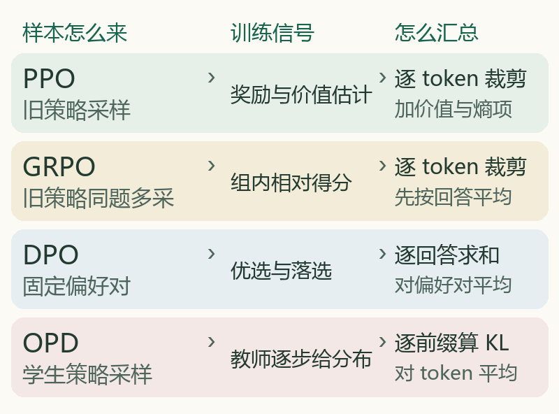
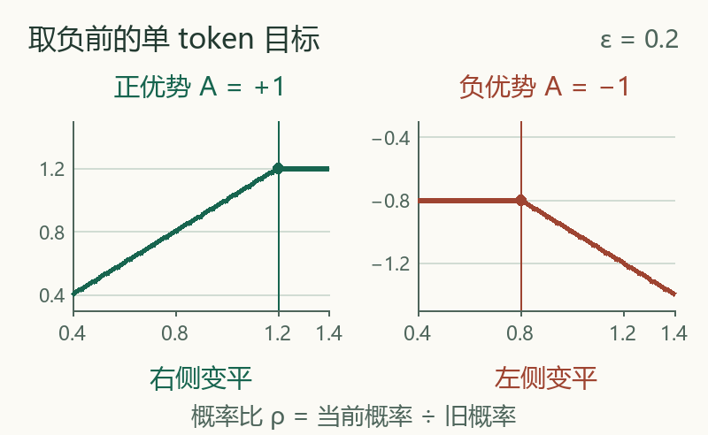
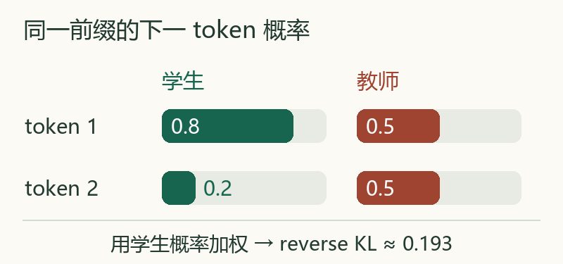

# PPO、GRPO、DPO、OPD 的 Loss 怎么算？

假设模型答完一道题才拿到分数。可回答是一步一步生成的，这个总分怎么用来训练前面的每一步？

PPO 从奖励和价值估计得到逐 token 优势，GRPO 从同题答案的组内得分得到优势，DPO 使用两条答案的偏好，OPD 让教师在学生访问过的前缀上提供下一 token 的分布。

**统一记号。** $x$ 是 prompt，$y$ 是完整回答，$y_t$ 是它的第 $t$ 个 token，$s_t=(x,y_{<t})$ 是生成这个 token 前的上下文。$\pi_\theta$ 是正在训练的策略，$\pi_{\rm old}$ 是生成本轮样本的策略快照，$\pi_{\rm ref}$ 是冻结的参考策略，$\pi_{\rm T}$ 是蒸馏教师。$\pi_m(y_t\mid s_t)$ 表示模型 $m$ 在该前缀给实采 token 的概率，$\pi_m(\cdot\mid s_t)$ 表示整个词表上的分布。$\log$ 用自然对数。下文的 $L$ 都按最小化方向写，$\operatorname{mean}$ 是对标明的样本取算术平均，只统计有效回答 token。

## PPO · 从奖励到总 Loss

**先算优势。** 旧策略生成回答，存下每个实采 token 的 log-prob 和 critic 的价值预测。$u_t$ 是执行第 $t$ 个动作后拿到的奖励。LLM 的整条回答分数通常放在最后一个 token 上，前面的 token 可只有逐步奖励或参考 KL 惩罚。InstructGPT 就在采样奖励里加入对冻结 SFT 策略的逐 token KL 惩罚，再算优势。［[InstructGPT §3.5](https://arxiv.org/pdf/2203.02155)］

$$
\begin{aligned}
\delta_t &= u_t+\gamma V_{\rm old}(s_{t+1})-V_{\rm old}(s_t),\\
\hat A_t &= \delta_t+\gamma\lambda\hat A_{t+1},\\
\hat V_t &= V_{\rm old}(s_t)+\hat A_t.
\end{aligned}
$$

$V_{\rm old}(s_t)$ 是 rollout 时 critic 对前缀后续累计回报的估计，$\gamma$ 是奖励折扣，$\lambda$ 控制广义优势估计（GAE）对后续误差的加权，$\delta_t$ 是一步时序差分（TD）误差，$\hat A_t$ 是估出的优势，$\hat V_t$ 是这里使用的 critic 回归目标。设这一段有 $N$ 个 token，从 $\hat A_{N+1}=0$ 倒推。若回答真正终止，取 $V_{\rm old}(s_{N+1})=0$。若只是截断，可用末尾状态的价值估计补上后续回报。更新时，缓存的旧概率、优势和回归目标都作为固定量。［[GAE 原论文 §3](https://arxiv.org/abs/1506.02438)］

**再算同一个 token 的概率比。** 用当前策略在已采样的回答上重新前向，取相同前缀、相同 token 的 log-prob。$\rho_t$ 衡量当前策略相对旧策略把这个 token 的概率改成了多少倍。

$$
\rho_t=\exp\!\bigl(\log\pi_\theta(y_t\mid s_t)-\log\pi_{\rm old}(y_t\mid s_t)\bigr)
$$

**同一份优势乘两次，取较小值，再整体取负。** 令 $c_\epsilon(\rho)=\operatorname{clip}(\rho,1-\epsilon,1+\epsilon)$，其中 $\epsilon>0$ 是裁剪幅度，$\rho$ 是输入概率比，$\operatorname{clip}$ 把输入限制在给定区间内。$M_\epsilon(\rho,A)$ 是单个 token 的裁剪目标，$A$ 是传进去的优势，$\min$ 取两个乘积中较小的一个。

$$
\begin{aligned}
M_\epsilon(\rho,A)&=\min\{\rho A,\ c_\epsilon(\rho)A\},\\
L_{\rm actor}&=-\operatorname{mean}_{\rm tokens} M_\epsilon(\rho_t,\hat A_t).
\end{aligned}
$$

考试常考负优势。若 $\epsilon=0.2$、$\hat A_t=-1$、$\rho_t=0.7$，两项是 $-0.7$ 和 $-0.8$，取 $-0.8$，该 token 的 actor loss 是 $0.8$。正优势在右侧变平，负优势在左侧变平。另一侧仍有梯度，其他样本的更新也可能继续改变这个 token 的概率。

**最后加 critic 和熵。** 下式用均方误差写一个常见版本。$V_\phi$ 是正在训练的 critic，$\phi$ 是它的参数。固定的回归目标仍是 $\hat V_t=V_{\rm old}(s_t)+\hat A_t$，即采样时的旧估值加上 GAE 优势。$\bar H$ 是当前策略在有效回答前缀上的平均 Shannon 熵，$c_V,c_H\ge0$ 分别加权 value loss 和熵奖励。

$$
\begin{aligned}
L_V &= \operatorname{mean}_{\rm tokens}
       \bigl(V_\phi(s_t)-\hat V_t\bigr)^2,\\
L_{\rm PPO} &= L_{\rm actor}+c_V L_V-c_H\bar H.
\end{aligned}
$$

负的熵项鼓励探索。若题目只问 PPO-Clip 的策略损失，写 $L_{\rm actor}$。若问 actor–critic 总 loss，再写出 value 和熵项，并按题设处理 value clipping、熵系数或参考 KL。参考 KL 管的是离参考模型多远，clip 里的分母是本轮的采样策略。［[PPO 原论文式 7–12](https://arxiv.org/pdf/1707.06347)］

**两步手算。** 取 $\gamma=1$、$\lambda=0.9$、$\epsilon=0.2$，终止价值为 0。奖励是 $(0,2)$，旧 critic 预测 $(1.1,1.0)$。从最后一步开始，$\delta_2=2+0-1.0=1.0$，所以 $\hat A_2=1.0$。回到第一步，$\delta_1=0+1.0-1.1=-0.1$，加上后一步的优势后得到 $\hat A_1=-0.1+0.9\times1.0=0.8$。旧预测加上这两个优势，价值目标就是 $(1.9,2.0)$。

| token | 当前 ÷ 旧概率 | $\rho_t$ | 原值 / 裁剪后 | 取较小 |
| :--- | :--- | ---: | :--- | ---: |
| 1 | 0.26 ÷ 0.20 | 1.30 | 1.04 / 0.96 | 0.96 |
| 2 | 0.33 ÷ 0.30 | 1.10 | 1.10 / 1.10 | 1.10 |

平均后取负，$L_{\rm actor}=-1.03$。如果当前 critic 仍预测 $(1.1,1.0)$，两项平方误差是 $0.64$ 和 $1.00$，所以 $L_V=0.82$。取 $c_V=0.5$、$c_H=0$，总 loss 是 $-1.03+0.5\times0.82=-0.62$。

## GRPO · 用同题答案算优势

同一个 $x$ 用 $\pi_{\rm old}$ 生成 $G$ 个答案。$i$ 是答案编号，$R_i$ 是第 $i$ 条答案的整条奖励，$\bar R$ 和 $\sigma_R$ 是这组奖励的均值和标准差，$\eta$ 是实现里防止除零的小正数。结果监督版把同一个答案优势发给这条答案的每个 token，组内比较省去了 critic 和 value loss。

$$
\hat A_i=\frac{R_i-\bar R}{\sigma_R+\eta}
$$

例如奖励 $(0,0,2,2)$ 的均值为 1，按总体标准差计算也是 1，忽略很小的 $\eta$ 时，四个优势约为 $(-1,-1,+1,+1)$。若同组奖励全相同，这组的策略优势项为零。

对第 $i$ 条回答的第 $t$ 个 token 用 PPO 同样的当前/旧概率比 $\rho_{i,t}$ 和裁剪函数 $M_\epsilon$。DeepSeekMath 结果监督版先按每条回答的长度平均，再对同题答案和 prompt 平均。$N_i$ 是第 $i$ 条回答的有效 token 数，$\beta$ 是参考 KL 的权重，$k_{i,t}$ 是原文对实采 token 的参考 KL 估计项。

$$
\begin{aligned}
L_{\rm GRPO}
&=\operatorname{mean}_{x}\frac{1}{G}
  \sum_{i=1}^{G}\frac{1}{N_i}\sum_{t=1}^{N_i}
  \bigl[-M_\epsilon(\rho_{i,t},\hat A_i)+\beta k_{i,t}\bigr].
\end{aligned}
$$

**全词表 KL。** 固定前缀 $s$，令 $p(v)=\pi_\theta(v\mid s)$、$r(v)=\pi_{\rm ref}(v\mid s)$，分别是当前策略和参考策略给词表项 $v$ 的概率，$\mathcal V$ 是词表。KL 就是逐项用当前策略的概率给 log-prob 差加权，再求和。

$$
D_{\rm KL}(p\Vert r)=\sum_{v\in\mathcal V}p(v)\bigl[\log p(v)-\log r(v)\bigr].
$$

如果手里只有 log-prob，记 $\ell_p(v)=\log p(v)$、$\ell_r(v)=\log r(v)$。每一项是 $e^{\ell_p(v)}$ 乘以 $\ell_p(v)-\ell_r(v)$。

**单 token 估计。** DeepSeekMath 式（4）只取实采 token $y_{i,t}$ 在生成前缀 $s_{i,t}$ 上的两个概率。$q_{i,t}$ 是参考/当前的概率比，前面裁剪用的 $\rho_{i,t}$ 则是当前/旧。

$$
\begin{aligned}
q_{i,t}&=\frac{\pi_{\rm ref}(y_{i,t}\mid s_{i,t})}
                  {\pi_\theta(y_{i,t}\mid s_{i,t})},\\
k_{i,t}&=q_{i,t}-\log q_{i,t}-1.
\end{aligned}
$$

固定前缀，从当前策略 $p$ 抽 token 时，$-\log q_{i,t}$ 的期望等于 KL。$q_{i,t}$ 的期望恒为 1，因为按 $p$ 加权后正好对参考策略的概率求和。于是加上 $q_{i,t}-1$ 一方面不改变期望，另一方面抵消了 $q_{i,t}$ 接近 1 时的一阶波动。例如 $q_{i,t}=1.1$ 时，$-\log q_{i,t}\approx-0.0953$，加上 $0.1$ 后得到 $k_{i,t}\approx0.0047$。如果复用旧策略采出的样本，且当前策略已经变了，直接平均这些 $k_{i,t}$ 一般会偏离当前策略下的 KL。［[DeepSeekMath §4.1.1–4.1.2](https://arxiv.org/html/2402.03300#S4.SS1)］

接着上面的四答案例子，假设每条只有一个 token，当前/旧概率比分别是 $0.7$、$1.0$、$1.3$、$1.1$。取 $\epsilon=0.2$，裁剪目标依次为 $-0.8$、$-1.0$、$1.2$、$1.1$。若参考策略在这四个 token 上的概率与当前策略相同，四项 $k_{i,t}$ 都是 0，平均后取负得到 $L_{\rm GRPO}\approx-0.125$。

## DPO · 整条回答做偏好对比

每条训练样本包含同一 prompt 的优选回答 $y^+$ 和落选回答 $y^-$。对每条回答，把它的 $N$ 个有效 token 的 log-prob 相加，得到模型 $m$ 的序列 log-prob $\ell_m(y\mid x)$。分别用当前策略和参考策略算。$d(y)$ 是两者之差，表示当前策略相对参考策略的序列 log-prob 增量。

$$
\begin{aligned}
\ell_m(y\mid x)&=\sum_{t=1}^{N}\log\pi_m(y_t\mid s_t),\\
d(y)&=\ell_\theta(y\mid x)-\ell_{\rm ref}(y\mid x).
\end{aligned}
$$

用两个增量的差构造分类 logit $z$。$\beta_{\rm DPO}>0$ 控制这个差的缩放，$\sigma(z)=1/(1+e^{-z})$ 是 sigmoid，$e$ 是自然指数的底。对偏好数据集中的样本取平均。

$$
\begin{aligned}
z &= \beta_{\rm DPO}\,[d(y^+)-d(y^-)],\\
L_{\rm DPO} &= -\operatorname{mean}_{\rm pairs}\log\sigma(z).
\end{aligned}
$$

举例，参考策略对优选 / 落选的序列 log-prob 为 $(-3,-4)$，当前策略为 $(-2,-4.5)$。两边的增量分别是 $+1$、$-0.5$。取 $\beta_{\rm DPO}=1$，得到 $z=1-(-0.5)=1.5$，loss 约 $0.201$。公式推动两个增量的差变大。经典 DPO 直接用固定偏好对训练。［[DPO 原论文式 7](https://arxiv.org/html/2305.18290#S4.E7)］

## OPD · 学生采样，老师逐步给分布

学生策略生成回答。教师和学生在同一批学生访问过的 $s_t$ 上预测下一个 token。下面选常见的 **逐 token reverse KL**，并把采样得到的前缀视为本次更新的固定输入。$p_t(v)=\pi_\theta(v\mid s_t)$ 是学生在前缀 $s_t$ 给词表项 $v$ 的概率，$q_t(v)=\pi_{\rm T}(v\mid s_t)$ 是教师给它的概率，$\mathcal V$ 是双方共享的词表。$D_{\rm KL}$ 衡量第一个分布相对第二个分布的偏离。

$$
\begin{aligned}
D_{\rm KL}(p_t\Vert q_t)
&=\sum_{v\in\mathcal V}p_t(v)\log\frac{p_t(v)}{q_t(v)},\\
L_{\rm OPD}&=\operatorname{mean}_{\rm tokens}D_{\rm KL}(p_t\Vert q_t).
\end{aligned}
$$

手算时，两项分别是 $0.8\log(0.8/0.5)\approx0.376$ 和 $0.2\log(0.2/0.5)\approx-0.183$，相加约为 $0.193$。若批次只有这一个前缀，这就是 $L_{\rm OPD}$。

如果只拿到实采 token 上的老师 log-prob，可以用 **采样 token 的策略梯度**。先缓存教师 log-prob 减学生采样 log-prob，得到 $a_t$。$\operatorname{sg}$ 表示停止梯度。训练时让同一个 token 的当前/旧概率比 $\rho_t$ 承担梯度，一种不带 clip 的代理 loss 如下。

$$
\begin{aligned}
a_t &= \operatorname{sg}\!\bigl(
  \log\pi_{\rm T}(y_t\mid s_t)-\log\pi_{\rm old}(y_t\mid s_t)
  \bigr),\\
L_{\rm sampled}&=-\operatorname{mean}_{\rm tokens}(\rho_t a_t).
\end{aligned}
$$

固定前缀时，若 token 由学生采样策略抽取，这个形式在当前学生等于采样策略的点估计 reverse KL 的梯度。只把采样 token 的学生 log-prob 减老师 log-prob 后直接反传，会漏掉由学生分布加权产生的梯度。OPD 的 on-policy 指前缀来自学生采样，蒸馏距离也可以选 forward KL 等其他形式。［[Thinking Machines Lab · On-Policy Distillation](https://thinkingmachines.ai/blog/on-policy-distillation/) · [GKD 原论文](https://arxiv.org/abs/2306.13649)］
