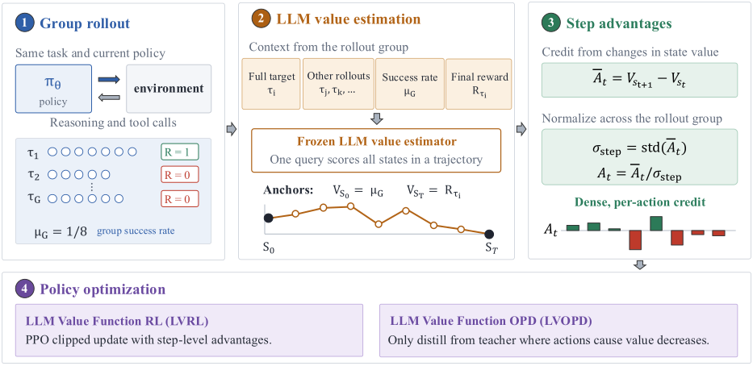
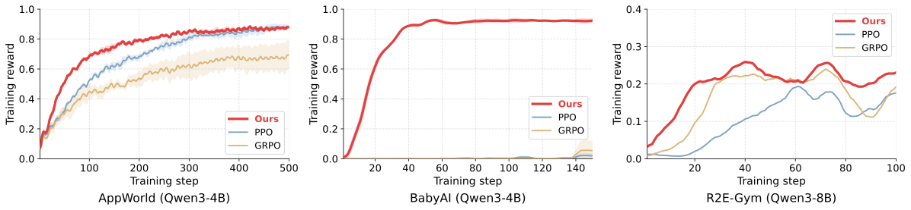
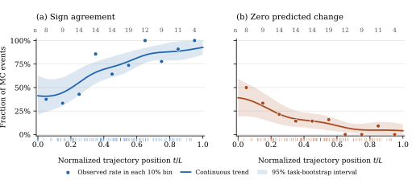
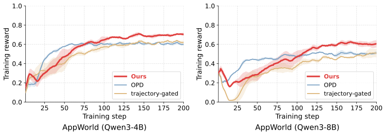

# LVRL：给长程 Agent 的每一步分配优势

> 一次任务尝试最终成功了，里面的绕路也应该学吗？另一次尝试最终失败了，里面已经做对的动作还值得保留吗？

**LVRL（LLM Value Function RL，用大语言模型估值的强化学习）** 用一个参数冻结的大语言模型回看已完成的任务尝试，估计每个中间状态离成功有多近。相邻估值之差进入训练，让同一次尝试中的不同动作得到不同的信号。本文对照 Kaijie Zhu 等人的 [2026 年 10 月预印本 v1](https://arxiv.org/abs/2610.15840v1)。

## 第 1 章 终局奖容易给，逐步归因很难

**Agent** 是能按轮生成输出、调用工具并读取反馈的模型。**策略** $\pi$ 是模型在给定历史时选择下一步输出的概率分布。用某个策略从开始跑到结束，得到一次 **rollout（采样轨迹）**。设 $\tau_i$ 是同一任务中的第 $i$ 条轨迹，$s_{i,t}$ 是其中第 $t$ 个动作执行前的状态，$a_{i,t}$ 是该动作，执行后进入 $s_{i,t+1}$。状态需要保留能影响后续行动的交互历史和工作进展。$T_i$ 是动作总数，所以 $s_{i,0}$ 在首个动作前，$s_{i,T_i}$ 在末个动作后。

假设任务是从模拟日历里找到某个项目的下次会议。Agent 先查项目名，随后搜错账户，之后改正并返回正确结果。把轨迹 $\tau_i$ 的终局奖励记为 $R(\tau_i)$，成功给 1，失败给 0。这条轨迹与从头到尾都选对的轨迹都会拿到 1。训练还需要解决 **信用分配（credit assignment）**，也就是把结果同之前的动作联系起来。**优势（advantage）** 是用于更新策略的带符号权重。正值一般鼓励提高已采样动作的概率，负值则给出相反方向的信号。

### 1.1 PPO、GRPO 与 LVRL 各用什么信号

| 方法 | 优势从哪里来 | 在终局奖励稀疏时的难点 |
| --- | --- | --- |
| PPO（近端策略优化） | 训练 **critic（价值估计器）**，再用实际奖励和估计价值计算广义优势估计（GAE）。GAE 将连续多步的奖励和价值预测误差加权起来。 | critic 要从有限成功经验中学会区分中间状态。本文的 PPO 基线是在策略模型上接价值头并共同训练。 |
| GRPO（组相对策略优化） | 对同一道任务采样一组轨迹，用该条结果与组内平均结果的差衡量相对表现。本文比较的 GRPO 在轨迹内共用这个优势。 | 正确动作和绕路共享同一个权重，组内奖励全相同则组内相对信号消失。 |
| LVRL | 冻结的语言模型用同组轨迹和目标轨迹进行事后估值，步骤之间用不同优势，随后通过 PPO 裁剪目标更新策略。 | 价值估计依赖评估模型的能力，还需要额外推理。 |

把单次训练中的采样组大小记作 $G$，$j$ 为组内轨迹编号，$\mu_G$ 为组内平均回报。对于成功为 1、失败为 0 的任务，它也就是同组成功率。$\sigma_G$ 为组内终局回报的标准差。标准差为正时，论文中的 GRPO 轨迹优势记作 $A_i^{\mathrm{GRPO}}$。

**式 1 · 同组平均回报与传统 GRPO 的轨迹优势**

$$
\mu_G=\frac{1}{G}\sum_{j=1}^{G}R(\tau_j),\qquad A_i^{\mathrm{GRPO}}=\frac{R(\tau_i)-\mu_G}{\sigma_G}
$$

如果所有轨迹都失败，分子全部是零并且标准差也是零。这意味着这组没有可用于相对比较的终局奖励差异。[论文 §3.1](https://arxiv.org/html/2610.15840v1#S3.SS1)

## 第 2 章 冻结模型怎样给中间状态估值

在二值终局任务里，经典的状态价值可以理解为：**给定当时的状态，拿指定策略继续跑，最后成功的概率是多少？** 在不折扣未来且成功给 1、失败给 0 的约定下，这就是期望终局回报。换了策略，成功概率也可能变。工具还需登录的时候，熟悉接口的策略可能成功，弱一点的策略可能卡住。

LVRL 为每条待评分轨迹做一次联合估值。设冻结评估模型是 $V_\phi$，$\phi$ 是它固定的模型参数，$v_{i,t}$ 是最终用于训练的该状态估值。处理一条轨迹时，评估模型看到三部分信息：

1. 任务及目标轨迹的全程动作、环境响应和终局结果。单次工具返回很长时，附录中的实现会截断返回文本。
2. 随机选择的若干条同组其他轨迹的摘要。摘要保留关键动作、观察和结果；同一份摘要可以在组内复用。
3. 当前采样策略在本组的成功率 $\mu_G$。同一任务在当前策略手里有多难，要由同组表现帮助判断。

模型一次输出所有状态的估值，训练代码将第一个和最后一个值换成实际可观测的锚点。

**式 2 · 用实测结果固定起点和终点**

$$
v_{i,0}=\mu_G,\qquad v_{i,T_i}=R(\tau_i)
$$

同组轨迹提供了**与采样策略有关的提示**。同一个状态的事后估值也可能随评估模型看到的后续路径而变，因此它衡量的是看过全程之后对该步的判断。它与只看当时状态、对未来所有可能走法取平均的经典状态价值有不同的信息条件。[论文 §3.2 与附录提示词](https://arxiv.org/html/2610.15840v1#S8)

图右下还有 **LVOPD（LLM Value Function On-Policy Distillation）**。它用同一组逐步优势决定在哪些动作上向教师学习，第 6 章再展开。[论文图 1](https://arxiv.org/html/2610.15840v1#S1.F1)

## 第 3 章 从状态变化到实际训练损失

### 3.1 状态差分和组内缩放

把动作前后的两个值相减。$\bar A_{i,t}$ 是动作 $a_{i,t}$ 的未缩放优势。执行后更有希望，差值为正；执行后任务变得更难完成，差值为负。

**式 3 · 相邻状态的价值变化**

$$
\bar A_{i,t}=v_{i,t+1}-v_{i,t}
$$

把组内所有轨迹的**有效环境步骤**合到一起算标准差 $\sigma_{\mathrm{step}}$，然后用这个正数缩放每个 $\bar A_{i,t}$，得到最终的逐步优势 $A_{i,t}$。此处只除标准差，保持每个非零差值的符号。

**式 4 · 用组内所有有效步骤的标准差缩放**

$$
A_{i,t}=\frac{\bar A_{i,t}}{\sigma_{\mathrm{step}}}
$$

将同一条轨迹所有相邻差分相加，中间值一正一负成对抵消。留下起点、终点两项，恰好等于 GRPO 的轨迹优势分子。

**式 5 · 整条轨迹的未缩放优势和**

$$
\sum_{t=0}^{T_i-1}\bar A_{i,t}=v_{i,T_i}-v_{i,0}=R(\tau_i)-\mu_G
$$

同组所有步骤共用 $\sigma_{\mathrm{step}}$，所以缩放后的轨迹总和就是式 5 再除以这个常数。这里的守恒说的是**每个环境步骤计一次**。估值误差只能改变这笔优势在各步之间的分配，但依旧可能把某步的符号判断错。

### 3.2 手算一组两条轨迹

假设同一任务两条轨迹一成一败，故起点均为 $0.50$。各行的中间值都是为讲解构造的。每条有三个动作。

| 轨迹 | 起点 → 三个动作后的估值 | 动作 1 | 动作 2 | 动作 3 | 差分相加 |
| --- | --- | ---: | ---: | ---: | ---: |
| 成功 | 0.50 → 0.75 → 0.50 → 1.00 | +0.25 | −0.25 | +0.50 | +0.50 |
| 失败 | 0.50 → 0.75 → 0.25 → 0.00 | +0.25 | −0.50 | −0.25 | −0.50 |

在这组教学数字下，按总体标准差计算，$\sigma_{\mathrm{step}}=\sqrt{0.125}\approx 0.354$。失败轨迹的首个动作依然拿到正优势，约 $+0.71$，成功轨迹的第二个动作则得到约 $-0.71$。

如果换成两条都失败，终点和起点都为 0。取其中一条的路径 $0\to0.30\to0.10\to0$，三个差分为 $+0.30,-0.20,-0.10$。它总和为零，三个步骤却有不同信号。这是论文在 BabyAI 冷启动中要利用的现象。这里唯一的变化依据来自评估模型对中途进展的判断，因此估值保持不变时没有这样的信号。[论文 §4.2](https://arxiv.org/html/2610.15840v1#S4.SS2)

### 3.3 一个动作含多个 token，优势怎样进入损失

一个 **token** 是模型读写的基本单位。把动作输出的第 $u$ 个已采样 token 记作 $y_{i,t,u}$，它生成时所见的上下文和动作内前缀合记为 $h_{i,t,u}$。$\pi_{\mathrm{old}}$ 代表生成该样本时的策略，$\pi_\theta$ 代表当前正更新的策略，$\theta$ 为其参数。用二者对同一个 token 的条件概率形成概率比 $\rho_{i,t,u}$。

**式 6 · 一个已采样 token 的概率比**

$$
\rho_{i,t,u}=\frac{\pi_\theta(y_{i,t,u}\mid h_{i,t,u})}{\pi_{\mathrm{old}}(y_{i,t,u}\mid h_{i,t,u})}
$$

设 $\epsilon>0$ 是 PPO 的裁剪幅度，$\operatorname{clip}$ 把概率比限制在给定区间。$\mathcal M$ 是当前训练小批次的有效动作 token 位置集合，$|\mathcal M|$ 为它的大小。论文对每个动作的 token 使用相同的 $A_{i,t}$，逐 token 计算裁剪目标再取平均。负号把最大化的目标写为要最小化的损失 $\mathcal L_{\mathrm{LVRL}}$。

**式 7 · PPO 裁剪损失按有效动作 token 平均**

$$
\mathcal L_{\mathrm{LVRL}}=-\frac{1}{|\mathcal M|}\sum_{(i,t,u)\in\mathcal M}\min\!\left(\rho_{i,t,u}A_{i,t},\,\operatorname{clip}(\rho_{i,t,u},1-\epsilon,1+\epsilon)A_{i,t}\right)
$$

所以式 5 **不约束实际 token 损失或梯度的总和**。例如两个动作的原始优势分别为 $+0.5$ 和 $-0.5$，步骤和为零。若它们分别含 2 和 6 个有效 token，第二个权重会在更多位置使用，实际更新还受各 token 的概率比、是否触发裁剪以及模型梯度影响。这也解释了为什么「守住总优势」不能推出「逐步重分配和原始训练等价」。[论文 §3.2](https://arxiv.org/html/2610.15840v1#S3.SS2)

## 第 4 章 在哪些规模与任务上有效

- **AppWorld** 是一个用编程接口操作模拟应用的环境。训练后在保留的 Test Challenge 任务上评估。
- **BabyAI** 是文字交互的网格导航。训练覆盖最短路线需通过 1 至 3 扇门的布局。**分布内（ID）** 评测沿用这些门数。**分布外（OOD）** 评测需要通过 4 或 5 扇门。
- **R2E-Gym** 提供软件工程训练任务。模型在其中训练后，在 **SWE-bench Verified** 上评估代码修复任务。

下面选出最能说明问题的几组，数字为任务成功率。默认的 LVRL 评估模型是 Claude Opus 4.6。Qwen3 的 4B、8B、32B 是策略模型的参数量，B 表示十亿。

| 评测 / 策略 | RL 前 | GRPO | PPO | LVRL |
| --- | ---: | ---: | ---: | ---: |
| AppWorld / 4B | 4.2% | 10.7% | 14.8% | **24.3%** |
| AppWorld / 8B | 10.9% | 19.8% | 17.5% | **26.3%** |
| BabyAI / 8B，ID / OOD | 0.7% / 0.0% | 2.7% / 0.0% | 0.3% / 0.0% | **75.0% / 65.5%** |
| SWE-bench Verified / 8B | 2.9% | 12.0% | 9.0% | **20.2%** |
| SWE-bench Verified / 32B | 20.2% | 22.3% | 24.9% | **30.9%** |

**32B 确实做了全参数 RL 训练，** 在 SWE-bench Verified 上比同尺寸 PPO 高 6.0 个百分点，比 GRPO 高 8.6 个百分点。看重复次数时，AppWorld 与 BabyAI 有三个独立训练种子，代码实验则只有一个训练种子，各方法的最终权重重复评测三次。32B 的 $30.9\%\pm1.6$ 个百分点中，后一项反映重复评测的标准差，因而无法据此判断重新训练时的波动。[论文表 1、附录 §7.2](https://arxiv.org/html/2610.15840v1#S4.T1)

横轴是**训练步数**，纵轴是训练奖励。左、中两张子图用的是 Qwen3-4B，右图用的是 Qwen3-8B。图 9 支持「相同训练步数下，LVRL 更早获得回报」的判断。端到端耗时还要计入估值调用和等待。同一环境与策略尺寸下，各方法共用初始权重、任务采样、rollout 预算、更新步数和生成配置。[论文图 9、附录 §7](https://arxiv.org/html/2610.15840v1#S9.F9)

### 4.1 去掉上下文或更换评估模型会怎样

AppWorld 的 8B 实验里，完整 LVRL 为 26.3%，去掉校准上下文后为 22.1%，GRPO 为 19.8%。这个对照说明整套上下文校准有用，论文没有进一步分离端点锚定与同组样例各自的贡献。另一个 AppWorld 4B 对照中，只替换冻结评估模型，Claude Opus 4.6、GLM-5.2 和 Qwen3-235B 的结果分别为 24.3%、22.3% 和 9.8%。改用其他评估模型可以获得收益，幅度会明显变化。[论文 §4.5](https://arxiv.org/html/2610.15840v1#S4.SS5)

成本方面，论文记录的单条轨迹估值请求约消耗 **9K 至 20K 输入 token、0.6K 至 1.9K 输出 token**。token 数用代理分词器估算，数字也没有计入生成其他轨迹摘要的独立调用。论文说摘要单次成本与估值相近，实际总开销还受组内缓存和复用影响。读训练效率时，可以同时看环境交互数量、GPU 更新成本和评估模型推理开销。[论文附录 §7.1](https://arxiv.org/html/2610.15840v1#S7.SS1)

## 第 5 章 怎样检验某一步真的变好

如果能把环境恢复到某一步，让同一个策略从那里续跑多次，就能用 **Monte Carlo（蒙特卡洛，简称 MC）** 的抽样比例近似状态的成功概率。论文在 AppWorld 从同一次训练中取三个时点的权重，从选出的 180 条成功或失败轨迹记录了 3,899 个状态。为了恢复状态，研究者从头重演之前的动作，核对环境响应，并丢弃重演不一致的转移。

这里临时省略轨迹下标 $i$。令 $M=32$ 表示每个恢复状态的独立续跑数，$m_t$ 表示从 $s_t$ 开始续跑的成功次数，$\widehat V_{\mathrm{MC}}(s_t)$ 是该状态的经验成功率，$\Delta_t^{\mathrm{MC}}$ 是动作前后两次经验估计的差。

**式 8 · 从同一个状态续跑，估计成功概率**

$$
\widehat V_{\mathrm{MC}}(s_t)=\frac{m_t}{M},\qquad\Delta_t^{\mathrm{MC}}=\widehat V_{\mathrm{MC}}(s_{t+1})-\widehat V_{\mathrm{MC}}(s_t)
$$

两个续跑集合独立时，差值的标准差最大为 0.125。作者只把变化绝对值至少为 $0.375$（也就是 $12/32$）的转移标成高置信事件。增加的是「恢复」，降低的是「陷阱」。绝对值小于 0.125 的转移归为中性，其余变化不进入这两个对照集合。

| MC 参考标签 | 样本数 | LVRL 的对应结果 |
| --- | ---: | --- |
| 陷阱 | 76 | 72% 的动作被判估值下降 |
| 恢复 | 38 | 66% 的动作被判估值上升 |
| 中性 | 1,533 | 8% 被判下降，22% 被判上升 |

把图中的位置按前三分之一、中间、后三分之一汇总，方向一致率分别约为 **44%、78%、88%**。114 个高置信事件都没有落在最后一次转移，后段的一致率因此不由终点锚定直接造成。这项检查衡量的是**明显变化的方向**，不能证明逐状态数值已经校准。32 次续跑会带来采样误差，样本也只来自 AppWorld 和一次训练；早期判断更难的原因还需要单独验证。MC 续跑用于这项分析，LVRL 的常规训练步骤不执行这些额外续跑。[论文 §4.4 与附录 §11](https://arxiv.org/html/2610.15840v1#S11)

## 第 6 章 LVOPD：只在估值下跌的动作蒸馏

在 **OPD（on-policy distillation，在策略蒸馏）** 中，学生先自己生成轨迹。前缀指某个位置之前模型已经看到的上下文和生成内容。教师在学生实际访问过的前缀上给出下一个 token 的概率分布，学生据此调整。冻结的评估模型回答「哪里在倒退」，冻结的教师回答「在这个前缀上接下来怎么写」。一条成功轨迹里容易有局部错误，一条失败轨迹里也能有有用动作，因此 LVOPD 用逐步优势控制蒸馏位置。

令 $g(A_{i,t})$ 为步骤的蒸馏权重。$A_{i,t}<0$ 时开启，负得越多权重越大。$\mathcal L_{\mathrm{VD}}$ 是用这组权重计算的蒸馏损失，逐 token 比较学生与教师的词表概率分布。论文用 **反向 KL 散度**（这里按学生分布加权衡量学生与教师分布的差异），再按该小批次有效动作 token 总数平均。$\beta$ 是平衡蒸馏项和策略项的系数，$\mathcal L_{\mathrm{LVOPD}}$ 是两项合并后的训练目标。

**式 9 · 负优势决定教师监督的位置和强度**

$$
g(A_{i,t})=\max(-A_{i,t},0),\qquad \mathcal L_{\mathrm{LVOPD}}=\mathcal L_{\mathrm{LVRL}}+\beta\,\mathcal L_{\mathrm{VD}}
$$

假设某个动作的优势是 $-0.7$，它的所有 token 共用权重 $0.7$，但各 token 位置的教师分布仍不同。如果动作优势为 $+0.7$，该动作只有策略损失，蒸馏权重为零。

在 AppWorld 的 8B 模型上，论文报告纯 OPD、按整条轨迹决定是否蒸馏、LVOPD 的评测成功率依次是 **22.2%、21.2%、23.3%**。该组实验的教师和评估模型都是 Qwen3-235B。在 BabyAI，上述蒸馏方法仍停在约 0%，说明这种方法还依赖教师能否在学生访问的状态上给出有效建议。[论文 §3.3、§4.3 与附录 §10](https://arxiv.org/html/2610.15840v1#S4.SS3)

## 第 7 章 和 mentor 讨论时抓住三个问题

1. **谁提供信号？** 环境给真实终局奖励，冻结语言模型给中间步骤的估值，策略仍用已采样 token 的概率比和裁剪目标更新。
2. **哪些东西守恒？** 在同一条轨迹上，每步只计一次的差分和等于实际回报减组内均值。中间差分可以给全失败组提供有方向的局部信号；实际 token 目标还有动作长度和重要性权重。
3. **规模化时最值得测什么？** 同样的 rollout 预算下效果能否跨训练种子复现。加上评分调用之后，每小时完成的有效训练量是否提高。早期动作的归因质量是否足够稳定，能否让更便宜的评估模型接手。

本文图 1、9、10、11 采用 [论文 HTML 的原始图形](https://arxiv.org/html/2610.15840v1)，原作者为 Kaijie Zhu、Weixiang Yan、Omar Attia、Abbas Kazerouni、Alexander Toshev、Andrew Szot，授权见 [CC BY-NC-SA 4.0](https://creativecommons.org/licenses/by-nc-sa/4.0/)。正文的两轨迹手算是教学例子。可以对照站内的 [SAO 单轨迹异步优化](./sao.html) 和 [CompactionRL 上下文压缩训练](./compactionrl.html)，把估值、轨迹结构与训练更新分别看清。
