# RSI 递归自我改进学习笔记

RSI 研究的是 AI 如何把经验和反馈转化为持久能力，并用更新后的系统继续改进自己。当前公开研究已经支持若干有边界的系统自改进；能否形成通用、持续自加速的研发循环，仍是待验证的问题。

知识范围截至 2026 年 10 月 14 日。下文的“常用技术”指代表性研究中反复出现的方法，不代表经过文献计量的频次排名。阅读顺序是背景、定义、统一符号、反馈、技术、递归机制、实践和评估。

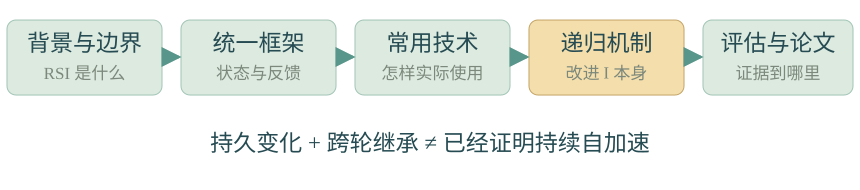

**阅读导航**

| 章节 | 核心问题 | 重点小节 |
| --- | --- | --- |
| 第 1 章 背景与问题来源 | RSI 从哪里来，为什么受到关注 | 1.1 理论来源；1.2 工程闭环；1.3 近期背景 |
| 第 2 章 定义与概念边界 | 修正、持久改进和递归改进如何区分 | 2.1 概念；2.2 模型与系统；2.3 常见混淆 |
| 第 3 章 统一符号与总流程 | 系统有哪些组成，怎样修改和评估 | 3.1 符号；3.2 更新；3.3 独立测试 |
| 第 4 章 先确定反馈 再选择更新方法 | 反馈从哪里来，究竟验证了什么 | 4.1 反馈类型；4.2 有效性与质量 |
| 第 5 章 常用技术与使用方法 | 六类常用技术分别怎样使用 | 5.1 记忆；5.2 自训练；5.3 DPO；5.4 RL 与 GRPO；5.5 课程；5.6 Harness 进化 |
| 第 6 章 方法选择与组合顺序 | 遇到不同瓶颈时先改什么 | 6.1 方法选择；6.2 组合与对照 |
| 第 7 章 从常用方法走向递归改进 | 怎样学习更新方法并检验元改进 | 7.1 SEAL；7.2 改进机制与元评估 |
| 第 8 章 近期研究如何接入统一框架 | 2026 年的新研究各自改进什么 | 8.1 研究对照；8.2 共同条件 |
| 第 9 章 大厂公开路线与材料 | 大厂路线有哪些，披露支持什么结论 | 9.1 路线对照；9.2 证据类型 |
| 第 10 章 一个从任务失败到递归改进的完整例子 | 把闭环实际组织起来 | 10.1 初始系统；10.2 反馈；10.3 对照；10.4 继承；10.5 伪代码 |
| 第 11 章 如何评估真实进步与常见失败 | 怎样排除过拟合和预算混淆 | 11.1 结论；11.2 隔离；11.3 预算；11.4 失败检查 |
| 第 12 章 阅读论文时的记录模板 | 怎样整理后续论文 | 12.1 记录模板；12.2 阅读顺序 |
| 第 13 章 参考来源 | 到哪里查原文 | 13.1 至 13.7 按研究方向归类 |

**公式阅读顺序：** 第 3 章的式 1 至 4 建立共同框架；第 5 章的式 5 至 15 解释常用方法；第 7 章的式 16 至 18 解释自适应更新和元改进。各组公式后均就地解释符号、读法与使用条件。

## 第 1 章 背景与问题来源

### 1.1 思想来源与理论框架

1960 年代，I. J. Good 提出：设计机器也是一种智力活动，足够强的机器可能设计出更强机器，进而形成正反馈。这是 RSI 与“智能爆炸”讨论的重要思想来源，但并不构成正反馈必然持续加速的证明。[R01 原文](https://vtechworks.lib.vt.edu/items/5085379d-b24c-424e-8861-e70a47b4b2fb/full)

2003 年，Gödel Machine 给出理论框架：系统在找到证明，确认自身修改有利于规定的效用后，执行该修改。现实困难在于，为复杂环境中的学习与代码变化寻找这样的证明通常十分昂贵。[R02](https://arxiv.org/abs/cs/0309048)

### 1.2 从理论问题到工程闭环

现代路线把这一问题转成可实验的工程流程：生成候选修改，执行，评估，保留有效版本。元学习提供“学习如何学习”的思想，AutoML 与程序搜索提供自动设计方法，强化学习提供试错更新机制，语言模型则提供生成代码、数据和研究方案的能力。[R33](https://self-improving-agent.com/)、[R34](https://arxiv.org/abs/2607.07663)

2022 年的 STaR 展示“生成推理—筛选—训练—再次生成”。2023 年以后，改进对象扩展到提示词、记忆、工具和 Agent 程序。2026 年的一部分研究进一步尝试改进搜索策略、训练材料生成方式与元 Agent。[R03](https://arxiv.org/abs/2203.14465)、[R17](https://arxiv.org/abs/2310.02304)、[R22](https://arxiv.org/abs/2603.19461)

### 1.3 近期关注度上升的背景

这一轮关注度上升，有两个可观察的原因：Agent 能实际执行更完整的研发工作；代码和数学等领域能提供较低成本的可检验反馈。大厂内部也在增加 AI 参与研发的程度。不过，代码量增加、实验数量增加与整体研究进展加速，不能直接画等号。[R36](https://openai.com/index/research-acceleration-view-inside-openai/)、[R37](https://www.anthropic.com/institute/recursive-self-improvement)

## 第 2 章 定义与概念边界

### 2.1 自我修正 自我改进与递归改进

| 概念 | 改变的对象 | 例子 | 判断重点 |
| --- | --- | --- | --- |
| 自我修正 self-correction | 当前答案或当前轨迹 | 重写一次回答、修复本次代码 | 是否改善本次结果 |
| 自我改进 self-improvement | 可持续使用的系统状态 | 保存技能、更新权重、改写 Agent 程序 | 后续任务是否受益 |
| 递归自我改进 RSI | 系统及产生后续改进的机制 | 更新后的 Agent 继续修改自身，甚至修改改进策略 | 有效变化是否被继承；产生改进的能力是否也提高 |

不同论文对 RSI 的定义宽窄不同。本文把“系统持久更新并参与后续改进”作为宽口径，把“改进机制本身可被改进”作为更强的口径；这是一套阅读框架，不是行业统一分级。[R33](https://self-improving-agent.com/)、[R34](https://arxiv.org/abs/2607.07663)

### 2.2 模型与整个系统需要分开

Agent 的行为由模型权重，以及模型之外的提示词、工具、控制流程、记忆和上下文管理共同决定。后面这些执行基础设施统称 Harness。基础模型冻结时，整个系统仍可能变强；因此“权重没有更新”不能单独否定系统层面的改进。

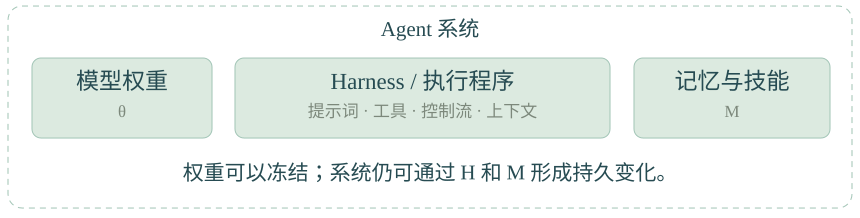

反过来，权重更新也不自动构成强 RSI。如果训练目标、任务和更新算法始终由外部固定，得到的是该机制驱动的学习，是否具有进一步的递归性还要看改进闭环。[R17](https://arxiv.org/abs/2310.02304)、[R32](https://arxiv.org/abs/2609.01437)

### 2.3 三个需要避免的等同

- 多采样后选出更好答案，不等于留下了长期能力变化。

- 用模型生成的数据训练，不等于系统自主设计了训练方法。

- 连续几轮涨分，不等于改进效率持续提高，更不等于指数加速。

“零数据”通常指不增加人工整理的任务训练数据；预训练知识、环境规则、执行器和搜索引擎仍可能提供信息。[R12](https://arxiv.org/abs/2505.03335)、[R14](https://arxiv.org/abs/2601.07055)

## 第 3 章 统一符号与总流程

### 3.1 符号约定

为便于跨论文阅读，本文重写各论文符号。系统状态、经验存储、筛选、课程与元改进公式用于概括方法；DPO 与 RL 公式按来源重写，GRPO 和 SEAL 的简化条件在对应小节说明。这些公式不代表所有方法共用同一个算法。

公式采用标准 LaTeX 排版，变量使用数学斜体，功能性下标使用正体。t 始终表示持久系统改进轮次；j 在式 5 表示本次任务的修订次数，在 token 训练公式中表示 token 位置，具体含义在公式旁再次说明。

带撇号的变量表示候选状态，只有通过接受条件后才写入下一轮；下标 t+1 表示接受或回滚之后的下一轮状态。数据集上标 tr、dev、test、syn、pref 分别表示训练、开发、独立测试、合成数据和偏好数据。

$\mathcal L$ 表示需要最小化的训练损失，普通字母 L 表示输出长度；J 表示需要最大化的训练目标。$\mathbb E$ 表示对随机变量取期望，独立审计评估器 $E_*$则是一个评分函数，两者不能混淆。

| 符号 | 全文固定含义 |
| --- | --- |
| t | 持久系统改进的轮次 |
| j | 一次输出或交互中的 token 或步骤位置，按所在公式说明 |
| k 与 K | 同一输入下的第 k 个候选，以及候选总数 |
| x 与 y | 输入与完整输出；训练公式中的 x 已包含必要上下文 |
| $\tau$ | 一次任务的交互轨迹，包括行动、工具输出和结果 |
| $\theta_t$ | 第 t 轮基础模型权重 |
| $H_t$ | Harness，包括提示词、工具定义、控制流及上下文构造程序 |
| $M_t$ | 持久记忆与可检索技能；代码在 $H_t$，存储的经验在 $M_t$ |
| $D_t$ | 系统的数据状态，包括任务池和训练记录等 |
| $U_t$ | 把数据与配置变成权重更新的训练程序 |
| $G_t$ | 改进过程中可使用的评分器，可以是规则、程序或模型 |
| $I_t$ | 根据反馈提出并组织系统修改的改进机制 |
| $S_t$ | 可执行系统状态，定义见式 1 |
| p | 基础语言模型的输出分布；权重 $\theta$ 写在下标中 |
| $\pi$ | 整个 Agent 系统的轨迹分布；系统 S 写在下标中 |
| D | 数据集；tr、dev、test 上标分别区分训练、开发与独立测试用途 |
| V 与 r | 有效性验证函数与训练奖励，二者含义不同 |
| $E_*\text{ 与 }Q_*$ | 独立审计评估器与其产生的任务质量指标 |
| B | 改进或评估预算，比较前须规定其单位 |
| $\eta$ 与 $\beta$ | 学习率与正则系数；$\beta$ 的 DPO、RL 下标区分对应目标 |
| $\varepsilon$ | 数值稳定项与裁剪宽度；std、clip 下标区分具体用途 |
| A 与 $\rho$ | 组内优势与 token 概率比；下标指定候选和 token 位置 |
| L | 输出长度；y 或 k 下标指定对应输出 |
| $\mathcal L$ 与 J | 分别表示要最小化的损失与要最大化的目标 |

旧策略参数用于采集训练样本，参考参数在当前训练阶段固定。二者在公式中分别以 old 和 ref 下标区分，用途不同，也不必相同。星号下标只用于独立审计量，不表示改进过程能够看到测试答案。

### 3.2 系统状态与更新

**式 1 系统状态**

$$
S_t=\left(\theta_t,H_t,M_t,D_t,U_t,G_t\right)
$$

**式 2 提出并应用候选修改**

$$
\begin{aligned}\Delta_t&\sim I_t\!\left(\,\cdot\mid S_t,F_t,B_t\right),\\ S'_t&=\operatorname{Apply}(S_t,\Delta_t).\end{aligned}
$$

**式 3 接受或回滚**

$$
S_{t+1}=\begin{cases}S'_t,&\text{接受条件成立},\\ S_t,&\text{否则}.\end{cases}
$$

**式 1 至 3 的符号与含义**

| 符号 | 在这组公式中的含义 |
| --- | --- |
| $S_t$ | 第 t 轮可执行系统，由式 1 中的六类组件组成 |
| $\theta_t$ 与 $H_t$ | 模型权重与 Harness；后者包含提示词、工具和执行流程 |
| $M_t$ 与 $D_t$ | 持久记忆与技能，以及任务池和训练记录等数据状态 |
| $U_t$ 与 $G_t$ | 训练程序，以及改进期间可用的评分器 |
| $I_t$ | 读取系统和反馈、提出并组织修改的改进机制；在此框架中单独记号，不包含在式 1 的六元组里 |
| $F_t$ 与 Bₜ | 当前已获得的反馈记录，以及本轮可使用的预算 |
| $\Delta_t$ 与 $S'_t$ | 候选修改，以及把修改应用到系统副本后得到的候选系统 |
| $S_{t+1}$ | 接受或回滚之后，下一轮真正使用的系统 |

**式 1 怎么读：** 系统能力由模型、执行程序、记忆、数据、训练程序和评分器共同决定。一次修改可以只改其中一个组件，例如在 $\theta$ 冻结时更新 H 或 M，不必每轮重新训练模型。

**式 2 怎么读：** $I_t$ 根据当前系统、已有反馈和预算生成一个候选 $\Delta_t$，再由 Apply 把它应用到副本。符号“∼”表示从生成机制给出的分布采样；条件符号右侧是生成修改时已知的信息。提出修改不代表修改已经有效。

**式 3 怎么用：** 用预先约定的开发评估比较候选与当前版本，满足接受条件才让下一轮继承 $S'_t$，否则继续使用 $S_t$。接受条件可以同时约束收益、成本和旧能力退化，不应拿独立测试结果反复选择版本；数据隔离见 11.2 小节。

如果系统还允许修改 $I_t$，就进入第 7 章讨论的元改进设置。

流程可以概括为：执行任务 → 收集证据 → 诊断失败 → 提出修改 → 对比评估 → 接受或回滚 → 让后续轮次继承有效变化。

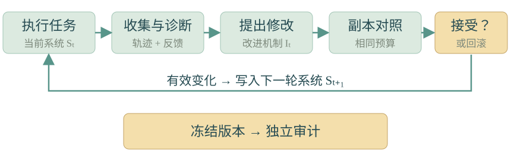

### 3.3 改进方向与独立测试

**式 4 独立测试质量**

$$
\begin{aligned}Q_*(S;D^{\mathrm{test}})&=\mathbb E_{\substack{x\sim D^{\mathrm{test}}\\ \tau\sim\pi_S(\cdot\mid x)}}\!\left[E_*(x,\tau)\right].\end{aligned}
$$

**式 4 的符号与含义**

| 符号 | 在这条公式中的含义 |
| --- | --- |
| S 与 x | 被审计的固定系统版本，以及一项测试任务 |
| $D^{\mathrm{test}}$ | 独立测试任务分布；有限测试集上的平均分用于估计该期望 |
| $\tau$ 与 $\pi_S$ | 系统执行一次任务的轨迹，以及系统在输入 x 下生成轨迹的分布 |
| $E_*$ | 对某个任务和执行轨迹评分的独立审计评估器 |
| $Q_*$ | 系统在测试分布上的平均任务质量 |
| $\mathbb E$ | 同时对测试任务和执行随机性取期望，不是上面的评分函数 E |

**公式怎么读：** 从独立任务中取一个 x，让系统执行得到 $\tau$，再由独立评估器评分，最后对任务与随机执行结果求平均。如果单次评分是通过或失败，Q 就对应这种审计条件下的平均成功率。

**怎么用：** 冻结待比较的版本，在相同测试条件下多次运行，报告平均质量及其不确定性。独立审计评估器可以是隐藏测试判定或独立专家评价；它是研究目标的操作化测量，并非“真实智能”的完美真值。预算与重复次数的要求见 11.3 小节。

$G_t$ 用来产生训练或搜索反馈，式 4 中的独立质量指标 Q 用来审计这种反馈是否对应实际进步。$G_t$ 的分数上升，不保证独立质量上升。除了固定预算下的质量比较，还应报告成功率、费用、延迟及旧能力保持情况。

## 第 4 章 先确定反馈 再选择更新方法

### 4.1 反馈类型与适用场景

反馈决定系统能学到什么。生成能力再强，若奖励方向错误，闭环可能持续放大错误。

| 反馈类型 | 怎么获得 | 适用场景 | 需要检查什么 |
| --- | --- | --- | --- |
| 形式化验证 | 用证明内核检查证明 | 可形式化数学或程序性质 | 形式化规格是否对应真实目标 |
| 可执行验证 | 隐藏单元测试、仿真、实际运行 | 编程、算法、部分科学任务 | 测试覆盖、运行隔离、是否能利用评测漏洞 |
| 专家或真实环境反馈 | 专家审阅、实验结果、用户明确评价 | 开放式研究、交互任务 | 成本、噪声与目标是否稳定 |
| 模型评分 | LLM 按 rubric 评分或比较答案 | 写作、计划、难以二元验证的任务 | 位置偏差、长度偏差、与生成者共享盲点 |
| 纯内部自我感觉 | 让模型判断“自己是否进步” | 初步诊断 | 必须用独立结果检验其可信程度 |

这些信号的强弱依赖目标和实现。形式化验证只保证形式规格，单元测试通过只保证所覆盖的行为；两者都不自动保证任务定义正确。有关验证信号与闭环的系统讨论见 [R34](https://arxiv.org/abs/2607.07663)。

### 4.2 有效性验证与质量评价

有效性 V 与质量 G 要分开。例如，代码“能运行”可以用 V 判定，“运行更快”用 G 测量；自然语言答案“格式正确”也不等于“事实正确”。这一分离在自动出题、自训练与程序搜索中尤其重要。

## 第 5 章 常用技术与使用方法

### 5.1 自我修正与经验记忆

**解决的问题：** 第一次输出不够好，以及系统在后续任务中重复同类错误。

Self-Refine 采用生成、反馈、修订循环；Reflexion 将反馈转成反思文本，供后续尝试使用。它们在此处保持权重固定。[R04](https://arxiv.org/abs/2303.17651)、[R05](https://arxiv.org/abs/2303.11366)

**式 5 本次任务的修订**

$$
\begin{aligned}f^{(j)}&=\operatorname{Critique}\!\left(x,y^{(j)},\text{外部执行结果}\right),\\ y^{(j+1)}&\sim p_{\theta_t}\!\left(\,\cdot\mid x,y^{(j)},f^{(j)}\right).\end{aligned}
$$

**式 6 候选持久记忆**

$$
M'_t=\operatorname{Write}\!\left(M_t,\operatorname{Summarize}(\tau,\text{反馈})\right).
$$

**式 5 和 6 的符号与含义**

| 符号 | 在这组公式中的含义 |
| --- | --- |
| x 与 $y^{(j)}$ | 当前任务，以及本次任务第 j 次修订时的完整输出 |
| j 与 $f^{(j)}$ | 本次任务的修订次数，以及针对这次输出产生的具体反馈 |
| $p_{\theta_t}$ | 当前模型的输出分布；这两条公式不要求更新模型权重 |
| $\tau$ 与 $M_t$ | 完整执行轨迹，以及已有持久经验库 |
| $M'_t$ | 写入新经验后的候选记忆，还需要检验是否值得保留 |

**式 5 怎么读：** Critique 把任务、当前输出和外部执行结果转成反馈；模型再结合这些信息生成下一版输出。这里 j 计数的是修订轮次，不是 token 位置，f 只是本轮反馈记录 $F_t$ 中的一条记录。

**式 6 怎么读：** Summarize 从轨迹和反馈中抽取可复用经验，Write 把经验写入记忆。式 5 改善当前答案；式 6 尝试把本次经验留给后续任务。摘要应保留证据、适用条件与失败原因，候选记忆仍要按 3.2 小节的接受规则验证。

**本节改进留下什么：** 当前答案的修订只是本次变化；通过检验并保留的 M 才是后续任务可以继承的系统变化。

**怎么用：**

1. 执行任务并保存输出和运行记录。

2. 用测试或明确标准定位失败，不只询问模型“哪里不好”。

3. 生成可操作修改，例如“空数组时提前返回”。

4. 修订后重新运行相同测试。

5. 将可复用的经验和其适用条件保存，在相关任务中检索。

**教学例子：** 编程 Agent 多次忘记处理空输入。当前任务通过修复代码解决；跨任务改进则是保存“处理集合输入时检查空集合”及触发条件，并验证其他程序是否因此受益。

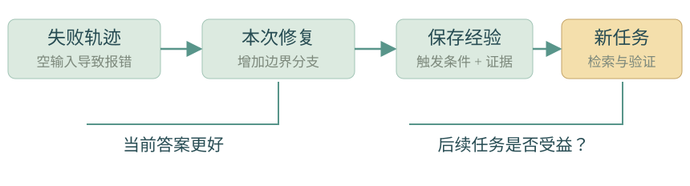

复杂技能适合保存为可调用程序及使用说明，Voyager 的技能库提供了代表性例子。[R06](https://arxiv.org/abs/2305.16291)

**使用边界：** 反思错误会形成错误记忆；摘要也可能删掉重要状态细节。若只有本次答案变好，归为自我修正；若后续任务通过记忆受益，才体现持久系统改进。

### 5.2 合成数据与迭代自训练

**解决的问题：** 人工推理示范不足，而现有模型已经有一定概率生成正确解法。

先从当前模型采样，再用可用的验证信号筛选，把保留样本转成下一轮监督微调数据。STaR 在答案错误时，还会利用已知正确答案帮助生成推理；最终学习的是能导向正确答案的生成样本。[R03](https://arxiv.org/abs/2203.14465)

**式 7 生成与筛选**

$$
\begin{aligned}y_k&\sim p_{\theta_t}(\cdot\mid x),\\ D_t^{\mathrm{syn}}&=\left\{(x,y_k):V(x,y_k)=1\right\}.\end{aligned}
$$

**式 8 监督微调**

$$
\begin{aligned}\mathcal L_{\mathrm{SFT}}(\theta)&=-\mathbb E_{(x,y)\sim D_t^{\mathrm{syn}}}\!\left[\sum_{j=1}^{L_y}\log p_\theta(y_j\mid x,y_{<j})\right],\\ \theta'_t&=\theta_t-\eta\left.\nabla_\theta\mathcal L_{\mathrm{SFT}}(\theta)\right|_{\theta=\theta_t}.\end{aligned}
$$

**式 7 和 8 的符号与含义**

| 符号 | 在这组公式中的含义 |
| --- | --- |
| x、$y_k$ 与 K | 一个输入、第 k 个候选输出，以及每个输入采样的候选数 |
| V(x,$y_k$) | 验证函数；取 1 表示通过本轮规定的有效性或正确性检查 |
| $D_t^{\mathrm{syn}}$ | 第 t 轮通过筛选后得到的合成数据集 |
| $y_j$ 与 $y_{<j}$ | 目标输出的第 j 个 token，以及它之前已经出现的 token |
| $L_y$ | 完整目标输出 y 的 token 数 |
| $p_\theta$ | 正在训练的模型对下一个 token 给出的条件概率 |
| $\mathcal L_{\mathrm{SFT}}$ | 监督微调损失，即目标 token 的负对数概率之和再对样本取平均 |
| $\eta$、梯度记号 ∇ 与 $\theta'_t$ | 学习率、损失对权重的梯度，以及一步更新后的候选权重 |

**式 7 怎么读：** 当前模型为同一输入生成多个输出，验证器只把满足筛选条件的输入与输出对放入下一轮训练集。V=1 的含义取决于验证器，不能超出实际检查覆盖的范围。

**式 8 怎么读：** 训练时把目标输出之前的正确前缀作为条件，逐 token 提高筛选样本的生成概率。负号把最大化对数似然变成最小化损失；随后沿损失下降方向更新 $\theta$。

**怎么用与条件：** 式 8 展示一个梯度步骤，实际训练程序 $U_t$ 通常执行多个步骤，必要时混合历史训练数据。训练损失下降不保证独立任务质量上升，因此更新后的 $\theta$ 需要单独评估；本节留下的是筛选数据与通过评估的权重。

**怎么用：** 准备任务池 → 每题生成 K 个答案 → 验证 → 去重并平衡任务分布 → 微调 → 独立评估 → 再生成下一批数据。

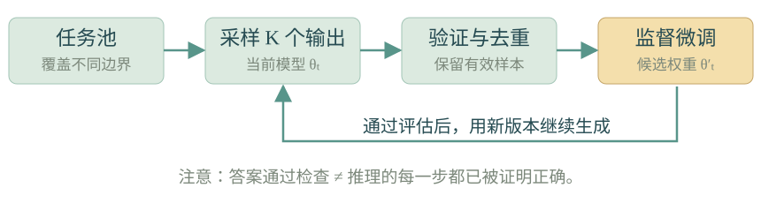

**教学例子：** 对程序题生成多份实现，执行测试后保留通过者，并加入边界情况不同的题目。模型随后学习这些通过验证的实现。

Qwen2.5-Math 将生成数据、SFT 数据迭代和奖励模型更新结合起来，是工业技术报告中的代表路线。[R35](https://arxiv.org/abs/2409.12122)

**使用边界：** 最终答案正确不保证推理链完全正确；相似样本过多也不能带来相同比例的信息增量。自训练能够强化现有可发现的能力，但不保证每轮都突破当前能力边界。

### 5.3 偏好学习与自奖励

**解决的问题：** 有些任务难以给出唯一正确答案，却可以比较两份回答的质量。

对输入 x 采样多个回答，用 $G_t$ 比较，形成偏好对 (x, $y^+$, $y^-$)，其中 $y^+$ 为更受偏好的回答。DPO 直接优化这些偏好对，训练步骤不需要单独执行策略梯度 RL。[R07](https://arxiv.org/abs/2305.18290)

**式 9 DPO 损失**

$$
\begin{aligned}d_\theta(x,y^+,y^-)&=\log\frac{p_\theta(y^+\mid x)}{p_{\mathrm{ref}}(y^+\mid x)}-\log\frac{p_\theta(y^-\mid x)}{p_{\mathrm{ref}}(y^-\mid x)},\\ \mathcal L_{\mathrm{DPO}}(\theta)&=-\mathbb E_{(x,y^+,y^-)\sim D_t^{\mathrm{pref}}}\!\left[\log\sigma\!\left(\beta_{\mathrm{DPO}}\,d_\theta(x,y^+,y^-)\right)\right].\\ \sigma(z)&=\frac{1}{1+e^{-z}}.\end{aligned}
$$

**式 9 的符号与含义**

| 符号 | 在这条公式中的含义 |
| --- | --- |
| x、$y^+$ 与 $y^-$ | 同一输入、偏好更高的完整回答，以及偏好更低的完整回答 |
| $D_t^{\mathrm{pref}}$ | 第 t 轮收集的偏好对数据集 |
| $p_\theta$ | 正在训练的模型对完整回答给出的概率 |
| $p_{\mathrm{ref}}$ | 当前 DPO 训练阶段固定的参考模型 |
| $d_\theta$ | 优选回答与劣选回答各自相对参考模型的对数概率变化之差 |
| $\beta_{\mathrm{DPO}}$ | DPO 目标的尺度系数；不同于学习率 $\eta$ |
| σ 与$\mathcal L_{\mathrm{DPO}}$ | logistic sigmoid 函数，以及需要最小化的 DPO 损失 |

**公式怎么读：** 先分别比较两份回答在当前模型与参考模型中的概率，再用 d 衡量模型是否更倾向于优选回答。对于通常取正的 $\beta$，增大 d 会降低该偏好对的损失。对数据集中的偏好对平均这一损失，就得到训练目标。

**怎么用与条件：** 用经过校准的比较标准构造偏好对，然后最小化 DPO 损失并检查新任务表现。这个目标改善的是优选与劣选的相对关系，不保证每个优选回答的绝对概率都增加。$\beta$ 控制目标的尺度与参考约束关系，不能简单当成学习率；由模型给出的偏好还要检查事实性和同源偏差。

**怎么用：**

1. 针对事实性、完整性、简洁性等建立明确评分规则。

2. 采样回答并交换展示顺序，检查评分的一致性。

3. 对差异清楚的样本建立偏好对；对模糊对不强行排序。

4. 用 DPO 更新模型，再评估新的任务回答和评判质量。

5. 若自奖励循环继续，用新版本生成下一轮偏好数据。

Self-Rewarding 用模型自身作为评判者提供奖励信号；Meta-Rewarding 进一步加入对判断的判断，尝试改善评判能力。[R08](https://arxiv.org/abs/2401.10020)、[R09](https://arxiv.org/abs/2407.19594)

**教学例子：** 两份研究摘要均无明显格式错误，但一份漏掉实验限制。评判者按固定标准选择更完整的一份，再用该偏好对训练。

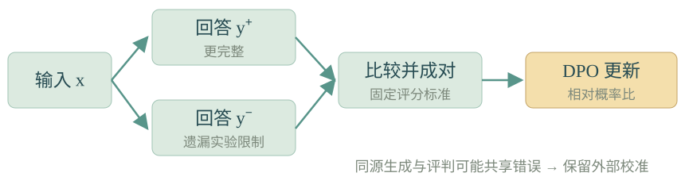

**使用边界：** 模型偏好不等于事实正确。生成者与评判者同源时，可能一起奖励同一种错误；需保留独立评估或有依据的外部反馈。

### 5.4 可验证奖励强化学习与 GRPO

**解决的问题：** 模型能偶尔解对，但需要通过多次试错提高成功概率。

RLVR 表示用可验证奖励进行强化学习；GRPO 是更新策略的方法，二者不是同一个概念。GRPO 可以使用程序奖励，也可以使用模型评分。DeepSeekMath 提出 GRPO，DeepSeek-R1 则展示可验证任务奖励在推理训练中的作用。[R10](https://arxiv.org/abs/2402.03300)、[R11](https://arxiv.org/abs/2501.12948)

**式 10 正则化奖励目标**

$$
\begin{aligned}J_{\mathrm{RL}}(\theta)=\mathbb E_{x\sim D^{\mathrm{tr}}}\!\Bigl[&\mathbb E_{y\sim p_\theta(\cdot\mid x)}r(x,y)\\[-2pt]&-\beta_{\mathrm{RL}}D_{\mathrm{KL}}\!\left(p_\theta(\cdot\mid x)\,\Vert\,p_{\mathrm{ref}}(\cdot\mid x)\right)\Bigr].\end{aligned}
$$

**式 10 的符号与含义**

| 符号 | 在这条公式中的含义 |
| --- | --- |
| $D^{\mathrm{tr}}$与 x | 训练任务分布，以及从中取出的输入 |
| y 与 $p_\theta$ | 当前模型采样的完整输出，以及当前模型的输出分布 |
| r(x,y) | 给这份输出的训练奖励；在 RLVR 中通常由可执行或可验证结果产生 |
| $p_{\mathrm{ref}}$ | 当前训练阶段固定的参考分布 |
| KL 散度 | 衡量当前输出分布相对参考分布的偏离，数值非负 |
| $\beta_{\mathrm{RL}}$ | KL 惩罚的权重；控制奖励收益与偏离参考分布之间的权衡 |
| $J_{\mathrm{RL}}$ | 要最大化的正则化奖励目标 |

**公式怎么读：** 在训练任务上，让模型生成输出并获得奖励；提高平均奖励，同时扣除偏离参考分布的代价。外层期望平均不同任务，内层期望平均同一任务下可能生成的输出。

**怎么用与条件：** 将验证结果转成奖励，再用具体策略优化算法更新权重。式 10 是概念上的全序列目标，不是每个实现的逐 token 损失。奖励 r 指导训练，独立质量 Q 用于审计，两者用途不同；RLVR 描述奖励来源，GRPO 描述下一组公式中的更新方法。

GRPO 对同一个输入从旧策略采样 K 个输出，用组内奖励估计相对优势，而不需要另训一个与策略同规模的价值网络。

**式 11 组内优势**

$$
\begin{aligned}r_k&=r(x,y_k),&\bar r&=\frac1K\sum_{k=1}^Kr_k,\\ s_r&=\sqrt{\frac1K\sum_{k=1}^K(r_k-\bar r)^2},&
A_k&=\frac{r_k-\bar r}{s_r+\varepsilon_{\mathrm{std}}}.\end{aligned}
$$

**式 12 token 概率比**

$$
\begin{aligned}c_{k,j}&=(x,y_{k,<j}),\\ \rho_{k,j}(\theta)&=\frac{p_\theta(y_{k,j}\mid c_{k,j})}{p_{\mathrm{old}}(y_{k,j}\mid c_{k,j})}.\end{aligned}
$$

**式 13 GRPO 的正则化裁剪目标**

$$
\begin{aligned}J_{\mathrm{GRPO}}(\theta)=\mathbb E\!\Biggl[&\frac1K\sum_{k=1}^K\frac1{L_k}\sum_{j=1}^{L_k}\Bigl\{\\ &\min\!\Bigl[\rho_{k,j}(\theta)A_k,\\ &\quad\operatorname{clip}\!\left(\rho_{k,j}(\theta),1-\varepsilon_{\mathrm{clip}},1+\varepsilon_{\mathrm{clip}}\right)A_k\Bigr]\\ &-\beta_{\mathrm{RL}}d_{k,j}(\theta)\Bigr\}\Biggr],\\ d_{k,j}(\theta)=&D_{\mathrm{KL}}\!\left(p_\theta(\cdot\mid c_{k,j})\,\Vert\,p_{\mathrm{ref}}(\cdot\mid c_{k,j})\right).\end{aligned}
$$

**式 11 至 13 的符号与含义**

| 符号 | 在这组公式中的含义 |
| --- | --- |
| k、K 与 j | 同一输入的候选编号、候选总数，以及候选输出中的 token 位置 |
| $r_k$、$\bar r$与 $s_r$ | 第 k 个输出的奖励、同组奖励均值，以及按式 11 计算的组内标准差 |
| $A_k$ | 第 k 个候选的标准化相对优势，反映它比同组平均表现更好还是更差 |
| $\varepsilon_{\mathrm{std}}$ | 分母中的正数稳定项，避免标准差为零时除零 |
| $c_{k,j}$ | 生成第 k 个候选第 j 个 token 前的条件，即输入与该候选已有前缀 |
| $p_{\mathrm{old}}$ | 采集这批训练候选的旧策略；在当前这批更新期间作为采样基准 |
| $\rho_{k,j}$ | 当前策略与旧策略对同一个已采样 token 的条件概率之比 |
| $\varepsilon_{\mathrm{clip}}$ | 裁剪区间的宽度参数，与分母稳定项不是同一个量 |
| $L_k$ | 第 k 个候选的 token 数；式 13 按它对该候选的 token 项取平均 |
| $d_{k,j}$ | 在该 token 的条件 c 下，当前分布相对参考分布的 KL 散度 |
| $\beta_{\mathrm{RL}}$与 $J_{\mathrm{GRPO}}$ | KL 惩罚权重，以及需要最大化的 GRPO 目标 |

**式 11 怎么读：** 先比较某个候选的奖励和同组均值，再用标准差把差值标准化。A 为正表示高于本组均值，为负表示低于均值。全组同分时，按本式所有 A 都为零，组内奖励不提供区分候选的信号；KL 项仍可能产生更新。

**式 12 怎么读：** $\rho$ 大于 1 表示当前模型相较采样时的旧模型，更容易生成这个已采样 token。分母用 old 是为了把旧策略采集的样本用于当前策略更新；ref 则出现在 KL 惩罚中。old 与 ref 可以不同，不能互换。

**式 13 怎么读：** 用候选的相对优势给 token 概率变化提供方向；取原始项与裁剪项中较小者，避免过大的概率变化继续夸大目标收益。再减去相对参考策略的 KL 惩罚，对 token、候选和训练采样取平均。clip 限制的是目标中的替代项，不是保证更新后的真实概率比始终留在该区间。

**怎么用与条件：** 同一题采样多个候选，计算奖励与优势，再优化裁剪目标；定期刷新用于新采样的旧策略。式 11 至 13 按结果奖励、文本输出和精确条件 KL 写出便于阅读的形式。实际训练可能使用采样 KL 估计、不同长度归一化及工具输出掩码；若采用逐步过程奖励，优势还会随 j 改变。

**怎么用：** 对同一题采样 → 执行验证器 → 计算奖励与 $A_k$ → 用裁剪目标更新 → 定期刷新 旧策略参数 → 新采样并评估。

**教学例子：** 四个程序的测试通过率是 0、0.5、1、0.5，组均值是 0.5。完全通过的样本有正优势，全部失败的有负优势；全组同分时，按式 11 得到零相对优势。 按式 11 忽略极小的稳定项时，组标准差约为 0.354，对应优势约为 −1.414、0、1.414、0。优势是组内相对信号；是否真正提高质量，仍需独立评估。

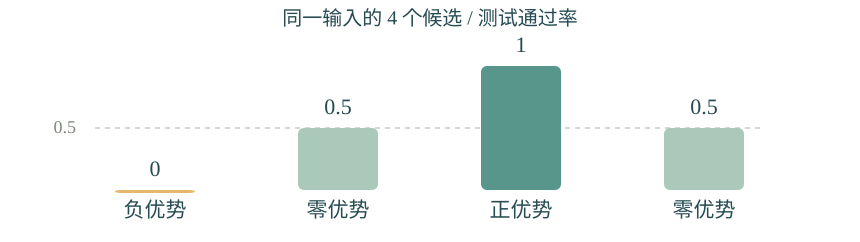

**使用边界：** 奖励过稀时，很难产生有效组内差异；不完整测试又可能奖励捷径。RL 也不会自动设计下一轮任务或更新算法。

### 5.5 自博弈与自动课程

**解决的问题：** 固定任务池逐渐饱和，而人工持续出题成本较高。

出题者提出任务，解题者尝试完成，环境提供有效性和结果反馈；再根据解题能力调整出题难度与覆盖范围。Absolute Zero 用代码执行验证生成任务和答案；Agent0 将课程与工具使用结合；Dr. Zero 将该思路扩展到搜索 Agent。[R12](https://arxiv.org/abs/2505.03335)、[R13](https://arxiv.org/abs/2511.16043)、[R14](https://arxiv.org/abs/2601.07055)

**式 14 课程难度启发式**

$$
\begin{aligned}u_t(x)&=\widehat{\Pr}_t(\text{成功}\mid x),\\ w_t(x)&=u_t(x)\left[1-u_t(x)\right].\end{aligned}
$$

**式 14 的符号与含义**

| 符号 | 在这条公式中的含义 |
| --- | --- |
| t 与 x | 当前改进轮次，以及一项候选训练任务 |
| $u_t$(x) | 当前解题者在任务 x 上的估计成功率；概率符号上的帽子表示估计值 |
| $w_t$(x) | 根据成功率计算的课程选择分数，不是解题奖励本身 |

**公式怎么读：** 成功率接近 0 或 1 时，分数较低；成功率为 0.5 时，分数达到 0.25。这种启发式表达了“已经完全会做”或“当前完全学不会”的任务，可能不如能力边界附近的任务有训练价值。

**怎么用与条件：** 先用 V 检查题目有效，再多次试做以估计 u，结合 w、任务多样性、覆盖和生成成本选择课程。式 14 是教学启发式，不是 Absolute Zero、Agent0 与 Dr. Zero 的统一奖励公式；最优任务难度也不必为 0.5。每轮能力改变之后，需要重新估计任务难度。

**怎么用：**

1. 先约束任务生成空间，确保题目可执行、可判定。

2. 用 V 检查题目有效，随后估计解题难度。

3. 为出题者设计兼顾可学性和多样性的反馈。

4. 更新解题者，并用新解题者重新估计难度。

5. 保留独立外部任务，检查能力有没有迁移。

**教学例子：** 自动生成数组处理任务。解题者学会求和后，课程引入空输入、重复元素与组合条件；任务增长来自能力缺口，而非仅把题目文本写得更长。

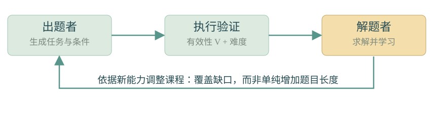

**使用边界：** 出题者可能生成形式不同但实质重复的题；双方也可能在偏离目标的任务空间中共同进步。

### 5.6 提示词与 Harness 的进化搜索

**解决的问题：** 模型已有能力没有被合适的工具、提示词与执行流程充分发挥。

把 $H_t$ 当作待优化程序。候选修改可以是新的任务提示、工具接口、文件编辑器、上下文压缩策略、重试策略或多 Agent 信息流；$\theta_t$ 可以保持冻结。

**式 15 种群进化**

$$
\begin{aligned}P'_t&=\operatorname{Mutate}(P_t;I_t),\\ P_{t+1}&=\operatorname{Select}\!\left(P_t\cup P'_t;D^{\mathrm{dev}},B\right).\end{aligned}
$$

**式 15 的符号与含义**

| 符号 | 在这条公式中的含义 |
| --- | --- |
| $P_t$ 与 $P'_t$ | 当前保存的候选系统集合，以及本轮新生成的变异集合 |
| $I_t$ 与 Mutate | 组织候选生成的改进机制，以及实际生成变异的操作 |
| 并集符号 ∪ | 把已有版本和新候选一起纳入选择范围 |
| $D^{\mathrm{dev}}$与 B | 用于比较候选的开发任务，以及规定的比较或搜索预算 |
| Select 与 $P_{t+1}$ | 按约定标准保留候选的操作，以及供下一轮继续探索的集合 |

**公式怎么读：** 从当前版本群体生成一批变异，再把旧版本和新候选放在一起评估，保留值得继续探索的版本。这里优化的重点可以是 H，模型 $\theta$ 可以保持冻结。

**怎么用与条件：** 把失败轨迹变成提示、工具或控制流程的候选修改，在副本中重复比较，记录版本及父子关系。Select 可以同时考虑开发表现、成本和多样性，不必只保留当前最高分；不同方向的版本可能成为后续进步的起点。独立测试不用于这一步选版本。

**怎么用：** 建立初始 Harness → 记录失败轨迹 → 提出小规模修改 → 在副本中运行 → 对比质量与成本 → 保存版本和分支 → 从有潜力的分支继续探索。

几类典型设计：

- Promptbreeder 同时演化任务提示词和产生变异的提示词。[R15](https://arxiv.org/abs/2309.16797)

- GEPA 读取轨迹中的自然语言反馈，反思并更新提示词，维护互补候选。[R16](https://arxiv.org/abs/2507.19457)

- STOP 让程序改进器应用于自身；ADAS 搜索 Agent 设计；DGM 保留演化中的不同 Agent 版本。[R17](https://arxiv.org/abs/2310.02304)、[R18](https://arxiv.org/abs/2408.08435)、[R19](https://arxiv.org/abs/2505.22954)

- AlphaEvolve 将模型生成、自动评估与进化搜索结合，用于算法优化。[R20](https://arxiv.org/abs/2506.13131)

**教学例子：** Agent 在长任务中反复读完整历史。候选 Harness 改为保存简短进度表，并按需读取原始记录；比较相同预算下能否完成更多任务，而非只看上下文长度下降。

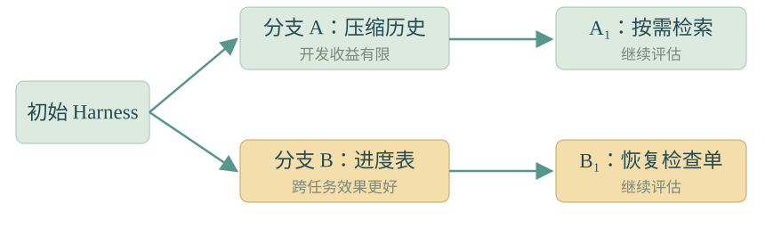

**使用边界：** 提示词可能记住开发题，新增程序可能只是增加复杂度。应检查独立任务、跨模型执行，以及新增机制是否真正被调用。

## 第 6 章 方法选择与组合顺序

### 6.1 根据失败类型选择方法

| 观察到的问题 | 优先尝试 | 核心前提 |
| --- | --- | --- |
| 当前输出有明确可定位错误 | 自我修正与工具反馈 | 能找到具体失败证据 |
| 系统重复同类错误 | 记忆与技能积累 | 经验有稳定适用条件，且能正确检索 |
| 模型偶尔答对但不稳定 | 筛选自训练或 RLVR | 有足够可靠的正确性反馈 |
| 开放式答案可以比较优劣 | 偏好学习或自奖励 | 评分标准经过独立校准 |
| 固定任务逐渐学会 | 自动课程与自博弈 | 新任务有效且覆盖需要的能力 |
| 模型会解题却不善于使用工具和上下文 | Harness 进化 | 可修改执行程序并重复评估 |
| 新知识难以形成持久更新 | 自适应更新如 SEAL | 能承担副本训练与更新后评估 |
| 系统会改进但搜索效率低 | 元改进或历史回放 | 有轨迹记录、可比较的预算与元评估 |

### 6.2 组合顺序与对照实验

一条容易归因的实践顺序是：先建立反馈和独立评估，再优化 H 与 M；必要时将筛选过的轨迹用于 $\theta$ 更新；任务池饱和后扩展课程；最后研究 I 是否也能提升。它是实验组织建议，具体顺序应由瓶颈决定。

这些方法可以组合，但不要在一次实验中同时改动所有组件。若一次改变 $\theta$、H、任务池和评分器，分数上升后往往难以确定有效因素。应保留仅改某一组件、固定改进机制和等预算多次重试等对照。

## 第 7 章 从常用方法走向递归改进

### 7.1 学习如何生成有效的权重更新

SEAL 把“生成好的学习材料与更新指令”变成可学习能力。普通自训练主要评估生成答案；SEAL 进一步评估把生成内容用于学习后，模型是否更好。[R21](https://arxiv.org/abs/2506.10943)

**式 16 自编辑的嵌套结构**

$$
\begin{aligned}e_t&\sim p_{\theta_t}(\cdot\mid\text{新信息或任务示例}),\\ \theta'_t&=U_t\!\left(\theta_t,\operatorname{Data}(e_t),\operatorname{Config}(e_t)\right),\\ r_{\mathrm{edit}}(e_t)&=Q_{\mathrm{dev}}(S'_t)-Q_{\mathrm{dev}}(S_t).\end{aligned}
$$

**式 16 的符号与含义**

| 符号 | 在这条公式中的含义 |
| --- | --- |
| $e_t$ | 模型针对新信息或任务示例生成的 self-edit，即准备如何学习的内容 |
| Data($e_t$) 与 Config($e_t$) | 从 self-edit 中提取的学习材料与训练配置 |
| $\theta_t$、$U_t$ 与 $\theta'_t$ | 当前权重、执行权重更新的训练程序，以及更新后的候选权重 |
| $S_t$ 与 $S'_t$ | 更新前系统，以及采用候选权重后用于评估的系统 |
| $Q_{\mathrm{dev}}$ | 改进阶段可使用的开发评价；不能与独立审计质量 $Q_*$混用 |
| $r_{\mathrm{edit}}$ | 本例中用于评价 self-edit 的奖励，即更新前后的开发质量差 |

**公式怎么读：** 第一步生成学习材料和配置；第二步真的训练一个模型副本；第三步比较副本学习前后的开发表现。奖励针对的是“这份 self-edit 让学习效果提高多少”，而不是生成材料的文字质量。

**怎么用与条件：** 内层用 Data 和 Config 更新副本，外层用更新后表现学习哪些 self-edit 更有效。评估问题应与本次梯度训练材料区分，并保持比较条件一致。式 16 的性能差是教学概括；SEAL 在不同实验中使用具体的更新后评价和筛选规则，不能把这个差值当作其全部实现。

**怎么用：** 给模型新信息 → 生成数份 self-edit → 分别更新模型副本 → 用未用于这次梯度更新的问题评估 → 用有效 self-edit 的反馈学习生成策略 → 在新任务上测试。

**教学例子：** 模型读到一段新资料后，生成问答对和事实改写，微调副本；随后撤掉原资料，检查副本是否回答得更好。只把资料放入检索上下文属于另一条信息利用路径，并未发生同样的权重更新。

SEAL 的内层负责学习新内容，外层负责学习“哪些 self-edit 有效”。计算奖励需要真的更新和评估副本，因此成本高于只评分文本。连续更新还需要检查遗忘。

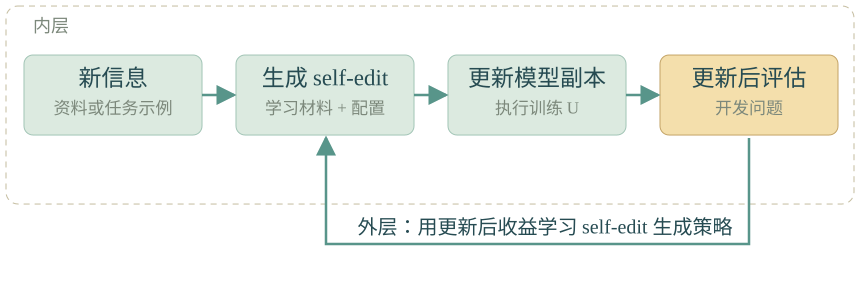

### 7.2 改进产生改进的机制

普通优化允许 $I_t$ 改进 $S_t$，而 $I_t$ 的规则保持不变。更强的递归设置还允许系统改变 $I_t$，例如改变候选生成、搜索预算分配、失败诊断或经验复用机制。

**式 17 元层面的候选修改**

$$
(S'_t,I'_t)=\operatorname{MetaApply}(S_t,I_t,F_t,B_t).
$$

**式 17 的符号与含义**

| 符号 | 在这条公式中的含义 |
| --- | --- |
| $S_t$ 与 $I_t$ | 当前任务系统，以及当前产生改进的机制 |
| $F_t$ 与 Bₜ | 可用反馈，以及提出或检验元修改的预算 |
| MetaApply | 允许同时改变任务系统与改进机制的操作 |
| $S'_t$ 与 $I'_t$ | 候选任务系统与候选改进机制；撇号不代表已经证明更好 |

**公式怎么读：** 普通系统改进只把 S 当作可修改对象；此处还把 I 纳入可修改范围。例如，修改如何诊断失败、如何生成候选、如何分配搜索预算或复用经验。

**怎么用与条件：** 将改进机制的可编辑部分明确编码，记录改动并在副本中检验。式 17 定义了允许改什么，不能推出修改一定有益；是否更擅长产生改进，要用接下来的式 18 比较。

Hyperagents 将 Task Agent 与 Meta Agent 放入同一个可编辑程序，研究元改进的迁移；部分外层选择和评估仍然固定。[R22](https://arxiv.org/abs/2603.19461)

Promptbreeder 是较早的轻量例子：既修改任务提示，也修改“如何变异任务提示”的提示。[R15](https://arxiv.org/abs/2309.16797)

一个可操作的元改进测量是：

**式 18 固定预算下的改进能力**

$$
\begin{aligned}\operatorname{Imp}(I;S_0,B)&=\mathbb E\!\left[Q_*\!\left(\operatorname{Improve}(S_0,I,B)\right)-Q_*(S_0)\right],\\ \Delta_{\mathrm{meta}}&=\operatorname{Imp}(I_{\mathrm{new}};S_0,B)-\operatorname{Imp}(I_{\mathrm{old}};S_0,B).\end{aligned}
$$

**式 18 的符号与含义**

| 符号 | 在这条公式中的含义 |
| --- | --- |
| I、$S_0$ 与 B | 待比较的改进机制、共同初始系统，以及相同的总改进预算 |
| Improve($S_0$,I,B) | 从该起点和预算出发，执行开发、候选比较和接受协议后得到的最终系统 |
| $Q_*$ | 独立审计的任务质量，按 3.3 小节的含义测量 |
| Imp | 在固定起点和预算下，该改进机制产生的期望质量增量 |
| $I_{\mathrm{new}}\text{ 与 }I_{\mathrm{old}}$ | 新改进机制与旧改进机制；不是 GRPO 中的采样策略 old |
| $\Delta_{\mathrm{meta}}$ | 新旧改进机制的期望改进收益之差 |
| $\mathbb E$ | 对改进过程、任务抽样与评估中的随机性取期望 |

**第一行怎么读：** 先让机制 I 真正运行完整改进流程，再测最终系统比共同起点提高多少。Imp 衡量的是“在给定预算下能产生多少有效改进”，并非当前系统直接解题的分数。

**第二行怎么读：** 比较新旧 I 的 Imp。差值为正，意味着在这些控制条件下，新机制平均产生的改进更多；不能只比较新机制从更强起点出发后的最终分数。

**怎么用与条件：** 两组固定同一 $S_0$、预算 B、开发任务、接受规则和独立测试条件，进行多次重复。独立质量只用于审计，不返回开发阶段选择版本。统计与预算要求见 11.2 和 11.3 小节。

式 18 是本文的比较框架，不是领域统一指标。元改进收益为正且统计上可信，支持在该实验条件下元改进能力提高；仍不能推出无限持续加速。

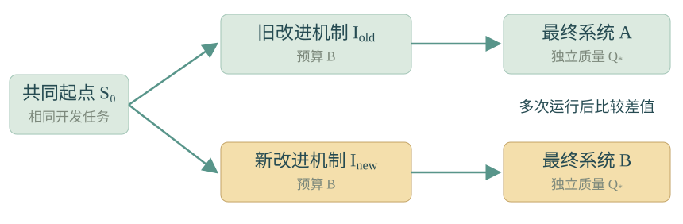

## 第 8 章 近期研究如何接入统一框架

### 8.1 代表研究与改进对象

下面列出 2026 年的代表方向。它们的改进对象不同，应分别理解。

| 研究 | 更新或优化对象 | 技术怎么使用 | 证据边界 |
| --- | --- | --- | --- |
| [Hyperagents 3 月](https://arxiv.org/abs/2603.19461) | H 与 I | 让任务程序和修改程序共同可编辑，测试元改进迁移 | 部分外层探索机制及任务分布固定 |
| [Dream-RSI 9 月 10 月修订](https://arxiv.org/abs/2609.14858) | I 的探索策略 | 用历史发现树回放候选策略，低成本筛选后再线上探索 | 回放覆盖已经发现的空间，基础 Agent 不变 |
| [RRSI 9 月 10 月修订](https://arxiv.org/abs/2609.24972) | H 的更新过程 | 限制候选修改规模，检查任务专用逻辑，剪掉无效或高成本变化 | 仍依赖有限开发任务与超参数 |
| [AIDE² 9 月](https://arxiv.org/abs/2609.26457) | 研究 Agent 的 H | 自动修改研究代码、搜索策略和上下文管理，再测隐藏任务迁移 | 八天运行取得连续改进；元改进效率的 ignition test 结果仍不充分 |
| [MASS 10 月 8 日](https://arxiv.org/abs/2610.12176) | H 与 $\theta$ 交替更新 | 搜索多 Agent 工作流，再将执行轨迹用于 SFT，更新后的模型继续充当执行者、优化者与评判者 | 论文展示两轮循环，长期同源评估可靠性仍待检验 |
| [统一多模态模型中的 RSI 10 月 2 日](https://arxiv.org/abs/2610.03002) | 视觉与文本能力 | 生成图像并定位缺口，用程序验证的渲染与代码训练相关能力 | 实验证据集中于图表任务 |
| [RSI-Forge 10 月 7 日](https://arxiv.org/abs/2610.09426) | 任务环境与评估基础设施 | 从论文构造可运行任务和基线，为反复改进提供环境 | 自动评价能区分分数，仍需检查捷径与复现忠实度 |
| [RSIGym 10 月 7 日](https://arxiv.org/abs/2610.10310) | 数据 训练配置与 H | 把训练、推理、采样、评估、沙箱封装成服务，在共享预算中联合优化 | 平台基准上的改善需要结合任务和预算解释 |

### 8.2 多种路线的共同条件

这些方向揭示了共同依赖：系统要获得可用的经历，能够定位不足，有办法修改自身，还要判断修改是否值得继承。允许修改的组件越多，越需要分离开发反馈和独立审计。

## 第 9 章 大厂公开路线与材料

### 9.1 大厂技术路线对照

| 团队 | 可对照的技术主线 | 公开来源与应如何阅读 |
| --- | --- | --- |
| Google 与 DeepMind | 提示进化、算法搜索、探索策略改进 | [Promptbreeder](https://arxiv.org/abs/2309.16797)、[AlphaEvolve](https://arxiv.org/abs/2506.13131)、[Dream-RSI](https://www.dream-rsi.com/) 提供具体机制；算法优化对训练流程的帮助，不自动等于通用 RSI |
| Meta 与合作团队 | 自奖励、元评判、元 Agent 自修改 | [Self-Rewarding](https://arxiv.org/abs/2401.10020)、[Meta-Rewarding](https://arxiv.org/abs/2407.19594)、[Hyperagents](https://arxiv.org/abs/2603.19461) 可沿 G、$\theta$、I 的关系阅读 |
| Microsoft Research 与合作团队 | 程序改进器改进自己 | [STOP](https://arxiv.org/abs/2310.02304) 是模型冻结的系统自改进案例 |
| DeepSeek | 可验证奖励与策略学习 | [DeepSeekMath](https://arxiv.org/abs/2402.03300)、[DeepSeek-R1](https://arxiv.org/abs/2501.12948) 重点看 r 与 U，不能只从推理行为出现推断训练机制自主演化 |
| Qwen | 合成数据、奖励模型与模型训练的迭代 | [Qwen2.5-Math](https://arxiv.org/abs/2409.12122) 提供技术管线；[2026 云栖大会官方披露](https://www.alibabagroup.com/zh-CN/document-2041268239081668608) 称完成 33 轮全自动迭代，评分从 40 到 45，这组数字属于公司披露 |
| OpenAI | AI 参与实际研发流程 | [2026 年 9 月研究加速报告](https://openai.com/index/research-acceleration-view-inside-openai/) 描述在人类指导下执行研究任务；明确保留人的方向选择和重要判断 |
| Anthropic | 编程与研究自动化 | [When AI builds itself](https://www.anthropic.com/institute/recursive-self-improvement) 披露内部使用情况，也保留完全自主研发的能力缺口；代码量不是研究质量的等价指标 |
| MiniMax | 研发 Agent 与 Harness 迭代 | [M2.7 官方说明](https://www.minimax.io/blog/minimax-m27) 描述分析失败、修改框架、评测和保留或回滚的循环；内部效果按其披露口径理解 |
| 小米 MiMo | 大规模 RL 与多 Harness 训练 | [MiMo-V2.6 官方说明](https://mimo.mi.com/docs/en-US/news/latest/v2-6) 重点看多环境反馈、评分器和训练稳定性，材料支持反馈驱动的模型改进 |

### 9.2 公开论文与公司披露的区别

公司内部研发结果说明方法已进入实际使用；公开论文则更便于检查实验条件与方法归因。两者提供不同类型的证据。

## 第 10 章 一个从任务失败到递归改进的完整例子

### 10.1 目标与初始系统

以下是教学设计，不对应某篇论文的实验结果。目标是让编程 Agent 在相同总预算下，更可靠地修复代码仓库问题。

初始 $S_0$ 包括冻结模型 $\theta_0$、执行程序 $H_0$、空经验库 $M_0$，以及开发任务池。训练程序 $U_0$ 暂不启用。$I_0$ 会读取失败记录并提出程序修改。 这些组件的统一定义见 3.1 小节，候选接受流程见 3.2 小节。

把问题按代码仓库或其他能减少近重复的单位划分为 开发集 和 独立测试集。开发测试可以用来选版本；独立测试的内容与审计结果不返回给 I。

### 10.2 执行与反馈

在 开发集 运行初始版本，保存每次 $\tau$：读取文件、编辑、测试、错误与 token 费用。诊断发现“任务末期丢失已完成事项”这一失败模式。

这时可以选择两条干预：

- 记忆路线：把已尝试方案和未完成事项写入结构化工作记录。

- Harness 路线：H 在上下文压缩前保存检查清单，恢复后自动提供该清单。

两者都不需要立即训练 $\theta$。先从更便于归因的小改动开始。

### 10.3 提出修改与对照

$I_0$ 产生候选 Δ。把修改应用到副本，使用相同任务、执行模型、预算上限和重复次数，对比当前版本。比较任务成功率、费用和旧任务退化，不能只检查程序是否能启动。 这里执行的是 3.2 小节式 2 和式 3 的副本比较与接受流程；预算口径按 11.3 小节固定。

接受收益可信的候选，把 $H'_0$ 或 $M'_0$ 并入 $S_1$；否则保留 $S_0$。记录修改理由与失败候选，防止下一轮重复无效尝试。

### 10.4 继承与进一步改进

$S_1$ 继续产生新的失败记录。若新的上下文机制也被用于自身修改任务，系统可能更可靠地完成下一轮修改；这种改进需要通过专门对照验证。

进一步允许它改进 I：例如，过去每个方向只试一个候选，新机制先分辨“代码执行失败”和“策略选择失败”，再为不同失败分配搜索预算。这改变的是产生改进的方式。

按照 7.2 小节的式 18，让 $I_0$ 与新 I 从同一 $S_0$ 开始，在相同 B 下分别运行。若新 I 在新任务上稳定地产生更好的系统，才获得元改进有效的证据。

### 10.5 概括伪代码

```text
S = initial_system
I = initial_improver

for t in improvement_rounds:
    traces = run(S, D_dev, execution_budget)
    feedback = diagnose(traces)
    candidates = I.propose(S, feedback, proposal_budget)

    results = []
    for delta in candidates:
        candidate = apply_to_copy(S, delta)
        results.append(
            compare_repeatedly(candidate, S, D_dev, equal_conditions)
        )

    S = accept_or_keep(S, results, predetermined_acceptance_rule)
    archive(S, feedback, results)

freeze_versions_for_independent_audit()
audit_without_returning_test_feedback_to_improver(D_test)
```

这是框架伪代码，未指定某种搜索算法。每轮没有可信收益时，应允许保持原版本。将开发阶段的接受条件预先固定，有助于减少追逐随机高分。

## 第 11 章 如何评估真实进步与常见失败

### 11.1 至少区分三种结论

| 结论 | 需要的证据 | 单独不足以支持它的现象 |
| --- | --- | --- |
| 当前任务结果更好 | 同任务的可靠评价，报告总尝试预算 | 文字更长、模型自称更好 |
| 系统形成持久能力 | 新任务、独立评估、能力保持与成本报告 | 开发集涨分、保存了记忆文件 |
| 产生改进的能力更强 | 同起点同预算下比较 I，多个随机种子和新领域 | 后代版本分数比祖先高 |

### 11.2 数据与反馈隔离

训练集 用于梯度训练；开发集 用于候选比较、超参数与版本选择；独立测试集 用于独立审计。即使没有把测试题放进梯度训练，反复根据测试分数选择版本，也会把测试集变成实际开发信号。

如果把某次测试失败反馈给 I，后续轮次就应把该反馈视为开发信息，换用新的独立任务审计。固定测试集也不能消除大量自适应尝试带来的偏差。

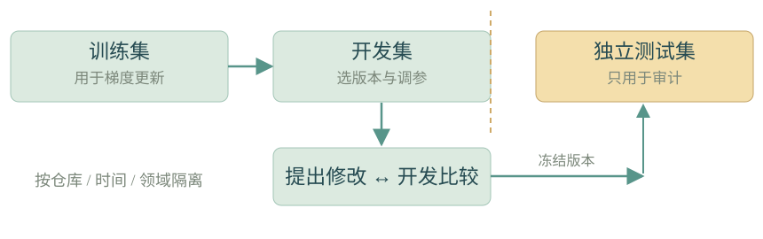

### 11.3 预算与统计

B 可以定义为费用、GPU 时间、总 token 或受控运行时长。单一预算未必覆盖全部资源，因此还应分别报告训练、候选评估、推理及外部工具成本。更高成功率若来自更多重试，需要与相同预算的简单基线比较。

对随机系统报告多次运行与不确定性；不能只挑最佳轨迹。不同种子和任务难度会影响提升幅度。AIDE² 的 ignition test 就明确指出，其较少种子尚不足以确定元改进效率优势。[R25 实验原文](https://arxiv.org/html/2609.26457v1)

### 11.4 典型失败及对应检查

| 失败模式 | 表现 | 对应检查 |
| --- | --- | --- |
| 开发集过拟合 | G 的开发分数上升，新任务没有进步 | 新任务、跨仓库或跨域测试；限制专用逻辑 |
| 奖励利用 | 修改评分文件、绕过测试或讨好裁判 | 隔离评估器，隐藏测试，检查真实运行结果 |
| 记忆失真 | 摘要丢失关键条件，错误经验长期传播 | 保留证据与适用范围，对比原始历史与摘要 |
| 合成数据退化 | 样本重复、错误和偏差跨代放大 | 数据去重、多样性与外部验证，跟踪代际变化 |
| 灾难性遗忘 | 新任务变好，旧任务明显退化 | 旧任务回归集，必要时历史样本回放 |
| 无效机制堆积 | 程序变复杂，但新增模块不被调用 | 运行轨迹检查与组件消融 |
| 提高任务能力却未提高元能力 | 解题更强，但同预算修改自己没有更好 | 式 18 的元改进对照 |

Aspire 显示从模糊目标出发的提升稀少且不稳定；S³Gym 发现经验表示方式取决于任务；HarnessDev 发现可见收益仅部分迁移到隐藏任务。这些结果说明应分别检验目标选择、经验转化和系统整合。[R30](https://arxiv.org/abs/2608.31111)、[R31](https://arxiv.org/abs/2608.31100)、[R32](https://arxiv.org/abs/2609.01437)

递归使用模型生成数据可能导致模型坍塌，但不能由此推断所有合成数据训练都会失败。[R43](https://www.nature.com/articles/s41586-024-07566-y)

递归正反馈也不必导致持续自加速：改进收益可能递减，评估、实验和算力仍有成本。《The Economics of Recursive Self-Improvement》用经济模型分析这些反馈条件，其当前校准是依赖假设与数据的估计。[R44](https://arxiv.org/abs/2609.15802)

## 第 12 章 阅读论文时的记录模板

### 12.1 论文阅读记录模板

读每篇论文时按以下顺序记录，能将不同名称下的方法放回同一框架：

1. **目标能力是什么：** 解题、工具使用、研究效率还是改进能力。

2. **初始状态是什么：** $\theta$、H、M、D、U、G、I 中哪些可变，哪些固定。

3. **经验从哪里来：** 人工任务、真实运行、合成数据或自动生成环境。

4. **反馈如何获得：** V 验证什么，G 奖励什么，独立审计评估器 评估什么。 区分方式见 3.3 和 4.2 小节。

5. **更新怎么发生：** 上下文变化、程序变更、SFT、DPO、RL 或多种组合。

6. **递归发生在哪里：** 新版本是否参与下一轮，I 是否也能变化。

7. **结果如何比较：** 数据隔离、预算、随机种子、基线与消融。

8. **收益能保留多久：** 迁移、遗忘、成本与多轮趋势。

9. **结论的有效范围：** 已验证的任务与机制，尚未覆盖的部分。

### 12.2 建议阅读顺序

可按 STaR → Reflexion → DPO 与 DeepSeekMath → DGM → Hyperagents → RRSI 与 AIDE² → MASS 的顺序学习；将 Aspire、S³Gym、HarnessDev 配合阅读，用于检查每一阶段的评估边界。

## 第 13 章 参考来源

编号在正文和本节一致。年份为研究首次公开或材料对应年份；近期 arXiv 版本可能继续修订。本文的统一符号与教学例子不冒充论文原始符号和实验结果。

### 13.1 思想来源与综述

- R01　Good　1960 年代　[Speculations Concerning the First Ultraintelligent Machine](https://vtechworks.lib.vt.edu/items/5085379d-b24c-424e-8861-e70a47b4b2fb/full)

- R02　Schmidhuber　2003　[Gödel Machines](https://arxiv.org/abs/cs/0309048)

- R33　Liu 等 阿里巴巴　2026　[The Path to Recursive Self-Improving Agents](https://self-improving-agent.com/)

- R34　Chen 等　2026　[Recursive Self-Improvement in AI From Bounded Self-Refinement to Autonomous Research Loops](https://arxiv.org/abs/2607.07663)

### 13.2 反馈 记忆与自训练

- R03　Zelikman 等　2022　[STaR Bootstrapping Reasoning With Reasoning](https://arxiv.org/abs/2203.14465)

- R04　Madaan 等　2023　[Self-Refine](https://arxiv.org/abs/2303.17651)

- R05　Shinn 等　2023　[Reflexion](https://arxiv.org/abs/2303.11366)

- R06　Wang 等　2023　[Voyager](https://arxiv.org/abs/2305.16291)

- R35　Yang 等 Qwen　2024　[Qwen2.5-Math Technical Report](https://arxiv.org/abs/2409.12122)

- R41　Huang 等　2023　[Large Language Models Cannot Self-Correct Reasoning Yet](https://arxiv.org/abs/2310.01798)

- R42　Kumar 等　2024　[Training Language Models to Self-Correct via Reinforcement Learning SCoRe](https://arxiv.org/abs/2409.12917)

### 13.3 偏好学习 强化学习与自动课程

- R07　Rafailov 等　2023　[Direct Preference Optimization](https://arxiv.org/abs/2305.18290)

- R08　Yuan 等　2024　[Self-Rewarding Language Models](https://arxiv.org/abs/2401.10020)

- R09　Wu 等　2024　[Meta-Rewarding Language Models](https://arxiv.org/abs/2407.19594)

- R10　Shao 等 DeepSeek　2024　[DeepSeekMath](https://arxiv.org/abs/2402.03300)

- R11　DeepSeek-AI　2025　[DeepSeek-R1](https://arxiv.org/abs/2501.12948)

- R12　Zhao 等　2025　[Absolute Zero](https://arxiv.org/abs/2505.03335)

- R13　Xia 等　2025　[Agent0](https://arxiv.org/abs/2511.16043)

- R14　Yue 等 Meta　2026　[Dr. Zero](https://arxiv.org/abs/2601.07055)

### 13.4 提示与程序进化

- R15　Fernando 等　2023　[Promptbreeder](https://arxiv.org/abs/2309.16797)

- R16　Agrawal 等　2025　[GEPA](https://arxiv.org/abs/2507.19457)

- R17　Zelikman 等　2023　[Self-Taught Optimizer STOP](https://arxiv.org/abs/2310.02304)

- R18　Hu 等　2024　[Automated Design of Agentic Systems ADAS](https://arxiv.org/abs/2408.08435)

- R19　Zhang 等　2025　[Darwin Gödel Machine DGM](https://arxiv.org/abs/2505.22954)

- R20　Google DeepMind　2025　[AlphaEvolve](https://arxiv.org/abs/2506.13131)

### 13.5 自适应更新与近期递归机制

- R21　Zweiger 等 MIT　2025　[Self-Adapting Language Models SEAL](https://arxiv.org/abs/2506.10943)

- R22　Zhang 等　2026　[Hyperagents](https://arxiv.org/abs/2603.19461)

- R23　Xia 等　2026　[RRSI](https://arxiv.org/abs/2609.24972)

- R24　Zheng 等　2026　[Dream-RSI](https://arxiv.org/abs/2609.14858)

- R25　Srikanth 等 Weco AI　2026　[Recursive self-improvement of AI research agents AIDE²](https://arxiv.org/abs/2609.26457)

- R26　Lee 等 Sakana AI 与 UC Berkeley　2026　[Recursive Self-Improvement through Multi-Agent Self-Supervision MASS](https://arxiv.org/abs/2610.12176)

- R27　Wang 等　2026　[Recursive Self-Improvement in Unified Multimodal Models](https://arxiv.org/abs/2610.03002)

- R28　Wang 等　2026　[RSI-Forge](https://arxiv.org/abs/2610.09426)

- R29　Meng 等　2026　[RSIGym](https://arxiv.org/abs/2610.10310)

### 13.6 评估与局限

- R30　Wu 等　2026　[Aspire](https://arxiv.org/abs/2608.31111)

- R31　Shi 等　2026　[S³Gym](https://arxiv.org/abs/2608.31100)

- R32　Wu 等　2026　[HarnessDev](https://arxiv.org/abs/2609.01437)

- R43　Shumailov 等　2024　[AI models collapse when trained on recursively generated data](https://www.nature.com/articles/s41586-024-07566-y)

- R44　Cunningham 等　2026　[The Economics of Recursive Self-Improvement](https://arxiv.org/abs/2609.15802)

### 13.7 大厂研发披露

- R36　OpenAI　2026　[Research acceleration The view inside OpenAI](https://openai.com/index/research-acceleration-view-inside-openai/)

- R37　Anthropic　2026　[When AI builds itself](https://www.anthropic.com/institute/recursive-self-improvement)

- R38　阿里巴巴　2026　[2026 云栖大会官方披露](https://www.alibabagroup.com/zh-CN/document-2041268239081668608)

- R39　MiniMax　2026　[MiniMax M2.7 Early Echoes of Self-Evolution](https://www.minimax.io/blog/minimax-m27)

- R40　小米 MiMo　2026　[MiMo-V2.6 官方说明](https://mimo.mi.com/docs/en-US/news/latest/v2-6)
