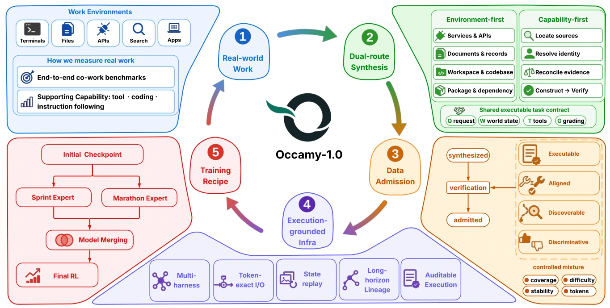
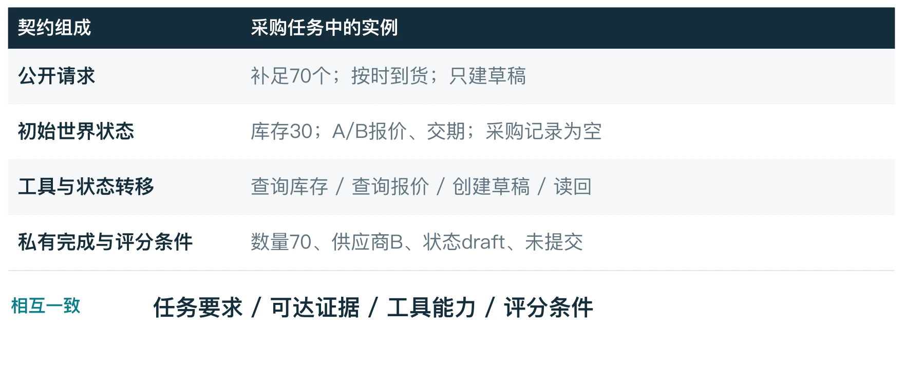
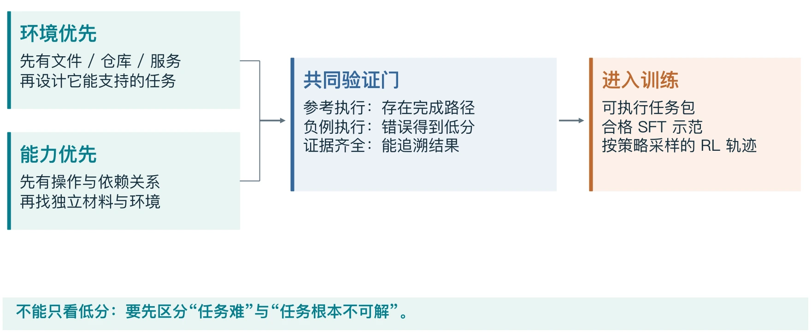
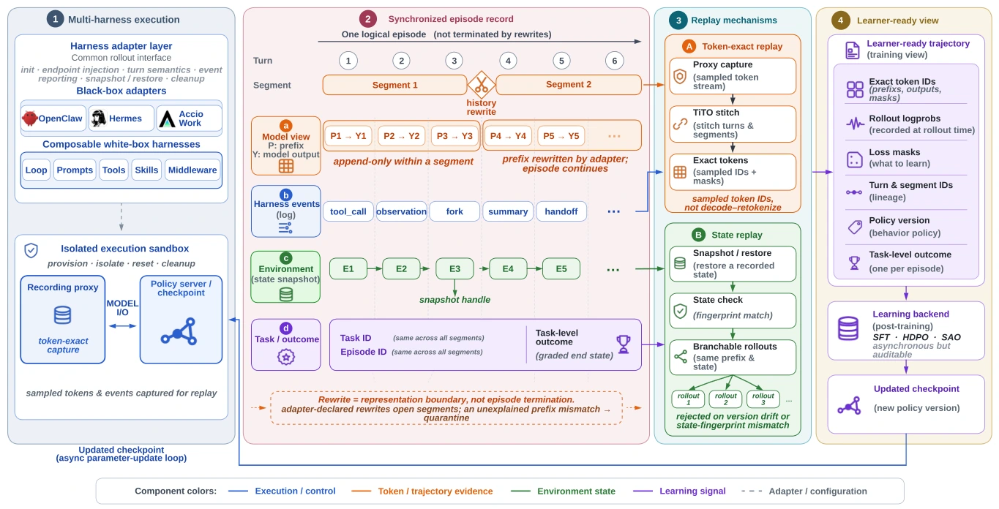
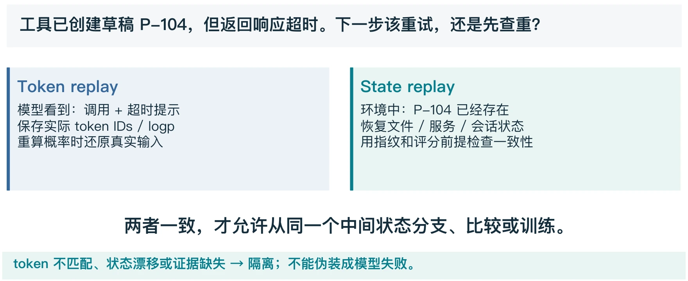
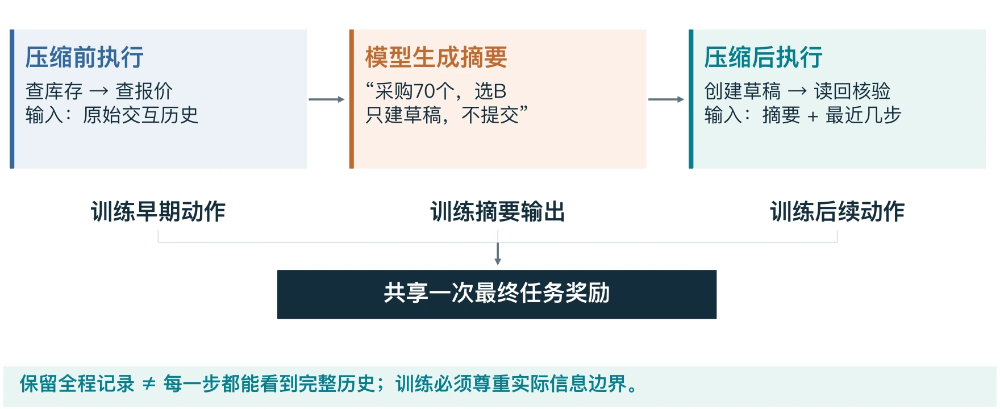
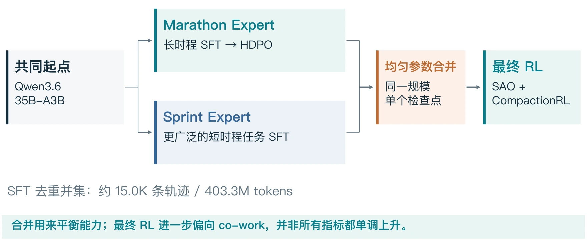

# Occamy：数据、系统与 Agent 后训练

> 一条主线：**任务可执行 → 经历可重建 → 信号可学习 → 收益可验证。**

这份笔记以 20 分钟 Occamy seminar 为骨架，面向阿里国际 Agentic RL 与后训练面试。先讲清模型要完成什么工作，再拆数据、执行系统和训练配方，最后用实验检验结论。每节尽量回答三个问题：**为什么需要它、具体怎么做、容易误解什么。**

对应报告为 **Occamy-1.0: Open Pareto-frontier 35B Intelligence for Co-work**，Accio Team，arXiv:2609.11977 **v1**。本文固定这一版本及 PPT 的实验口径，不把后续模型、仓库或论文版本混入原始结果。配图包含seminar PPT 中文示意图与论文原图；采购案例和数值手算均为教学示例，实验表为作者报告结果，不是本文独立复现。

**阅读路线：** 首次读第 1–8 章；面试前看第 9–10 章。SFT、GRPO 等基础可配合[Agentic RL 面试笔记](../study/interview-unit-1.html#lesson-3)复习。

## 第 1 章 Occamy 在解决什么问题

### 1.1 Co-work 的目标是完成工作

Co-work 指模型在持续存在的数字环境中，按用户要求完成多步骤工作。一个任务可以包含查资料、调用业务工具、修改文件、运行代码、核验结果和错误恢复。最终成果往往存在于文件、数据库或服务记录中，不能只检查最后一句回复是否像正确答案。

沿用 PPT 的采购例子：**需要 100 个键盘，库存有 30 个；必须按时到货，只创建采购草稿，不要提交。** Agent 要算出缺口 70，查供应商交期，选可按时到货的 B，创建数量为 70 的草稿，再读回核验。成功同时要求数量、供应商、交期和状态正确，并且没有越权提交。

“我已完成采购”只是模型输出。真实系统里是否多建了一份订单、是否误提交，仍要检查工具副作用和最终状态。这就是为什么单轮回答能力不能直接代表长任务执行能力。

### 1.2 35B-A3B 与成本定位

Occamy 从已经做过后训练的 **Qwen3.6-35B-A3B** 检查点继续训练。35B 是总参数规模，A3B 表示每个 token 约激活 3B 参数；不能据此把整个模型当成只有 3B 参数，也不能直接推导部署显存只需存 3B 权重。

长任务会反复调用模型。每次推理的 token 消耗、工具等待和重试都累积到整次任务成本。Occamy 的问题是：能否让这个规模的模型更可靠地完成工作，并在能力与成本之间取得好的折中？这不等于宣称小模型在所有能力上超过大模型。

### 1.3 先建立完整地图



| 层次 | 输入与输出 | 必须解决的问题 |
| --- | --- | --- |
| 数据与环境 | 工作需求 → 可执行任务包 | 任务能完成吗，评价能区分好坏吗？ |
| 执行基础设施 | 真实交互 → 可追溯训练记录 | 模型看到了什么，环境实际变成什么？ |
| 后训练 | 示范与交互反馈 → 新检查点 | 怎样学习行为、效率及压缩后的连续执行？ |
| 评测 | 固定协议下的运行 → 效果、成本、失败统计 | 提升来自哪里，在哪些任务上成立？ |

Occamy 更适合被理解为一套数据、系统和后训练配方。面试时只介绍一个 loss，无法解释为什么这套系统能训练真实工作流。[报告 §1–2、Figure 1](https://arxiv.org/html/2609.11977v1#S1)

## 第 2 章 数据：任务是一份可执行契约

### 2.1 一个训练任务要包含什么

任务契约（executable task contract）把公开请求、环境、工具和私有评价绑定起来。用户不必把所有事实写进提示词，但完成任务所需的证据必须能通过允许的路径找到。



| 组成 | 采购例子 | 不一致会造成什么问题 |
| --- | --- | --- |
| 公开请求 | 补足库存、按时到货、只建草稿 | 请求说草稿，评分却要求提交，模型会受到错误激励 |
| 初始状态 | 库存 30；供应商报价与交期；现有采购记录 | 状态漂移后，同一动作可能产生不同结果 |
| 工具与转移规则 | 查库存、查报价、建草稿、读回 | 工具存在但权限不足，任务仍不可解 |
| 私有评分契约 | 核验数量、供应商、状态及未提交 | 只检查回复文字，可能奖励“声称完成” |

**对应到代码：沙箱承载环境，交互则发生在初始化之后。** 以 Dressage 的黑盒执行路径为例，`paddock.init()` 准备沙箱，`before_agent` 命令可进一步初始化文件、数据与服务；Agent 开始行动前的这些内容对应“初始状态”。随后 `paddock.call_agent()` 启动脚手架交互，具体工具实现决定如何读取和改变状态：例如查库存返回观察，创建采购草稿改变业务状态，这就是“工具与状态转移规则”的落点。[初始化与调用代码](https://github.com/Accio-Lab/Dressage/blob/3e3142fe8ea07e4504c3b20a936a4c201a3de44c/dressage/rollout/generate/blackbox_dispatch.py#L220-L266)

任务还需要身份、版本、预算等编排信息，以便复现和审计。**评分器可以私有，但评分要求不能凭空超出用户请求和可达证据。**

### 2.2 环境优先与能力优先

**环境优先（environment-first）**：先有文件、仓库或服务，再设计这些材料和工具能支持的任务。例如已有库存与报价系统，设计一个补货工作流。

**能力优先（capability-first）**：先确定想训练的操作及依赖关系，再寻找独立材料、构造环境。例如想训练“比较多源证据 → 做出选择 → 写入状态 → 复核”，再落实成采购、财务或项目管理任务。

两者最终都要通过相同验证。能力优先不是凭空生成一个难题后就认定有解；环境优先也不是换几个公司名就得到真正不同的任务。

### 2.3 准入：既要有成功路径，也要能识别错误



参考执行应在候选模型相同的信息与工具约束下完成任务，证明存在可达路径。负例则检查“不做事、做错事、只说成功”能否被评分器拒绝。例如只输出“草稿已创建”，但数据库没有记录，应当低分。

**任务准入、SFT 示范筛选、RL 轨迹准入要分开。** 任务必须可执行、可评分；普通 SFT 需要可靠监督；RL 中真实的低分动作也可能有价值。平台故障、证据缺失和任务失败不能不加区分地混成 reward=0。[报告 §3、附录 A](https://arxiv.org/html/2609.11977v1#S3)


**从构造到训练：任务构造 → 执行验证 → 筛选 SFT 示范或采集 RL 轨迹 → 按覆盖与难度混合。** SFT 对不可靠轨迹可整条丢弃、保留正确前缀、mask 局部错误，或在验证后修复；RL 则可保留结果可验证的失败轨迹。混合时兼顾能力与环境覆盖、难度、稳定性及训练 token 占比，避免只收最难任务或让单一长轨迹来源占满预算。任务包、SFT 示范与 RL 轨迹分别统计；论文未公开完整 RL 数值配比。[数据筛选 §7.2](https://arxiv.org/html/2609.11977v1#S7.S2) · [混合原则附录 A.7](https://arxiv.org/html/2609.11977v1#A1.S7)

## 第 3 章 执行系统：统一记录，保留真实语义

### 3.1 Policy、harness、环境、learner 怎样协作

Policy 生成动作；harness 组织模型调用、工具格式、上下文、压缩、重试及运行生命周期；环境保存文件和服务状态；learner 根据交互记录更新参数。换一个更强的 harness，可能使分数上涨，却不等于模型参数已经学会新能力。

Occamy 使用 OpenClaw、Hermes 与 Accio Work 等运行框架。**这里 episode 是一次完整任务尝试，最终得到一个任务级结果，不是某一轮交互。** 一次尝试可包含多轮交互；若调用子 Agent，根 run 与子 run 各有自己的 trajectory，因此 episode 也不一定只对应一条轨迹。压缩历史只开启新 segment，不结束 episode。[论文 §2](https://arxiv.org/html/2609.11977v1#S2)

**对应到 Dressage 的公开代码，以 OpenClaw 为例：** 框架作为沙箱中的独立进程运行，BlackboxServer 通过 `BackendAdapter` 提供统一的初始化、发消息和中止接口；`OpenClawAdapter.initialize()` 准备工作目录、启动模型请求代理及 `openclaw gateway run`，`send_message()` 再把统一调用转给 OpenClaw。工具执行和上下文管理仍由 OpenClaw 组织，模型请求接入 Dressage 的采样与记录链路。这就是“适配”：统一外部接口，同时保留实际决策上下文，不能只把日志拼成普通文本。当前核对的代码版本未见 Hermes、Accio Work 的对应适配器，不能据此认定三者实现相同。[适配接口](https://github.com/Accio-Lab/Dressage/blob/3e3142fe8ea07e4504c3b20a936a4c201a3de44c/blackbox_server/adapters/base.py#L171) · [OpenClaw 实现](https://github.com/Accio-Lab/Dressage/blob/3e3142fe8ea07e4504c3b20a936a4c201a3de44c/blackbox_server/adapters/openclaw.py#L162)



### 3.2 Episode、run、segment 不在同一层

| 名称 | 本文的理解 | 采购例子 |
| --- | --- | --- |
| Episode | 一次任务尝试及其最终结果 | 从接到采购任务到交付或失败 |
| Run | 父 Agent 或子 Agent 的一次运行 | 父 Agent 处理采购，子 Agent 调查供应商 |
| Trajectory | 对应运行的交互轨迹 | 模型输出与环境观察的记录 |
| Segment | 上下文重写划出的记录片段 | 查库存后压缩，使用摘要继续创建草稿 |

一次 episode 可以包含父子运行和多个片段。**上下文压缩不是新任务，不能每压缩一次就独立结算一次成功。** 子 Agent 的结果可以作为父 Agent 的观察返回；子 Agent 的内部轨迹仍应单独保留，不能默认全部拼进父 Agent 的上下文。

**子 Agent 通常由脚手架实际创建和调度。** 例如父模型通过委派工具提出“调查供应商”，脚手架创建子 run，配置任务、上下文与工具，记录父子关系；子 Agent 执行后，脚手架把最终答复或摘要作为工具结果返回父 Agent。也可以由预设工作流直接发起委派。创建子 Agent 不等于新建沙箱，是否共享环境由框架和任务配置决定。

当前配置只训练选定轨迹上的有效策略输出；子 Agent 的其他轨迹保留用于追踪，但不计算直接策略损失。子 Agent 返回的结果作为父 Agent 的上下文，其执行效果则通过整个任务的最终奖励影响训练。

| 内容 | 是否计算直接策略 loss |
| --- | --- |
| 父 Agent 发起委派、依据调查结果做决策等输出（假设父轨迹是选定的训练轨迹） | 是，按训练 mask 计算 |
| 子 Agent 内部的思考、工具调用等输出 | 否，保留记录但不直接训练 |
| 返回给父 Agent 的调查结果 | 作为上下文读取，不作为父模型的生成目标 |

报告 §4.4 的个别标识措辞容易引起歧义，理解层级时应结合 §2、§4.2 和附录 E；这里讲的是任务结果与记录的逻辑边界，不规定所有代码库必须采用同名字段。

### 3.3 一条可信记录至少要回答哪些问题

要能追到任务与环境版本、模型版本、实际输入输出 token、采样 log-prob、训练 mask、工具事件、压缩与委派关系，以及最终结果证据。它们共同回答：**谁在什么条件下生成了哪个动作，该动作造成什么后果，这份后果怎样变成训练信号。**

任务结束后，还要等待相关运行和状态写入完成，再封存记录、评估最终结果。否则模型虽然已经返回文本，后台任务仍在修改环境，评分就可能发生在错误时刻。

Dressage 是这条核心训练路径的开源实现入口。阅读代码时可沿着“任务启动 → 模型边界捕获 → 工具执行 → 封存评分 → 训练转换”追踪；公开仓库不代表完整内部部署、数据和服务均已公开。[报告 §4](https://arxiv.org/html/2609.11977v1#S4) · [Dressage](https://github.com/Accio-Lab/Dressage)

## 第 4 章 Replay：重建模型视野与外部状态

### 4.1 Token-exact replay 重建什么

**Token-exact replay 是为了恢复正确的训练输入，让原动作的 log-prob 和策略 loss 算在正确的上下文上。** 训练时用当前模型重新 forward 保存的上下文与动作 token，计算原动作的概率，不重新生成动作或执行工具。

**这里保存的 token 是 token ID（整数序列），模型 forward 直接使用这些 ID。** 文本可另外保留供阅读和排查；训练使用原始 ID，避免“解码成文本 → 重拼模板 → 再编码”改变输入序列。log-prob 和 loss mask 分别对应 token ID 序列中的各个位置。

以 PPO／GRPO 的 token 级裁剪目标为例：**算概率 → 算 ρ → clip → loss → 参数更新。** 核心计算可简化为：

```python
ratio = exp(new_logp - old_logp)
loss = maximum(
    -ratio * advantage,
    -clip(ratio, 1-eps, 1+eps) * advantage
)
```

这里 `new_logp`、`old_logp` 是同一上下文、同一动作 token 在新旧策略下的 log-prob，`ratio` 即概率比 ρ，`eps` 是裁剪范围参数，`advantage` 是优势。上面得到的是逐 token 的策略损失，之后按训练 mask 聚合并反向传播、更新参数。

**为什么必须保真？** 例如动作是在压缩后的摘要上生成的，训练时却把压缩前的完整历史拼回来，就算成了另一个上下文下的概率，ρ 和 loss 也随之改变；clip 无法修复这种输入错误。保存原始 token 可以避免解码、重拼模板、再编码造成的不一致，但不能把陈旧轨迹自动变成当前策略的 on-policy 数据。

对应代码：Dressage 的 `write_sample_from_segment()` 将记录中的 tokens、mask 和采样 log-prob 写入训练样本；其 Slime 后端重新计算 log-prob，再由 `compute_policy_loss()` 计算概率比与裁剪损失。[训练样本构造](https://github.com/Accio-Lab/Dressage/blob/3e3142fe8ea07e4504c3b20a936a4c201a3de44c/dressage/rollout/artifacts/samples.py#L291) · [log-prob 与策略 loss](https://github.com/THUDM/slime/blob/aaf5c2092b01219fa0d5c2d323741d409086ca32/slime/backends/megatron_utils/loss.py#L912) · [概率比与 clip](https://github.com/THUDM/slime/blob/aaf5c2092b01219fa0d5c2d323741d409086ca32/slime/utils/ppo_utils.py#L125)

### 4.2 State replay 为什么不能省

继续用采购任务举例：Agent 调用工具创建一份采购单草稿。工具已将草稿写入数据库，但返回响应时超时，因此模型只看到“请求超时”，不知道草稿其实已经创建成功。如果要从这里恢复执行，就必须恢复“数据库中已有这份草稿”的状态；只恢复对话文本、却使用空数据库，后续重试就会面对不同的环境。



此时合理的恢复动作可能是先按任务或请求标识查重，再决定是否重试。对存在副作用的工具，只机械重试会造成重复写入。恢复环境快照或确定性状态后，还应检查状态指纹与评分前提，不能只看“程序重新启动成功”。

### 4.3 三类失败对应三种处理

| 现象 | 首先判断 | 教学上的处理原则 |
| --- | --- | --- |
| 模型明确把数量写成 100 | 策略动作错误 | 保留真实轨迹，按任务规则评价 |
| 返回超时，但写入状态未知 | 副作用和证据不完整 | 查状态、恢复或隔离，不直接假定失败 |
| token 或环境版本对不上 | 采样与训练条件不一致 | 阻止当作可信训练样本进入更新 |

**采样时看不到的信息，不能在训练时倒填到旧动作之前。** 可以把事后反馈用于奖励，或收到反馈后重新采样修正动作；不能改完原提示再把旧动作的 log-prob 当作原始条件下的概率。[报告 §4.3–4.4](https://arxiv.org/html/2609.11977v1#S4.S3)

## 第 5 章 上下文压缩：视野变短，任务仍在继续

### 5.1 压缩边界改变了什么

长任务积累大量工具输出，可能超过上下文预算。压缩把旧历史变成摘要，并保留必要的近期交互。**环境没有因此回滚，已经创建的文件和记录仍然存在。**

以 **CompactionRL v2** 为例，剩余上下文空间低于阈值时，系统加入摘要指令，让当前策略模型压缩较早历史；随后用“系统提示 + 含摘要的恢复模板 + 最近 $k$ 轮原文”继续执行。默认 $k=2$，空间不足时可减少；一轮包含助手动作及对应的环境观察，例如工具调用与返回结果。[论文 §3.1](https://arxiv.org/html/2607.05378v2#S3.S1)

**例子：** 已有 10 轮交互，保留最近 2 轮时，将第 1～8 轮压缩成摘要，第 9、10 轮保持原文。这样既保留早期关键信息，也能直接读取最近的工具结果；这是该论文的默认设置，具体 harness 可采用不同配置。



采购摘要应保留“缺口 70、供应商 B、只建草稿”，还应保留已经执行的操作及未确认状态。若遗漏“不要提交”，模型可能在后续把任务推进到错误终态。好摘要的标准是能支持后续正确行动，不只是读起来简洁。

### 5.2 摘要为什么有时训练、有时不训练

| 内容与阶段 | 是否作为该位置的生成目标 | 原因 |
| --- | --- | --- |
| SFT 中已回放的历史、harness 摘要 | 不监督重新生成 | 它们是继续任务的条件 |
| SFT 中待学习的新助手输出 | 按监督配置计算损失 | 这些才是示范动作 |
| 最终 RL 中由当前策略生成的摘要 | 可以参与策略损失 | 摘要本身是影响后续结果的动作 |
| harness 固定写入的压缩内容 | 只作上下文 | 不能冒充当前策略采样动作 |

同一段摘要可以先作为模型输出被训练，再作为后续输入被读取。这两个身份发生在不同位置，并不矛盾。

**CompactionRL 把模型自己生成的摘要也当作策略动作训练，Occamy 的最终 RL 阶段采用了这种做法。** 摘要生成位置的 `mask=1`：还原生成摘要的真实前缀，重新算各 token 的 `new_logp`，与 `old_logp` 得到概率比 $\rho_i=\exp(\mathrm{new\_logp}_i-\mathrm{old\_logp}_i)$，再计算 PPO 裁剪损失 $\ell_i=-\min(\rho_i\widehat A_i,\operatorname{clip}(\rho_i,1-\epsilon,1+\epsilon)\widehat A_i)$。$i$ 是训练 token 的位置，$\widehat A_i$ 是其优势，$\epsilon$ 是裁剪幅度；摘要与执行 token 的损失一起按有效 token 汇总。摘要被复制到后续上下文时，该输入位置的 `mask=0`。

**摘要的学习信号来自整个任务的最终奖励，没有单独的“摘要质量分”。** Critic 与 GAE 据此计算优势，因此共享最终奖励不代表各 token 的优势相同。例如摘要保留“只建草稿、不要提交”并帮助后续任务成功，最终结果就可以为摘要生成提供学习信号。

**优势怎么计算？段内沿用 PPO 常用的 GAE，再做 CompactionRL 的跨段修正：**

**Segment 具体怎么划分？** CompactionRL 将执行与摘要分成不同的训练片段。假设一次任务只压缩一次，就是“执行段 → 摘要段 → 执行段”；一段执行可以包含多轮工具交互，这三段仍共享同一个最终任务奖励。 **执行段不是按工具调用次数划分的。** 例如生成摘要 1 后，连续进行“读文件 → 修改代码 → 运行测试”三轮交互，中间没有再次压缩或其他上下文重写，这三轮仍属于同一个执行段；再次生成摘要时，才进入下一个摘要段。

| 片段 | 为计算概率而提供的输入上下文 | 本段新生成、参与训练的 token |
| --- | --- | --- |
| 执行段 $\sigma_1$ | 任务提示，以及执行中逐步积累的工具观察等 | 压缩前的模型执行输出，例如读文件、修改代码的工具调用 |
| 摘要段 $\sigma_2$ | 待总结的历史 + 摘要指令 | 模型新生成的摘要 |
| 执行段 $\sigma_3$ | 系统提示、摘要恢复模板、保留的近期交互，以及后续新观察 | 恢复后多轮新生成的执行输出，例如读文件、修改代码、运行测试三轮合在这一段 |

**摘要段会读取前面的历史，但不会把这些历史再训练一次。** $n_s$ 只统计该段新生成且参与训练的输出 token，不统计输入上下文和工具返回；摘要或近期交互被复制到后续输入时，也不重复计数。[论文 §3.1](https://arxiv.org/html/2607.05378v2#S3.S1)

**后续计数例子：** 假设三段分别有 100、20、80 个训练 token，则 $N_{>s}=\sum_{j>s}n_j$，即把同一轨迹后面各段的训练 token 数相加：

| 当前片段 | 本段训练 token 数 $n_s$ | 后续训练 token 总数 $N_{>s}$ | 本段局部优势乘的系数 |
| --- | ---: | --- | --- |
| 执行段 $\sigma_1$ | 100 | $20+80=100$ | $(\gamma\lambda)^{100}$ |
| 摘要段 $\sigma_2$ | 20 | $80$ | $(\gamma\lambda)^{80}$ |
| 执行段 $\sigma_3$ | 80 | $0$ | $1$ |

这里指数数的是**后续训练 token，不是后续 segment**。同一段的局部优势乘同一个系数，具体计算如下。

1. 算一步 TD 残差：$\delta_{s,i}=r_{s,i}+\gamma V_\phi(h_{s,i+1})-V_\phi(h_{s,i})$。
2. 各 segment 独立在段内累加残差，得到局部优势，不接入下一段的优势：$A^{\mathrm{loc}}_{s,i}=\sum_{l=0}^{n_s-i}(\gamma\lambda)^l\delta_{s,i+l}$。
3. 对算好的局部优势乘一次该段的后续距离系数，得到用于 PPO loss 的优势；修正后的值不再传回其他段递推：$\widehat A_{s,i}=(\gamma\lambda)^{N_{>s}}A^{\mathrm{loc}}_{s,i}$。

$s$ 是片段，$i$ 是段内训练 token 位置，$n_s$ 是该段训练 token 数，$l$ 是向后累加的偏移；$h$ 是对应上下文，$V_\phi$ 是 Critic 的价值预测，$r$ 是局部奖励，$\gamma$ 是奖励折扣，$\lambda$ 是 GAE 衰减参数。这里局部计算把同一个任务终局奖励放在各段末尾，其余位置奖励为 0；$N_{>s}$ 是同一轨迹后续片段的训练 token 总数。

**前两步是常见 GAE，第三步是跨段距离修正。** 局部计算把终局奖励“搬近”了，第三步补偿后续距离，但没有补回后续片段的全部 TD 残差，因此不等于完整轨迹 GAE，也不是按段数平均 loss。Occamy 附录 C.2 同样采用这一形式，局部段末后继价值置 0，并使用随轨迹长度变化的 $\lambda_\tau$。[CompactionRL §3.2](https://arxiv.org/html/2607.05378v2#S3.S2) · [详细手算](./compactionrl.html#chapter-5)

**$\lambda_\tau$ 怎样随长度变化？** Occamy 使用 $\lambda_\tau=1-\frac{1}{\alpha L_\tau}$，其中 $\alpha=1.5$，$L_\tau$ 是整条轨迹中参与训练的 token 总数，包含执行与摘要输出，不是某一段的长度。先按整条轨迹确定一个 $\lambda_\tau$，再将它用于各段 GAE 和跨段修正。

**Occamy 表 11 与 CompactionRL v2 的实验配置均设 $\gamma=1$**，因此跨段系数简化为 $(\gamma\lambda_\tau)^{N_{>s}}=\lambda_\tau^{N_{>s}}$；$\lambda_\tau<1$ 仍会带来衰减。这是论文采用的配置，不是所有 PPO 的统一默认值。[Occamy 表 11](https://arxiv.org/html/2609.11977v1#A3.SS2) · [CompactionRL §4.1](https://arxiv.org/html/2607.05378v2#S4.S1)

$\lambda$ 控制 GAE 中后续 TD 残差的衰减，实际权重是 $(\gamma\lambda)^l$；轨迹越长，上式给出的 $\lambda_\tau$ 越接近 1，减轻远处反馈因反复相乘而迅速衰减的问题。例如 $L_\tau=1000$ 时，$\lambda_\tau=1-\frac{1}{1500}\approx0.999333$；若 $\gamma=1$，跨越 500 个训练 token 的系数约为 $0.999333^{500}\approx0.716$。这是该配置的长度自适应设计，普通 PPO 不要求使用这个公式。[Occamy 附录 C.2](https://arxiv.org/html/2609.11977v1#A3.SS2)

### 5.3 跨段学习不等于跨段补回全历史

训练压缩前动作时，重建压缩前前缀；训练摘要时，使用生成摘要的前缀；训练压缩后动作时，使用真实摘要和近期交互。最终奖励可以影响这些动作的学习信号，但不能让模型在 forward 时读取当时已被移出上下文的历史。

离散摘要被采样出来后，后续任务结果通过 RL 的奖励、价值或优势影响摘要策略。不要把这一过程讲成普通连续网络里“从最终答案穿过文本摘要直接反向传播”。[报告 §5.2、附录 C.2](https://arxiv.org/html/2609.11977v1#S5.S2)

## 第 6 章 训练配方：两类专家、合并、最终 RL

### 6.1 先看顺序，再看算法名



共同起点是 Qwen3.6-35B-A3B 的后训练检查点。Marathon 分支通过长任务 SFT（[见 6.2](#section-6-2)）与 HDPO（[见 6.3](#section-6-3)）学习长时程执行；Sprint 分支通过更广泛的短任务 SFT 保持覆盖。随后均匀合并参数，再以 SAO 配合 CompactionRL 做最终 co-work RL。

**这里没有“把 MoE 内部的两组专家接起来”。** 两个分支各自都是完整模型；最终部署一个合并后又经过 RL 的检查点，不需要在两套模型之间做推理路由。

### 6.2 SFT：建立基本工作行为

论文 §5.1、表 3 给出的 Marathon 与 Sprint 两支 SFT 数据去重并集为 **14,998 条轨迹（约 15.0K）、403.3M tokens**，不是任一分支单独的数据量。该表未分别列出两支的数据配比。[论文 Table 3](https://arxiv.org/html/2609.11977v1#S5.S1)

| 数据类型 | 轨迹数 | Token 数 | 主要用途 |
| --- | ---: | ---: | --- |
| 通用 Agent | 5,418 | 204.1M | 多轮助手、电脑操作、文件与网页工具、专业交付物 |
| 长程交互 Agent | 923 | 88.4M | 持续状态下的多会话任务，学习长期规划与执行 |
| 终端与软件工程 | 1,228 | 43.1M | 沙箱中的文件、命令行与代码任务 |
| 工具调用 grounding | 7,429 | 67.7M | 工具选择、调用格式、参数绑定与约束遵循 |
| **去重并集合计** | **14,998** | **403.3M** | 两支 SFT 数据的合并统计 |

M 表示百万。**轨迹数占比不等于 token 占比：** 工具调用类占约一半轨迹，却仅占 16.8% 的 tokens；通用 Agent 与长程交互合计贡献 72.5% 的 tokens。长轨迹提供持续执行示范，短轨迹补足基本工具行为，不能仅凭长度筛选。

**式 1 · 带监督掩码的 SFT 损失**

$$
L_{\mathrm{SFT}}=-\frac{\sum_{t=1}^{T}m_t\log\pi_\theta(y_t\mid h_t)}{\sum_{t=1}^{T}m_t}
$$

$t$ 是序列位置，$T$ 是长度；$y_t$ 是示范 token，$h_t$ 是当时的真实前缀；$\pi_\theta$ 是待训练模型，$m_t\in\{0,1\}$ 表示该位置是否监督，分母为监督 token 数且须大于零。正确目标的 one-hot 权重为 1，因此交叉熵化为 $-\log\pi_\theta(y_t\mid h_t)$。

用户输入、工具返回、已回放前缀和 harness 摘要可作为条件，但不要求模型重新生成。监督的是选定的新助手输出。Packed 样本还需正确隔离注意力，不能让后一个任务读取前一个任务的答案。

### 6.3 HDPO：相同准确性下比较交互效率

**HDPO（Hierarchical Decoupled Policy Optimization，分层解耦策略优化）让模型兼顾任务准确性与工具使用效率，分别处理两类学习信号。** 在 Occamy 的 Marathon 训练中，同一任务采样多条轨迹，按终局准确性奖励分组，再比较同分轨迹的交互步数，让模型在相同准确性下减少冗余交互。[Occamy §5.2](https://arxiv.org/html/2609.11977v1#S5.SS2)

**HDPO 用的是 GRPO 的组相对优势 + PPO 风格的裁剪损失，不是 SFT 或 DPO。** 原论文式 7 用同题全部轨迹的准确性奖励算优势，不需要 Critic；式 11 将准确性和效率两份 GRPO loss 加权。Marathon 先做 SFT、再做 HDPO，之后与 Sprint 合并，最后才进入第 7 章的 SAO + CompactionRL；这些是先后阶段。[HDPO 原论文 §3.2](https://arxiv.org/html/2604.08545v1#S3.S2)

**准确性 loss 怎么算？** 先算 $A_i^{\mathrm{acc}}=(R_i^{\mathrm{acc}}-\mu_{\mathrm{acc}})/(\sigma_{\mathrm{acc}}+\epsilon)$。$i$ 是轨迹编号，$R_i^{\mathrm{acc}}$ 是准确性奖励，$\mu_{\mathrm{acc}},\sigma_{\mathrm{acc}}$ 是同题全部采样轨迹的奖励均值与标准差（包含失败轨迹），$\epsilon$ 防止除零。再把该优势用于本轨迹每个训练 token，展开核心裁剪策略项：

$$
L_{\mathrm{acc}}=\operatorname{Agg}_{i,t}\!\left[-\min\!\left(\rho_{i,t}A_i^{\mathrm{acc}},\operatorname{clip}(\rho_{i,t},1-\eta,1+\eta)A_i^{\mathrm{acc}}\right)\right]
$$

$t$ 是 token 位置，$\rho_{i,t}=\exp(\mathrm{new\_logp}_{i,t}-\mathrm{old\_logp}_{i,t})$ 比较同一前缀下新旧策略对原 token 的概率，$\eta$ 是裁剪幅度；$\operatorname{Agg}$ 表示按训练 mask 与约定权重聚合。

**效率 loss 怎么算？** 将准确性 loss 中的 $A_i^{\mathrm{acc}}$ 换成效率优势 $A_i^{\mathrm{eff}}$，其余符号含义不变：

$$
L_{\mathrm{tool}}=\operatorname{Agg}_{i,t}\!\left[-\min\!\left(\rho_{i,t}A_i^{\mathrm{eff}},\operatorname{clip}(\rho_{i,t},1-\eta,1+\eta)A_i^{\mathrm{eff}}\right)\right]
$$

$R_i^{\mathrm{eff}}$ 是效率奖励，$A_i^{\mathrm{eff}}$ 是由奖励构造的效率优势，$L_{\mathrm{tool}}$ 才是用于更新参数的策略损失。**奖励 → 优势 → 策略损失，三者不能直接画等号。** Occamy 给出了下方的效率奖励，但未完整展开其后续优势标准化，不能直接认定 $A_i^{\mathrm{eff}}=R_i^{\mathrm{eff}}$。

最后 $L_{\mathrm{HDPO}}=w_{\mathrm{acc}}L_{\mathrm{acc}}+w_{\mathrm{tool}}L_{\mathrm{tool}}$，两个 $w$ 是损失权重。**轨迹级奖励先变成优势，再作用于 token loss；不是算完 token loss 后再追加长度惩罚。** Occamy 未展开 Marathon 的聚合分母及两项权重，不能直接套用最终 RL 的 token 平均配置。

**Occamy 论文给出的效率奖励为** $R_i^{\mathrm{eff}}=(\bar S_i-S_i)/\bar S_i$。$i$ 是轨迹编号，$S_i$ 是该轨迹的交互步数，$\bar S_i$ 是同一任务中、准确性奖励与它相同的轨迹的平均步数（须大于 0）。比同组平均步数少，效率奖励为正；更多则为负。这是效率奖励项，不是完整 HDPO loss。

**例子：** 同一任务采样得到 A、B、C 三条轨迹：

| 轨迹 | 准确性奖励 | 步数 | 同分组平均步数 | 效率奖励 |
| --- | --- | --- | --- | --- |
| A | 1 | 10 | 15 | $+1/3$ |
| B | 1 | 20 | 15 | $-1/3$ |
| C | 0 | 5 | 5 | 0 |

A、B 都成功，平均 15 步，因此分别得到 $+1/3$、$-1/3$；B 的负值只表示同分下更慢。C 单独属于 0 分组，效率奖励为 0，不会因比 A 更短就获得正效率奖励。这里按 Occamy 的同分分组定义，若有多条 0 分轨迹，也会在该组内部比较。

**论文与代码的边界：** HDPO 原论文的效率优势只比较同题成功轨迹，成功不足两条时置零；Occamy 则采用上文的“相同准确性奖励分组”定义。核对的 Dressage `3e3142f` 有组内均值／可选标准差归一化的通用 GRPO 路径，但未找到 HDPO 双通道 loss，不能将它当作 Marathon 的完整实现。[原论文式 7–11](https://arxiv.org/html/2604.08545v1#S3.S2) · [Dressage GRPO 代码](https://github.com/Accio-Lab/Dressage/blob/3e3142fe8ea07e4504c3b20a936a4c201a3de44c/dressage/training/reward_post_process.py#L118-L160)

### 6.4 Model soup：参数合并是什么

**式 4 · 两模型均匀参数合并**

$$
\theta_{\mathrm{soup}}=\tfrac12\theta_{\mathrm{Marathon}}+\tfrac12\theta_{\mathrm{Sprint}}
$$

$\theta_{\mathrm{Marathon}}$、$\theta_{\mathrm{Sprint}}$ 是两个完整检查点的对应参数，$\theta_{\mathrm{soup}}$ 是合并结果。这是对应张量逐元素平均，不是平均两份输出，也不是拼接参数。

可合并的前提是架构、tokenizer 和参数对应关系兼容。报告还处理了 MoE 张量的不同序列化布局，并验证写出的权重。合并本身不增加模型规模，也不需要训练；但 **Occamy 随后还做最终 RL**。它的作用是平衡能力，不能保证每个 benchmark 都超过两个父模型。[报告 §5.3、附录 C.3](https://arxiv.org/html/2609.11977v1#S5.S3)

## 第 7 章 最终 RL：SAO 与 CompactionRL 各负责什么

### 7.1 SAO：完成一条，就能进入训练队列

SAO 全称 **Single-Rollout Asynchronous Optimization**。它每个 prompt 采一条轨迹，用 critic 和 GAE 提供学习信号。单轨迹不等于 batch size=1；不同任务的轨迹仍可组成训练 batch。相比等待同一 prompt 的整组轨迹，异步处理有助于减少长尾等待。

异步的代价是 policy lag：轨迹开始采样后，learner 可能已经更新了多个版本。SAO 的 DIS（Direct Double-Sided Importance Sampling）直接比较当前概率与记录的 rollout 概率，并过滤偏离区间的 token。

**式 5 · 直接概率比与双侧筛选**

$$
\rho_t=\exp\!\left(\log\pi_\theta(y_t\mid h_t)-\log\pi_{\mathrm{rollout}}(y_t\mid h_t)\right)
$$

$$
f(\rho_t)=\begin{cases}\rho_t,&1-\epsilon_l<\rho_t<1+\epsilon_h,\\0,&\text{其他情况}.\end{cases}
$$

$t$ 为动作 token 位置，$y_t,h_t$ 为实际 token 与前缀；$\pi_\theta$ 是当前策略，$\pi_{\mathrm{rollout}}$ 的 log-prob 来自采样记录；$\rho_t$ 是概率比，$\epsilon_l,\epsilon_h$ 控制下、上界，$f$ 为筛选后的权重。窄屏公式中的 $\ell_t$ 与 $\ell_t^{\mathrm{rollout}}$ 分别缩写当前和采样时的 log-prob。它不同于普通 PPO 的裁剪：**区间外直接不贡献这项策略梯度**。这是算法筛选，不是因为该动作“事后做错了”才删除。

**Critic 学什么？** Actor 生成动作，Critic $V_\phi(h_t)$ 预测在当前上下文 $h_t$ 下还能获得多少未来回报；$\phi$ 是 Critic 参数。单条 rollout 没有同题的组内均值可作基线，因此 SAO 用 Critic 和 GAE 提供优势。Critic 估得不准，会直接使 Actor 的学习信号变得嘈杂。

**Critic 的 loss：让价值预测接近回报目标。** 将论文的均方误差写成训练 token 的平均：

$$
L_V=\frac{1}{N}\sum_{t\in I}\left(V_\phi(h_t)-\widehat R_t\right)^2
$$

$I$ 是参与价值训练的模型输出位置集合，$N=|I|$，$\widehat R_t$ 是回报目标，不是当前 token 的即时奖励。用 GAE 构造目标时，$\widehat R_t=V_{\mathrm{old}}(h_t)+A_t^{\mathrm{critic}}$：$V_{\mathrm{old}}$ 是这批数据计算目标时的价值预测，$A^{\mathrm{critic}}$ 是用于价值目标的未归一化优势。**目标算好后固定，只对当前预测 $V_\phi$ 反向传播；不能把归一化后的 Actor 优势直接加回去。** 例如目标为 0.9，预测从 0.4 变为 0.7，单点 loss 就从 $(0.4-0.9)^2=0.25$ 降到 $(0.7-0.9)^2=0.04$。[SAO §2](https://arxiv.org/html/2607.07508v1#S2) · [GAE 回报目标的实现示例](https://github.com/volcengine/verl/blob/main/verl/trainer/ppo/core_algos.py)

**GAE 怎样跳过工具观察？** 只沿模型生成的动作 token 递推：$\delta_t=r_t+\gamma V_{\mathrm{old}}(h_{t+1})-V_{\mathrm{old}}(h_t)$，$A_t=\delta_t+\gamma\lambda A_{t+1}$。这里 $t+1$ 指下一个动作 token，$r_t$ 是即时奖励，$\gamma$ 是奖励折扣，$\lambda$ 控制残差累积的衰减。比如“调用测试 → 100 个报错 token → 修复输出”，递推直接连接调用末尾与修复开头，不经过这 100 个观察位置；但修复时的 $h_{t+1}$ 仍包含报错。真正终止后的价值和优势置 0；不能将因预算耗尽而截断的记录一律当作自然终止。

**SAO 的价值训练技巧，分别解决什么问题？**

| 做法 | 具体含义 |
| --- | --- |
| 扩大价值预训练 | 先用更多带回报的轨迹训练 Critic，改善起步时的价值估计；这是价值回归，不是让 Actor 模仿示范 |
| 更快的价值更新 | 原论文设 $K=2$，每次策略更新配两次价值更新，让 Critic 跟上策略变化；同一批训练中区分固定目标与不断更新的预测 |
| 冻结 Critic 注意力 | 论文观察到价值模型的 Full Attention 梯度较大，因而冻结注意力模块、优化 MoE 投影；这不表示冻结 Actor |
| Actor、Critic 使用不同 λ | 原论文设 $\lambda_{\mathrm{actor}}=1-\frac{1}{1.5L}$、$\lambda_{\mathrm{critic}}=1$，$L$ 是响应长度。两者的优势用途不同：前者更新策略，后者构造价值目标 |
| Actor、Critic 共用 γ（Occamy） | Occamy 附录 C.2 明确设两者的 $\gamma=1$；Critic 又有 $\lambda_{\mathrm{critic}}=1$，因此段内 GAE 为 $A_t^{\mathrm{critic}}=\delta_t+A_{t+1}^{\mathrm{critic}}$，直接累加后续 TD 残差，不随距离衰减。Actor 的 $\lambda<1$，仍有衰减。[配置原文](https://arxiv.org/html/2609.11977v1#A3.S2) |
| 分别配置学习率 | 原论文 Actor 为 $10^{-6}$，Critic 为 $5\times10^{-6}$；更快更新还包括更新频率，不能只理解为调大学习率 |

当 $\lambda_{\mathrm{critic}}=1$、轨迹真正终止且末端后继价值为 0 时，$V_{\mathrm{old}}+A^{\mathrm{critic}}$ 等价于折扣后的实际回报；这也解释了 Critic 为什么是在拟合回报，而不是拟合 Actor 使用的标准化优势。表中除明确标注 Occamy 的 γ 一项外，其余为 **SAO 原论文的配置**；Occamy 附录 C.2 另外给出其最终 RL 的参数，不能默认所有设置完全照搬。[SAO §3.2](https://arxiv.org/html/2607.07508v1#S3.S2) · [实验配置 §4.1](https://arxiv.org/html/2607.07508v1#S4.S1) · [SAO 完整笔记与手算](./sao.html#chapter-4)

### 7.2 CompactionRL：执行动作与摘要共同学习

CompactionRL 把摘要生成纳入策略训练，让最终任务结果同时评价“怎样行动”和“保留哪些历史”。摘要漏掉关键约束，即使前半段执行正确，也可能导致后半段失败。

它处理两个分段问题：**损失权重**与**奖励距离**。前者避免仅因拆出更多小片段而获得额外权重；后者避免把真实终局奖励看成每个早期片段之后就立即发生。

**式 6 · 按训练 token 统一归一化**

$$
L=\frac{1}{|\mathcal M|}\sum_{(s,i)\in\mathcal M}\ell_{s,i}
$$

$\mathcal M$ 是 batch 中所有参与训练的助手 token 位置，$s$ 是片段号，$i$ 是段内位置；$\ell_{s,i}$ 是该 token 的策略损失项，$|\mathcal M|$ 是训练 token 总数。这只展示聚合方式，不替代 PPO 或 SAO 的具体单项损失。

例如两段分别有 2 和 8 个训练 token，先各自平均再平分两段，会让短段每个 token 的权重更大；统一除以 10，则每个 token 的基础权重相同。这不意味着每条任务的总权重相同。

### 7.3 跨段优势修正及边界

**式 7 · CompactionRL 的位置修正**

$$
\widehat A_{s,i}=(\gamma\lambda)^{N_{>s}}A^{\mathrm{loc}}_{s,i},\qquad N_{>s}=\sum_{j>s}n_j
$$

$A^{\mathrm{loc}}_{s,i}$ 是片段内计算的局部 GAE 优势，$\widehat A_{s,i}$ 是修正后优势；$n_j$ 是后续第 $j$ 段的训练 token 数，$N_{>s}$ 是全部后续训练 token 数；$\gamma$ 为奖励折扣因子，$\lambda$ 为 GAE 衰减参数。

教学例：若 $\gamma\lambda=0.9$，后面还有 2 个训练 token，局部优势为 1，则修正为 $0.9^2\times1=0.81$。这是论文提出的位置校正，**不能当作完整跨段 GAE 递推的精确重建**；局部奖励、价值边界和实现仍需核对。

SAO 解决异步采样与稳定更新，CompactionRL 解决摘要和分段后的学习组织，两者可以组合。一个 episode 共享最终结果，也不意味着所有 token 最终得到完全相同的优势。[CompactionRL §4](https://arxiv.org/html/2607.05378v1#S4)

### 7.4 Occamy 最终运行的关键配置

下面选取主报告附录 C.2 的实际配置，便于把概念落到一次训练；它们不代表 SAO 或 CompactionRL 的通用默认值。

| 配置 | 报告值 | 如何理解 |
| --- | --- | --- |
| 每步轨迹数／group size | 128／1 | batch 可有多条，但同一任务不要求组内多采样 |
| Actor／critic 学习率 | $2\times10^{-6}$／$3\times10^{-6}$ | 两类网络分别优化 |
| Critic 预训练／更新频率 | 20 步／每次 actor 更新配 2 次 critic 更新 | 为优势估计提供更可靠的基线 |
| Context budget | 128,000 tokens | 是模型视野预算，不是整个任务累计 token 上限 |
| DIS 概率比范围 | 0.8–3.0 | 下、上界可以不对称 |
| KL 系数／熵奖励 | 0／0 | 不应给这次运行凭空加上非零的附加项 |
| Actor 更新步数 | 100 | 不要与 SAO 独立论文的实验步数混用 |

完整配置和压缩细节应查[Occamy 附录 C.2](https://arxiv.org/html/2609.11977v1#A3.S2)。本文的简化公式与手算用于理解机制，不代替可运行的训练配置。

## 第 8 章 实验：看收益，也看口径

### 8.1 主结果：同一规模有提升，对大模型的差距因任务而异

下表沿用 PPT 的代表性结果，源于报告 Table 5。各行保留原生指标，不把不同 benchmark 的分数混在一起平均。

| 基准／指标 | Qwen3.6-35B-A3B 起点 | Occamy-1.0 | GPT-5.6 Sol 参照 |
| --- | --- | --- | --- |
| Claw-Eval 平均得分 | 69.50 | 82.20 | 81.80 |
| WildClawBench | 40.40 | 49.16 | 67.20 |
| AutomationBench 严格通过率 | 7.50 | 27.60 | 45.50 |
| OfficeQA Pro | 39.10 | 48.10 | 74.40 |
| BFCL v4 | 63.19 | 65.40 | 64.33 |
| Terminal-Bench 2.1 | 49.50 | 59.00 | 88.80 |
| IFEval | 86.90 | 91.53 | 95.00 |

Claw-Eval 表现接近较大模型，不代表在知识密集和开放任务上也追平。比如 OfficeQA Pro 和 WildClawBench 仍有明显差距。不同表格中的引用结果、作者复现和改编评测应分别标识，跨报告比较还要检查 harness、工具、预算与版本。

PPT 还列出 Business Arena 最终净资产从 **44,751 美元**到 **79,868 美元**；初始资金为 **80,000 美元**，因此不能表述成“赚了 79,868 美元”。GDPval 的 1004 → 1128 属于作者对公开任务的复现协议分数，不是百分制准确率。[报告 Table 5、附录 B.3](https://arxiv.org/html/2609.11977v1#S6)

### 8.2 成功率、效率、可靠性要一起读

下表为报告 Table 6 的 Claw-Eval T/C 协议：161+38 个任务，每个模型 597 次计划尝试。token 与工具调用按已记录轨迹统计，执行成功率按计划尝试统计。

| 指标 | 起点 | Occamy | 变化 |
| --- | --- | --- | --- |
| 执行成功率 | 62.81% | 77.55% | +14.74 个百分点 |
| token／轨迹 | 185,999 | 149,713 | −19.5% |
| 工具调用／轨迹 | 14.24 | 12.07 | −15.2% |
| 完整试验耗时 | 222.44 s | 141.13 s | −36.6% |
| 超时率 | 9.88% | 2.18% | −7.70 个百分点 |
| 无效调用率 | 1.85% | 0.86% | −0.99 个百分点 |

**77.55% 执行成功率不等于 82.2 平均得分。** 两者统计对象与聚合方式不同。token／轨迹也不要直接读成“新生成 token 数”；长交互的累计 token 不能与单次上下文窗口大小直接比较。

这些结果支持“在该协议下完成更多任务且交互成本更低”，不能外推为所有生产业务都减少同样比例的耗时。[报告 Table 6](https://arxiv.org/html/2609.11977v1#S6.S6)

### 8.3 Pareto frontier 具体是什么意思

成本越低越好、能力越高越好。若存在另一方案既不更贵也不更差，且至少一项更好，当前方案就被它支配。未被其他观测方案支配的点构成帕累托前沿（Pareto frontier）。

教学例：A 成本 1、得分 70；B 成本 2、得分 80；C 成本 3、得分 75。B 支配 C，但 A 与 B 各有取舍。所谓低成本“拐点”，是进一步提分开始需要明显更多成本的位置，不是数学保证的全球最优。

报告使用约定的 token 价格口径比较能力与成本。**统一定价代理不等于完整部署 TCO**：自托管还需考虑权重与 KV 显存、GPU 利用率、工具服务、并发、运维和失败重试。论文标题中的 frontier 必须和候选模型、评测集及定价协议一起理解。

### 8.4 哪些归因能够成立

起点到最终模型经历了 SFT、分支 RL、合并和最终 RL。整体提升支持整套配方有效，不能全部归因于最后一段 RL。

PPT 中 soup → 最终模型的 Claw-Eval 为 **79.2 → 82.2**，WildClawBench 为 **48.28 → 49.16**，可用于讨论最终阶段的增益；但仍不能由此拆出 SAO、摘要训练和各类数据的独立贡献。要归因某个组件，还需要固定其他条件的对照、重复运行和误差估计。

## 第 9 章 经验、失败与面试中的设计判断

### 9.1 怎样判断训练数据有学习信号

可以看强弱模型是否拉开差距、部分得分是否区分不同完成程度，以及文件、服务状态、要求和评分结构是否真正变化。先排除工具不可用等基础设施噪声，否则“强模型也得 0 分”可能只是任务坏了。

长轨迹本身不是质量证据：它可能由重复搜索、无效重试或循环构成。SFT 更应关注结果、动作和中间步骤是否可靠，以及能力覆盖是否足够。RL 则保留可评价的真实交互，不能把 SFT 的“正确示范筛选”机械搬成“只训练成功轨迹”。

### 9.2 为什么高 reward 可能是假进步

PPT 的危险闭环是：工具或评分有漏洞 → 模型绕过允许工具直接读后端答案 → 拿高分 → 被成功率筛选收进数据 → 偶然绕过被进一步强化。

防线既在 RL 更新，也在任务构造和数据准入。教学上的检查是：核验是否通过允许接口完成、交付物是否真实存在、隐藏答案能否被读到、无操作和错误产物能否骗过评分。只看 reward 曲线无法回答这些问题。

PPT 引述报告中 4,352 条轨迹的 4 次确认案例集中于同一任务。这是特定审计范围内的观察，不能推出模型不会进行其他绕过或策略性欺骗。

### 9.3 Reward 平台期怎样排查

先看有效样本比例、任务难度与奖励区分度，再看行为是否在变化，例如工具并行、重试、重复检索、摘要次数与无效调用；同时检查 critic 的拟合情况、策略版本滞后和被过滤 token 的比例。

Reward 不变不自动意味着没学习，但观察到行为变化也不自动证明能力提升。最终仍需在固定协议的独立任务上检验。把诊断指标和最终效果指标分开，才能避免用一个好看的中间指标替代任务成功。

### 9.4 如果让我实现一个小规模版本

这是面试设计练习，不是报告声明的实现顺序：先选一个状态可控、可验证的业务任务，做可靠工具与评分；记录真实 token、版本、工具副作用和最终状态；用少量可靠示范建立可执行行为；再接入 RL，并逐项加入异步、压缩或多 harness。

验收顺序也应明确：先证明任务有解、负例会低分和记录可复现，再比较训练前后成功率、成本与故障。模型合并和复杂并行不应先于这些基本验证。

## 第 10 章 面试口述与追问参考

### 10.1 两分钟讲清 Occamy

**记忆顺序：工作 → 数据 → 记录 → 训练 → 证据。**

“Occamy 面向持续环境中的多步骤工作，目标是让 35B-A3B 规模的模型更可靠、更经济地完成任务。它的贡献可以分三层：数据侧把请求、环境、工具与隐藏评分组织成可执行契约，并验证可解性和评分区分度；系统侧适配多个 harness，精确记录模型 token 与外部状态，使压缩和委派后的经历仍可追溯；训练侧先培养 Marathon 和 Sprint 两个完整检查点，再做参数合并，用 SAO 与 CompactionRL 继续优化执行和摘要。实验要同时看成功率、token、工具调用和故障率。它在部分 co-work 任务上接近更大模型，但整体收益不能全部归因于 RL，论文的 token 成本代理也不等于部署总成本。”

### 10.2 六个必须答清楚的问题

| 追问 | 精简参考答案 |
| --- | --- |
| 为什么不是只做一个更大的 SFT 数据集？ | SFT 提供行为起点；真实交互还会出现分布偏移、状态变化与错误恢复。后续 RL 用行为后果提供信号，但数据和评价必须可信。 |
| 为什么既要 token replay 又要 state replay？ | 前者还原模型看到的输入，后者还原动作留下的世界；工具超时但写入成功时，两者尤其不能互相替代。 |
| 摘要为什么能参与 RL？ | 摘要由策略生成并影响后续决策，最终任务反馈可用于优化摘要选择；harness 固定摘要只作为条件。 |
| 单 rollout 没有组内均值，优势从哪来？ | 用 critic 估计价值并结合回报计算 GAE；单 prompt 一条不表示整个 batch 只有一条。 |
| 两类专家是 MoE 内部专家吗？ | 不是，是两个完整训练分支的检查点，合并对应参数后部署一个模型。 |
| 为什么不能把所有成功轨迹动作都叫正确？ | 最终成功可能包含弯路与恢复；终局结果没有直接标注每步贡献，更细的归因需要额外方法。 |

### 10.3 面试时怎样连接自己的项目

可以用五句话组织真实经历：**任务是什么；状态与工具怎样定义；轨迹如何记录和对齐；用什么训练信号更新；在什么独立协议下看到改善。** 如果没有完整训练经历，就明确介绍自己做过的论文复现、工具环境或日志分析，不能把阅读报告说成参与 Occamy 训练。

面对更深入的实现追问，优先明确三个边界：哪些内容是模型动作，哪些是观察；哪些是论文明确给出的配置，哪些是自己的方案；哪些结果来自实际实验，哪些仍是假设。

## 第 11 章 来源与继续阅读

### 11.1 原始材料

本笔记的结构、采购案例、中文流程图、主要结果及口述重点来自 **Occamy_Seminar_20min.pptx**（14 页主讲 + 6 页备份，含讲者备注）。原 PPT 保留不变。图 2、3、5、6、7 取自该演示文稿的 PDF 导出；图 1、4 为 Occamy 报告原图，保留原意并裁去页内其他正文。

| 资料 | 本文用途 | 阅读入口 |
| --- | --- | --- |
| Occamy-1.0 v1 | 主报告、数据与系统、训练路线、Table 5–6 | [HTML](https://arxiv.org/html/2609.11977v1) · [PDF](https://arxiv.org/pdf/2609.11977v1) |
| Occamy 模型与项目 | 模型说明、公开资源 | [模型卡](https://huggingface.co/Accio-Lab/Occamy-1.0) · [项目仓库](https://github.com/Accio-Lab/occamy) |
| Dressage | 多 harness 与训练基础设施入口 | [代码仓库](https://github.com/Accio-Lab/Dressage) |
| SAO v1 | 单轨迹异步优化、DIS 与 critic | [论文](https://arxiv.org/html/2607.07508v1) |
| CompactionRL v1 | 摘要共同训练、token 聚合与跨段修正 | [论文](https://arxiv.org/html/2607.05378v1) |
| HDPO 相关原论文 | 追查方法出处，与 Occamy 的具体奖励设计区分 | [论文](https://arxiv.org/html/2604.08545v1) |

### 11.2 和站内笔记连接

- [Agentic RL 面试单元 1](../study/interview-unit-1.html)：训练闭环、loss mask、信用分配、SFT 与 RL 损失。
- [推理基础设施](./inference-infra.html)：token 成本、KV 显存、调度与长请求服务。
- [RSI 递归自我改进](./rsi.html)：区分收集经验、实际参数更新与独立评测。

本笔记核对日期：**2026-10-19**。阅读新版本时，应重新核对训练目标、协议和配置，尤其不要把 SAO、CompactionRL 各自的独立实验设置直接当作 Occamy 的最终运行配置。
