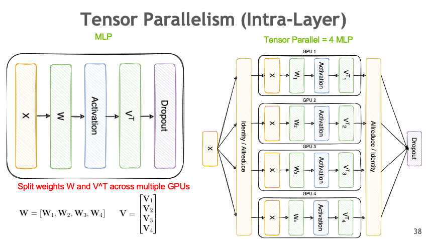
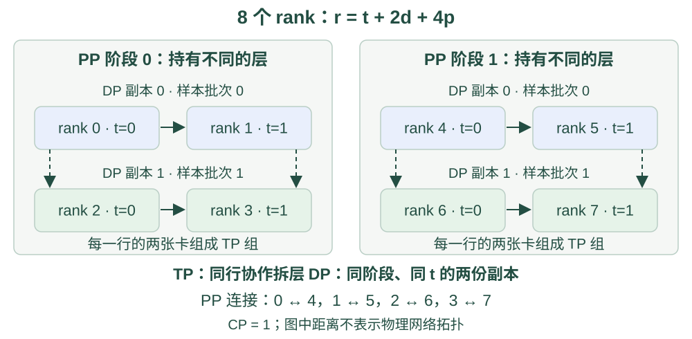
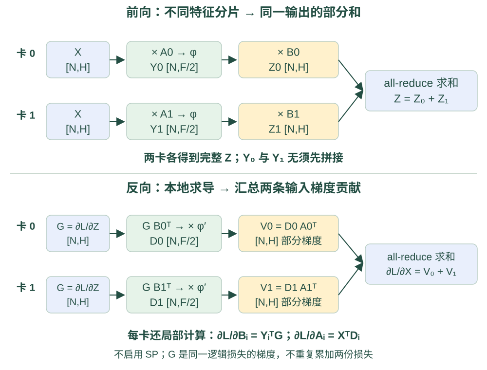
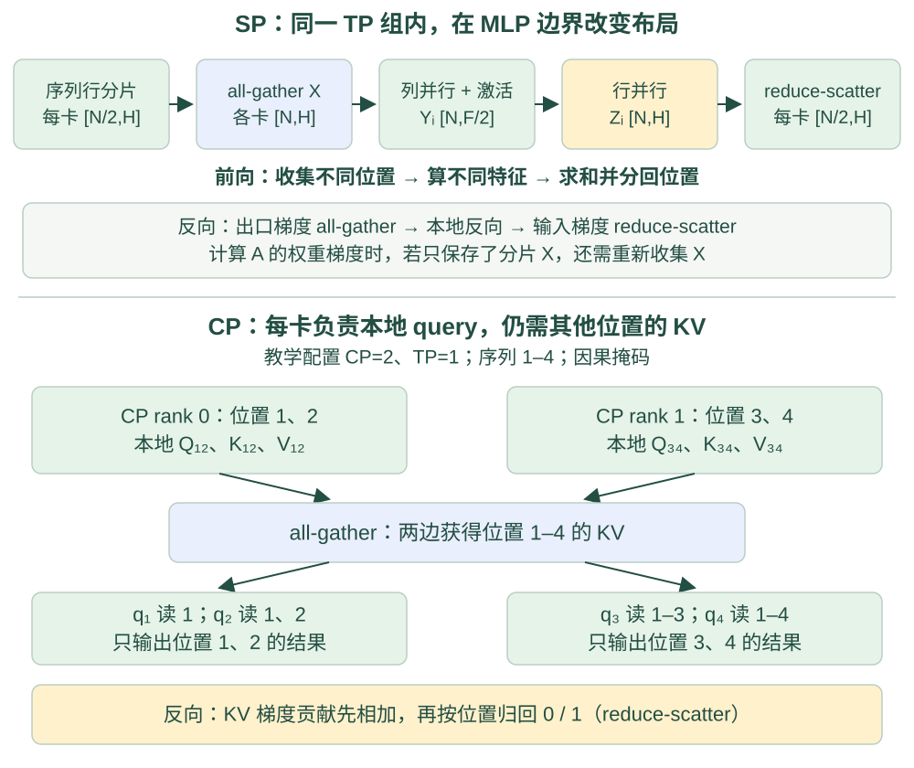
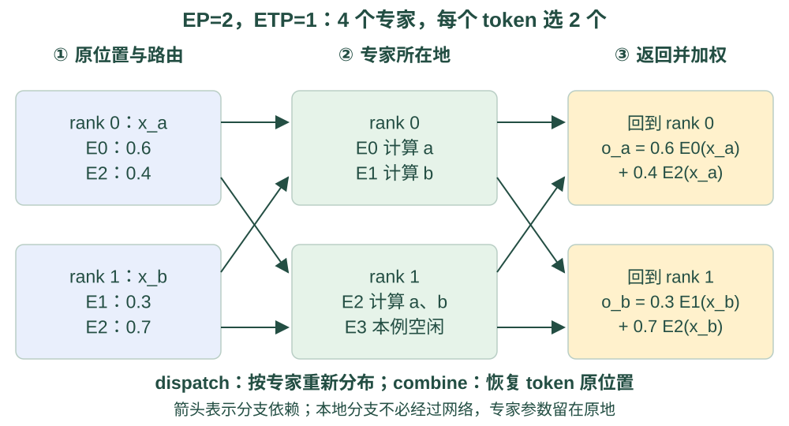

# 03 · Megatron 分布式训练与恢复

> **状态：第一章已补全，其余章节仍为大纲。** 包含前反向推导、固定版本源码核对和 CPU 数学实验；未进行 GPU 分布式性能验证。更新日期：2026-11-02。

[返回路线总览](./rl-infra-roadmap.html) · 建议进度：第 4–5 周

[MoE 训练显存估算](./rl-infra-memory-budget.html) 用 Qwen3-30B-A3B 的 8 卡、32K 配置串起静态训练状态、激活和通信缓冲的单卡计算。

**学习目标：** 能够从模型与硬件约束推导并行配置，并解释每次 collective、重计算及恢复的代价。

**学习方法：** 论文机制 → 数学/成本模型 → 源码实现 → 小实验 → 大规模验证方案。

## 第 1 章 张量布局与并行语义

同一个模型拆到多张 GPU（Graphics Processing Unit，图形处理器）后，要逐步回答：**每张卡持有什么、算出的结果是否完整、下一步需要从谁那里拿什么？** 本章先讲普通 decoder（解码器）的两层 MLP（Multi-Layer Perceptron，多层感知机），再加入序列、上下文、数据与专家并行。教学基线采用非打包序列、一进程一卡，不启用 Generalized Tensor Parallelism（GTP，广义张量并行）和 Fully Sharded Data Parallel（FSDP，完全分片数据并行）等扩展。

源码统一固定为 Megatron Core `core_v0.19.0` 对应提交 [`5be9626709af`](https://github.com/NVIDIA/Megatron-LM/tree/5be9626709af2722333bf54797c954c09edeada3)。本文教学图和公式是教学整理；原生线性层用于对应数学推导，使用 NVIDIA Transformer Engine（TE，Transformer 算子库）的实际后端可能融合或重排计算与通信，不能照搬为逐条执行轨迹。[固定源码的 TE 与本地后端选择](https://github.com/NVIDIA/Megatron-LM/blob/5be9626709af2722333bf54797c954c09edeada3/megatron/core/models/gpt/gpt_layer_specs.py#L181)。动态官方文档另标访问日期。本章只运行 CPU（Central Processing Unit，中央处理器）数学核对，没有运行 GPU 分布式实验。

### 1.1 先看布局，再看进程组

**先别急着数卡，先看手里的张量是什么。** Shape（形状）只说明有多少行、多少列；还要说明它与完整逻辑张量的关系。

| 布局 | 两张卡分别持有什么 | 还缺什么 |
| --- | --- | --- |
| Replicated（复制） | 都有相同的完整 $X$ | 在这个组内，不缺 $X$ 的数据 |
| Sharded（分片） | 各有 $X$ 的不同列或不同位置 | 要恢复完整 $X$，需沿被切开的维度拼接 |
| Partial（部分结果） | 各有同一输出的贡献 $Z_0,Z_1$ | 要得到 $Z$，需按对应元素求和：$Z=Z_0+Z_1$ |

这里的布局总是**相对于某个进程组**而言：一个权重可以在 TP 组内分片、同时在 DP 组内复制。两个本地张量即使都是 $[N,H]$，也可能是相同副本，或数值不同的部分结果；拼接与求和不能互换。

**Rank 是分布式进程编号；process group（进程组）是参加某项通信的进程集合。** 本章一进程对应一张 GPU，同一个 rank 可以同时属于多个组。下表先作索引，随后用具体计算解释各组的作用。

| 缩写与全称 | 主要划分什么 |
| --- | --- |
| DP：Data Parallelism，数据并行 | 不同训练样本；相应模型分片有多个副本 |
| TP：Tensor Parallelism，张量并行 | 一层内部的参数与计算 |
| PP：Pipeline Parallelism，流水线并行 | 模型层或计算阶段 |
| SP：Sequence Parallelism，序列并行 | 在 TP 组内，沿序列维保存并处理部分激活 |
| CP：Context Parallelism，上下文并行 | 同一序列的不同位置及其计算 |
| EP：Expert Parallelism，专家并行 | 不同专家的参数 |
| ETP：Expert Tensor Parallelism，专家张量并行 | 单个专家内部的参数与计算 |
| EDP：Expert Data Parallelism，专家数据并行 | 同一专家参数分片的不同副本 |

**先用两张官方图区分“复制模型”和“拆开一层”。** 以下引用 NVIDIA NeMo Framework 25.07 文档的原图；这一归档版本用于解释并行机制，与本章核对的 Megatron Core 源码版本分别标注。

**读图：先看每列有哪些层。** 四张卡都有 Layer 0–2，表示四份模型副本；训练时它们处理不同样本，再同步同一参数的梯度。这里展示的是单独使用 DP 的情形。与 TP、PP 组合后，一张卡可以只保存模型的一片，DP 复制的是这片对应的参数，下面的 8-rank 例子会把这层关系画出来。[NVIDIA 官方说明：DP](https://docs.nvidia.com/nemo-framework/user-guide/25.07/nemotoolkit/features/parallelisms.html#data-parallelism)

**读图：沿右侧任意一行走。** GPU i 从相同输入 X 出发，只计算自己的权重分片；四条路径最后通过 Allreduce（全归约）将对应元素相加，才得到完整输出。图中 W 对应下一节的 A，Vᵀ 对应 B。两端的成对标签分别表示前向／反向：左侧 Identity／Allreduce 是前向直接传递、反向汇总输入梯度；右侧 Allreduce／Identity 是前向汇总输出、反向直接传递。为什么要在这两个位置求和，1.2 会逐步计算。[NVIDIA 官方说明：TP](https://docs.nvidia.com/nemo-framework/user-guide/25.07/nemotoolkit/features/parallelisms.html#tensor-parallelism)

**再把 PP 加进来。** PP 按模型层分阶段，TP 在每个阶段内部拆层，DP 为这些分片建立处理不同样本的副本。所以下图的左右大框是 PP 阶段、框内横向配对是 TP、纵向两行是 DP 副本；三种分组可以同时作用于同一批卡。

**用 8 个 rank 看“同一张卡属于多个组”。** 固定 $TP=2,DP=2,PP=2,CP=1$，教学编号采用 $r=t+2d+4p$，其中 $t,d,p$ 分别是 TP、DP、PP 坐标，均取 0 或 1。这是本文明确选择的编号规则，不是所有配置下的默认顺序。

| 组 | 全部成员集合 | 在本例中一起做什么 |
| --- | --- | --- |
| TP | {0,1}、{2,3}、{4,5}、{6,7} | 为同一批 token 协作计算层内分片 |
| DP | {0,2}、{1,3}、{4,6}、{5,7} | 汇总不同样本对同一参数分片的梯度 |
| PP | {0,4}、{1,5}、{2,6}、{3,7} | 在相邻阶段之间传激活和激活梯度 |
| CP | {0}、{1}、…、{7} | 本例 $CP=1$，没有跨 rank 的上下文交换 |

例如 rank 0 与 1 合作计算前一阶段；与 2 持有同一参数分片、处理不同样本；与 4 连接前后阶段。不要把 DP 组内的两份输入也当作同一批 token 的副本。

在关闭额外并行维度的普通 decoder 基线中，进程总数 $W=DP\times TP\times CP\times PP$。加入 MoE Parallel Folding（混合专家并行折叠，见 1.6）后，同一批进程又可写成 $W=EDP\times ETP\times EP\times PP$；**不能在第一个式子上再乘 EP**。固定源码分别构造普通层与专家层的进程网格，并存在 GTP 扩展维度，因此这两个乘积只适用于本章基线。[固定源码：两套 rank 网格](https://github.com/NVIDIA/Megatron-LM/blob/5be9626709af2722333bf54797c954c09edeada3/megatron/core/parallel_state.py#L801)

### 1.2 两层 MLP：前向在哪求和，反向又在哪求和

设输入 $X\in\mathbb R^{N\times H}$，$N$ 是本例参与计算的 token 数，$H$ 是隐藏维度，$F$ 是中间维度。先忽略偏置、残差和随机操作，令 $U=XA$、$Y=\phi(U)$、$Z=YB$，其中 $A\in\mathbb R^{H\times F}$、$B\in\mathbb R^{F\times H}$，$\phi$ 是逐元素激活函数。这里的两路 TP **不启用 SP**，第一层不立即拼接输出；$F$ 可被 2 整除，两张卡开始时都有同一个 $X$。

**前向第一步：拆 A 的输出特征。** 写成 $A=[A_0\;A_1]$，每张卡保存 $A_i\in\mathbb R^{H\times F/2}$，计算 $U_i=XA_i$、$Y_i=\phi(U_i)$，形状均为 $[N,F/2]$。$Y_0$ 和 $Y_1$ 是不同特征列，逐元素激活不需要另半列的信息，所以可以各自完成。完整 $Y$ 是两者沿特征维拼接，但下一步不必真的把它拼出来。

**前向第二步：让 B 按同一个中间维度分片。** 把 $B$ 按行拆成 $B_0,B_1\in\mathbb R^{F/2\times H}$，卡 $i$ 计算 $Z_i=Y_iB_i\in\mathbb R^{N\times H}$。矩阵乘法展开即 $Z=[Y_0\;Y_1]\begin{bmatrix}B_0\\B_1\end{bmatrix}=Y_0B_0+Y_1B_1$。所以 **$Y_i$ 是不同列的分片，$Z_i$ 却是同一输出的部分和**。两张卡在 TP 组内执行 all-reduce（全归约）：把对应元素相加，并让每张卡都获得完整 $Z$；结果从 partial 变为 replicated。[Megatron-LM 原论文 v4，§3 与 Figure 3](https://arxiv.org/html/1909.08053v4#S3)

**反向先定义梯度，再看缺哪一项。** 令 $L$ 为单个逻辑模型的损失，$G=\partial L/\partial Z\in\mathbb R^{N\times H}$ 为下一层传来的梯度；本基线中两张卡都持有相同的 $G$。复制计算不是两份独立损失，不能再把相同的 $G$ 多加一遍。

在第二层，卡 $i$ 局部计算 $\partial L/\partial B_i=Y_i^\top G$，形状为 $[F/2,H]$；传给本地激活的梯度是 $\partial L/\partial Y_i=GB_i^\top$，形状为 $[N,F/2]$。再经过激活函数，得到 $D_i=\partial L/\partial U_i=(GB_i^\top)\odot\phi'(U_i)$；$\odot$ 表示对应元素相乘，$\phi'$ 是激活函数的导数。

在第一层，本地权重梯度为 $\partial L/\partial A_i=X^\top D_i$，形状为 $[H,F/2]$。但传回输入的 $V_i=D_iA_i^\top\in\mathbb R^{N\times H}$ 仍只是本分支的贡献；完整输入梯度为 $\partial L/\partial X=V_0+V_1$。因此 TP 组内还要一次 all-reduce，把输入梯度从 partial 变为 replicated。**这条经典路径有两个关键求和点：第二层的前向输出、第一层的反向输入梯度。** 两片参数梯度在 TP 内已经各自算出，不代表后面不需要 DP 副本之间的同步。

**和代码对照时，先转过权重方向。** 数学使用 $XA$，PyTorch 线性层通常保存 $A^\top$，即 `[out_features, in_features]`。因此 `ColumnParallelLinear` 的数学列分片，对应存储权重第 0 维；`RowParallelLinear` 的数学行分片，对应存储权重第 1 维。对应本节的原生路径是 `gather_output=False`、`input_is_parallel=True`、`sequence_parallel=False`，且非专家特殊通信分支。源码把第一层输入梯度归约放在线性层反向，把第二层输出归约放在行并行层结尾；不要据函数名猜物理维度。[ColumnParallelLinear](https://github.com/NVIDIA/Megatron-LM/blob/5be9626709af2722333bf54797c954c09edeada3/megatron/core/tensor_parallel/layers.py#L869) · [输入梯度归约](https://github.com/NVIDIA/Megatron-LM/blob/5be9626709af2722333bf54797c954c09edeada3/megatron/core/tensor_parallel/layers.py#L637) · [RowParallelLinear 输出归约](https://github.com/NVIDIA/Megatron-LM/blob/5be9626709af2722333bf54797c954c09edeada3/megatron/core/tensor_parallel/layers.py#L1471)

**手算并核对一次。** 取 $N=2,H=2,F=4$，$X=\begin{bmatrix}1&2\\2&-1\end{bmatrix}$，$A=\begin{bmatrix}1&0&1&-1\\0&1&1&2\end{bmatrix}$，$B=\begin{bmatrix}1&0\\0&1\\1&1\\2&-1\end{bmatrix}$，激活使用 ReLU（Rectified Linear Unit，修正线性单元），即 $\phi(u)=\max(0,u)$。按前两列、后两列拆 A，并对应拆 B 的前两行、后两行。对第一个 token，$Y_0=[1,2]$、$Y_1=[3,3]$，所以 $Z_0=[1,2]$、$Z_1=[9,0]$，相加才是 $Z=[10,2]$。

令 $L=\tfrac12\sum_{n,h}Z_{n,h}^2$，则 $G=Z$。第一个 token 的两份输入梯度贡献分别是 $V_0=[10,2]$、$V_1=[-6,48]$，求和得到 $[4,50]$。本文的标准库 CPU 脚本同时核对了两个 token：单体与两路分片的输出、输入梯度、A/B 权重梯度最大绝对差均为 0；故意漏掉前向求和、仅保留卡 0，输出最大绝对误差为 9；使用正确 $G$ 但漏掉反向求和，输入梯度最大绝对误差为 48。小整数让本例可以精确核对，不是对任意浮点实现逐比特一致的保证。[可运行脚本](../scripts/rl-infra-megatron-mlp-lab.py) · [本地核对结果与全部矩阵](../assets/rl-infra-megatron/mlp-check.json)

### 1.3 SP：层内按特征拆，层间还能按序列拆

上一节 TP 组内的 $X$、$Z$ 是重复副本。LayerNorm（层归一化）等操作对每个 token 的隐藏向量单独计算；只要每个位置的完整隐藏向量在本地，就可以让不同卡分别处理不同位置。**SP 的作用是减少这些位置上的重复激活，不是把第一层的特征分片再当作序列分片。** [SP 原论文 v1，§4.2.2 与 Figure 2](https://arxiv.org/html/2205.05198v1#S4.SS2.SSS2)

先定义另外两个通信操作：all-gather（全收集）将各 rank 的分片沿指定维度拼接，让各卡拿到完整结果；reduce-scatter（归约后分散）先按对应元素求和，再把结果沿指定维度切开分给各卡。前者解决“缺不同位置”，后者解决“既有不同贡献，又只需保存部分位置”。

**对照上半图，把同一个 MLP 开启 SP。** 为直观看序列维，这里取一条长度为 $N$ 的序列，且 $N$ 为偶数。每张 TP 卡入口只持有 $X$ 的 $N/2$ 行，形状为 $[N/2,H]$。列并行层前，在 TP 组内沿序列行 all-gather，恢复同一个 $[N,H]$ 的 X；然后按 1.2 算出各自的 $Y_i$ 与部分输出 $Z_i$。行并行层结尾改用 reduce-scatter：先将两个 $[N,H]$ 贡献相加，再按序列行分配。每张卡只保留自己那 $[N/2,H]$ 的完整输出，继续做逐 token 操作。中间的 $Y_i$ 依然是特征分片，临时收集的 X 依然是完整副本，**不是所有激活始终只有原来的 $1/TP$**。

**反向也按布局逐步走。** 出口梯度先是不同序列行的 $[N/2,H]$ 分片；行并行层的反向在 TP 组内 all-gather，拼成完整 $G$，每张卡才能计算所有本地特征分支的 $GB_i^\top$。到列并行层反向，$V_i$ 仍是对完整 X 的部分贡献，改用 reduce-scatter 求和并按入口的序列行分回去，返回 $[N/2,H]$ 的输入梯度。若前向只保存了分片 X，计算 $X^\top D_i$ 前还需再次 all-gather X；固定原生实现的这个分支可与其他反向计算交错安排。[原生线性层的 SP 收集与反向](https://github.com/NVIDIA/Megatron-LM/blob/5be9626709af2722333bf54797c954c09edeada3/megatron/core/tensor_parallel/layers.py#L565)

SP 使用现有 TP 组，不额外把总卡数乘一个 SP。LayerNorm 的缩放等参数可能在 TP 内复制，但各卡处理不同 token，梯度贡献不同，因此相应参数梯度仍需跨 TP 汇总。还要注意：不能把“all-gather 的反向”一律记成 reduce-scatter；固定映射函数根据下游是否产生独立贡献，选择归约切分或只切分，重复计算的同一贡献不能又加一次。[梯度映射的条件分支](https://github.com/NVIDIA/Megatron-LM/blob/5be9626709af2722333bf54797c954c09edeada3/megatron/core/tensor_parallel/mappings.py#L300) · [SP 参数梯度归约](https://github.com/NVIDIA/Megatron-LM/blob/5be9626709af2722333bf54797c954c09edeada3/megatron/core/distributed/finalize_model_grads.py#L452)

### 1.4 CP 与 attention：本地 query 为什么还需要远端 KV

**先看普通多头注意力怎样做 TP。** Q、K、V 分别指 Query（查询）、Key（键）、Value（值）。假设注意力头数可被 TP 整除，每张卡通过分片投影算一部分头；一个头的 attention 不依赖其他头，所以可以本地计算。各头输出随后进入按输入特征分片的输出投影，形成同一隐藏向量的部分贡献，再像 MLP 的第二层一样求和。反向先通过本地输出投影与 attention 求 Q/K/V 梯度，输入投影的各头分支对 X 的贡献再汇总；开启 SP 时相应边界改为上一节的序列收集与归约切分。这里先不展开 Grouped-Query Attention（GQA，分组查询注意力）的 KV 头复制等变体。[原论文的 attention 分片图，Figure 3b](https://arxiv.org/html/1909.08053v4#S3)

**CP 切的是同一序列的位置，跨位置依赖还在。** 现在对照上一张图的下半部，单独取 $TP=1,CP=2$：CP rank 0 负责位置 1、2，rank 1 负责位置 3、4。每张卡算本地位置的 Q/K/V，但因果注意力中 q₃ 要读位置 1、2、3 的 KV，q₄ 要读 1–4；远端的 KV₁、KV₂ 不能凭空省掉。q₁ 则只读位置 1，不是所有 query 都必须读取全部 token。

**本节详细采用 all-gather KV 的路径。** 前向在 CP 组内把各自 $[N/2,H]$ 的 K/V 沿位置维拼为完整 $[N,H]$ 副本，各 rank 保留本地 Q，并根据因果掩码计算自己 $[N/2,H]$ 的输出。全序列 KV 被收集，不等于掩码允许每个 query 使用所有 KV。这里省略多头的 reshape，仅表示所有头合计的宽度；这张图是依赖教学图，不是 TE 内核的物理布局图。

**反向时，KV 的梯度要回到它原来的位置。** rank 0 的 query 给 KV₁、KV₂ 产生贡献；rank 1 的 query 也可能给它们产生贡献。令 $C_{r\to s}^{K}$ 表示 CP rank $r$ 的本地 query 对位置分片 $s$ 的 K 梯度贡献，则所属 rank $s$ 需要的是 $\partial L/\partial K_s=\sum_r C_{r\to s}^{K}$，V 同理。CP 组内 reduce-scatter 将贡献相加，再按位置归还 K/V 梯度分片；Q 的梯度留在负责相应 query 的 rank。随后各 rank 计算本地位置的投影梯度；共享投影参数的梯度还要汇总各位置贡献，见 1.5。若完整 KV 没有保留到反向，则还要重新收集所需 KV。

| 比较项 | SP | CP |
| --- | --- | --- |
| 参与的组 | TP 组 | 独立 CP 组 |
| 序列分片覆盖哪里 | 特定逐 token 操作和层间激活 | 网络输入及各层负责的序列位置 |
| 注意力依赖怎样处理 | 典型 TP 路径先恢复所需序列布局 | 本地 query 仍须通过 CP 通信获得远端信息 |
| 能否共存 | 可以，在一个 CP 分片内部再使用 SP | 可以，与 TP/SP 配合 |

固定配置还支持 `p2p`（point-to-point，点对点环形 KV 交换）、`a2a`（all-to-all，全交换）以及 `a2a+p2p` 等路径，因此 **CP 不等于每层必须先完整收集所有 KV**。上面的归属关系必须满足，但通信和临时布局可不同。官方 CP Figure 1 给出 TP2CP2 与环形交换的具体图解；实际配置须核对后端支持，不能仅改原生 MLP 开关就认为实现了 CP。[固定配置及各通信方式](https://github.com/NVIDIA/Megatron-LM/blob/5be9626709af2722333bf54797c954c09edeada3/megatron/core/transformer/transformer_config.py#L987) · [官方 CP 图解与实现说明，动态文档，访问于 2026-11-02](https://docs.nvidia.com/megatron-core/developer-guide/latest/user-guide/features/context_parallel.html)

### 1.5 参数、梯度和优化器状态：各自归谁

**PP 先决定“这张卡有哪几层”，TP 再决定“这些层有哪一片”。** 在 1.1 的例子中，rank 0/1 持有前一阶段的层，rank 4/5 持有后一阶段的层。前向发送本 microbatch（微批次）的阶段边界激活；后一阶段据此计算。反向沿对应 PP 连接返回该边界激活的梯度，前一阶段才能继续求自己的参数梯度。按本例无 SP 的复制边界布局，消息形状为 $[N,H]$；接收方得到前一阶段的输出，不会因此得到其权重。调度及通信优化留到第三章。

**DP、CP 汇总的是同一参数的不同数据贡献。** DP 副本处理不同样本，CP 副本处理同一序列的不同位置；两者对共享参数的梯度都需要合并。在固定实现中，普通参数可通过包含 DP 与 CP 的组完成同步；不要将已经联合归约的梯度再独立重复相加。求和后怎样按样本或有效 token 数归一化，需要与损失定义一致。专家参数则检查 EDP 组；它的副本范围可能不同于普通层的 DP/CP 组。[普通参数与专家参数的分组分支](https://github.com/NVIDIA/Megatron-LM/blob/5be9626709af2722333bf54797c954c09edeada3/megatron/core/distributed/distributed_data_parallel.py#L218)[固定源码：同步收尾及 DP/CP 组](https://github.com/NVIDIA/Megatron-LM/blob/5be9626709af2722333bf54797c954c09edeada3/megatron/core/distributed/finalize_model_grads.py#L612)

下面固定 $TP=2,CP=1$，同一 PP 阶段有 $d$ 个 DP 副本；先采用普通优化器。表中的全局 shape 指本层的完整逻辑对象，不是整网；$m,v$ 是 Adam 优化器保存的梯度一阶、二阶矩估计。

| 对象 | 全局 → 本地 shape | 所属关系 | 何时有效；谁处理 |
| --- | --- | --- | --- |
| 权重 A | $[H,F]\to[H,F/2]$ | TP 分片；DP 复制；只在所属 PP 阶段 | 前向前版本须一致；对应 DP 副本同步更新 |
| 权重 B | $[F,H]\to[F/2,H]$ | 同上 | 同上 |
| 本地 $Y_i$ | $[N,F]\to[N,F/2]$ | TP 特征分片；不同 DP 样本不相同 | 前向产生；反向读取或重计算，不由优化器更新 |
| A 的参数梯度 | $[H,F]\to[H,F/2]$ | TP 内片段已完整；DP 同步前是不同样本贡献 | 反向累积、DP 归约后，才能作为本轮更新依据 |
| B 的参数梯度 | $[F,H]\to[F/2,H]$ | 同上 | 同上 |
| A 的主权重副本 | $[H,F]\to[H,F/2]$ | 本例采用低精度模型权重及 FP32 主权重；DP 复制 | FP32（32 位浮点）副本积累更新，再转换到模型权重 |
| A 的 Adam $m,v$ | 各为 $[H,F]\to[H,F/2]$ | 与参数片段对应，普通优化器下 DP 复制 | 优化器更新；B 的状态同理 |

**标准 distributed optimizer（分布式优化器）改变的是更新责任。** 再把同一 TP 参数片段展平成长度 $P$ 的缓冲区，假设无填充且 $P$ 可被 $d$ 整除。普通数据并行让每个副本保存整段主权重和优化器状态；标准分布式优化器让每个 DP rank 只负责其中 $P/d$ 个元素的主权重、Adam 状态和参数更新。前向用的模型参数仍须恢复为这整个 TP 片段，不能把它解释成“计算时每张卡只持有原来参数的 $1/d$”。本节不讨论 FSDP 或多个优化器实例的扩展。

流程是：**在 DP 组内 reduce-scatter 梯度 → 各 rank 更新自己的参数区间 → all-gather 更新后的模型参数**。这里切分维度是展平后的参数缓冲区，不是 token 维。若 $P=8,d=2$，选用 1.1 图中的 DP 组 {0,2}，全局 rank 0 更新元素 0–3，rank 2 更新 4–7；all-gather 后两边都有更新后的 0–7，供下一次计算读取。注意 reduce-scatter 后，即使原梯度缓冲区仍有 8 个位置，也只有本 rank 负责的 4 个位置是完整归约结果；不能把其余位置当作有效更新输入。[官方数据流与分片图，动态文档，访问于 2026-11-02](https://docs.nvidia.com/megatron-core/developer-guide/latest/user-guide/features/dist_optimizer.html) · [固定源码：普通归约与分布式优化器分支](https://github.com/NVIDIA/Megatron-LM/blob/5be9626709af2722333bf54797c954c09edeada3/megatron/core/distributed/param_and_grad_buffer.py#L698)

### 1.6 MoE：专家留在原地，token 去找专家

**MoE（Mixture of Experts，混合专家模型）** 用 router（路由器）为每个 token 选择部分专家及其合并权重，专家分别计算，再合并输出。EP 切分的是专家参数；dispatch（分发）搬运的是 token 激活及有关路由数据。先取 4 个专家、2 个 EP ranks、$ETP=1$，不丢弃或填充 token，每个 token 选择两个专家（top-2）；这里选择的是专家，不是下一个生成 token。

**沿图走一次。** EP rank 0 保存专家 E0、E1，并持有输入向量 $x_a$；rank 1 保存 E2、E3，并持有 $x_b$。设 router 为 a 选择 E0/E2，权重 0.6/0.4；为 b 选择 E1/E2，权重 0.3/0.7。先按专家所在地排列待发送行：a 留一条本地 E0 分支，再发给 rank 1 的 E2；b 留一条本地 E2 分支，再发给 rank 0 的 E1。EP 组内的 all-to-all 让各 rank 向相应成员发送不同的 token 行；交换后，数据按专家归属分布，E2 有两个 token，E3 没有，负载并不平均。

专家使用本地参数计算，combine（合并）再把结果送回 token 原来的 rank，恢复顺序并按路由权重组合：$o_a=0.6E_0(x_a)+0.4E_2(x_a)$，$o_b=0.3E_1(x_b)+0.7E_2(x_b)$。本教学例子把权重乘法写在最后便于阅读；实际实现可以在等价位置提前加权，不能重复乘。完成后输出重新按原 token 位置分布，不是所有 EP ranks 都持有全部输出。

**反向传的是相应分支的梯度。** 例如下一层给 a 的梯度为 $h_a=\partial L/\partial o_a$，E0 分支收到 $0.6h_a$，远端 E2 分支收到 $0.4h_a$；各专家用它计算本地参数梯度和输入梯度，再把对 $x_a$ 的贡献送回原 rank 相加。把 a 分给专家 i 的权重记为 $g_{a,i}$；路由权重也有来自专家输出的梯度，例如 $\partial L/\partial g_{a,i}=h_a^\top E_i(x_a)$，再经具体权重计算规则传回 router；离散 top-k 选择本身不能据此被视为可导。因而反向包含加权、求导和分支贡献汇总，并不是只把 token 搬运顺序倒过来。

**与固定 dispatcher 对照。** `MoEAlltoAllTokenDispatcher` 在 EP 组内交换 token 行与权重，并使用各目的地实际计数确定发送、接收分割。若 $ETP>1$，分发后还在专家 TP 组内 gather token 行，使同一专家的参数分片都能看到所需输入；局部专家计算之后再 reduce-scatter 合并贡献并切回 token 行，然后执行返回的 EP all-to-all。反向时，返回结果的 EP 交换先将各分支输出梯度送回专家；专家输出端 reduce-scatter 的反向在 ETP 组内 all-gather 梯度，各参数分片据此反向计算；专家输入端 gather 的反向则在 ETP 组内 reduce-scatter，汇总输入梯度并归回原 token 行分片，随后通过 EP 交换送回来源。因此完整 MoE 层不能概括成“只有两次 all-to-all”；top-k 的分支数也不能直接当作网络字节数倍数，本地专家、填充、重复数据合并和后端都会影响传输。[固定源码：EP dispatch](https://github.com/NVIDIA/Megatron-LM/blob/5be9626709af2722333bf54797c954c09edeada3/megatron/core/transformer/moe/token_dispatcher.py#L675) · [专家 TP 收集](https://github.com/NVIDIA/Megatron-LM/blob/5be9626709af2722333bf54797c954c09edeada3/megatron/core/transformer/moe/token_dispatcher.py#L737) · [归约切分与返回](https://github.com/NVIDIA/Megatron-LM/blob/5be9626709af2722333bf54797c954c09edeada3/megatron/core/transformer/moe/token_dispatcher.py#L817)

**MoE Parallel Folding：换一种分组，不增加一批卡。** 回到 1.1 的 8 ranks：普通层采用 $TP=2,DP=2,CP=1,PP=2$；专家层可以改为 $ETP=1,EP=2,EDP=2,PP=2$。在本文教学映射中，前一阶段的 {0,1} 从合作拆一个普通层，变为分别持有不同专家；{0,2} 则成为相同专家参数的副本组，后一阶段同理。两套乘积都是 8，PP 阶段关系保持一致，ETP 不必等于普通层 TP。进入专家层时，dispatcher 还必须衔接输入布局；上段两 token 的例子正是从“不同 rank 已持有不同 token 行”这一边界开始。[MoE Parallel Folding v3，§3.2、§3.3 与附录图](https://arxiv.org/html/2504.14960v3#S3.SS2)

本章的阅读检查是：遇到一次通信，先找到参与的组，再说清传的是哪种张量、按哪个维度拼接或归约，以及完成后得到副本、分片还是仍未合并的贡献。第二章再据这些张量与通信，计算字节数和显存成本。

## 第 2 章 通信与显存成本模型（待写入）

- 计算 all-reduce、all-gather、reduce-scatter、all-to-all 的通信量及拓扑敏感项。
- 建立参数、主权重、梯度、优化器状态、激活与临时 buffer 的峰值显存账本。
- 比较重计算、offload、分片的时间和内存代价，明确重叠条件。

## 第 3 章 流水线调度与气泡（待写入）

- 手画 1F1B、interleaving 的 microbatch 时间线与激活存活区间。
- 分析 stage 不均衡、通信等待与 microbatch 数对气泡的影响。
- 沿 schedules.py 跟踪 forward/backward 函数选择、收发、梯度同步和收尾。

## 第 4 章 版本更新与一致性恢复（待写入）

- 以 Megatron Core 0.19 为一个版本切片，记录发布能力与开发中设计的区别。
- 研究确定性训练所需的 RNG、数据游标、累加顺序、checkpoint 与硬件条件。
- 设计中断前后状态指纹及等价性检查；MFSDP v2 等开发中内容单独记录。

## 第 5 章 无 GPU 小实验（待实现）

- 用 CPU 实现一个小线性层的单体与分片前反向，对照输出、梯度和通信张量。
- 编写流水线离散事件模拟器，改变 stage 时长、microbatch 数与通信延迟。
- 交付：shape 表、显存/通信计算器、流水线图及故障恢复检查清单。

## 第 6 章 论文、报告与源码入口

以下为规划时的阅读入口。正式写入时需记录论文版本、访问日期和仓库 commit；`main` / `latest` 链接会变化，不代表已完成该版本的复现。

- [Megatron Core 0.19 release](https://github.com/NVIDIA/Megatron-LM/releases/tag/core_v0.19.0)
- [Megatron：pipeline schedules.py](https://github.com/NVIDIA/Megatron-LM/blob/main/megatron/core/pipeline_parallel/schedules.py)
- [Megatron：MoE token_dispatcher.py](https://github.com/NVIDIA/Megatron-LM/blob/main/megatron/core/transformer/moe/token_dispatcher.py)
- [NVIDIA：bitwise deterministic pretraining](https://developer.nvidia.com/blog/scale-bitwise-deterministic-pretraining-with-nvidia-megatron-core/)

## 第 7 章 交付物与验收（待完成）

- 待写入：核心概念与公式推导。
- 待写入：固定版本的源码调用链、shape / ownership / 时序表。
- 待完成：可重复的小实验、反例和结果解释。
- 待写入：GPU 实测方案、对照组与适用边界。
- 验收问题：给定模型尺寸和卡数，独立写出并行配置的显存、通信和气泡估算。
- 验收问题：用源码解释一次完整 microbatch 的前反向及跨 stage 依赖。

### 7.1 后续记录模板

- 本次阅读版本与来源：待填写。
- 新理解与仍不确定的问题：待填写。
- 实验条件、原始数据与结论：待填写。
- 下一步与需要 GPU 验证的项目：待填写。

[← 上一篇：02 · 训练推理数值一致性与低精度 RL](./rl-infra-numerics.html)

[下一篇：04 · vLLM / SGLang 调度与混合状态缓存 →](./rl-infra-serving.html)
