# 04 · vLLM / SGLang 调度与混合状态缓存

> **状态：第一至四章已补全，其余章节仍为大纲。** 已补全内容包含机制讲解与固定版本源码静态核对，未进行图形处理器（Graphics Processing Unit，GPU）实验。更新日期：2026-11-02。

[返回路线总览](./rl-infra-roadmap.html) · 建议进度：第 6 周

**学习目标：** 能够解释缓存命中究竟节省了什么，并沿调度器源码定位首 token 延迟、吞吐和尾延迟的限制。

**学习方法：** 论文机制 → 数学/成本模型 → 源码实现 → 小实验 → 大规模验证方案。

## 第 1 章 一次请求的生命周期

一个请求进入引擎后，每一步为什么能运行、为什么需要等待，又必须保留什么才能继续生成？本章先看最简单的路径：**单个引擎、固定权重、纯文本自回归生成，采用普通因果全注意力（full attention），prefill 与 decode 在同一组设备上执行**。不启用推测解码（speculative decoding），也不涉及跨设备缓存传输；先讲同步调度循环，最后说明异步执行的区别。

下面的流程图与数字都是教学模型，不是引擎实测。源码静态核对日期为 **2026-11-02**，统一使用 vLLM 提交 `318c4db661d9706764ee3d9e1b9c14fc4e49c75b`、SGLang 提交 `6aca4198075af1ab42e753f419c9827ff0fec0d9`；可变的官方文档只作补充。

### 1.1 一个请求到底保存了什么

**先区分输入、计算和输出的位置。** 设请求的输入序列（prompt）有四个 token，依次记为 $p_1,p_2,p_3,p_4$；新采样的回答 token 记为 $a_1,a_2,\ldots$。这里一个 token 是一个词表编号，不一定对应一个汉字。模型处理一个位置后，给出下一个 token 的候选分数（logits），再按生成参数采样。

```text
已有输入：   p₁  p₂  p₃  p₄
首次前向：  [p₁  p₂  p₃  p₄] → 采样 a₁
下次前向：                  [a₁] → 采样 a₂
再次前向：                       [a₂] → 采样 a₃
```

第一次处理输入前缀称为 **prefill（预填充）**；随后逐步输入新 token、预测下一个 token，称为 **decode（解码）**。注意力层会保存已处理位置的 **Key/Value cache（KV cache，键／值缓存）**，供后续位置读取，避免每一步重新计算整个历史。所以下次只输入 $a_1$，仍能通过缓存关注 $p_1$ 到 $p_4$。

**已生成 token，不等于已为它建立 KV。** 在首次前向结束、采样出 $a_1$ 时，缓存覆盖的是四个输入位置；$a_1$ 要到下一次前向才建立自己的 KV。下面固定“无缓存命中、无抢占、每轮都获准执行”，记录每轮**前向及采样完成后、资源释放前**的状态：

| 观察时点 | 本轮送入模型的位置 | 已建立 KV 的位置／数量 | 已采样的回答 |
| --- | --- | --- | --- |
| 请求到达 | 尚未计算 | 无，0 个 | 无 |
| 第 1 轮：prefill | $p_1$ 到 $p_4$ | $p_1$ 到 $p_4$，4 个 | $a_1$，1 个 |
| 第 2 轮：decode | $a_1$ | 前四个输入及 $a_1$，5 个 | $a_1,a_2$，2 个 |
| 第 3 轮：decode | $a_2$ | 前四个输入及 $a_1,a_2$，6 个 | $a_1,a_2,a_3$，3 个 |

如果把四个输入拆成两块，第一轮只算 $p_1,p_2$，通常还不能给用户第一个回答 token：$p_3,p_4$ 也是请求条件。处理到 $p_4$ 后，才用末位置的 logits 采样 $a_1$。分块之间必须保留已经建立的缓存。

于是，一个请求至少要保存这些信息：

| 对象 | 用途 |
| --- | --- |
| 请求标识与生成参数 | 区分任务，保存采样设置、输出上限和停止条件 |
| 输入 token 与已生成 token | 保留用户给出的条件及已经采样的回答 |
| 已计算进度 | 记录哪些位置已有可用计算状态，判断下一次从哪里接着算 |
| KV 缓存的引用与位置映射 | 找到各层、各位置对应的缓存；缓存内容通常在引擎管理的内存池中 |
| 请求状态与结果交付进度 | 判断是否可调度、是否结束，以及哪些结果已交给上层 |

这也解释了源码为什么分开保存 token 序列与计算进度。vLLM 的 `Request` 有 `prompt_token_ids`、`output_token_ids` 和 `num_computed_tokens`；SGLang 的 `Req` 有 `origin_input_ids`、`output_ids`，并在准备下一轮时结合前缀命中确定待计算部分。它们并非字段一一对应。尤其 vLLM 可以在**安排计算后**提前推进进度字段，因此不能把任意时刻的字段值直接当成上表的“已完成 KV 数”。[vLLM Request](https://github.com/vllm-project/vllm/blob/318c4db661d9706764ee3d9e1b9c14fc4e49c75b/vllm/v1/request.py#L147) · [调度后推进进度](https://github.com/vllm-project/vllm/blob/318c4db661d9706764ee3d9e1b9c14fc4e49c75b/vllm/v1/core/sched/scheduler.py#L1844) · [SGLang 下一轮输入](https://github.com/sgl-project/sglang/blob/6aca4198075af1ab42e753f419c9827ff0fec0d9/python/sglang/srt/managers/schedule_batch.py#L1834)

### 1.2 从进入队列到结束：请求状态怎样变化

**请求状态、计算阶段、调度迭代是三个不同概念。** 状态说明请求在等待、运行还是结束；prefill/decode 说明本次在做哪种计算；一次调度迭代则是“选择本轮内容 → 提交执行 → 处理结果”的循环。同一个迭代可以处理多个请求，一个请求也需要跨越多个迭代。

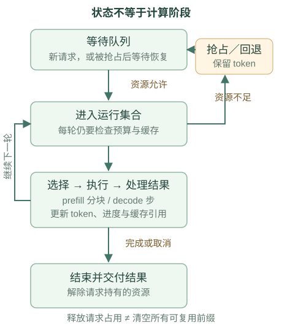

**waiting（等待）不只包含新请求，running（运行）也不等于正在 decode。** 四 token 示例获准进入运行集合后，若只处理了前两个输入位置，仍处在 prefill；被抢占的请求则可能携带已生成回答回到等待队列。进入运行集合也不保证每一轮都能分到计算资源。

对照真实实现：vLLM 用 `RequestStatus` 区分 `WAITING`、`RUNNING`、`PREEMPTED` 以及不同结束原因，并维护等待队列与运行集合；SGLang 则通过 `Req`、`waiting_queue`、`running_batch` 和 `ScheduleBatch` 等对象组织等待、分块输入及运行批次，不能直接套用 vLLM 的枚举。[vLLM 状态定义](https://github.com/vllm-project/vllm/blob/318c4db661d9706764ee3d9e1b9c14fc4e49c75b/vllm/v1/request.py#L389) · [SGLang 批次选择](https://github.com/sgl-project/sglang/blob/6aca4198075af1ab42e753f419c9827ff0fec0d9/python/sglang/srt/managers/scheduler.py#L4170)

vLLM 这版 `schedule()` 明确采用统一的 token 进度调度：让已计算进度追上需要处理的序列，而不是先划分两个独立的 prefill/decode 调度阶段。这不代表模型计算中不存在两者的区别。[vLLM 调度算法注释](https://github.com/vllm-project/vllm/blob/318c4db661d9706764ee3d9e1b9c14fc4e49c75b/vllm/v1/core/sched/scheduler.py#L698)

达到输出上限、命中停止条件或被取消后，请求停止继续生成，完成结果处理并解除资源占用。**释放请求对缓存块的引用，不等于立即擦除所有缓存内容。** 开启前缀缓存时，仍有效的内容可能留待其他请求复用，也可能随后被淘汰；结束请求与清空共享缓存是不同操作。[vLLM 释放引用与缓存块复用](https://github.com/vllm-project/vllm/blob/318c4db661d9706764ee3d9e1b9c14fc4e49c75b/vllm/v1/core/block_pool.py#L816)

### 1.3 每次到底调度多少：三种限制要分开

调度器不能只看“还有请求”，还要同时回答三个问题：

| 限制 | 本轮要检查什么 |
| --- | --- |
| 计算 token 预算 | 最多安排多少个 token 位置进入模型？ |
| 请求数量限制 | 本轮或运行集合还能容纳多少请求？具体口径由实现规定 |
| KV 容量与分配约束 | 能否保留已有状态，并为接下来的计算分配缓存空间？ |

设 $n_i$ 是请求 $i$ 在本轮安排计算的 token 数，$B$ 是本轮 token 预算，则教学模型要求 $\sum_i n_i\le B$。**这只是必要条件**：即使预算有余，请求槽位或缓存分配失败仍会阻止执行。预算既不是整条回答的输出 token 上限，也不是 KV 总容量；本轮只计算一个 decode token，仍可能需要读取很长的历史缓存，相同 token 数因此不代表相同耗时。

例如指定一种“先安排 decode、剩余预算给 prefill”的教学策略：本轮预算为 8，两个已有请求各安排 1 个 decode token，还剩 $8-1-1=6$ 个位置。若另一个长输入仍有 10 个位置未计算，这轮最多再处理其中 6 个；若换成前面的四 token 输入，可以一次安排完 4 个，预算仍余 2。**两种排程都还需通过请求数量与缓存准入检查，不是两套引擎统一的默认行为。**

固定版本的 vLLM 分别初始化 `token_budget = max_num_scheduled_tokens` 和 `input_budget = max_num_batched_tokens`；前者未单独配置时才回退使用后者，不能把所有限制都叫成同一个参数。请求槽位与运行准入还分别涉及 `max_num_seqs` 和 `max_num_active_seqs`。SGLang 的 `PrefillAdder.add_one_req()` 除了待算输入长度，还考虑剩余输出额度、分配开销和请求槽位等条件。[vLLM 限制初始化](https://github.com/vllm-project/vllm/blob/318c4db661d9706764ee3d9e1b9c14fc4e49c75b/vllm/v1/core/sched/scheduler.py#L129) · [本轮预算](https://github.com/vllm-project/vllm/blob/318c4db661d9706764ee3d9e1b9c14fc4e49c75b/vllm/v1/core/sched/scheduler.py#L718) · [SGLang 准入检查](https://github.com/sgl-project/sglang/blob/6aca4198075af1ab42e753f419c9827ff0fec0d9/python/sglang/srt/managers/schedule_policy.py#L1399)

### 1.4 连续批处理、分块预填充与前缀缓存分别改变什么

| 机制 | 直接改变的事情 | 边界 |
| --- | --- | --- |
| Continuous batching（连续批处理） | 在迭代边界调整参与执行的请求集合 | 新请求到达不会因此中断正在运行的计算程序 |
| Chunked prefill（分块预填充） | 把长输入的计算分散到多个迭代 | 后一块仍依赖前面的上下文，各块不是独立 prompt |
| Prefix caching（前缀缓存） | 复用有效前缀的已有状态，避免重复计算 | 复用的是计算状态，不是直接返回缓存中的整段答案 |

连续批处理可以这样理解：一个请求结束后，下一轮就能让其他请求加入，而不必等整批回答都结束。Orca 的 iteration-level scheduling（迭代级调度）是这一机制的代表性来源。[Orca，OSDI 2022](https://www.usenix.org/conference/osdi22/presentation/yu)

**为什么要分块？让长 prompt 分几轮推进，给其他请求持续生成的机会。** 如果把很长的 prefill 放进一次迭代，这一轮可能耗时较长，已在 decode 的请求就可能很久拿不到下一个输出。把 prefill 拆小后，每轮可以安排“一块 prefill ＋ 其他请求的 decode”，并把部分线性运算合批。收益是改善混合负载下的等待与计算利用率，不是减少 prompt 本身的必要计算；块太小也会增加调度和缓存读取开销，首 token 时间不一定更短。[SARATHI v1 §4.2–4.4](https://arxiv.org/html/2308.16369v1#S4.SS2)

**decode 在哪里？在其他请求里。** 设 A 刚开始处理 $p_1,p_2,p_3,p_4$，每轮处理两个位置；B、C 已完成各自的 prefill，正在生成回答。下图假设预算与缓存足够，三个请求每轮均获准执行、均未结束：

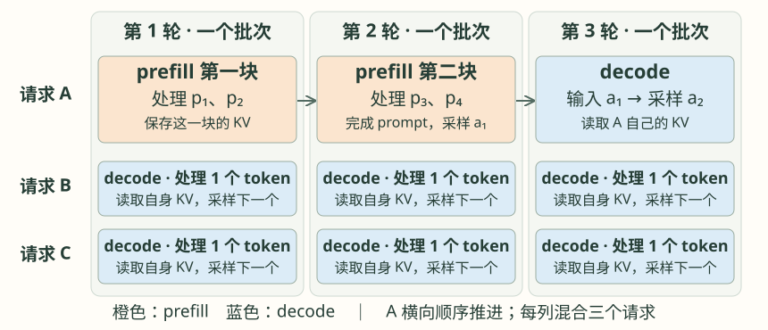

**竖着看第 1 列：A 做 prefill，B、C 做 decode，这才是“prefill 与 decode 一起运行”。横着看 A：第一块 → 第二块 → 自己的 decode。** A 仍要处理完全部 prompt 才能采样 $a_1$，并在下一轮输入 $a_1$、采样 $a_2$；不能把 A 未完成的 prompt 当成完整条件，提前生成它的正式回答。

**同一批的计算如何合在一起？先看“合并 → 拆分 → 再合并”。** 线性层对每一行使用同一份权重，不需要把不同请求的上下文混在一起。把 A 的两个位置、B 和 C 各一个位置堆成四行，可以一次完成这一线性层的矩阵乘法；到了注意力，才需要区分每行属于哪个请求、能读取哪些 KV。下面的论文原图把这条计算路径直接画了出来。

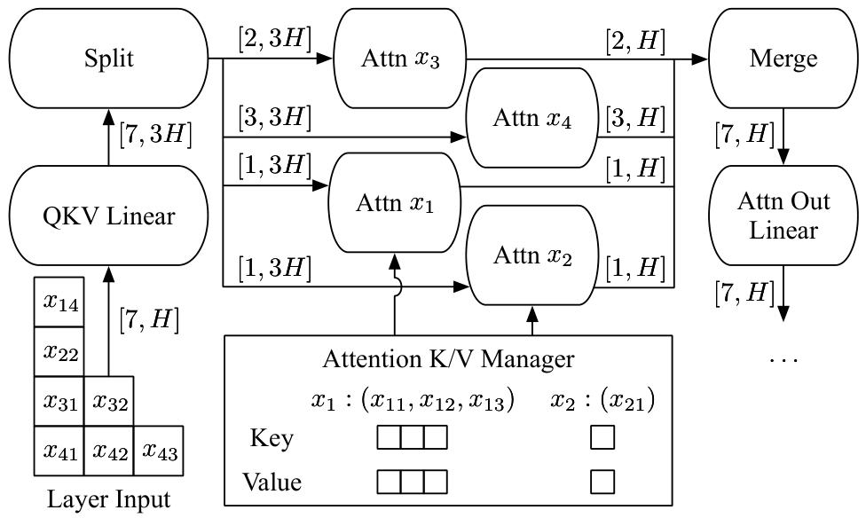

**先认左下角的输入。** 图中有四个请求 $x_1,x_2,x_3,x_4$；$x_{ij}$ 表示请求 $i$ 的第 $j$ 个 token。$x_1,x_2$ 在 decode，各输入一个位置 $x_{14},x_{22}$；$x_3,x_4$ 在 prefill，分别输入 2、3 个位置。共 $1+1+2+3=7$ 行，每行隐藏向量的长度为 $H$，所以合并输入是 $[7,H]$。这与前面的 A/B/C 四行例子原理相同，数量不同。

**沿箭头读：① QKV Linear（查询／键／值线性投影）**把七行一起计算为 $[7,3H]$，这里 $3H$ 是图中 Query、Key、Value 三份向量拼接后的宽度。**② Split（拆分）**按请求把 Q、K、V 分成四组，在同一模型层内分别计算 Attention（注意力），不是送入四个不同模型。每组只读取该请求的当前及历史 Key/Value；历史部分由下方 K/V Manager 提供。这里分开的是数据边界：各组内部可以并行计算，组间是否同时执行取决于实现，图中并排的方框不代表同时运行。**③ Merge（合并）**把四组注意力输出重新拼成 $[7,H]$；这里是按行拼接，不是把不同请求的向量相加。**④ Attn Out Linear（注意力输出线性层）**再对这七行一起计算。一次线性运算共享的是该层权重，不是让不同层共用同一份权重。[Orca §3、Figure 5 原文](https://www.usenix.org/system/files/osdi22-yu.pdf#page=7)

**这张图说明合批机制，不能直接当作所有引擎的执行图。** Orca 图中注意力逐请求拆开；SARATHI 的具体方案合并 prefill 与 decode 的线性运算，同时将 decode 请求的注意力组成一批，与 prefill 注意力分开执行。现代引擎也可用专门的计算程序处理多条序列的注意力，但各请求的上下文仍须隔离。因此，“同批执行”不表示所有计算程序在同一时刻运行。[SARATHI v1 §4.3](https://arxiv.org/html/2308.16369v1#S4.SS3) · [vLLM 官方博客 Figure 4：输入拼接与注意力隔离](https://vllm.ai/blog/2025-09-05-anatomy-of-vllm)

**再看同一个请求内部，分块后怎样保留前文。** 下面的 SARATHI 原图把 12 个输入位置分成三块，每块 4 个位置；从上到下依次展示三轮 prefill 的注意力范围。

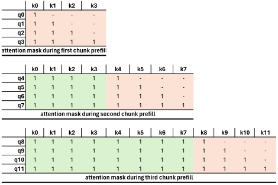

**先认图中的行、列和颜色。** 行 $q_i$ 是位置 $i$ 的 Query（查询），列 $k_j$ 是位置 $j$ 的 Key（键）；“1”表示可以关注该位置，并加权其对应的 Value（值），“–”表示屏蔽。橙色是当前块，绿色是前面块已保存的 Key/Value。

**上面一幅：处理第一块，位置 0–3。** 每个注意力层先计算当前块的 Query、Key、Value，再做注意力：$q_0$ 只关注 $k_0$，$q_1$ 关注 $k_0,k_1$，直到 $q_3$ 关注 $k_0$ 到 $k_3$。因此，第一块虽然没有绿色的历史缓存区，仍能读取橙色区内自己及前面位置的 Key/Value；算完后，各层保存这四个位置的 KV，供下一块使用。

**中间一幅：处理第二块，位置 4–7。** $q_4$ 到 $q_7$ 都能读取绿色区中位置 0–3 的历史 KV，同时读取橙色区中当前块允许关注的位置。例如 $q_4$ 关注位置 0–4，$q_7$ 关注位置 0–7。**最下面一幅：处理第三块，位置 8–11。** 此时绿色区扩大为位置 0–7，说明前两块的上下文都保留了下来。三幅图始终遵守同一个规则：每个位置只能关注自己及前文。[SARATHI v1 §4.2、Figure 6](https://arxiv.org/html/2308.16369v1#S4.SS2)

块内的输入 token 都已知，各层可并行计算这些位置的注意力，无需逐个采样输入 token；块与块之间则通过保存的 KV 延续上下文。在权重、位置与可见范围一致时，分块保留整段 prefill 的数学计算含义；浮点结果是否逐比特一致仍需另行验证。[SARATHI v1 §2.2、§4.2](https://arxiv.org/html/2308.16369v1#S2.SS2) · [数值差异见 02 篇 §2.2](./rl-infra-numerics.html#section-2-2)

**再对照缓存的变化。** vLLM 官方博客用 18 个输入 token、每轮最多处理 8 个的例子，展示分块计算怎样逐步填充 KV 缓存。原图画出前两轮：

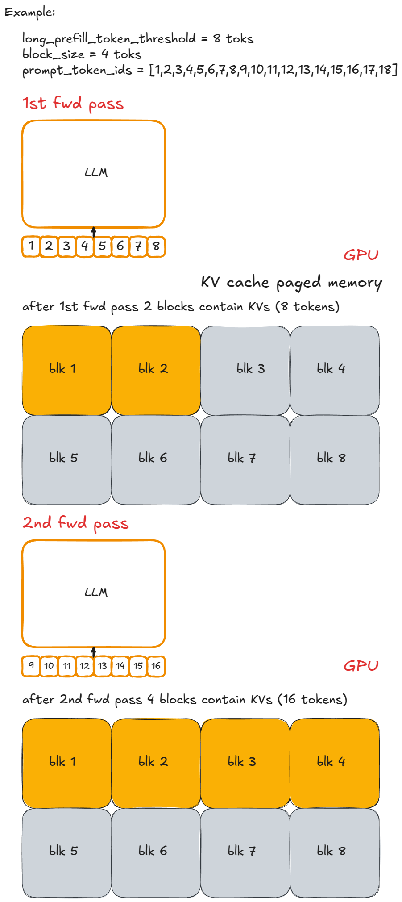

**读图：** `fwd pass` 指一次前向计算，LLM（Large Language Model，大语言模型）方框表示模型计算。图中每轮最多处理 8 个 token，而一个缓存块（`block`）容纳 4 个位置的 KV，**计算分块与缓存分块是两种不同的划分**。第一轮处理 1–8，两个缓存块填入 KV；第二轮处理 9–16，已有内容保留，累计四个块填入 KV。还剩 17、18 两个 token，需在后续轮次处理，完成全部 prompt 后才能采样首个回答 token；这一步未画在原图中。[原文与图注](https://vllm.ai/blog/2025-09-05-anatomy-of-vllm)

图中的 8 和 4 是示例配置。该文依据 2025-08-09 的提交 `42172ad`，用于说明机制，不代表本章固定版本的默认配置。

**三者接在一起的顺序是：查可复用前缀 → 确定剩余计算 → 必要时分块 → 与其他请求共同调度。** 对四 token 示例，假设配置允许复用 $p_1,p_2$ 的有效 KV，就只需继续处理剩余部分；但若本轮预算已用完或缓存分配不通过，它仍要等。命中减少了需要做的工作，没有替它预留本轮执行机会。

前缀命中直接省去的是重复前缀计算，不会免除后续新 token 的前向；负载降低可能间接改变 decode 等待时间。还有一个容易遗漏的边界：**即使整个 prompt 已有 KV，也不必然零计算就能给出首 token**，因为还需要用于采样的 logits。这版 vLLM 的 `get_computed_blocks()` 明确为此保留最后 token 的重算，块对齐还可能扩大重算范围。[vLLM 官方前缀缓存说明，动态文档，访问于 2026-11-02](https://docs.vllm.ai/en/latest/features/automatic_prefix_caching/) · [固定源码中的末 token 重算](https://github.com/vllm-project/vllm/blob/318c4db661d9706764ee3d9e1b9c14fc4e49c75b/vllm/v1/core/kv_cache_manager.py#L266)

### 1.5 缓存不够时，抢占和恢复到底做什么

**为什么已经运行，还会缺缓存？** 获准运行不等于预先占好了整段未来回答的空间。每次生成后，上下文会增长；下一个位置可能需要新的缓存块，其他请求也在竞争空间。因此，能完成这一轮，不保证下一轮仍能分配成功。

这里有三种不同操作：**缓存淘汰**回收可淘汰的缓存内容；**请求抢占／回退**暂停正在执行的请求，让出资源；**恢复计算**利用保留的 token 与仍有效的缓存重建执行状态。选谁暂停取决于具体策略，并不由“KV 不够”唯一决定。

vLLM 在分配失败后选择被抢占者：优先级策略按优先级和到达时间选择，另一条分支从运行列表尾部选择。`_preempt_request()` 释放请求缓存块，把状态改为 `PREEMPTED`，将 `num_computed_tokens` 重置为 0，并放回等待队列；输入与已采样输出序列仍留在请求中。这里是通过重新准入和必要的重算恢复，不能描述成默认把 KV 搬到主机内存、再原样搬回。[vLLM 选择被抢占请求](https://github.com/vllm-project/vllm/blob/318c4db661d9706764ee3d9e1b9c14fc4e49c75b/vllm/v1/core/sched/scheduler.py#L911) · [抢占与重新入队](https://github.com/vllm-project/vllm/blob/318c4db661d9706764ee3d9e1b9c14fc4e49c75b/vllm/v1/core/sched/scheduler.py#L1798)

SGLang 的相应路径是 `update_running_batch()` 检查 decode 内存，再调用 `retract_decode()`，把可恢复的请求重新入队。它有自己的回退排序规则；本章普通文本、非分离部署的路径会释放缓存、重置相关进度，保留已生成 token，之后重新准备输入并匹配前缀。源码也有无法恢复时中止请求的分支，因此“发生回退”不能被理解为无条件保证恢复。[SGLang 检查与入队](https://github.com/sgl-project/sglang/blob/6aca4198075af1ab42e753f419c9827ff0fec0d9/python/sglang/srt/managers/scheduler.py#L4750) · [回退排序与释放](https://github.com/sgl-project/sglang/blob/6aca4198075af1ab42e753f419c9827ff0fec0d9/python/sglang/srt/managers/schedule_batch.py#L3621) · [释放与重建分支](https://github.com/sgl-project/sglang/blob/6aca4198075af1ab42e753f419c9827ff0fec0d9/python/sglang/srt/managers/schedule_batch.py#L2519)

**回到贯穿例子。** 假设第 2 轮后已有回答 $a_1,a_2$，这时请求被抢占且没有可复用的缓存。恢复时把 $p_1,p_2,p_3,p_4,a_1,a_2$ 作为已知序列重新计算，建立所需 KV，再预测 $a_3$；不会重新采样并替换已经交付的 $a_1,a_2$。如果部分前缀缓存仍有效，就可以复用那一部分。保留回答的是 token 序列，重建的是执行这些 token 所需的缓存。

更激进地接纳请求可能提高并发，也可能增加抢占与重算。因此要同时观察吞吐和尾延迟，而不能只看运行请求数。SGLang 调优文档也把缓存使用率与回退频率放在一起讨论；其参数数值需要结合工作负载验证。[SGLang 调优说明，动态文档，访问于 2026-11-02](https://docs.sglang.io/docs/advanced_features/hyperparameter_tuning)

### 1.6 对照源码，并把生命周期连接到延迟指标

读源码时先找职责边界，再跟随同一个请求的 token、计算进度与缓存引用，不必逐行翻译。下表均指本章开头的固定提交：

| 职责 | vLLM 阅读入口 | SGLang 阅读入口 |
| --- | --- | --- |
| 主循环与执行边界 | [`EngineCore.step()`](https://github.com/vllm-project/vllm/blob/318c4db661d9706764ee3d9e1b9c14fc4e49c75b/vllm/v1/engine/core.py#L718) | [`event_loop_normal()`](https://github.com/sgl-project/sglang/blob/6aca4198075af1ab42e753f419c9827ff0fec0d9/python/sglang/srt/managers/scheduler.py#L2077) |
| 选择本轮计算内容 | [`Scheduler.schedule()`](https://github.com/vllm-project/vllm/blob/318c4db661d9706764ee3d9e1b9c14fc4e49c75b/vllm/v1/core/sched/scheduler.py#L698) | [`get_next_batch_to_run()`、`get_new_batch_prefill()`](https://github.com/sgl-project/sglang/blob/6aca4198075af1ab42e753f419c9827ff0fec0d9/python/sglang/srt/managers/scheduler.py#L4170) |
| 预算与缓存准入 | [`KVCacheManager.allocate_slots()`](https://github.com/vllm-project/vllm/blob/318c4db661d9706764ee3d9e1b9c14fc4e49c75b/vllm/v1/core/kv_cache_manager.py#L379) | [`PrefillAdder.add_one_req()`](https://github.com/sgl-project/sglang/blob/6aca4198075af1ab42e753f419c9827ff0fec0d9/python/sglang/srt/managers/schedule_policy.py#L1399) |
| 请求与批次状态 | [`Request`](https://github.com/vllm-project/vllm/blob/318c4db661d9706764ee3d9e1b9c14fc4e49c75b/vllm/v1/request.py#L60)、调度输出 | [`Req`、`ScheduleBatch`](https://github.com/sgl-project/sglang/blob/6aca4198075af1ab42e753f419c9827ff0fec0d9/python/sglang/srt/managers/schedule_batch.py#L1165) |
| 处理结果与更新状态 | [`update_from_output()`](https://github.com/vllm-project/vllm/blob/318c4db661d9706764ee3d9e1b9c14fc4e49c75b/vllm/v1/core/sched/scheduler.py#L2252) | [`process_batch_result()`](https://github.com/sgl-project/sglang/blob/6aca4198075af1ab42e753f419c9827ff0fec0d9/python/sglang/srt/managers/scheduler.py#L5371) |

在普通循环里，vLLM 先调度、提交模型执行、等待结果，必要时调用采样，再更新请求；SGLang 先接收请求、选择批次，再执行并处理结果。**不要从“同样支持分块”推出“排程顺序相同”。** 这版 SGLang 在存在可运行的新 prefill batch 时优先选择它，同时还有推迟与混合分支；不能直接套用其他引擎文档里的“decode 优先”。

异步执行会把“已经安排计算”和“结果已经返回”分开：主机侧可能准备后续工作，设备仍在计算前一批。vLLM 的批次队列路径和 SGLang 的 overlap 循环体现了这种重叠。因此，1.1 的表是完成后的教学快照，不是所有即时字段的含义；释放内存也必须考虑尚未结束的执行。[vLLM 批次队列](https://github.com/vllm-project/vllm/blob/318c4db661d9706764ee3d9e1b9c14fc4e49c75b/vllm/v1/engine/core.py#L761) · [SGLang overlap 循环](https://github.com/sgl-project/sglang/blob/6aca4198075af1ab42e753f419c9827ff0fec0d9/python/sglang/srt/managers/scheduler.py#L2114)

最后把这些等待连接到用户看到的时间。本章采用**客户端口径**：设 $t_0$ 为客户端发出请求的时刻，$t_1,t_2,\ldots$ 为各输出 token 可见的时刻。**Time to First Token（TTFT，首 token 延迟）**为 $t_1-t_0$；**Inter-Token Latency（ITL，相邻输出 token 间隔）**为 $t_j-t_{j-1}$，其中 $j\ge2$。若改用服务端接收或发出时刻，必须另行标明口径；流式响应合并多个 token 时，也不能直接把网络包间隔当成单 token 间隔。

在四 token 示例里，TTFT 包含请求传输、排队、prefill 各块计算及块间等待、采样和输出交付，**不能写成“TTFT 就是 prefill 时间”**。后续 ITL 还可能包含下一轮调度等待、抢占重算、模型执行及输出缓冲。前缀命中后仍等很久，可能是少算了一部分，却仍在等待计算机会或输出交付；这正是要把生命周期与计时边界一起记录的原因。

## 第 2 章 混合模型的状态复用

第一章说明了缓存怎样避免重复计算。本章接着问：**两条请求的 token 前缀相同，为什么仍可能无法从这个位置继续？** 因为匹配到的是共同历史，而继续计算需要的是这段历史在各层留下的完整状态。

延续固定权重、纯文本自回归生成的设定，这里新增 **hybrid model（混合模型）**：模型组合了不同类型的注意力层，或将注意力层与 Mamba 等采用递推状态的层组合；这与专家混合是不同概念。判断能否复用，要依次检查：**历史是否相同 → 所需状态是否齐全 → 状态是否就绪，且后续写入不会污染其他请求。** 本章只讲这些正确性条件；内存布局与淘汰策略留到第三章，传输过程留到第四章。源码沿用第一章的两个固定提交，以下图表和数字均为教学示例。

### 2.1 三种层，保存的“历史”有什么区别

**先看模型有哪些层，再决定需要哪些状态。** 推理引擎执行的是模型已有的结构，按各层的计算方式管理缓存。例如，NVIDIA 的 **Nemotron-H-56B-Base** 包含 54 个 Mamba-2 层、54 个 Multi-Layer Perceptron（MLP，多层感知机）层和 10 个自注意力层。因此，这个模型在逐 token 推理时既需要注意力层的 KV，也需要 Mamba 层的内部状态；其中普通 MLP 按位置计算，不额外保存这类跨 token 的历史状态。这是真实的混合架构例子，不表示它同时采用了下文列出的三类结构。模型是否包含递推层由架构决定，不能仅凭它是否逐 token 生成来判断。[NVIDIA 官方架构说明](https://research.nvidia.com/labs/adlr/nemotronh/)

先统一位置的含义：**恢复到边界 $c$，表示已经处理前 $c$ 个 token，准备输入第 $c+1$ 个 token 继续计算。** $c$ 是已处理的 token 数，不是层号，也不是对话轮数。本章讨论恢复继续前向所需的状态；若还需要从边界处的输出采样，下一个 token 的 logits 是否保留或需要重算，是另一项执行安排。

**① 递推层：以 Mamba 为例，保存处理历史后的状态。** Mamba 模块包含 State Space Model（SSM，状态空间模型），逐 token 推理时通过更新内部状态传递历史信息。下文把这类采用递推状态的层简称为“递推层”；这是对计算方式的概括，具体结构仍需看模型定义。[Mamba 原论文 v2，§2、§3.4](https://arxiv.org/html/2312.00752v2#S3.SS4)

设 $z_t$ 是第 $t$ 个 token 到达这一层时的输入向量，$s_{t-1}$ 是处理完前一个位置的状态，$f$ 是更新规则，则新状态为 $s_t=f(s_{t-1},z_t)$。这一层还会根据输入和状态计算输出，交给下一层：**状态沿 token 序列传递历史，输出传给后面的层。** 这个式子只概括状态更新，不是 Mamba 模块的完整计算公式。

例如，依次处理三个 token `A、B、C`：输入 `A` 后得到 $s_1$，输入 `B` 后结合 $s_1$ 得到 $s_2$，输入 `C` 后再结合 $s_2$ 得到 $s_3$。$s_2$ 对应处理完 `AB`，$s_3$ 已包含 `C` 的影响。若之后要从 `AB` 接着输入 `E`，需要的是 $s_2$；保存这个位置的完整状态，就得到**边界 2 的状态快照**。状态不是按 token 排列的原文列表，不能从 $s_3$ 中简单截取出 $s_2$。

**完整快照可能包含多个张量。** 除了递推状态，具体模型还可能需要卷积缓冲等辅助状态，恢复时必须一起满足。例如，SGLang 的相关状态池会复制卷积状态与时间递推状态；只保留其中一项，可能不足以继续计算。这是具体实现的例子，不是所有递推模型的统一布局。[固定源码：状态复制内容](https://github.com/sgl-project/sglang/blob/6aca4198075af1ab42e753f419c9827ff0fec0d9/python/sglang/srt/mem_cache/memory_pool.py#L1185)

**② 全注意力层：保存前缀中各位置的 KV。** 在普通因果全注意力（full attention）中，当前位置可以关注此前所有位置。因此，从边界 $c$ 继续输入第 $c+1$ 个 token 时，需要该层位置 1 到 $c$ 的 KV，再结合当前位置新算出的 KV 做注意力计算。例如，已处理到 8、下一步输入 9，就需要位置 1–8 的历史 KV。[SGLang 官方图解：全前缀复用](https://www.sglang.io/blog/unified-radix-cache)

**③ 滑动窗口注意力层：保存当前窗口需要的历史 KV。** Sliding Window Attention（SWA，滑动窗口注意力）限制当前位置只关注附近的一段历史。本章令窗口长度 $W$ **包含正在计算的当前位置**，所以从边界 $c$ 继续，最多需要前面 $W-1$ 个位置的 KV。取 $c=8$、$W=4$，输入位置 9 时读取历史位置 6、7、8，再加上当前位置 9；位置 1–5 不在这一步的窗口中。所需窗口必须连续完整，缺少位置 7 就不能直接按这个窗口继续。[vLLM 固定源码：窗口命中检查](https://github.com/vllm-project/vllm/blob/318c4db661d9706764ee3d9e1b9c14fc4e49c75b/vllm/v1/core/single_type_kv_cache_manager.py#L969)

这里的 $W$ 是教学口径。框架内部的窗口参数、缓存保留长度和块对齐可能采用不同定义，使用接口时需要另外核对。

**真实例子：Gemma 2。** 它交替使用局部滑动窗口注意力和全局注意力，局部窗口大小为 4096。因此，复用同一段前缀时，全局注意力层需要自己的完整前缀 KV，滑动窗口层需要自己的窗口 KV；要从同一个边界继续计算，两类层的状态都必须满足各自要求。[Gemma 2 技术报告，§2](https://storage.googleapis.com/deepmind-media/gemma/gemma-2-report.pdf)

把三类层放到同一个恢复边界比较：

| 层类型 | 从边界 $c$ 继续需要什么 | 常见失效情况 |
| --- | --- | --- |
| 采用递推状态的层（以 Mamba 为例） | 处理完前 $c$ 个 token 后的完整状态快照 | 没保存这个位置，或状态已被后续更新覆盖 |
| 因果全注意力（full attention） | 该层前 $c$ 个位置的 KV | 中间某段历史 KV 缺失 |
| 滑动窗口注意力（SWA） | 该边界所需的连续历史窗口 KV | 窗口有缺口，或只剩另一个位置的窗口 |

**模型实际包含哪些层，恢复时就检查对应哪些状态。** 只有模型同时含有这三类层时，才要三类都齐全。各层的历史由各自的输入和参数计算，不能拿一个全注意力层的 KV，代替另一个窗口层的 KV 或 Mamba 状态。下面统一以边界 8 展示三种需求。

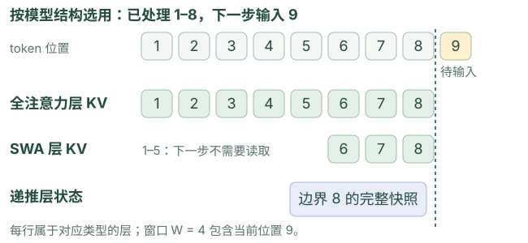

**读图：** 全注意力层需要位置 1–8 的 KV，SWA 层需要位置 6–8 的 KV，递推层需要边界 8 的完整快照。三行都对应“已处理前 8 个 token”，但保存历史的方式不同。

### 2.2 前缀相同，为什么还不能直接复用

| 检查 | 它确认什么 |
| --- | --- |
| token 前缀匹配 | 两条请求共享从开头到这里的 token 历史 |
| 缓存身份有效 | 状态对应当前模型权重和前向计算条件 |
| 恢复状态完整 | 各层在所选边界需要的状态都存在 |

**反例一：匹配到 8，却只有 12 的快照。** 旧请求处理到了位置 12，新请求与它共享前 8 个 token，但从位置 9 开始不同。如果递推层只保存了边界 12 的快照，它已经包含旧请求位置 9–12 的影响，不能作为边界 8 的状态。前 8 个 token 匹配、全注意力 KV 也齐全，仍不足以恢复整个模型。[SGLang 固定源码：递推组件检查候选边界的快照](https://github.com/sgl-project/sglang/blob/6aca4198075af1ab42e753f419c9827ff0fec0d9/python/sglang/srt/mem_cache/unified_cache/components/mamba.py#L158)

**反例二：结尾相同，不等于历史相同。** 假设两条请求最后三个 token 一样，但更早的 token 不同。即使某个 SWA 层只读取最近三个历史位置，其 KV 也来自这些位置的隐藏表示，而隐藏表示可能已受更早的层和历史影响。因此，不能仅凭相同的文本后缀交换缓存。这里是根据逐层计算依赖得到的推论：**窗口限制本层读哪些位置，不保证这些位置的状态只由窗口内的原始 token 决定。**

此外，权重版本、适配器、位置和注意力可见范围等会影响前向状态，也需要一致。具体哪些条件进入缓存键、哪些由引擎实例及缓存生命周期隔离，要看实现。例如，这版 SGLang 把适配器标识加入 `extra_key`，并将它用于前缀键的命名空间；这不表示缓存键自动检查了所有前向条件。仅改变输出采样温度，通常不会改变同一固定前缀已经算好的 KV，但会影响之后采样出的 token。[固定源码：适配器加入请求键](https://github.com/sgl-project/sglang/blob/6aca4198075af1ab42e753f419c9827ff0fec0d9/python/sglang/srt/managers/schedule_batch.py#L1301) · [前缀键的命名空间](https://github.com/sgl-project/sglang/blob/6aca4198075af1ab42e753f419c9827ff0fec0d9/python/sglang/srt/mem_cache/radix_cache.py#L224)

### 2.3 怎样找到所有层都能恢复的位置

**最长 token 匹配只是查找范围，还要从中找出各类状态共同接受的恢复边界。** 下面假设一个教学模型同时包含全注意力、SWA 和递推层，检查它们共同接受的位置。缓存条件如下：前 10 个 token 相同，全注意力 KV 完整；SWA 仍取 $W=4$，保留位置 2–4、6–10，但缺少位置 5；可复用的递推快照只有边界 4 和 6。假设只检查 4、6、8、10 四个候选，表中已有状态均已在设备上就绪。

| 候选边界 $c$ | 全注意力 KV | SWA 所需历史 KV | 递推快照 | 整体恢复 |
| --- | --- | --- | --- | --- |
| 4 | 完整 | 2、3、4：完整 | 有 | **可以** |
| 6 | 完整 | 4、5、6：缺 5 | 有 | 不可以 |
| 8 | 完整 | 6、7、8：完整 | 无 | 不可以 |
| 10 | 完整 | 8、9、10：完整 | 无 | 不可以 |

所以，**token 匹配到 10，实际只能从边界 4 恢复，再输入已知的第 5 个 token 继续。** 不能简单取三个组件“最大可恢复位置”的最小值：它们分别是 10、10、6，取最小得到 6，但位置 6 缺少所需的 SWA 状态。能在较晚位置恢复，也不保证能在每个较早位置恢复。

若把组件 $j$ 接受的候选边界记作集合 $B_j$，共同恢复位置就是 $c^*=\max(\bigcap_j B_j)$：先求所有集合的交集，再选其中最晚的位置。这里 $j$ 遍历状态组件；把从头计算的边界 0 放进各集合，就有无命中时的退路。这是本文对正确性条件的概括，不表示实现会真的构造这些集合。

**两套框架怎样落实这个检查？** 这版 SGLang 沿前缀路径访问候选节点，各组件分别验证，只有全部通过才更新最佳恢复位置；某个候选失败，仍可继续检查更深的节点。SWA 验证器会跟踪连续可用的窗口，递推验证器检查端点快照。vLLM 的混合协调器采用迭代检查：某类状态要求缩短候选长度后，再协调其他类型，直到得到共同结果；全注意力与另一种状态的简单组合有专门的提前结束路径。[SGLang 匹配循环](https://github.com/sgl-project/sglang/blob/6aca4198075af1ab42e753f419c9827ff0fec0d9/python/sglang/srt/mem_cache/unified_cache/unified_tree_core.py#L972) · [SWA 验证器](https://github.com/sgl-project/sglang/blob/6aca4198075af1ab42e753f419c9827ff0fec0d9/python/sglang/srt/mem_cache/unified_cache/components/swa.py#L287) · [vLLM 混合协调器](https://github.com/vllm-project/vllm/blob/318c4db661d9706764ee3d9e1b9c14fc4e49c75b/vllm/v1/core/kv_cache_coordinator.py#L806)

这里以固定源码为准。访问于 2026-11-02 的 [vLLM 动态设计文档](https://docs.vllm.ai/en/latest/design/hybrid_kv_cache_manager/) 仍把相关算法描述为“全注意力加另一种类型”，不能用这段限制概括上述提交的迭代实现。另需区分**有有效备份**与**已经可以计算**：状态若只在主机内存中，必须先恢复到执行所需的位置并等待就绪；本表没有计入这段等待。[SGLang 原文：状态有效性与存储层级](https://www.lmsys.org/blog/2026-08-11-unified-radix-cache/)

### 2.4 前缀树能拆分，快照不能凭空产生

**Radix tree（压缩前缀树）** 把共同前缀放在同一路径上，一条边可以表示多个 token。这里用 `A、B、C、D、E、F` 分别代表一个 token：已缓存 `ABCD` 后再遇到 `ABEF`，树可以把原来的长边拆成下面的结构。

```text
拆分前：根 ── ABCD
拆分后：根 ── AB ─┬─ CD
                  └─ EF
```

**树中新建了 `AB` 分叉点，不代表已保存 `AB` 的递推快照。** 如果原来只有处理完 `ABCD` 的状态，就不能按“取前两个 token”的方式切出 `AB` 的状态。树记录的是前缀关系；递推快照记录的是特定端点的计算结果。这版 SGLang 拆分节点时，将新父节点的递推状态设为空，原端点状态仍留在子节点，正是为了保留这个区别。[固定源码：递推组件如何处理节点拆分](https://github.com/sgl-project/sglang/blob/6aca4198075af1ab42e753f419c9827ff0fec0d9/python/sglang/srt/mem_cache/unified_cache/components/mamba.py#L474)

同样，**树节点仍在，不代表它关联的每类数据都还在。** 某段 SWA 数据可以被淘汰，节点及其他组件继续保留。因此，不能只看树是否匹配到 `AB`，还要做上一节的状态检查；缺失快照时，应从更早的共同有效边界重算到 `AB`。[作者原文：节点生命周期与组件数据](https://www.lmsys.org/blog/2026-08-11-unified-radix-cache/)

### 2.5 分叉后，为什么要隔离写入

现在假设 `AB` 的完整快照确实存在：请求甲下一步输入 `C`，请求乙下一步输入 `E`。两者可以读取同一份初始状态，但各自继续计算时，会把状态更新成不同的结果。

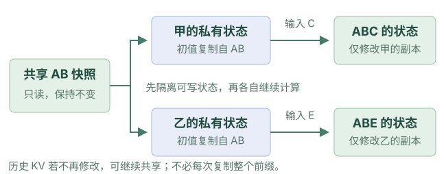

**如果甲直接覆盖共享快照，乙读到的就可能已经是 `ABC` 的状态。** 图中为两条请求准备独立的可写状态，甲输入 `C` 后更新自己的副本，乙输入 `E` 后更新另一个副本，共享的 `AB` 快照保持不变。**Copy-on-Write（CoW，写时复制）** 表达的原则就是：只读时可以共享，在写入会影响其他使用者的数据之前，先取得独立的可写空间。

| 对象 | 分叉后的处理原则 |
| --- | --- |
| 不再修改的历史 KV 块 | 可以继续共享引用 |
| 即将写入的共享区域 | 先准备独立写入空间，粒度由实现决定 |
| 会持续更新的递推状态 | 与共享快照隔离后，再执行状态更新 |

**源码中，“准备复制”和“执行复制”是两步。** 这版 SGLang 的递推组件先为请求准备私有状态槽，记录复制来源；批次准备阶段汇总来源和目的索引；模型执行器再在前向读取递推状态之前，调用复制或快照加载路径。前一个函数返回了，并不表示所有数据已经复制完成。[私有状态准备](https://github.com/sgl-project/sglang/blob/6aca4198075af1ab42e753f419c9827ff0fec0d9/python/sglang/srt/mem_cache/unified_cache/components/mamba.py#L206) · [收集待复制索引](https://github.com/sgl-project/sglang/blob/6aca4198075af1ab42e753f419c9827ff0fec0d9/python/sglang/srt/managers/schedule_batch.py#L3415) · [前向之前执行复制](https://github.com/sgl-project/sglang/blob/6aca4198075af1ab42e753f419c9827ff0fec0d9/python/sglang/srt/model_executor/model_runner.py#L1957)

### 2.6 回滚为什么不能只改一个长度字段

如果已经处理到位置 10，现在需要回到边界 6，长度字段改成 6 只表达“想回到哪里”，不会自动找回被覆盖或淘汰的数据。仍按本章 $W=4$、包含当前位置的口径检查：

| 状态类型 | 从 10 回到 6，需要检查什么 |
| --- | --- |
| 全注意力 | 位置 1–6 的 KV 是否完整，逻辑长度和位置映射是否对应这六个位置 |
| SWA | 下一步输入位置 7，需要历史位置 4、5、6；当前为位置 11 保留的 8、9、10 不能代替它们 |
| 递推层 | 是否有边界 6 的完整快照；只有边界 10 的状态通常无法直接恢复 |

递推更新可抽象为 $s_t=f(s_{t-1},z_t)$：$s_t$ 是该层处理完位置 $t$ 后的状态，$z_t$ 是当前位置的层输入表示，$f$ 是更新规则。这个教学式只说明如何向前更新，**不保证存在可用的逆运算**，也不是某个具体模型的完整计算公式。窗口缓存会丢失旧位置，递推快照只对应特定端点，因而两者都不能仅靠缩短逻辑长度完成回滚。[vLLM 固定源码：SWA 连续窗口查找](https://github.com/vllm-project/vllm/blob/318c4db661d9706764ee3d9e1b9c14fc4e49c75b/vllm/v1/core/single_type_kv_cache_manager.py#L969) · [递推端点查找](https://github.com/vllm-project/vllm/blob/318c4db661d9706764ee3d9e1b9c14fc4e49c75b/vllm/v1/core/single_type_kv_cache_manager.py#L1470)

**缺少目标状态时，从更早的共同有效边界重算。** 例如沿用 2.3 的缓存，边界 6 缺位置 5 的 SWA 状态，但边界 4 完整：先恢复到 4，再依次输入已知的第 5、6 个 token，便能重新建立边界 6 的各层状态；递推状态的写入也要按 2.5 隔离。若没有任何可复用边界，就从 0 开始。这是重放已知序列、重建状态，不是重新采样并替换已有回答。

排查一次复用时，按顺序记录**匹配到哪里、各层在哪些边界有效、最终从哪里恢复、哪些 token 要重算，以及继续写入前隔离了什么**。这些信息比单独报告“命中了几个 token”更能解释请求接下来究竟可以做什么。

## 第 3 章 统一缓存与内存分配

第二章解决“哪些状态齐全，才能继续计算”，本章接着问：**这些状态怎样占用空间，为什么还有空闲内存却分配失败？** 关键不只是剩余字节数，还包括空间属于哪个池、能否整理出来，以及当前是否允许使用。本章沿用前述 SGLang 固定提交；图中数字均为教学设定，性能数字则单独注明原始报告的条件。

### 3.1 看三张官方图，分清“统一”指什么

先沿着一次请求想两个问题：**以前算过的状态，哪些还能用？需要保存新状态时，显存从哪里分？** 前一个由缓存管理回答，后一个由内存分配回答。下面两张 SGLang 图分别对应它们；最后再辨认 NVIDIA 文档里另一个同名概念。

**① 统一基数树缓存：把“同一段前缀对应哪些状态”放在一起管理。**


**从左上往下读。** 树上的 `shared span` 表示请求共有的一段 token 前缀，分叉表示后续 token 不同。选定一段前缀后，下方三个框分别检查它对应的全注意力 KV（FULL）、窗口 KV（SWA）和递推快照（MAMBA）：整段历史、末尾窗口、指定边界快照，复用条件各不相同。模型有哪些层，就检查相应状态；并非每个模型都要三类齐全。

因此，Unified Radix Cache（统一基数树缓存）统一的是**查找与管理前缀的结构**。可以把它理解为一份目录：找到“这段前缀有哪些状态、是否还能用、数据在哪里”。目录放在一起，不代表数据已经存进同一个内存池。[官方原文与图注](https://www.lmsys.org/blog/2026-08-11-unified-radix-cache/)

**② SGLang 统一内存池：让不同状态共用一份显存预算。**

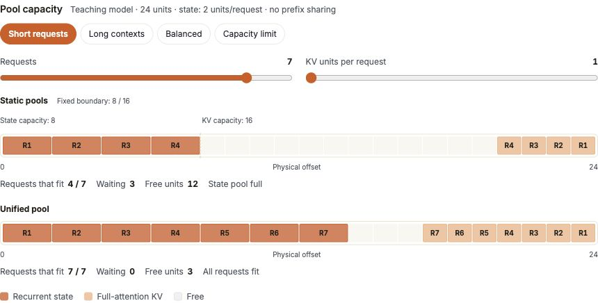

**先认图中的容量标签。** 顶部的 `24 units` 表示总共 24 个等大的存储单位，这是教学单位，不是 24 个 token。上排 Static pools（固定池）的横条上方，左侧 `State capacity: 8` 表示递推状态池有 **8 单位容量**，右侧 `KV capacity: 16` 表示 KV 池有 **16 单位容量**；两者合计 24。这里说的是两个池各有多大，不是已经存了多少数据。

**再看每个请求占多少，为什么只能放下四个。** 顶部 `state: 2 units/request` 表示每个请求的递推状态占 2 单位；右上 `KV units per request` 的数值为 1，表示每个请求的 KV 占 1 单位。因此，R1–R4 的状态占满左侧 $4\times2=8$ 单位，KV 只占右侧 $4\times1=4$ 单位，右侧还剩 $16-4=12$ 单位。但固定分区不允许状态借用这 12 单位，所以 R5–R7 仍要等。横条下方的 `Requests that fit 4/7`、`Waiting 3`、`Free units 12` 正好对应这个结果。

**最后看下排 Unified pool（共享池）。** 取消“状态只能用 8、KV 只能用 16”的固定配额后，两类数据按需分享同一份 24 单位容量。七个请求的状态占 $7\times2=14$，KV 占 $7\times1=7$，合计 21，剩余 3，所以七个都能放下。深色状态区从左侧增长，浅橙色 KV 区从右侧增长，中间浅色空格是剩余空间。这里共享的是 **GPU 内部的容量**，没有增加显存，也没有把数据搬到 CPU。[打开官方交互图](https://www.sglang.io/blog/unified-memory#share-the-unused-space)

**③ CUDA Unified Memory：让 CPU 与 GPU 能访问托管内存。**

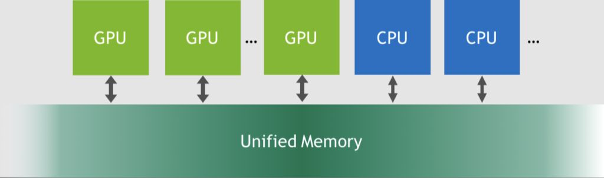

**看箭头两端的对象。** 上面是 CPU 和 GPU，下面的 Unified Memory 表示它们可访问的统一内存地址空间。程序可以申请一份托管内存供两侧代码使用；数据怎样驻留、迁移或被远端访问，由平台与运行机制决定。图中的一条长带不表示所有物理内存都变成了同一块显存。[NVIDIA 原文与图注](https://developer.nvidia.com/blog/unified-memory-cuda-beginners/) · [当前 CUDA 内存说明](https://docs.nvidia.com/cuda/cuda-programming-guide/02-basics/understanding-memory.html)

三张图对应三个不同问题：**前缀树管“哪些历史可复用”，SGLang 内存池管“各类状态怎样分显存”，CUDA 统一内存管“CPU/GPU 怎样访问托管内存”。** 本章接下来重点讲第二个问题。

### 3.2 容量怎样计算：先把单位说清楚

**“还能放 100 个 token”和“还有 10 个状态槽”，能直接相加吗？** 不能。它们代表不同存储单元，必须换算成字节，且说明每个单元覆盖哪些层。

| 计量单位 | 本章的含义 |
| --- | --- |
| token 数 | 序列长度或缓存覆盖的位置数，本身不是内存大小 |
| KV 页 | 成组分配、释放或搬动的 KV 单元；需说明每页容纳多少位置、包含哪些层 |
| 状态槽 | 保存一份完整递推状态的单元；需说明包含哪些层及哪些状态张量 |
| 字节数 | 比较不同类型占用量的共同单位 |

简化计量式为 $M=\sum_j n_jb_j$：$j$ 表示资源类型，$n_j$ 是实际占用的物理单元数量，$b_j$ 是该类单元的字节数。**多个请求引用同一份缓存，只计一次物理占用。** 统计时还应说明是否计入对齐填充、保留区域和元数据；不能用请求各自的逻辑长度直接相加代替物理占用。

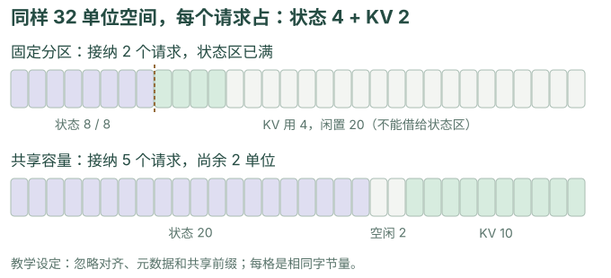

**对照图看固定分区的问题。** 状态区固定为 8、KV 区固定为 24 时，两个请求就用满状态区，虽然 KV 区还剩 $24-2\times2=20$ 单位，第三个请求仍无法分配。若两类容量可以自由共享，每个请求共需 $4+2=6$ 单位，最多容纳 $\lfloor32/6\rfloor=5$ 个，剩余 2 单位。改进来自打破固定分区的限制，并没有增加物理内存。[初始实现 PR #29678：问题与共享缓冲区设计](https://github.com/sgl-project/sglang/pull/29678)

递推层的一份工作状态通常不随回答长度增长，但**多保留一个边界快照，就可能多占一个状态槽**。即使总字节够用，页对齐、可用编号或搬动限制仍可能阻止分配。固定源码中，状态槽的 `available_size` 表示编号容量减已分配数量；`schedulable_available_size` 才进一步考虑共享缓冲区能实际提供的空间，两者不能混用。[状态槽的两种容量视图](https://github.com/sgl-project/sglang/blob/6aca4198075af1ab42e753f419c9827ff0fec0d9/python/sglang/srt/mem_cache/unified_memory_pool.py#L63)

### 3.3 怎样共享容量：布局与编号映射

**先看整块显存，再对应源码中的管理对象。** SGLang 官网的 *Reclaiming a hole*（回收空洞）交互图把共享缓冲区画成一条横带。图中没有直接标注类名；下面根据本章固定提交，把图里的区域与 `KVArena`、`Band`、`ChainAllocator` 对照起来。

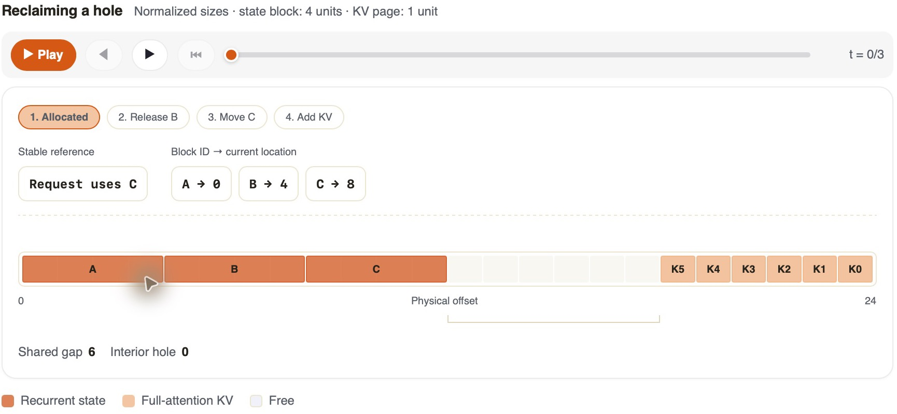

**先认横条里的三部分。** 深橙色 A、B、C 是三个递推状态块，每块占 4 单位，共占偏移 0–12；右侧浅橙色 K0–K5 是六个 KV 页，每页占 1 单位，占偏移 18–24。中间 12–18 的浅色区域是共享空闲空间，所以图下写着 `Shared gap 6`。A、B、C 属于同一类状态子池，并不是三个子池。[官方图与交互步骤](https://www.sglang.io/blog/unified-memory#consolidate-freed-space-at-runtime)

- **`KVArena`：整块缓冲区。** 持有整条 0–24 对应的共享字节缓冲区，并提供整块数据的复制、清零操作。状态和 KV 都放在这里；名字中的 KV 不表示只能存 KV。
- **`Band`：管理一种子池的区域。** 左侧状态区、右侧 KV 区分别由各自的 Band 管理，负责本区域的单元分配、释放、位置记录和整理。一个 Band 可以包含多个数据块。
- **`ChainAllocator`：协调多个 Band。** 把各区域按缓冲区中的次序连接起来，协调请求需要的分配与释放。它是分配器，不是横条里的第三块存储空间。

这张图画的是两个子池从两端向中间增长。固定版本还支持中间可移动的区域，供更多子池共享容量；具体有几类，取决于模型结构。上述对应关系是本文对源码的说明，不是官网原图的类结构标注。[KVArena](https://github.com/sgl-project/sglang/blob/6aca4198075af1ab42e753f419c9827ff0fec0d9/python/sglang/srt/mem_cache/kv/memory/arena.py#L61) · [Band 的职责](https://github.com/sgl-project/sglang/blob/6aca4198075af1ab42e753f419c9827ff0fec0d9/python/sglang/srt/mem_cache/kv/alloc/band.py#L14) · [ChainAllocator 如何创建和连接各 Band](https://github.com/sgl-project/sglang/blob/6aca4198075af1ab42e753f419c9827ff0fec0d9/python/sglang/srt/mem_cache/kv/alloc/chain.py#L158)

**把前图中的一个 KV 页放大，看它里面装什么。** 一页按固定容量容纳若干 token 的 K/V；同一组 token 经过不同注意力层，会产生各层自己的 K/V。下面的官网图用 **3 层、2 页**比较两种存放方式；图里的一个小矩形表示“一页在某一层的 K/V 部分”，不是一个 token。

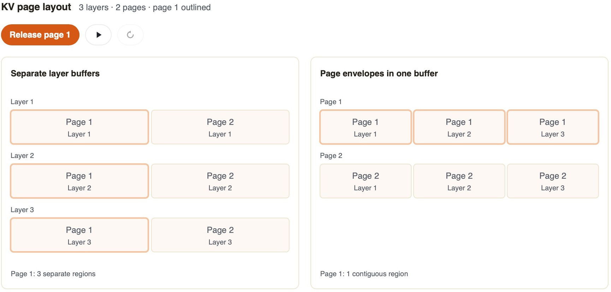

**左图按层存放，右图按页集中。** 左侧 *Separate layer buffers*（各层独立缓冲区）的三行分别是 Layer 1、2、3：找出三个橙框，它们都是 Page 1 的数据，却分散在三个层的缓冲区中。右侧 *Page envelopes in one buffer*（同一缓冲区中的页包）把这三份数据放进一块连续区域，合称 Page 1 的 **page envelope（页包）**；Page 2 同理。因此，搬动 Page 1 时，左边要分别搬三处，右边可以整块复制；释放后，右边得到的也是一整块连续空间。[官网原图与交互演示](https://www.sglang.io/blog/unified-memory#pack-data-into-movable-blocks)

**再对应固定版本的页内布局。** 源码把一个 token 在相关多层中的 K/V 打包成一个“token 条目”，再把多个条目连续排成一页。可以理解为：**一页 → 多个 token 条目 → 每个条目含各层 K/V**。官网图说明的是“同一页的跨层数据集中存放”，不是该版本逐字节排列的展开图。递推状态块则保存相应的状态张量；它与 KV 页大小可以不同，但都占用 KVArena 的共享容量。[固定版本的注意力布局](https://github.com/sgl-project/sglang/blob/6aca4198075af1ab42e753f419c9827ff0fec0d9/python/sglang/srt/mem_cache/kv/layout/mha.py#L52)

**再把官网的后两步放在一起看：释放 B → 把 C 搬进空洞。** 下图是本文的简化对照图，仍沿用本节第一张官方图中 0–24 的同一条缓冲区：左边 A、B、C 属于状态 Band，右边“另一子池”就是第一张图中 K0–K5 所在的 KV Band。

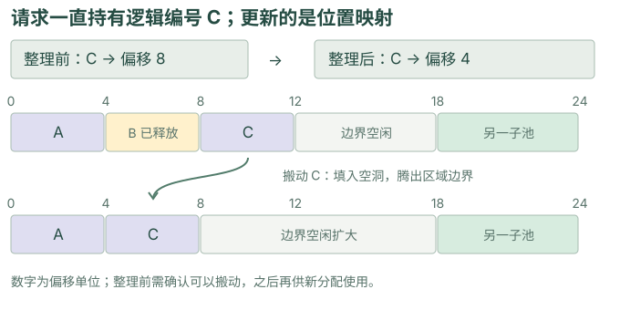

**请求记住“要用哪一份数据”，映射表记住“它现在在哪里”。** 图中请求一直持有逻辑编号 C，整理前映射到偏移 8，整理后映射到偏移 4。对应实现中，状态 Band 管理位置变化，调用 KVArena 的整块复制操作；更新映射后，请求仍能通过 C 找到数据。这里的逻辑编号是引擎管理的标识，不是操作系统的虚拟地址；移动前还必须保证使用旧位置的操作已经完成。[物理单元搬动](https://github.com/sgl-project/sglang/blob/6aca4198075af1ab42e753f419c9827ff0fec0d9/python/sglang/srt/mem_cache/kv/memory/arena.py#L214) · [状态槽编号到物理位置的转换](https://github.com/sgl-project/sglang/blob/6aca4198075af1ab42e753f419c9827ff0fec0d9/python/sglang/srt/mem_cache/unified_memory_pool.py)

**阅读源码时要区分版本。** 初始 PR 使用 `UnifiedKVPool`、`MultiEndedAllocator` 等入口；本文固定提交已采用上述组件，不能把早期图解当作当前类名的一一标注。[初始两端设计 #29678](https://github.com/sgl-project/sglang/pull/29678) · [多子池扩展 #35177](https://github.com/sgl-project/sglang/pull/35177)

### 3.4 为什么释放了空间，仍然需要整理

**上图释放 B 后，空间不是已经空出来了吗？** 对原区域而言，这个空洞可能可复用；但若另一子池只能从区域边界继续增长，内部空洞还不能直接供它使用。把 C 从偏移 8 搬到 4 后，空闲空间才与右边相连，边界从 12 退到 8。这种搬动存活数据、整理空闲空间的操作叫 **compaction（内存整理）**，不会降低数据精度。

| 空间没有被充分利用的原因 | 教学例子 | 处理方向 |
| --- | --- | --- |
| 固定分区闲置 | 状态区满，KV 区还有 20 单位 | 允许类型之间共享容量 |
| 单元内部浪费 | 一页容纳 16 个位置，只使用 10 个 | 调整分配粒度或布局；搬动其他页不能填满这页 |
| 布局中的空洞 | B 已释放，但 C 隔开了空洞与边界 | 必要时搬动 C，让空间可供后续分配 |

**有空洞、整理后能用、现在就能安全用，是三个判断。** 当前仍被计算或传输读取的数据不能随意移动；尚未完成的异步操作，也可能让已释放的单元暂时不能复用。固定版本的 `Band` 区分立即可用容量与整理邻接区域后可调度的容量，并检查禁止搬动的状态；等待完成事件的单元不能直接算作可回收空洞。因此，分配失败时需要区分空间不足、布局限制和同步等待。[容量计算、待复用空间与搬动限制](https://github.com/sgl-project/sglang/blob/6aca4198075af1ab42e753f419c9827ff0fec0d9/python/sglang/srt/mem_cache/kv/alloc/band.py#L665)

**与 vLLM 的短对照：先分组，再看数据放在哪里。** 官方设计文档有两张配套图。示例包含 10 个全注意力层（`full`）和 20 个滑动窗口层（`sw`），分成三组，每组 10 层；每块容纳 16 个 token，窗口为 32，请求长度为 112。

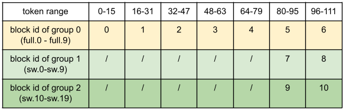

**读第一张图：列是 token 范围，格内数字是块编号。** 黄色 Group 0 覆盖全部 112 个位置，需要 7 块，编号 0–6；两个绿色组只保留末尾 32 个位置，各需 2 块，分别编号 7–8、9–10。“/”表示这段历史无需分配块。组内各层使用相同的块编号，但保存的是各层自己的 K/V。[官方分组示例](https://docs.vllm.ai/en/latest/design/hybrid_kv_cache_manager/#case-2-same-kv_hidden_size-and-a-regular-pattern)

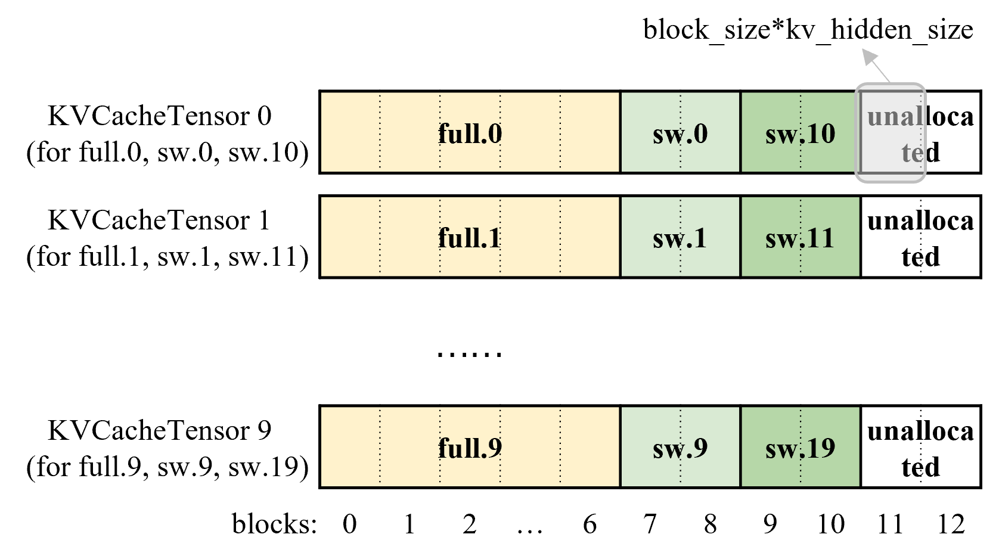

**读第二张图：每条横带是一个物理缓冲区。** 第一条 `KVCacheTensor 0` 同时存放 `full.0`、`sw.0`、`sw.10`，分别使用黄色、浅绿、深绿区域；白色 `unallocated` 表示尚未分配。其余横带采用相同安排。沿底部编号 0 向上看：每条横带都有对应的一小片，合起来才是逻辑块 0 的全部数据。因此，**一个逻辑块分布在 10 个缓冲区里，并非前面 SGLang 页包那样的一整块连续区域。** [官方内存布局说明](https://docs.vllm.ai/en/latest/design/hybrid_kv_cache_manager/#memory-layout)

**这里统一的是分配单位的字节数。** 各组都有 10 层，且每层每 token 的 KV 大小相同，所以逻辑块等大。层数凑不齐时，文档另有填充方案，会浪费部分空间；上面两图没有画填充。它与 SGLang 可变区域方案的差异在布局与分配方式，不是“只有一方共享容量”。[分组与填充](https://docs.vllm.ai/en/latest/design/hybrid_kv_cache_manager/#case-3-same-kv_hidden_size-and-no-regular-pattern)

注意单位：该文档的 `block size` 是每块 token 数（本例 16）；`page size` 是整个逻辑块的字节数（本例合计 10 层），代码 `KVCacheSpec.page_size_bytes` 则按单层计。以上解释对应文档所述设计，访问日期为 2026-11-02，不代表当前所有实现。[官方定义与版本说明](https://docs.vllm.ai/en/latest/design/hybrid_kv_cache_manager/#definitions)

### 3.5 淘汰何时停止：看新分配是否已经能满足

**为什么淘汰更多缓存，反而可能拖慢后续请求？** 选择哪些缓存牺牲，是“淘汰谁”；判断何时已经腾够空间，是“何时停止”。即使选择顺序合理，停止条件错误也会删掉本可保留的数据。

**先回答“淘汰哪一份 KV”：从可回收的前缀缓存中选。** 这里讨论已缓存、供后续请求复用的数据；正在被请求使用并锁定的节点不能直接淘汰。以固定版本的全注意力 KV 路径为例，候选是“没有仍保存 GPU 全注意力 KV 的子节点、且未被锁定”的前缀树节点，也就是可回收的叶端。淘汰它，释放的是该节点所代表的一段前缀的 KV；并非随意删除某个 token，也不一定删除整条请求的缓存。[候选节点条件](https://github.com/sgl-project/sglang/blob/6aca4198075af1ab42e753f419c9827ff0fec0d9/python/sglang/srt/mem_cache/unified_cache/unified_tree_core.py#L2561)

**LRU 决定先淘汰谁。** LRU 是 Least Recently Used（最近最少使用）：在符合条件的候选中，优先淘汰最久没有被访问的缓存，而不是序列中位置最早的 token。该版本配置为 `lru` 时，排序依据是节点的最后访问时间；另有其他策略，启用会话保护时还会考虑会话引用。因此，不能把所有缓存类型和配置都概括成同一条 LRU 队列。[LRU 排序依据](https://github.com/sgl-project/sglang/blob/6aca4198075af1ab42e753f419c9827ff0fec0d9/python/sglang/srt/mem_cache/evict_policy.py#L16) · [全注意力 KV 的候选排序](https://github.com/sgl-project/sglang/blob/6aca4198075af1ab42e753f419c9827ff0fec0d9/python/sglang/srt/mem_cache/unified_cache/components/full.py#L205)

**再看“何时停止”：用 A、B、C 三个缓存节点手算。** 假设它们都可淘汰，按 LRU 依次为 A、B、C；每个节点保存 KV 2 单位和递推快照 4 单位，淘汰时这两部分一起释放。这里的“单位”统一指内存容量，不是 token 数或快照个数。新 KV 分配还缺 12 单位，并假设释放的两类空间都能在必要整理后供它使用。

| 操作 | 累计释放 KV | 累计释放快照 | 合计可供新 KV 使用 | 是否继续 |
| --- | --- | --- | --- | --- |
| 淘汰 A | 2 | 4 | 6 | 还缺 6，继续 |
| 再淘汰 B | 4 | 8 | 12 | 已够，保留 C |

**如果只数“释放了多少 KV”，就会多删。** 淘汰 A、B 后，KV 计数只有 4，于是误以为还缺 8，继续淘汰 C；但共享池实际已回收 $4+8=12$ 单位。释放快照只是归还内存，再供新 KV 写入，并不是把快照内容转换成 KV。这个教学例子说明：**LRU 管顺序，分配条件管停止；连带释放的可用空间也应计入。** 每次是否连带释放快照、空间是否可用，仍取决于节点内容与实现，不能默认总是“2 加 4”。[分配驱动的停止条件](https://github.com/sgl-project/sglang/blob/6aca4198075af1ab42e753f419c9827ff0fec0d9/python/sglang/srt/mem_cache/unified_radix_cache.py#L763)

**但共享空闲区只能花一次。** 假设空闲区共 10 单位，单独询问“能否分配 KV 6 单位”和“能否分配状态 6 单位”，答案都可能为能；同时申请却需要 $6+6=12>10$，不能成功。这说明需要检查本轮所有资源需求的联合条件，不能相加各子池单独看到的可用容量。

固定源码区分显式 `evict()` 与为新分配服务的 `evict_for_alloc()`。后者可根据容量目标或联合回收条件停止，使连带释放的空间参与判断；回收后还要落实必要的整理，并复查实际分配条件。空闲字节能解决存储不足，却不能替代所需的状态槽编号。[分配驱动的淘汰与复查](https://github.com/sgl-project/sglang/blob/6aca4198075af1ab42e753f419c9827ff0fec0d9/python/sglang/srt/mem_cache/unified_radix_cache.py#L763)

再接回第二章：淘汰一个递推快照或一段窗口 KV，可能让原先的共同恢复边界失效。后续请求即使匹配到相同 token，也得退到更早边界重算。因此，淘汰的成本不仅是“删除多少字节”，还包括“让后面的请求多算多少内容”。

### 3.6 收益与代价：怎样判断改动是否有效

**接纳请求更多，是否就一定更快？** 还要看搬动、等待和重算的代价。建议在相同模型、精度、内存预算及请求序列下，记录下面五组指标；它们是本文整理的观察清单，不是框架统一提供的接口。

| 记录什么 | 用来解释什么 |
| --- | --- |
| 各类实际占用字节、立即及整理后可用容量 | 是否存在分配失衡；同一共享空间不重复计数 |
| 对齐填充、页内未用空间、区域内空洞 | 哪种浪费使空闲字节未变成可用容量 |
| 搬动字节数、整理耗时、同步等待时间 | 容量共享付出的执行代价 |
| 压力前后有效前缀数、后续实际重算 token 数 | 保留缓存是否减少了计算 |
| 分配失败、请求回撤次数、端到端延迟与吞吐 | 内存机制最终怎样影响请求 |

**一个有条件的报告结果。** PR #33091 在 RTX 5090 32 GB、Triton 注意力后端、预填充分块上限 8,192 token 的设置下，先缓存 28 条约 390-token 前缀，再用一个 7,000-token prefill 制造压力，最后重新请求这些前缀。两组均启用统一内存，比较的是淘汰停止规则；该压力设置下保留前缀从 10 条增至 19 条（1.9 倍）。Qwen3.5-4B 的六次重复实验中，28 次返回请求的总耗时中位数从 4.105 秒降至 2.548 秒，减少 37.9%。

原报告同时指出：改为 2,048-token 分块 prefill 后，两组都保留 17 条前缀；总体吞吐未观察到稳定变化。因此，上述数字支持的是**特定压力下减少过度淘汰和重算**，不能当成统一内存池的普遍加速比例。这些是 PR 作者的实验，本文只完成了资料和源码静态核对。[原始 PR：实验配置、结果与对照](https://github.com/sgl-project/sglang/pull/33091)


## 第 4 章 PD 分离与传输关键路径

前三章讲请求怎样计算、状态怎样复用、空间怎样分配。本章把 P、D 放到不同实例上，沿一条请求追踪：**源状态准备好了吗，接收空间分到了吗，数据传完了吗，D 何时能执行，客户端何时看到输出？** 主线限定为固定权重、文本请求、一次 P→D 交接，以 vLLM NIXL 的 push/pull 为例；混合状态作为扩展单独说明。固定源码版本沿用第一章，以下图与手算数字均为教学示意，不是 GPU 实测。

### 4.1 为什么分开 prefill 和 decode

**PD disaggregation（Prefill–Decode Disaggregation，预填充与解码分离）** 把一次生成分给两类实例：P 处理 prompt，建立后续需要的状态；D 接收状态，执行后续生成；代理选择 P、D、关联两侧请求，并把输出交给客户端。两侧都执行模型计算，D 并不是只负责把 P 的回答转发出去。

为什么这样做？长 prompt 的 prefill 与持续生成的 decode 争用计算资源时，可能拉长已有请求的输出间隔。分离后，可以分别配置两侧的设备数量、并行方式和调度策略。Prefill 常有较大的矩阵运算，decode 常受到权重与缓存读取的影响，但瓶颈会随模型、批量和硬件变化，不能用“一个永远计算受限、另一个永远带宽受限”概括。[DistServe，OSDI 2024：阶段干扰与独立资源配置](https://www.usenix.org/conference/osdi24/presentation/zhong-yinmin)

**分离也增加了一次交接。** 原来在同一实例内可以直接使用的状态，现在要找到目标空间、建立传输、等待数据就绪；两侧还各有自己的队列。收益要看减少的干扰能否抵消新增等待，而不只是 P、D 各自算得多快。

### 4.2 沿一条请求看：算完、传完与收到首 token

下面先看 push 的完整路径。**图中时间从上往下；四条泳道分别是代理、P、传输过程、D。** “传输”泳道归纳后台线程与传输系统，不是第三个模型实例。为方便读图，画的是目标登记先到、P 随后完成的情形；两者顺序也可以相反。

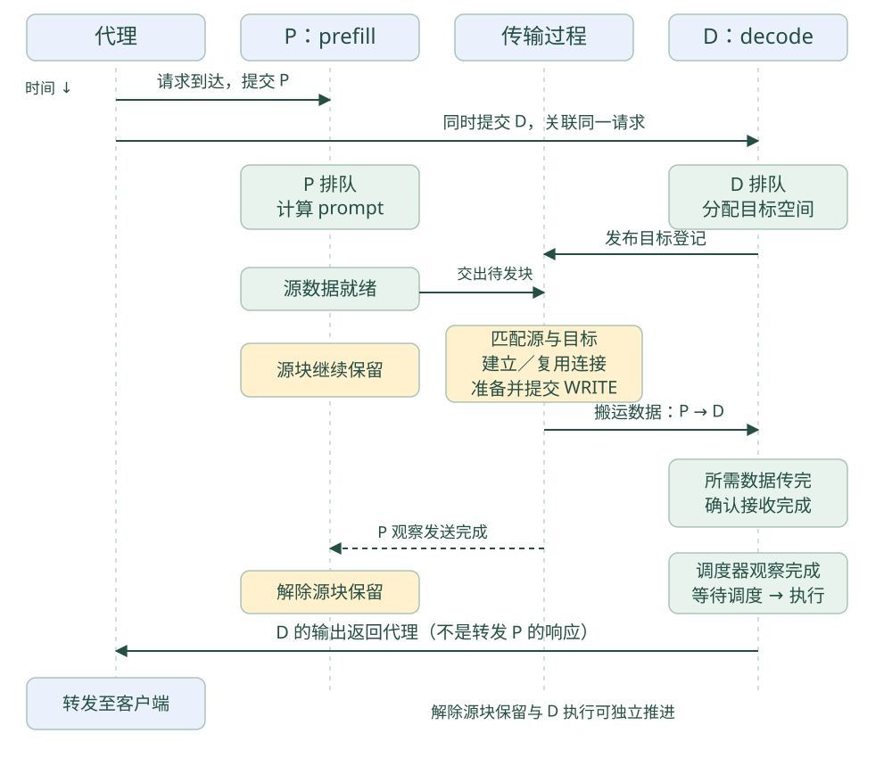

**先看上半图：两边可以同时准备。** 代理把同一逻辑请求分别交给 P、D。P 排队并计算 prompt；D 排队、申请接收空间，把目标位置登记给 P。目标空间已分配，只说明“有地方写”，不说明里面已有可用 KV。P 算完后仍保留源块，等源数据、目标登记与连接都就绪，才提交这次 WRITE（写入）。[固定版本 push 流程](https://github.com/vllm-project/vllm/blob/318c4db661d9706764ee3d9e1b9c14fc4e49c75b/docs/design/nixl_kv_push_connector.md#high-level-flow)

**再看下半图：数据传完，也不等于客户端已有输出。** D 要确认所需数据全部完成，调度器观察到接收完成后，再安排所需的前向计算与采样。最后，D 的响应经过代理到达客户端。这里必须区分三个时刻：**P 完成计算、D 具备执行条件、客户端收到首 token。** 固定版本的 push 代理并发提交 P、D 请求，读完但不转发 P 的响应，向客户端转发的是 D 的输出。因此，即使 P 已采样出一个 token，也不能把那一刻直接当作客户端首 token 到达时刻。[代理的提交与返回路径](https://github.com/vllm-project/vllm/blob/318c4db661d9706764ee3d9e1b9c14fc4e49c75b/examples/disaggregated/disaggregated_serving/disagg_proxy_pushconnector_demo.py#L227)

**用一组数字看重叠等待。** 令 $t_{\mathrm{src}}$、$t_{\mathrm{dst}}$、$t_{\mathrm{conn}}$ 分别为源数据、目标存储及登记、传输连接全部就绪的时刻，都相对于客户端发出请求的同一起点。令 $\delta_{\mathrm{submit}}$ 为条件齐全后准备并提交的额外耗时，则简化模型为 $t_{\mathrm{start}}=\max(t_{\mathrm{src}},t_{\mathrm{dst}},t_{\mathrm{conn}})+\delta_{\mathrm{submit}}$。若三者分别为 60、25、65 毫秒，提交还需 2 毫秒，则传输从第 67 毫秒开始；不是把三个时刻相加。

再假设搬运耗时 8 毫秒，完成状态到达调度器耗时 2 毫秒，D 随后等待调度 10 毫秒、执行 5 毫秒、返回客户端 3 毫秒，则首 token 在第 $67+8+2+10+5+3=95$ 毫秒到达。这里后五项特意设为依次发生的耗时；实际测量仍要画出依赖，不能重复相加重叠区间。这个教学模型未展开链路争用和多分片细节。

### 4.3 Push 与 Pull：数据都从 P 到 D

**NIXL 是 NVIDIA Inference Xfer Library，NVIDIA 的推理数据传输库。** 在这里，pull（拉取）由 D 提交 READ（读取），从 P 读取状态；push（推送）由 P 提交 WRITE，把状态写入 D 提前准备的空间。改变的是谁发起操作、怎样交换位置和安排准备工作，**状态数据的方向始终是 P→D**。

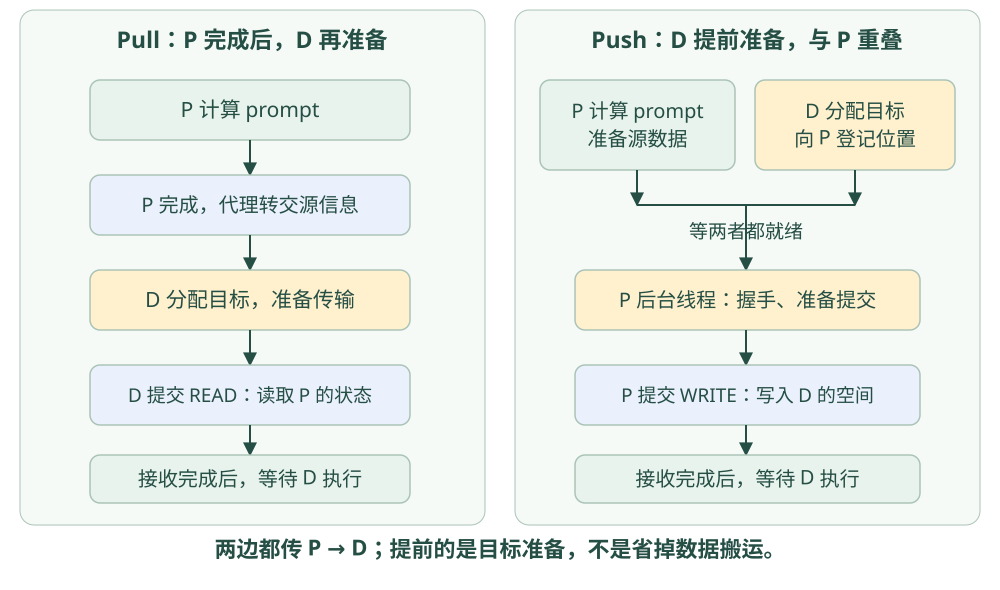

**上图先看 pull，再看 push 提前了哪一步。** 所述 pull 流程在 P 完成后，由代理把源位置交给 D，D 再分配目标、准备并提交 READ。Push 提前选好 D，让它申请目标空间并登记，与 P 的计算重叠；源数据就绪后，P 的后台线程准备并提交 WRITE。这里减少的是交接中串行等待的部分，不是让同一批数据凭空少传一次。[固定版本 push/pull 定义](https://github.com/vllm-project/vllm/blob/318c4db661d9706764ee3d9e1b9c14fc4e49c75b/docs/design/nixl_kv_push_connector.md) · [官方原图与时序对照](https://vllm.ai/blog/2026-10-14-nixl-push-connector#timing-comparison-pull-vs-push)

| 比较项 | 本章的 pull 流程 | 本章的 push 流程 |
| --- | --- | --- |
| 主要传输操作 | D 提交 READ | P 提交 WRITE |
| 发起方需要知道的位置 | P 的源块在哪里 | D 的目标块在哪里 |
| D 的准备时机 | 收到源信息后准备 | 可与 P 计算同时准备 |
| 取舍 | 可以晚些选择 D，但交接可能更长 | 可以隐藏准备等待，但较早占用 D 的容量 |

**Push 仍要握手，也仍要等 D。** 源块与目标登记谁先到，先到的一方都要等待另一方；连接未准备好也不能提交。本文这条路径在 P 完成后交出待发送块，主要重叠的是“P 计算”与“D 准备”。把提交放到后台线程，也不等于同一请求已经实现逐层或逐块的计算—传输重叠。[匹配表、握手与线程职责](https://github.com/vllm-project/vllm/blob/318c4db661d9706764ee3d9e1b9c14fc4e49c75b/docs/design/nixl_kv_push_connector.md#writer-local-matching-tables)

**提前占位也有代价。** 如果 P 的长 prompt 还要算很久，D 为它保留的空间暂时不能供其他请求使用。SGLang 的固定版本用 `early` 表示提前分配；`prefill_complete` 则等 P 完成并发出就绪信号后，D 才申请空间并开始既有交接。后者可能减轻 D 的占位压力，却会延长 P 的状态保留，并失去原有分块计算与传输的重叠。该版本要求 Mooncake 后端、Python 引导注册服务，以及注意力张量并行、上下文并行和流水线并行规模均为 1，不能直接套到所有部署。这只是容量取舍的对照，不是上图 vLLM 流程的另一个开关。[SGLang 固定版本：分配策略与限制](https://github.com/sgl-project/sglang/blob/6aca4198075af1ab42e753f419c9827ff0fec0d9/docs/docs/advanced_features/pd_disaggregation.mdx#decode-allocation-policy)

### 4.4 交接传什么，时间又花在哪里

**“知道数据在哪里”和“拿到数据”是两件事。** 请求标识、块编号、层与分片映射、完成通知属于控制信息；对应位置各层的 K/V 才是模型状态。混合模型还可能需要递推快照和卷积等辅助状态。第二章的规则仍成立：只有共同恢复边界所需的状态齐全，才能继续计算；传完一类状态不代表全部就绪。[固定设计：登记字段与混合状态映射](https://github.com/vllm-project/vllm/blob/318c4db661d9706764ee3d9e1b9c14fc4e49c75b/docs/design/nixl_kv_push_connector.md#wire-format)

**块编号不是跨进程通用的地址。** 例如同一段前缀在 P 的块 7、D 的块 42 中保存，完全可以合法；传输实现要把两侧编号转换为各自的内存位置，并匹配同一层、同一分片的数据。握手还要检查模型结构、数据类型、布局等条件。两边块数可以不同，但不同并行规模、块大小或量化方式是否兼容，必须查具体版本；不能只看模型名字相同。[固定设计：按层配对](https://github.com/vllm-project/vllm/blob/318c4db661d9706764ee3d9e1b9c14fc4e49c75b/docs/design/nixl_kv_push_connector.md#pipeline-parallelism-and-hybrid-kv-caches) · [官方兼容矩阵，动态文档，访问于 2026-11-02](https://docs.vllm.ai/en/latest/features/nixl_connector_compatibility/)

**先估算搬运，再检查准备开销。** 教学近似 $T_{\mathrm{copy}}\approx S/B_{\mathrm{eff}}$ 中，$S$ 是实际传输字节数，$B_{\mathrm{eff}}$ 是这次搬运实际获得的有效带宽。例如 400 MB、50 GB/s，按十进制单位计算约为 8 毫秒。这只估计数据搬运，不含全部握手、排队、描述符准备与完成通知；网卡标称带宽也不能直接替代有效带宽。

描述符可以理解为“这次要搬哪些内存片段”的清单。同样的字节数若分散在更多片段里，准备开销可能更大。因此应同时记录字节数、描述符数、提交耗时和提交至完成的耗时。官方指标中 `post time` 表示提交开销，`xfer time` 覆盖提交至后端完成、已包含 posting，**不能把这两个值再次相加**。异步提交只表示调用方可以继续做别的工作，不表示搬运无需时间。[NIXL 指标口径，动态文档，访问于 2026-11-02](https://docs.vllm.ai/en/latest/features/nixl_connector_usage/#metrics-reference)

### 4.5 分配、完成、释放：各是哪一个事件

| 事件 | 已经满足什么 | 还不能据此认为 |
| --- | --- | --- |
| D 的目标块已分配 | 有接收位置 | 数据已经有效 |
| 传输已提交 | 传输系统已接到操作 | 复制已经完成 |
| 所需数据全部完成 | 必要分片达到接收完成条件 | D 已开始执行 |
| 调度器观察到接收完成 | 请求可进入后续调度流程 | 已拿到本轮执行机会 |
| P 解除源块保留 | 不再因本次交接占用源块 | 缓存必须立即被擦除 |

**一个完成通知可能只代表一部分。** 例如 D 需要两个 P 分片共同提供状态，先收到其中一个通知时，另一部分仍可能在路上。固定版本的 push worker 按预期生产者数量累计通知，达到计数后才报告接收完成；P 则根据自己的发送完成结果进入解除保留流程。不能把“一个分片完成”“整个请求就绪”和“源端已释放”混为同一个事件。[接收完成计数](https://github.com/vllm-project/vllm/blob/318c4db661d9706764ee3d9e1b9c14fc4e49c75b/vllm/distributed/kv_transfer/kv_connector/v1/nixl/push_worker.py#L771) · [调度器完成与回收职责](https://github.com/vllm-project/vllm/blob/318c4db661d9706764ee3d9e1b9c14fc4e49c75b/docs/design/nixl_kv_push_connector.md#scheduler-side-responsibilities)

**如果 D 一直没来取，P 也不能一直等。** Lease（租约）为源块设定保留期限，heartbeat（心跳）让仍在排队或传输中的 D 延长这段期限。这样既避免 D 排队较久时 P 过早回收，也避免 D 已退出后 P 无限占着空间。租约文档主要用 pull 展示流程，push 设计复用源块租约；心跳与完成状态仍需被执行循环处理，不是精确到毫秒的定时承诺。[固定版本租约设计](https://github.com/vllm-project/vllm/blob/318c4db661d9706764ee3d9e1b9c14fc4e49c75b/docs/design/nixl_kv_cache_lease.md)

**失败时要分清“回收资源”和“结束请求”。** D 失联后，P 可按租约到期回收；传输失败时，尚未成功接收的目标块不能当作有效命中，需走相应的失败或重算路径，具体取决于故障位置与配置。尤其固定版本的 push watchdog 超时检查，只删除过期登记并记录警告；它并没有在这里完成整个请求的终止。请求级取消或超时处理还要沿引擎和代理继续核对。[watchdog 实际操作](https://github.com/vllm-project/vllm/blob/318c4db661d9706764ee3d9e1b9c14fc4e49c75b/vllm/distributed/kv_transfer/kv_connector/v1/nixl/push_scheduler.py#L296) · [push 的各类失败分支](https://github.com/vllm-project/vllm/blob/318c4db661d9706764ee3d9e1b9c14fc4e49c75b/docs/design/nixl_kv_push_connector.md#failure-handling)

### 4.6 怎样判断更快：计算、传输与客户端延迟分开看

**高命中率不保证低首 token 延迟。** 假设 P 命中了大部分 prompt，省下很多前缀计算；D 却没有相应状态，仍需等目标空间、接收大量数据，再排队执行。如果这些等待占据主要时间，P 少算了，客户端却未必明显更早看到输出。这是依赖关系的反例，不是实测结果。

| 指标 | 本章采用的口径 |
| --- | --- |
| 缓存命中率 | 先说明按请求、token 还是字节统计，以及命中发生在 P、D 还是远端 |
| 避免的计算量 | 实际省掉的计算工作；命中 token 比例不直接等于节省的时间比例 |
| TTFT：Time to First Token（首 token 延迟） | 客户端发出请求至收到首个输出 token |
| ITL：Inter-Token Latency（相邻输出间隔） | 客户端两个相邻输出 token 的到达时间差 |
| TPOT：Time per Output Token（平均每输出 token 时间） | 本节取首 token 之后的平均间隔 |
| E2E：End-to-End Latency（端到端延迟） | 客户端发出请求至整个响应完成 |

设客户端发出请求的时刻为 $t_0$，收到第一个、最后一个输出 token 的时刻为 $t_1,t_N$，响应完成时刻为 $t_{\mathrm{end}}$。则 $\mathrm{TTFT}=t_1-t_0$；输出 $N>1$ 个 token 时，$\mathrm{TPOT}=(t_N-t_1)/(N-1)$；$\mathrm{E2E}=t_{\mathrm{end}}-t_0$。只有一个输出 token 时，这个 TPOT 定义不适用。若流式响应将多个 token 合并发送，要说明测量工具如何处理，不能把响应块间隔直接当作单 token 间隔。这些是本章明确采用的计时定义。

**性能数字要连同条件一起读。** vLLM 在 2026-10-14 的报告中，以 Qwen3-32B、一个 P 加一个 D（1P1D）、Amazon EC2 P5en 实例及 Elastic Fabric Adapter（EFA，弹性网络适配器）互连测试，D 侧关闭前缀缓存，输出长度为 128 token。输入为 1k–16k token、请求速率为每秒 1–8 条的扫描中，部分高负载配置下 push 的 TTFT 约为 pull 的三分之一，TPOT 最高改善约 30%；低负载、短输入时两者接近。这是该实现与负载下的报告结果，不说明 WRITE 普遍比 READ 快，也不是本文本地复现。[原始实验、曲线与配置](https://vllm.ai/blog/2026-10-14-nixl-push-connector#performance-data)

对自己的部署，应在相同模型、硬件、缓存设置和请求序列下，对齐记录 P/D 排队、源与目标就绪、传输提交与完成、D 首次执行、客户端输出时刻，并比较延迟分布与满足延迟要求的请求数量。**Push 是否更快，要看它隐藏了多少串行准备；提前分配是否值得，要看占位是否挤压其他请求；KV 传完后为何还没输出，要继续看完成上报、D 调度与响应返回。**

## 第 5 章 无 GPU 小实验（待实现）

- 构造带共享前缀、长短请求和多轮分叉的 trace，编写 CPU 缓存与调度模拟器。
- 扫描容量、淘汰策略、状态类型和传输带宽，记录命中率、避免的计算量与排队时间。
- 交付：trace、成本假设、敏感性图和 GPU 验证方案；不把模拟 TTFT 当作实际引擎 benchmark。

## 第 6 章 论文、报告与源码入口

以下为规划时的阅读入口。正式写入时需记录论文版本、访问日期和仓库 commit；`main` / `latest` 链接会变化，不代表已完成该版本的复现。

- [vLLM：scheduler.py](https://github.com/vllm-project/vllm/blob/main/vllm/v1/core/sched/scheduler.py)
- [vLLM：kv_cache_manager.py](https://github.com/vllm-project/vllm/blob/main/vllm/v1/core/kv_cache_manager.py)
- [SGLang：scheduler.py](https://github.com/sgl-project/sglang/blob/main/python/sglang/srt/managers/scheduler.py)
- [SGLang：Unified Radix Cache](https://www.sglang.io/blog/unified-radix-cache)
- [SGLang：Unified Memory](https://www.sglang.io/blog/unified-memory)
- [vLLM：NIXL Push Connector](https://vllm.ai/blog/2026-10-14-nixl-push-connector)

## 第 7 章 交付物与验收（待完成）

- 待写入：核心概念与公式推导。
- 待写入：固定版本的源码调用链、shape / ownership / 时序表。
- 待完成：可重复的小实验、反例和结果解释。
- 待写入：GPU 实测方案、对照组与适用边界。
- 验收问题：给出高缓存命中率却未降低 TTFT 的反例，并拆出关键路径。
- 验收问题：在两套引擎中标注请求状态迁移与 KV/state 分配、释放的入口。

### 7.1 后续记录模板

- 本次阅读版本与来源：待填写。
- 新理解与仍不确定的问题：待填写。
- 实验条件、原始数据与结论：待填写。
- 下一步与需要 GPU 验证的项目：待填写。

[← 上一篇：03 · Megatron 分布式训练与恢复](./rl-infra-megatron.html)

[下一篇：05 · MoE 通信、GPU 执行与弹性并行 →](./rl-infra-moe.html)
