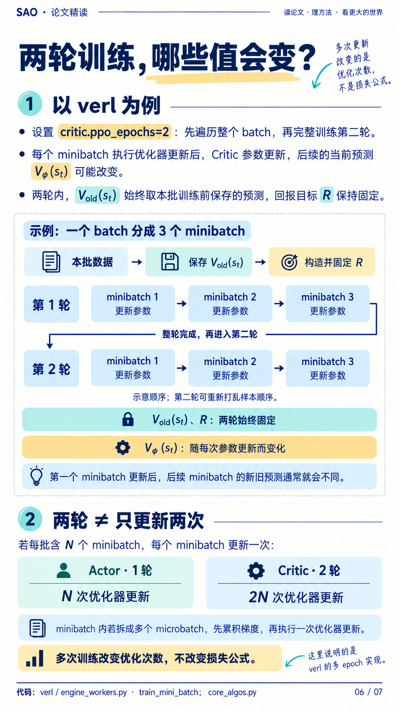
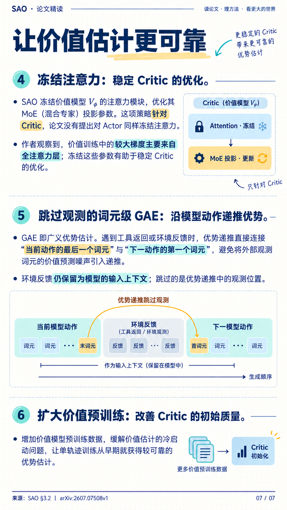

# SAO：单轨迹异步训练，怎样稳定地学

> **主线：减少组内等待 → 用 Critic 估计优势 → 用 DIS 控制策略偏离。**

SAO 全称 **Single-Rollout Asynchronous Optimization**。本文整合你整理的 7 页手机笔记 **v2 修订版**，对照 [SAO 论文 v1](https://arxiv.org/html/2607.07508v1)。重点是训练信号和 loss；数值手算均为教学例子。上下文压缩的训练方法见 [CompactionRL](./compactionrl.html)，两者在 [Occamy](./occamy.html) 中的组合见其第 7 章。

## 第 1 章 为什么每个 prompt 只采一条

Agent 任务长短差异很大。同步采样需要等整批完成；即使改成异步，采用组内相对优势的方法仍要等**同一 prompt 的整组轨迹**完成，才能算组内统计量。等待期间 learner 继续更新，数据与当前策略的差距会扩大，这就是策略滞后（policy lag）。

**SAO 每个 prompt 采一条轨迹，完成后即可进入可训练队列；learner 仍然凑 batch 更新。** 单轨迹不是 batch size=1，也不是每来一条就做一次 optimizer step。论文的一个 batch 有 128 条：SAO 是 128 个 prompt 各 1 条，对照 GRPO 是 16 个 prompt 各 8 条。

| 对比 | 结果监督 GRPO 的典型设置 | SAO |
| --- | --- | --- |
| 优势的基线 | 同一 prompt 的组内奖励统计 | Critic 对当前上下文的价值估计 |
| 同题采样 | 一组多条 | 一条 |
| 额外代价 | 组采样与组内等待 | Critic 的显存、前向和训练 |
| 核心取舍 | 相对比较方便，但受整组完成时间影响 | 减少组内等待，但更依赖价值估计质量 |

一条长轨迹可能跨越多个采样权重版本。SAO 使用**每个 token 生成时实际记录的 rollout log-prob**，不能拿一个最新旧模型重新 forward，假装它生成了整条轨迹。单轨迹减少一种等待来源，并不消除所有 off-policy 偏差。[论文 §3.1–3.2](https://arxiv.org/html/2607.07508v1#S3)

## 第 2 章 Actor、Critic 和优势各负责什么

**Actor** 是策略模型 $\pi_\theta$，生成动作；**Critic** 是价值模型 $V_\phi$，预测给定上下文后能得到多少未来回报。$\theta$、$\phi$ 分别是两者参数，独立优化。Critic 预测的是回报，任务的真实奖励仍由环境或验证器给出。

本文用 $h_t$ 表示生成第 $t$ 个动作 token 前的真实上下文，$y_t$ 表示该 token，$r_t$ 表示即时奖励。只沿模型动作 token 排序，工具观察仍包含在相应的 $h_t$ 中。

**式 1 · TD 残差与 GAE 递推**

$$
\delta_t=r_t+\gamma V_{\mathrm{old}}(h_{t+1})-V_{\mathrm{old}}(h_t),\qquad A_t=\delta_t+\gamma\lambda A_{t+1}
$$

$V_{\mathrm{old}}$ 是计算这批优势时保存的价值预测；$\delta_t$ 是“一步奖励加下一状态价值”与当前预测的差；$\gamma$ 是奖励折扣，$\lambda$ 控制后续 TD 残差的衰减；$A_t$ 是优势。真正终止后，后继价值和优势取 0；时间截断时是否 bootstrap 要按任务定义处理。

**小例子：** 最后一个动作得到 $r_t=1$，Critic 原本预测 0.6，任务随后终止，则 $A_t=1-0.6=0.4$。反馈比预期好，提供提高该动作概率的信号；若奖励为 0，则优势为 −0.6。优势衡量的是“比基线好多少”，不是给动作贴绝对正确标签。

### 2.1 Skip-observation：跳过的是优势递推位置

假设记录为“调用测试的输出 token → 100 个报错 token → 修复补丁的输出 token”。SAO 的 **skip-observation token-level GAE** 直接把前一动作末 token 与后一动作首 token 连接起来，不逐个经过这 100 个外部观察位置。后一动作的价值预测仍以**包含报错的真实上下文**为条件。

因此，**工具反馈不作为模型生成目标，但模型仍能读取它；跳过观察不等于删掉观察。** 这里的 token 级递推也不等于把整次工具调用只当成一个动作来估值。[论文 §3.2，式 4–5](https://arxiv.org/html/2607.07508v1#S3.S2)

## 第 3 章 DIS：概率比、过滤与策略 loss

DIS 是 **Direct Double-Sided Importance Sampling**。它直接比较当前策略与真实采样策略，并把偏离过大的 token 排除出这项策略更新。

**式 2 · 直接概率比**

$$
\rho_t=\exp\!\left(\log\pi_\theta(y_t\mid h_t)-\log\pi_{\mathrm{rollout}}(y_t\mid h_t)\right)
$$

$\pi_\theta$ 是训练端当前策略，$\pi_{\mathrm{rollout}}$ 是生成该 token 时的采样策略；后者的 log-prob 来自采样记录。$\rho_t$ 是概率比，**不是即时奖励 $r_t$**。分子在原上下文上重新 forward，分母固定。

**式 3 · 双侧过滤**

$$
f(\rho_t)=\begin{cases}\rho_t,&1-\epsilon_l<\rho_t<1+\epsilon_h,\\0,&\text{其他情况}.\end{cases}
$$

$\epsilon_l$、$\epsilon_h$ 分别控制下、上界；$f$ 是过滤后的权重。区间内按概率比加权，区间外权重为 0；按论文公式，恰在边界也不保留。上下界可不对称。

**式 4 · 论文的策略目标写成最小化形式**

$$
L_{\mathrm{DIS}}=-\frac{1}{N}\sum_{t\in I}f(\rho_t)\widehat A_t\log\pi_\theta(y_t\mid h_t)
$$

$I$ 是这批数据中参与策略训练的模型输出位置集合，$N=|I|$；$\widehat A_t$ 是供策略更新使用的优势。上式将论文的经验平均写成求和，并取负号以便最小化；这里只列策略项。**实现提醒：若将 $f(\rho_t)$ 作为加权策略梯度的权重，应停止其梯度，优势也固定；若让权重和 log-prob 同时求导，会得到额外项。** 论文式 1 未显式标注这一梯度约定，移植代码时需要核对。

**手算：** 假设允许区间是 $(0.8,1.2)$，采样概率为 0.20。当前概率 0.22 时，$\rho=1.1$，保留且乘权重 1.1；变成 0.30 时，$\rho=1.5$，这项策略梯度被屏蔽。屏蔽依据是分布偏离，不是事后认定动作做错。

**与 PPO clip 的区别：** PPO 的截断取决于概率比和优势符号，并非区间外全部屏蔽。DIS 对两侧越界都过滤，因而更严格；它也不保证整个策略的 KL 一定小。记录过滤比例、概率比和任务效果，才能判断是否把有用数据过滤得太多。[论文 §3.1，式 1–3](https://arxiv.org/html/2607.07508v1#S3.S1)

## 第 4 章 Critic 拟合什么，怎样训得更稳

### 4.1 固定目标，更新预测

**式 5 · 价值损失与 GAE 回报目标**

$$
L_V=\frac{1}{N}\sum_{t\in I}\left(V_\phi(h_t)-\widehat R_t\right)^2,\qquad \widehat R_t=V_{\mathrm{old}}(h_t)+A_t^{\mathrm{raw}}
$$

$V_\phi(h_t)$ 是当前 Critic 的可训练预测；$\widehat R_t$ 是第 $t$ 个位置的回报目标，**不是该位置即时奖励，也不必等于终局分数**。$A_t^{\mathrm{raw}}$ 是按 Critic 配置计算、构造价值目标用的未归一化 GAE，未必与 Actor 使用的优势版本相同；$V_{\mathrm{old}}$ 和目标在这批训练中固定，不参与反向传播。这里省略可选的价值裁剪。目标构造是原笔记采用的 [verl GAE 实现示例](https://github.com/volcengine/verl/blob/main/verl/trainer/ppo/core_algos.py)，不要把归一化后的 Actor 优势再加回旧价值。

例如 $V_{\mathrm{old}}=0.4$、$A^{\mathrm{raw}}=0.5$，则目标是 0.9。当前预测从 0.4 改善到 0.7 时，单点平方误差从 0.25 降到 0.04；目标仍是 0.9。

### 4.2 多训一轮，不是只多做一次更新

原笔记 v2 将多 epoch 例子澄清为：**同一批数据，Actor 训练一轮、Critic 训练两轮。** 若每轮有 3 个 minibatch、每个 minibatch 更新一次，则分别是 3 次和 6 次 optimizer step；minibatch 内的 microbatch 通常先累积梯度，再更新一次。

两轮内旧价值与回报目标固定，当前 $V_\phi$ 随参数更新而变化。论文用 $K=2$ 描述更频繁的价值训练；上面的次数解释以 [verl 的 epoch/minibatch 组织](https://github.com/volcengine/verl/blob/main/verl/workers/engine_workers.py)为例，不能只看“更新两次”就推断任意框架的 optimizer step 数。

### 4.3 SAO 的价值训练组合

| 做法 | 目的与边界 |
| --- | --- |
| 更充分的价值预训练 | 改善初始价值估计，减少训练起步时的优势噪声 |
| Critic 比 Actor 更频繁训练 | 让价值预测跟上变化中的策略；不是新增一种 loss |
| 冻结 Critic 注意力、训练 MoE 投影 | 论文观察到全注意力层的大梯度，借此稳定价值优化；不是冻结 Actor |
| 跳过观察的 token 级 GAE | 沿模型输出递推，保留外部反馈作为输入条件 |

## 第 5 章 实验说明什么，复现时看什么

论文报告约 1,000 步的稳定训练，并在编程、带 Python 工具的数学任务及模拟在线偏好变化中评测。下面摘取同一论文的代表结果；**数字为作者报告，不是本站复现**。

| 方法 | AIME2025 | BeyondAIME | SWE-bench Verified |
| --- | ---: | ---: | ---: |
| GRPO + DIS | 93.5 | 70.8 | 27.0 |
| SAO | 97.3 | 74.8 | 29.8 |

指标为 Pass@1 百分比，来自 Table 1–2。数学与编程使用各自的训练设置；SWE-bench 使用 OpenHands，不能直接与另一篇论文不同脚手架的分数比较。模拟在线实验是写作偏好阶段性变化，不等于已证明任意真实在线业务都有效。[实验 §4](https://arxiv.org/html/2607.07508v1#S4)

复现时先核对三类量：**样本年龄与版本差、DIS 过滤比例、Critic 误差与梯度**，再看固定预算的独立任务成功率。单轨迹换来了更多不同 prompt 的覆盖，也增加对 Critic 的依赖；不能把全部提升单独归因于某一个组件。

## 第 6 章 面试时怎样讲完整

**记忆顺序：等待 → 单轨迹 → Critic → DIS → 验证。**

“SAO 面向长任务的异步 RL。它每个 prompt 只采一条，减少组内等待；通过 Critic 和 token 级 GAE 提供优势。DIS 直接使用采样时保存的 log-prob，与当前策略计算概率比，双侧过滤偏离过大的 token。为稳定优势估计，它加强价值预训练，让 Critic 更频繁更新，并冻结 Critic 的注意力层；工具观察跳过优势递推，但仍作为输入。它减少等待和部分 off-policy 风险，代价是额外的价值模型，最终还要验证固定预算下的效果。”

**三个短答：** 单轨迹不是 batch 为 1；重新 forward 不会改变数据的采样来源；两轮训练不是两次 optimizer step。

来源：你的 **SAO-mobile-notes-7-pages-v2** 笔记；[SAO v1 全文](https://arxiv.org/html/2607.07508v1)；[verl GAE 与价值目标](https://github.com/volcengine/verl/blob/main/verl/trainer/ppo/core_algos.py)。核对日期：2026-10-20。论文机制、通用手算与框架示例已分别注明。
