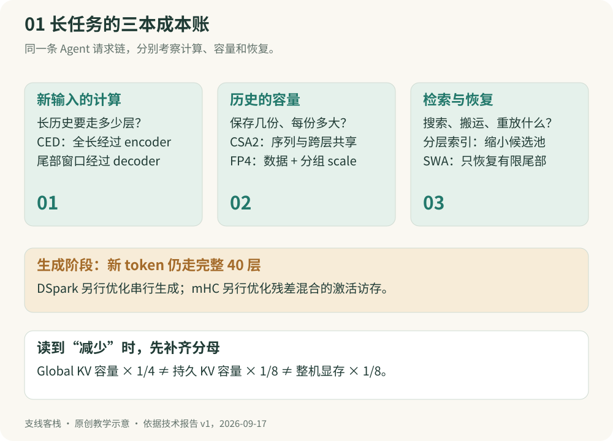
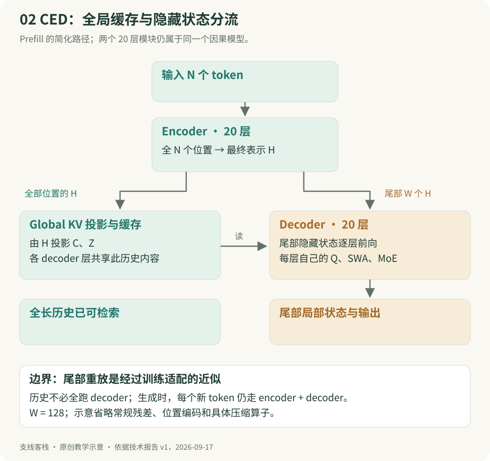
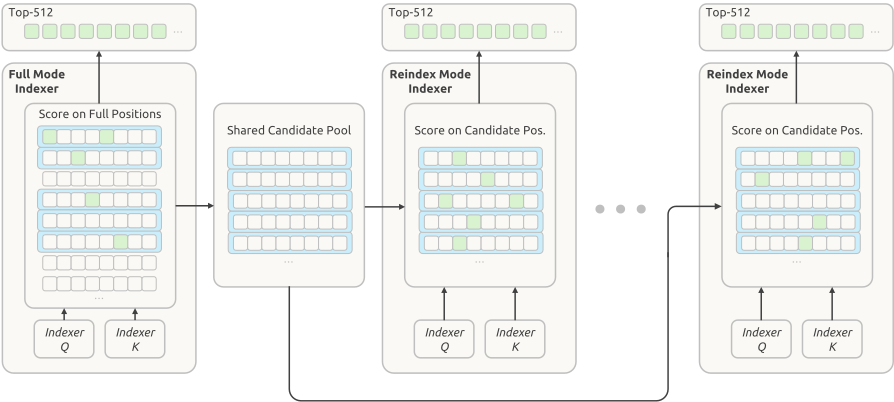
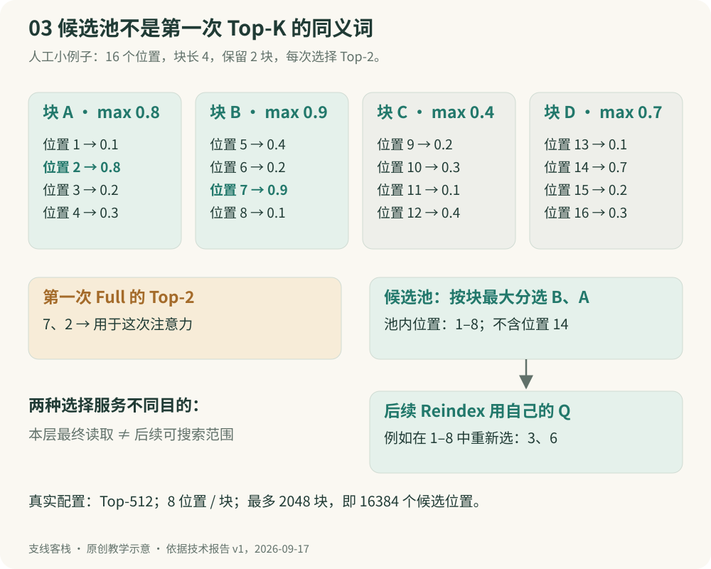
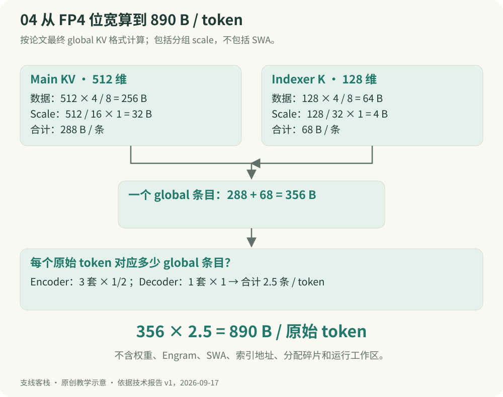
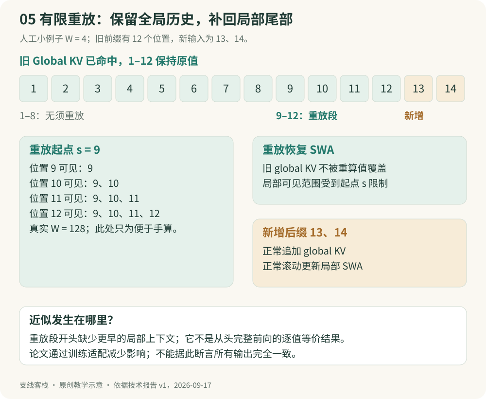
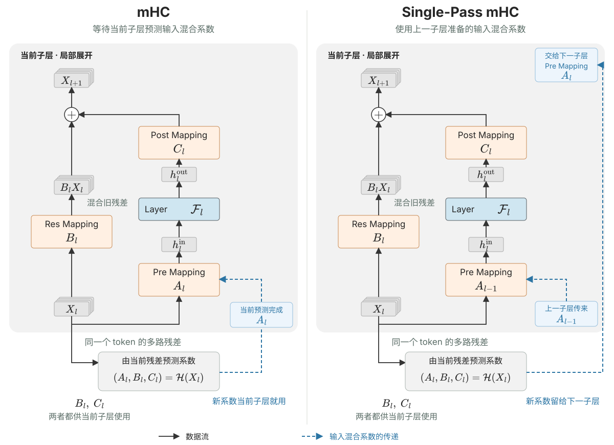
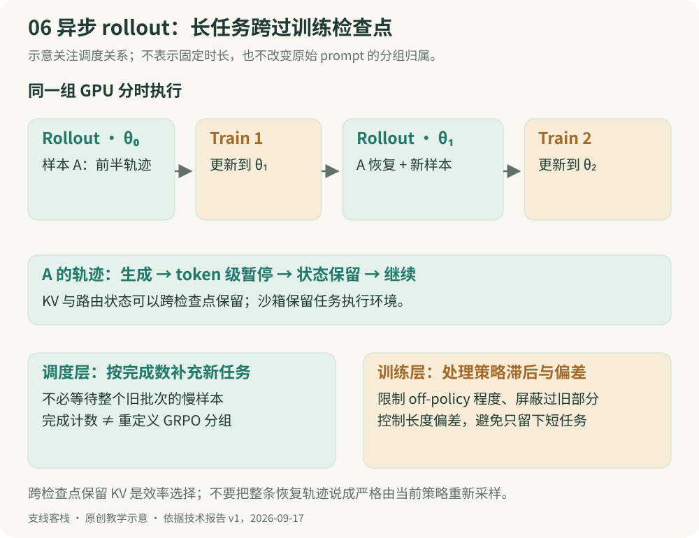
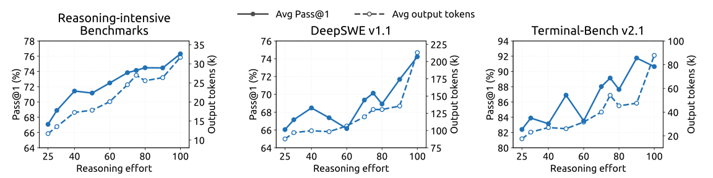

# DeepSeek-V4.1-Flash：从因果编码到 890 字节的缓存账本

> 一条主线：**长输入少走几层 → 多层共享历史 → 少量候选重新选址 → 缓存用更少字节 → 局部状态按需重建。**

一次编程 Agent 任务，会把代码、终端日志、工具结果不断追加到上下文。模型不仅要“能读一百万 token”，还要反复读得起、把中间状态存得下，并在任务恢复时搬得动。V4.1-Flash 的技术报告围绕这些实际成本，把模型结构、数值精度、缓存管理和后训练放到一起设计。

本笔记沿用本站 DeepInfer 的讲解方式：**先说为什么，再追数据流，接着手算，最后核对结论的边界。** 前七章讲清论文标题中的 KV Cache Compression；第八至十一章补足多模态、条件记忆、训练和评测；最后用一条完整请求与复习题把知识连起来。

**资料基线：2026-10-26。** 架构与实验固定为 DeepSeek-AI 的 [技术报告 v1，2026-09-17](https://arxiv.org/html/2609.19969v1)。9 月 10 日模型发布、9 月 17 日论文提交、10 月 17 日 checkpoint 更新是三个不同事件；本文表格使用论文 v1 的结果，不混入 1017 更新分数。源码辅助核对使用 DeepInfer 提交 `9bd9cf243fc53ef9afbf8f04d391d989117d6ab9`。

**配图说明：** 5 张论文原图保留原始文件与英文标注，每图配中文读图说明；6 张本站原创静态图帮助拆解数据流与手算。图下可打开原图放大。第二章配有沿 Figure 3 原图逐步播放的架构动画。论文报告的结果、根据配置计算的数值、人工教学例子会分别注明；没有把阅读与手算写成 GPU 复现实验。

**阅读路线：** 只想理解核心创新，读第 1–7 章；关注训练 Infra，再读第 9–11 章。若 KV、Prefill、Decode 还不熟悉，可先看本站 [推理基础设施笔记](./inference-infra.html)。已有 [DeepInfer 笔记](./deepinfer.html) 更侧重引擎和线上执行，本篇重点回答“模型为什么允许这样执行”。

## 第 1 章 先问：长上下文究竟贵在哪里

### 1.1 一条工具调用链，会反复产生长输入

设一个教学任务最初有 20,000 个输入 token。每轮模型输出 500 个 token，工具再返回 1,500 个 token。下一轮输入约为 22,000 个 token，再下一轮约 24,000 个。若五轮完全没有前缀缓存，总共要处理的输入是 20,000 + 22,000 + 24,000 + 26,000 + 28,000 = **120,000 个 token**。其中许多内容是已经看过的历史。

前缀命中时，可以复用已经算好的 KV，只处理新增后缀和必要的局部恢复。但命中不是免费：要查目录、读存储、传数据，还要确保模型版本和前缀条件相容。缓存变小同时帮助容量与搬运，不能只从注意力 FLOPs 理解它的价值。

**式 1 · 等增量多轮输入的教学账本**

$$
N_t=N_0+(t-1)\Delta,\qquad \sum_{t=1}^{T}N_t=TN_0+\frac{T(T-1)}{2}\Delta
$$

**$N_t$ 表示第 $t$ 轮请求送给模型的完整输入长度，单位是 token。** 它包括这一轮携带的历史上下文，而不只是本轮新增的内容；$t=1,2,\ldots,T$ 是请求的轮次，$T$ 是总轮数。

$N_0$ 表示初始输入长度，也就是第一轮的输入长度，因此 $N_1=N_0$；这里的下标 0 表示“初始值”，不是另有一次第 0 轮请求。$\Delta$ 表示相邻两轮输入长度的净增量，单位也是 token。以上例而言，$N_0=20000$、$\Delta=2000$，所以第二轮 $N_2=22000$：其中 20,000 个是已有历史，新增的 2,000 个来自上一轮模型输出与工具返回。

$\sum_{t=1}^{T}N_t$ 是这 $T$ 轮请求的输入 token 数之和，同一段历史随多轮输入被重复计数；它不是去重后的文本长度。**没有前缀缓存时，这个和才对应需要重复处理的总输入量；缓存命中后，完整输入长度 $N_t$ 不变，但实际需要重算的 token 数可以更少。** 这个等差数列假设每轮净增量固定，不包含裁剪或上下文压缩，实际任务未必满足这一假设。

### 1.2 三种成本必须分开算

| 成本 | 具体问题 | V4.1-Flash 的主要手段 |
| --- | --- | --- |
| 处理新输入的计算 | 未命中的历史要经过多少网络层？ | CED + Decoder SWA bounded replay |
| 保存历史的容量 | 有多少独立 KV、每条有多大？ | CSA2 跨层共享、序列压缩、FP4 |
| 读取与恢复的代价 | 每层搜多少位置？恢复会话要搬什么？ | 分层索引、持久缓存策略、Encoder SWA bounded replay |

生成阶段另有逐步输出的串行开销，DSpark 用投机解码处理；残差混合另有激活访存，Single-Pass mHC 处理。**它们优化不同部分，不是把几个加速倍数相乘就得到整机加速比。**

### 1.3 先定义 global、local 与 persistent

**Global KV** 是全局历史分支的缓存，包含 main KV 和用于检索的 indexer K，随上下文长度增长。**SWA KV** 是 Sliding-Window Attention 的层内局部状态，固定窗口下其运行时大小有界。**Persistent KV** 则按“跨请求长期保存”定义，是存储生命周期的分类。

所以 global/local 在区分注意力用途，persistent 在区分留存方式，两组概念不是三种互斥张量。V4.1 的 global KV 可以在执行时进入高带宽显存 HBM，又在长期存储中保留；局部 SWA 在运行中也占显存，但不再写入论文所述的长期持久缓存。[原文 §1、§3.2](https://arxiv.org/html/2609.19969v1#S3.SS2)

## 第 2 章 从原图建立模型全貌

### 2.1 552B、196B、8B 和 16B 分别指什么

| 项目 | 论文配置 | 怎样理解 |
| --- | --- | --- |
| 语言主干 | 552B 参数，40 层，hidden dimension 5120 | 参数容量，不是每 token 都执行全部参数 |
| Engram | 额外 196B 条件记忆参数 | 不能从“552B 主干”推断全部参数已经含它 |
| Prefill / Decode 激活规模 | 约 8B / 16B 每 token | 长输入主要执行前半主干；生成仍走完整主干 |
| Causal encoder / decoder | 各 20 层 | 两半都遵守因果可见性 |
| MoE | 每层 1 个共享专家 + 384 个路由专家，路由选 6 个 | 专家选择和注意力 Top-512 是两套不同路由 |
| 局部窗口 / 稀疏选择 | SWA 128；global attention Top-512 | 一个限制近期局部范围，一个选择全局条目 |
| 上下文 | 最高 1M token | 输入能力上限，不代表每个细节都能被可靠找回 |

B 表示十亿。8B/16B 是论文给出的激活参数口径，不是模型下载体积，也不意味着“只需存下 8B 权重”。不同请求可能激活不同专家，部署还要考虑专家权重、Engram、缓存与工作区。[原文 §2.1、§4.2.1](https://arxiv.org/html/2609.19969v1#S4.SS2.SSS1)

### 2.2 原图：40 层怎样分组

来源：[原论文 Figure 3](https://arxiv.org/html/2609.19969v1#S1.F3)。

> **沿原图看一遍数据怎么走**
>
> [▶ 打开架构分步动画：输入 → Encoder → CED 双路径 → Decoder](./v41-architecture.html#map)
>
> 在上方同一张论文图上逐段高亮连线，配合文字说明、实际层号与缓存来源计数。可手动前后翻步、自动播放、暂停和重播；手机支持聚焦当前区域。特别留意“全长 global KV”与“尾部 hidden states”两条路径。

**读图第一遍只看左右两大框。** 左侧从 Embedding 向上走过 20 层 encoder，顶部输出 `Enc. Hidden States`。这份表示经 CED 路径参与右侧 decoder 的 global KV 构造。图中省略的常规隐藏状态前向仍存在；不要把 CED 那根连线当成 decoder 的唯一输入。

**第二遍看重复次数。** Encoder 先有 2 层纯 SWA，再重复 3 次“1 个 Full + 5 个 Reuse”，共 18 层。Decoder 先有“1 个 Full + 3 个 Reuse”，再重复 4 次“1 个 Reindex + 3 个 Reuse”，共 20 层。前两层虽然没有 global attention，仍有 MoE，并非只有一个 SWA 算子。

**第三遍看旁路。** 底部视觉编码与文本 embedding 汇合；Engram 加入条件记忆；残差流经过 Single-Pass mHC；顶部 DSpark 负责草稿；右侧 Candidate Pool 是后续 Reindex 共用的候选范围。这是逻辑模型图，左右两个框不意味着部署时必须各占一组 GPU。

图中 **Single-Pass mHC** 虽然只标在入口附近，但它贯穿 Encoder 和 Decoder 的残差处理：Attention、MoE 子层都会涉及。它怎样工作、Prefill 和 Decode 何时执行，见 [8.3 节：Single-Pass mHC](#section-8-3)。

### 2.3 固定层号，避免差一层

本文层号统一从 **0 开始**：0–19 是 encoder，20–39 是 decoder。Encoder 的 Full 位于 2、8、14，Decoder 的 Full 位于 20；Reindex 位于 24、28、32、36。Engram 位于 1、14。若按日常“第几层”从 1 开始数，全部加一。

这让我们直接得到两个计数：全模型有 **4 套独立 global KV 来源**；decoder 有 **1 次 Full 索引 + 4 次 Reindex**。后面 890 B/token 和分层索引的手算都从这两个事实开始。

## 第 3 章 CED：隐藏状态与历史缓存走两条路

### 3.1 为什么历史可以不再逐层跑过整个 decoder

普通因果 Transformer 要得到某层历史 KV，往往先把历史位置逐层计算到那里。CED（Causal Encoder-Decoder）的改动，是让 decoder 的 global KV 直接由 **encoder 最后一层的隐藏状态**投影而来。这样，历史的全局表示可以在前半网络结束时提前构造，不必等待全部历史在 decoder 中逐层走完。

**式 2 · Decoder global KV 的投影起点（论文式 1）**

$$
C_l=H_{L/2}W_l^{KV},\qquad Z_l=H_{L/2}W_l^Z
$$

$H_{L/2}$ 是 encoder 输出；$C_l$ 表示 KV 条目，$Z_l$ 表示对应的压缩权重。公式沿用论文的深度记号，指上半网络的层；实际配置中 CSA2 Full 构造独立缓存，Reindex/Reuse 使用共享缓存。**不是把 encoder 已经存在的一份 KV 直接拷贝给 decoder**，而是由 encoder 的 hidden states 再投影。[原文 §2.2](https://arxiv.org/html/2609.19969v1#S2.SS2)

### 3.2 Decoder 仍然需要自己的 Q 与 SWA

Decoder 中同时有两条数据路径：一条是隐藏状态进入本层，产生自己的 main Q（查询）和局部 SWA KV；另一条是提前准备的 global KV，作为本层查询的历史内容。查询选中全局条目后，与局部窗口一起用于注意力，得到新的隐藏状态，再继续下一层。

可以把 global KV 理解成几层共读的资料库，把 Q 理解成每一层当前的问题。共享资料不等于问题相同，更不等于每一层回答相同。实际模型中 Q、KV 都是向量，类比只帮助理解数据来源。

### 3.3 用 8192 个输入位置算一次

仅有 CED 还不够：decoder 各层自己的 SWA 状态需要准备。结合第七章的 bounded replay，只把 prompt 最后一个窗口的 encoder 输出送过 decoder。令输入长度 $N=8192$、总层数 $L=40$、窗口 $W=128$，粗略的 token-layer 账本为：

**式 3 · CED 加有限重放的主干工作量近似**

$$
C_{\mathrm{full}}=NL,\qquad C_{\mathrm{CED}}\approx N\frac{L}{2}+W\frac{L}{2}
$$

完整路径为 $8192\times40=327680$；简化路径为 $8192\times20+128\times20=166400$，约为 **50.8%**。这里把各层视为等成本，省略全长 global KV 投影、算子差异、通信和排队，所以它解释“为什么接近一半”，不预测 TTFT。

若输入只有 128 个 token，按同一教学模型得到 $128\times20+128\times20$，几乎没有这项节省。若已有长前缀命中、只追加很短后缀，固定的尾部恢复也可能占比较高。**长输入近乎减半的结论有工作负载前提。**

### 3.4 新生成的 token 为什么仍走 40 层

Prefill 是准备已有输入的状态；Decode 是求下一个位置的输出分布。生成阶段每个新位置仍要经过 encoder 和 decoder，才能形成完整输出。8B 与 16B 的差异不是“模型看难题就动态加深”，也不是每轮推理省略后一半网络。

此外，encoder 是 **causal** 的：位置 $i$ 不能看未来位置。它与翻译任务中常见的双向 encoder 不同；这也是自回归生成和前缀复用能成立的重要条件。

## 第 4 章 CSA2：共享内容与共享地址是两件事

### 4.1 先认识四种量

| 名称 | 用途 | 一句话辨别 |
| --- | --- | --- |
| Main KV | 被 attention 真正读取的历史表示 | 资料内容 |
| Indexer K / Q | 轻量相关性打分 | 候选检索使用的键与查询 |
| Top-K indices | 选中的条目地址 | 页码，不是资料本身 |
| Main Q、SWA KV | 本层注意力查询及近期局部内容 | 每层保留自己的计算 |

压缩和稀疏也要分开：**压缩**减少被保存的条目数或每条大小；**稀疏**减少本次读取的条目。只选 Top-K 并不自动意味着其余 global KV 不用保存，因为下一位置、下一层可能需要它们。

### 4.2 原图：Full、Reindex、Reuse 逐项对照

来源：[原论文 Figure 4](https://arxiv.org/html/2609.19969v1#S2.F4)。

从下往上读，每种模式最终都来到 Core Attention。Full 的绿色 main KV 和 indexer K 是新构造的；Reindex 接收黄色共享内容，但保留自己的 indexer Q；Reuse 同时接收共享内容和红色 Top-K 地址，不再运行自己的 indexer。

| 模式 | Main KV / indexer K | Top-K 选择 | 仍然计算 |
| --- | --- | --- | --- |
| Full | 新构造 | 本层重新评分 | Main Q、SWA KV、attention、MoE |
| Reindex | 来自最近可用 Full | 本层 indexer Q 重新评分 | Main Q、SWA KV、attention、MoE |
| Reuse | 来自最近可用 Full | 沿用同一缓存上最近的 Full/Reindex 结果 | Main Q、SWA KV、attention、MoE |

**Reuse 复用的是缓存和地址，不是上一层的 attention 输出。** 模式是模型预先配置的层属性，不是每个 token 临时判断自己“简单还是困难”后切换。[原文 §2.3.1](https://arxiv.org/html/2609.19969v1#S2.SS3.SSS1)

### 4.3 用同一份档案解释 Reindex 的必要性

假设某 Full 层从 16 条资料中选了第 2、7、12 条。后续 Reuse 层读相同三条，但用本层 Q 重新计算注意力权重。再后的 Reindex 层可能改选第 3、7、15 条；它不需要保存一套新资料，只需要重新生成检索 query 和地址。

因此 Reindex 是在容量与表达灵活性之间留出空间：内容共享，关注位置仍可随深度变化。若只共享地址，缓存容量未必降低；若所有层始终只读完全相同的地址，可能限制模型表达。论文将这两种共享明确解耦。

### 4.4 序列压缩做在哪里

Encoder 三套 Full 缓存的压缩比为 2：每两位置形成一个 global 条目。Decoder 唯一一套 Full 缓存压缩比为 1，仍属于 CSA2 的特殊情形。**Decoder 没有沿序列做 2:1 压缩，但仍有跨层共享与稀疏选择。**

相较旧 CSA，CSA2 去掉相邻压缩组的重叠以及压缩路径中的绝对位置 embedding，并由 main KV 投影 indexer K，不再从 hidden states 另走一条独立压缩支路。这不是简单平均两 token；压缩是训练得到的向量变换，不能把教学分组图当成真实权重计算。[原文 §2.3](https://arxiv.org/html/2609.19969v1#S2.SS3)

## 第 5 章 分层索引：先缩小搜索范围，再让深层各自挑选

### 5.1 Top-512 之前，谁负责找到这 512 条

稀疏 attention 最终只读 512 条，不代表找到它们很便宜。如果每个 indexer 都先扫描 1M 个位置，反复评分仍是明显成本。Hierarchical Sparse Indexer 用第一次完整扫描顺带建立较大的候选池，后面的 Reindex 只在池内打分。

该机制用于 **CED decoder**，并在后训练阶段引入相同候选限制，让训练与推理看到一致搜索范围；不能把它描述成无需训练适配的任意模型插件。[原文 §2.3.2](https://arxiv.org/html/2609.19969v1#S2.SS3.SSS2)

### 5.2 原图：候选池不等于最终 Top-K

来源：[原论文 Figure 5](https://arxiv.org/html/2609.19969v1#S2.F5)。

最左侧 Full 对完整因果可见范围打分，同时完成两件事：选自己的 Top-512；按每块内的**最大分数**对块排序，选最多 2048 个块，每块 8 个位置，形成最多 16,384 个候选位置。后面 4 个 Reindex 各自从这份共享池里选 Top-512。

图中后续绿色方格可以不同，说明共享池没有锁死最终选择。它也不是“每向上一层就再砍半”的层层漏斗；多个 Reindex 面向同一个候选域独立重排。首个 Full 仍进行全范围扫描。

### 5.3 一个可手算的小例子

为了能在纸上算，把真实的“每块 8、最多 2048 块、Top-512”缩小成“每块 4、选 2 块、Top-2”。设 16 个位置的首次索引分数为：

| 块 | 位置 | 分数 | 块分数：取最大值 |
| --- | --- | --- | --- |
| A | 1–4 | 0.1、0.8、0.2、0.3 | 0.8 |
| B | 5–8 | 0.4、0.2、0.9、0.1 | 0.9 |
| C | 9–12 | 0.2、0.3、0.1、0.4 | 0.4 |
| D | 13–16 | 0.1、0.7、0.2、0.3 | 0.7 |

首层 Top-2 是位置 7、2。候选块则是 B、A，得到位置 1–8。**本层最终读两条，后层可以在八条中重新选择**；候选池不是首层 Top-K 地址的另一个名字。真实配置选 2048 块、首层选 512 个位置：按同一评分且无边界并列歧义时，Top-512 所在块至多 512 个，因此会被候选池覆盖。

后续某层可以在候选池中重新给位置 3、6 高分，最后选这两条。它无法选 14，因为 14 不在候选池中。这正是节省与潜在召回损失的交换；不能只讲省了多少打分，不讲早期筛选会限制后层的选择。

### 5.4 复杂度到底哪里变成常数

**式 4 · Decoder 五次索引的评分量近似**

$$
S_{\mathrm{full}}=5N,\qquad S_{\mathrm{hier}}\approx N+4\min(N,P)
$$

$P=16384$ 为候选池上限。若教学上取 $N=1,000,000$，五次完整扫描是 5,000,000 个候选评分，分层后约 1,065,536，评分数约为 **21.3%**。本式省略 block top-k 的成本、各 query head 计算以及内存访存差异，不是端到端 4.7 倍提速。

固定池大小后，**后四个 indexer** 的评分量相对上下文长度有上界；第一遍仍随 $N$ 增长。因此“整套 attention 变成 O(1)”是不成立的。

## 第 6 章 890 B/token：把每一个字节算清楚

### 6.1 原图中的纵轴不是整机显存

来源：[原论文 Figure 1](https://arxiv.org/html/2609.19969v1#S0.F1)。

先读纵轴单位 bytes/token，再看比较对象。V4.1-Flash 为 890，V4-Flash 为 3514，约 1/4。图中跨代比值说明的是指定缓存表示的变化；它没有同时计入权重、SWA、激活、通信缓冲或服务副本，也没有控制各代模型能力完全相同。

### 6.2 Main KV 与 indexer K 的 FP4 不是同一布局

Main KV 使用约 4-bit 的 E2M1 数值，**每 16 通道一个 8-bit E4M3 scale**；形式接近 NVFP4，但省略第二级 global scale。Indexer 的 Q/K 则沿用 **MXFP4**，每 32 通道一个 scale。这两条路径的精度设计和用途不同。

Main KV 在 attention 之前会反量化，因此采用这个格式主要是省存储，不等于主 attention 的所有乘法都原生用 FP4 执行。SWA KV 因精度敏感仍保留 FP8。论文通过后训练 QAT（量化感知训练）适应 main KV 的低精度，并在 RoPE 之后量化。[原文 §2.4.4](https://arxiv.org/html/2609.19969v1#S2.SS4.SSS4)

### 6.3 一条 global entry 是 356 字节

**式 5 · 单条缓存的数据与 scale**

$$
B_{\mathrm{main}}=512\times\frac{4}{8}+\frac{512}{16}=288,\qquad B_{\mathrm{index}}=128\times\frac{4}{8}+\frac{128}{32}=68
$$

512 个 main 数值占 256 字节，32 个 scale 再占 32 字节；128 个 indexer K 数值占 64 字节，4 个 scale 再占 4 字节。合计 **288 + 68 = 356 B/entry**。不能漏掉 scale，也不能把这个已经压缩成共享 latent 的表示再照传统 MHA 公式额外乘一个“独立 K、V 各一份”的 2。

数值布局除论文外，还回查了 [固定版本 cache_engine.py](https://github.com/deepseek-ai/DeepInfer/blob/9bd9cf243fc53ef9afbf8f04d391d989117d6ab9/deepinfer/worker/cache_engine.py)：main cache 为 per-16 FP4 的 288 B，indexer 为 per-32 MXFP4。这是模型的逻辑字节账本；分配器、分页补齐、复制与临时状态另计。

### 6.4 每个原始 token 摊销 2.5 条 entry

Encoder 有 3 套独立缓存，各自压缩比为 2，贡献 $3/2$；decoder 有 1 套独立缓存、压缩比为 1，贡献 1。因此：

**式 6 · 全模型 global KV 的摊销大小**

$$
B_{\mathrm{global}}=\left(\frac{3}{2}+1\right)(288+68)=890\ \mathrm{B/token}
$$

这不是“每一层 890 B”，也不是“4 层各 890 B”。它已经把不同来源的全局缓存加总。对有限序列，压缩边界和 block 补齐可产生小额额外开销；890 是长序列摊销口径。

### 6.5 1M token 到底需要多少内存

取十进制 1,000,000 token，global KV 约为 890,000,000 字节，即 **0.89 GB，约 0.829 GiB**。如果取 $2^{20}$ 个 token，则约为 0.869 GiB。写“1M”之前要说清是十进制还是二进制。

**式 7 · 从缓存推到部署内存的正确加法**

$$
M_{\mathrm{total}}=M_{\mathrm{weights}}+M_{\mathrm{global}}+M_{\mathrm{SWA}}+M_{\mathrm{activations}}+M_{\mathrm{workspace}}+M_{\mathrm{other}}
$$

算出不到 1 GiB 的 global KV，不表示一张 1 GB 显卡就能跑模型。并发会话数量还会放大缓存需求，长前缀共享和并行分片又会改变物理分配，不能把逻辑单请求大小直接当作每卡实际占用。

## 第 7 章 SWA bounded replay：用短重算换长期留存

### 7.1 一层窗口 128，不等于深层只依赖 128

设教学窗口 $W=4$。某上层位置 12 的局部 attention 看位置 9–12；但位置 9 的输入表示已在下层融合过位置 6–9。继续往下追，间接依赖不断向前扩展。局部窗口限制的是单层直接连接，不是整个网络的有效依赖。

按论文的量级描述，精确恢复 $D$ 层的窗口状态需要考虑约 $DW$ 长的后缀依赖范围。对于 20 层 decoder、$W=128$，是约 2560 个位置。只重放 128 个位置需要主动截断依赖，所以是近似恢复。[原文 §3.2.2](https://arxiv.org/html/2609.19969v1#S3.SS2.SSS2)

### 7.2 截断规则长什么样

**式 8 · 重放段的局部因果窗口**

$$
\max(s,i-W+1)\le j\le i
$$

$s$ 是重放起点，$i$ 是当前 query 位置，$j$ 是可见的 SWA key。教学上从 9 开始、$W=4$，位置 9 只看 9，位置 10 看 9–10，位置 11 看 9–11，位置 12 看 9–12。此前的局部依赖被截断，但原有 global KV 可按因果规则继续读取。

**“重放长度固定”不表示计算与层数无关。** 这些位置仍要经过相应多层网络；省的是要重放的历史范围，不是把全部恢复变成一个算子。

### 7.3 Encoder 和 decoder 是两种触发场景

| 场景 | 触发条件 | 重算什么 | 保留什么 |
| --- | --- | --- | --- |
| Encoder bounded replay | Global prefix 命中，短期 encoder SWA 缺失 | 命中前缀最后一个窗口的 SWA；新后缀正常前向 | 已命中的 global KV 原样复用，不覆盖 |
| Decoder bounded replay | 每次 prefill 准备生成状态 | Prompt 尾部 encoder 表示经过 decoder，形成各层 SWA | Decoder global KV 由 encoder 输出投影或前缀缓存提供 |

Encoder 重放段只恢复 SWA；新后缀则同时生成新 global 与 SWA。由于近似状态影响后续 hidden states，新后缀算出的 KV 可能随缓存命中位置变化，不能承诺与完全冷启动逐位一致。

Decoder 重放用于让 CED 真正省掉大部分历史在后半网络中的前向。生成的 decoder SWA 用于后续 decode，不用于前缀缓存。论文还在后训练中模拟相同重放，让模型适应这种近似；“实验质量影响很小”不是“数学上完全等价”。

### 7.4 为什么持久缓存从 1/4 进一步到 1/8

V4 部署中长期缓存的容量约一半用于 global、一半用于若干位置的 SWA 快照。V4.1 将 SWA 移出长期持久缓存，global 又压到原来的约 1/4。因此在论文相同工作负载的近似账本下：

**式 9 · 持久缓存的两项乘法收益**

$$
\frac{M_{\mathrm{persistent,new}}}{M_{\mathrm{persistent,old}}}\approx\frac{1}{2}\times\frac{1}{4}=\frac{1}{8}
$$

这个 1/2 来自旧工作负载中的容量构成，不是自然常数。SWA 仍可放在短期主机内存池中；论文用约 10% host DRAM 组成池、TTL 为分钟级，global 长期保留至少 72 小时。**“不进持久缓存”不等于“任何地方都不缓存 SWA”。** [原文 §3.2.1](https://arxiv.org/html/2609.19969v1#S3.SS2.SSS1)

官方 10 月部署文章进一步给出 128-token 分页、窗口外投机回退余量等实现细节。本文示例用论文的 128 窗口，不把生产 ring 长度和注意力窗口混为一谈。[官方部署说明](https://zhuanlan.zhihu.com/p/2095560295930508953)

## 第 8 章 其他模块：各自解决不同的成本

### 8.1 原生多模态：图像如何进入同一序列

图像先经过 DeepSeek-ViT，得到二维特征网格；$3\times3$ pixel-unshuffle 将局部九个位置沿通道重排，使空间位置数变为原来的 1/9，再由两层 MLP projector 映射到语言主干的隐藏维度。视觉 embedding 插入图像对应的序列位置，与文本一起经过因果主干。

Pixel-unshuffle 本身是重排，不应直接理解成“丢掉八成图像”。后续投影承担特征变换；空间 token 数减少也不等于整个视觉系统计算正好降九倍。ViT 采用 2D-RoPE 支持可变分辨率，论文输入策略最高约 1344×1344。[原文 §2.1.1](https://arxiv.org/html/2609.19969v1#S2.SS1.SSS1)

图像与文本对 MoE 专家的偏好可能不同，合在一起看总体负载会掩盖单一模态的不均衡。论文分别维护两套专家路由修正 bias，用于各模态的专家选择，而选中专家输出的加权仍使用原始 routing score。要区分“影响选谁”与“影响专家输出权重”。

### 8.2 Engram：条件记忆，不是会话 KV

Engram 用 token 序列确定 n-gram 哈希地址，读取训练得到的 embedding，再通过上下文门控融入主干。它保存的是模型学到的条件记忆；KV Cache 保存的是这一次输入的中间状态。删除会话 KV 不等于删除 Engram 知识，Engram 也不是外部向量数据库 RAG。

V4.1 配置两处 Engram，各分配一半 196B 参数，位于 0-based 层 1 与 14；每处使用 2、3、4-gram，各阶 8 个 hash heads。相比先前设计去掉短因果卷积，并更改大表优化方法。因为地址只依赖已知 token，可以提前从主机内存经 RDMA 预取，与主干计算重叠。[原文 §2.4.2](https://arxiv.org/html/2609.19969v1#S2.SS4.SSS2)

别把“可在 host memory 预取”写成“Engram 永远不占 GPU”。论文 §3.1.3 明确说 RL rollout 时将表留在 GPU，以缓解主机内存压力与碎片问题。存放位置是训练/部署方案，条件记忆才是模型模块。

### 8.3 Single-Pass mHC：先解除依赖，再融合访存

**先解释名字：mHC 是什么？**

图中的缩写是 **mHC**，全称 **Manifold-Constrained Hyper-Connections（流形约束超连接）**。先从普通残差连接理解：一个子层拿到表示 $x$，计算新信息 $\mathcal{F}(x)$，再把两者相加，得到 $x+\mathcal{F}(x)$。旧信息沿残差通路继续向后传，新信息在沿途加入。

mHC 把这一条残差流扩展成多路。对同一个 token，它维护 $n$ 份、每份 $d$ 维的表示，合起来就是 $X_l\in\mathbb{R}^{n\times d}$。这里的“多路”不是多个 token，也不是多个 Attention head。子层执行前，把多路表示混合成一份输入；子层执行后，把输出按系数写回多路，同时混合原有残差。“流形约束”指对混合映射施加结构约束，目的是让深层的信息传播更稳定；Single-Pass 则进一步处理这种多路混合带来的访存开销。[mHC 原始论文](https://arxiv.org/abs/2512.24880v2)

**它在架构里的哪个位置执行？**

可以把一层的主干读成：**多路残差 → 混合成 Attention 输入 → Attention → 写回多路残差 → 混合成 MoE 输入 → MoE → 写回多路残差 → 下一层。** 实现会把相邻的“写回”和“输入混合”等操作融合，所以这串逻辑步骤不等于相同数量的 GPU kernel。

图 3 只在底部标了 Single-Pass mHC，但它不是一次性的文本/图像融合器。固定版本 DeepInfer 的 `HCLayerMixin` 明确在 Attention 和 FFN/MoE 两类子层前后做残差混合，错位的系数也按**子层**传递。因此，下式的 $l$ 是这些计算 block 的深度索引，不应直接当成架构图中 0–39 的完整层号。[实现说明](https://github.com/deepseek-ai/DeepInfer/blob/9bd9cf243fc53ef9afbf8f04d391d989117d6ab9/deepinfer/model_executor/models/v4_modules/hc.py#L57-L68)

**Single-Pass 改了哪一步？**

原来的 mHC 要先读当前残差 $X_l$，预测输入混合系数 $A_l$，再用 $A_lX_l$ 形成当前 block 的输入。系数预测涉及完整隐藏维度的归约：读完一个小块（tile）还得等待其他小块的统计，因此不能立即完成输入混合，通常需要再读一遍残差。

Single-Pass 的办法是：**当前 block 直接使用上一 block 已准备好的输入混合系数，同时预测供下一 block 使用的新系数。** 这样每个 tile 被处理时，就能同时做输入混合和系数预测，不必为了等当前 $A_l$ 算完再重读 $X_l$。

**按图读：** 两边的黑色数据流相同：多路残差分成 Res Mapping 旁路和 Pre Mapping → Layer → Post Mapping 主路，最后相加。区别在蓝色虚线：左图把当前预测的 $A_l$ 送回当前 Pre Mapping；右图接收上一子层的 $A_{l-1}$，把新预测的 $A_l$ 交给下一子层。$B_l$、$C_l$ 仍供当前子层使用。灰色叠片表示同一个 token 的多路向量；Layer 包含 RMSNorm 与 Attention 或 MoE。本站按论文 §2.4.1 重绘，沿用 HC 图的视觉样式。

**式 10 · Single-Pass mHC 把输入混合系数错开一个 block**

$$
X_{l+1}=B_lX_l+C_l\mathcal{F}_l(A_{l-1}X_l),\qquad (A_l,B_l,C_l)=\mathcal{H}(X_l)
$$

逐项读这条式子（形状按单个 token 写）：

| 符号 | 形状或含义 | 在做什么 |
| --- | --- | --- |
| $X_l$、$X_{l+1}$ | $n\times d$；当前与更新后的多路残差表示 | 保存同一 token 的多路信息 |
| $A_{l-1}$ | $1\times n$；上一 block 生成的输入混合系数 | 把当前 $n$ 路残差混成一份 $d$ 维输入 |
| $\mathcal{F}_l$ | 当前 Attention 或 FFN/MoE 子层的计算 | 根据混合后的输入产生新信息 |
| $B_l$ | $n\times n$；残差混合系数 | 决定旧的各路信息怎样组合、继续传递 |
| $C_l$ | $n\times1$；输出写回系数 | 决定子层的新信息怎样加入各路残差 |
| $\mathcal{H}$ | 含归一化与投影的系数预测器 | 从当前 $X_l$ 预测 $A_l,B_l,C_l$；其中 $A_l$ 留给下一 block |
| $n,d,l$ | 残差流条数、每路隐藏维度、block 深度索引 | $l$ 不是 token 位置，也不是对话轮数 |

例如 $n=4$ 时，输入混合就是把同一 token 的四个 $d$ 维向量按四个系数加权，得到一个 $d$ 维向量交给子层。子层输出仍是一个 $d$ 维向量，再通过 $C_l$ 写回四路。混合系数由各 token 的表示预测，不是所有 token 共用一张固定配方。

这里的“上一”沿**网络深度**移动，不是在 Decode 时拿“前一个 token 的系数”处理当前 token。第一个子层没有前驱，固定版本 DeepInfer 使用 one-hot 初始输入混合系数；末尾再把多路残差混回单路。错开系数改变了原计算图，不是单纯等价重排；论文报告实验中的性能退化可忽略。

**什么时候会用到？**

- **Prefill：处理提示词。** 随 Encoder、Decoder 中实际执行的 Attention/MoE 子层进行。若 CED 截断让 Decoder 只处理尾部位置，残差处理也跟随实际保留的计算位置。
- **Decode：逐步生成。** 新 token 的表示向主干各层传播时持续使用；不是只在请求开始时运行一次，也不是上下文变长后才打开。
- **预训练。** 使用错位输入混合系数的结构；论文说明仍保留原有多 kernel 实现，不要求训练阶段也用单个融合 kernel。
- **推理部署。** 用 Mega-mHC 将残差更新、输入混合、系数预测等融合，减少激活数据的重复搬运；具体是否走融合路径还取决于实现和硬件条件。

**“单遍”到底节省了什么？**

论文统计相关激活读写量从原始实现的 $(4n+4)d$，经两遍融合的 $(3n+2)d$，到 Single-Pass 的 $(2n+2)d$。$n=4$ 时是 **20d → 14d → 10d**。这里计数的是每个 token 在这段残差变换中的激活元素读写量，含相应输入 pre-norm 的统计口径；换算字节还要考虑数据类型。减半的是这一局部的激活访存，不是模型总 FLOPs，也不是整个 GPU 内存。

所以，Single-Pass 的“单遍”指融合残差处理时避免重复遍历相关激活，不是整段文字只计算一遍、不是所有 Transformer 层合成一层，也不是 KV cache 压缩。它和 CED、跨层 KV 复用分工不同：后两者主要减少上下文处理或缓存成本，mHC 这项优化减少主干沿深度传播时的残差搬运。[原文 §2.4.1](https://arxiv.org/html/2609.19969v1#S2.SS4.SSS1)

### 8.4 DSpark：先便宜起草，再决定值得验多长

DSpark 的三层 drafter、128 局部窗口一次并行得到五个草稿位置的 base logits，再用轻量 Markov head 建模相邻依赖。Confidence head 预测每位置的条件接受概率；调度器结合硬件吞吐曲线，选择每条请求的验证长度。

若教学概率依次为 0.9、0.8、0.5，三段前缀全部存活的概率分别是 0.9、0.72、0.36。不能直接把 0.5 当第三个草稿对实际推进长度的收益，因为前两个必须先存活。候选仍须目标模型验证，confidence 只是决定预算的估计。

DSpark 在主干预训练之后单独训练，冻结主干；后训练时继续跟随更新，但其训练目标不向主干回传梯度。更详细的拒绝采样与调度例子已在 [DeepInfer 第 5–6 章](./deepinfer.html#chapter-5) 展开。[原文 §2.4.3](https://arxiv.org/html/2609.19969v1#S2.SS4.SSS3)

## 第 9 章 预训练：稀疏结构怎样被真正训练起来

### 9.1 45T 数据与 1M 上下文不是同一个数字

45T 是训练累计 token 规模；1M 是单条可处理序列的上限。论文从一开始就在 64K 序列长度上训练稀疏 attention，没有 dense warmup；到累计 34T token 时扩到 1M。文本与多模态数据的最终 token 比例为 7:1；这不表示图像张数占 1/8，也不表示所有多模态 token 都是纯视觉 token。

数据清理关注信息增量、文本和多模态样本去重、真实代码与图文交错数据。Vision encoder 先有单独训练，再接入语言模型；主干大部分预训练阶段冻结视觉编码器，到学习率衰减阶段再解冻。因此“从主干预训练开始加入多模态”与“视觉编码器全程更新”不是同一句话。[原文 §4.1–4.2](https://arxiv.org/html/2609.19969v1#S4)

### 9.2 共享 KV 跨 pipeline stage 后怎么办

推理时“共享一套张量”看起来简单；训练时共享源与消费者可能在不同流水线 stage，并且同时存在多个 microbatch、激活重算和反向传播。若只用一份全局临时变量，很容易读错样本或过早释放。

论文使用 **shadow indexer**：参与 stage 有轻量执行副本，但共享参数只有一个逻辑 owner，负责优化与 checkpoint；同步参数并归并梯度。跨 stage 的中间表示与稀疏路由信息走 pipeline payload，状态生命周期按 microbatch 管理，最后一个消费者完成后再释放。

这不意味着副本各自训练一套独立参数。关键是“一个逻辑模型、多处物理执行”，既保持共享语义，也适配分布式流水线。[原文 §3.1.2](https://arxiv.org/html/2609.19969v1#S3.SS1.SSS2)

### 9.3 优化器如何匹配参数形态

主干线性矩阵主要用 Muon，Q/K 采用 head-wise 处理，以适应不同注意力 head 的差异；归一化及其他非矩阵参数用 AdamW；巨大的 Engram/embedding/输出头采用带动量的 Sinkhorn-balanced update，交替归一化行和列方向的更新尺度。

理解重点不是再背一个优化器名称，而是大 embedding 表带来的状态内存：如果每个参数都额外保存多份优化统计，规模越大越贵。这里利用 token 行与 feature 列的结构，并减少优化状态。它也不是 residual mHC 中 Sinkhorn-Knopp 约束矩阵的同一个用途。[原文 §2.5](https://arxiv.org/html/2609.19969v1#S2.SS5)

## 第 10 章 后训练：环境、轨迹和异步调度

### 10.1 没有新 RL 算法，不等于没有后训练工程

报告明确说整体仍是 SFT → RL → OPD；主要投入在 **训练什么任务、环境是否可执行、反馈是否可信**。一个任务由 problem、environment、verification system 三部分组成。只生成一道题面，没有可运行环境与可靠验收，就不能当作高质量 Agent 训练任务。

代码任务流水线包含起点选择、依赖环境搭建、fail-to-pass 与 pass-to-pass 验证、去除答案痕迹、多次试做、独立质检与修复。Fail-to-pass 检查目标问题是否修好；pass-to-pass 检查已有功能是否退化。把“测试更容易过”误当能力提升，会让 RL 优化错误目标。[原文 §5.1.1](https://arxiv.org/html/2609.19969v1#S5.SS1.SSS1)

### 10.2 DSec 在这里负责什么

Agent sandbox 运行 harness 与工具，worker container 负责统一轨迹、控制 rollout 并联系 trainer；它们与可被抢占的 GPU 训练资源池分离。这样 GPU 切去训练或被集群抢占时，长任务的文件系统、进程和执行状态可以保留或挂起，后续恢复。

这里先把 DSec 放到模型训练链路中理解，独立的 DSec 平台报告留给下一篇。V4.1 报告中的平台规模、节点密度属于其描述的配置与工作负载，不应直接替代另一篇报告的测量口径。[原文 §5.1.2–5.1.3](https://arxiv.org/html/2609.19969v1#S5.SS1.SSS2)

### 10.3 异步 rollout 与训练共卡分时可以同时成立

“异步”描述样本完成与调度不必齐步走；“共卡分时”描述 GPU 执行资源如何切换。报告的系统让 rollout 和训练位于同一批物理设备，时间上轮流执行；长短样本可以跨更新边界继续，而不是每次必须等最慢任务全部结束。

设下一个 prompt 要采 4 条响应，系统只要累计出现 4 条新完成样本，就可投递这个 prompt；这 4 条完成样本不必来自同一个旧 GRPO 组。**这是补充并发的调度条件，不是把四个不同 prompt 的样本混成一个 GRPO advantage 组。**

### 10.4 速度提高后，还要处理什么偏差

短样本通常先返回，初期训练 batch 容易偏短；旧 checkpoint 产生的 token 又会带来 off-policy 陈旧性。论文分别用 dataset 并发控制、必要时丢弃早返回短样本缓解长度偏差，用调度/等待限制陈旧比例，并 mask 过于陈旧的 token loss。

系统支持 token 边界中断，保留 KV 与 expert routing 后继续；跨 checkpoint 的 routing 使用各段记录拼接。**继续执行不代表整条轨迹来自当前权重的一次纯 on-policy 前向。** 这是效率、状态复用与训练偏差共同处理的问题，不能只摘“零成本恢复”一句话。[原文 §5.2.1–5.2.3](https://arxiv.org/html/2609.19969v1#S5.SS2)

最终 full-vocabulary OPD 使用跨领域的 40 多个教师，并支持异构模型和异步样本。数据配比、并发上限或教师切换时，旧配置下的样本可能仍在途中，因此运行时配置的版本一致性也是后训练 Infra 的一部分。

## 第 11 章 推理预算与评测：如何读出可信结论

### 11.1 Effort 不是简单的最大输出长度

论文把 $b\in\{1,\ldots,100\}$ 作为显式条件，并在同一 prompt、同一 effort 的响应子组内计算相对优势。不同 effort 的响应不直接放在同一组里比较；通过 effort 相关的长度惩罚，引导模型学会不同成本水平的行为。

**式 11 · 随 effort 调整的长度惩罚（论文式 9–10）**

$$
r_{b,j}^{\mathrm{len}}=-\min\!\left(C_{\max},k(b)\frac{\ell_{b,j}}{L_{\mathrm{norm}}}\right),\qquad k(b)=k_0\exp\!\left(-\frac{b-b_{\min}}{\tau}\right)
$$

$\ell$ 是推理 token 数，$L_{\mathrm{norm}}$ 是长度归一化基准，$C_{\max}$ 限制最大扣分。更高 effort 让单位长度惩罚更轻，模型更愿意花 token 探索和验证；不是换一套权重，也不是把 token 上限机械乘倍数。[原文 §5.1.4](https://arxiv.org/html/2609.19969v1#S5.SS1.SSS4)

教学例：令 $k_0=0.2,b_{\min}=25,\tau=25,C_{\max}=1$，长度正好等于归一化基准。$b=25$ 时惩罚为 -0.2；$b=50$ 时约 -0.0736。参数为人工设定，仅说明指数下降，不能拿来当 DeepSeek 实际训练超参数。

### 11.2 原图：准确率和 token 数一起看

来源：[原论文 Figure 9](https://arxiv.org/html/2609.19969v1#S5.F9)。

先看左右纵轴，再读同一面板的两条线。左侧是八项推理评测均值，中间 DeepSWE 使用 mini-SWE，右侧 Terminal-Bench 2.1 使用 DeepSeek Harness Minimal。跨面板比较曲线“高度”没有意义。

论文报告 effort 25 → 100 时，推理均值 67.1 → 76.3，DeepSWE 66.0 → 74.2，Terminal-Bench 2.1 82.4 → 90.6，输出 token 约增加到 2.5 倍。它支持“更高 effort 往往用更多 token 换分数”，不支持“任何任务设 max 都划算”。论文的 9 月 API 档位映射为 low=50、high=75、max=100；这是报告时点的接口描述。

### 11.3 同一 checkpoint，harness 能改变多少分

以下摘取论文 Table 4 的部分配置，均为 Max effort；不要与 1017 checkpoint 的后续宣传分数混用。

| Harness | DeepSWE v1.1（Resolved） | Terminal-Bench 2.1（Pass@1） |
| --- | --- | --- |
| mini-SWE | 74.2 | 90.3 |
| DeepSeek Harness Minimal | 72.6 | 90.6 |
| DeepSeek Harness Standard | 70.5 | 85.8 |
| OpenCode | 65.5 | 85.0 |

同一模型在 DeepSWE 上的最高与最低配置相差 8.7 个百分点。工具 schema、系统提示、上下文管理和交互协议都可能影响结果。评估某次架构更新时，要先控制模型版本和 harness，而不是把差异都归因于参数量。

Table 4 的采样数为 DeepSWE 每任务 8 次、Terminal-Bench 每任务 3 次；使用 1M 上下文、temperature 1.0、top-p 0.95、最多 500 次模型生成轮。多次测量用于估计表现，不等于把表中的 Pass@1 自动改成 pass@8。[原文 §5.3.4](https://arxiv.org/html/2609.19969v1#S5.SS3.SSS4)

### 11.4 三个不能跳过的证据边界

**第一，Base 与后训练模型分开看。** Table 1 的 LongBench-V2：V4.1-Flash-Base 为 45.2，V4-Flash-Base 为 44.7，V4-Pro-Base 为 51.5。支持 1M 并不自动意味着长文本理解全面领先。

**第二，多 Agent 比较不等于同预算必胜。** 报告称其为初步实验，比较最强观察到的单/多 Agent 配置，在特定筛选任务和 wall-clock deadline 下评估；相同时间上限不是相同 GPU 成本、总 token 或调用次数。

**第三，完成任务的成本比单 token 更完整。** 更低价格、更多输出、重复工具调用与失败重试可以同时发生。教学上可把总成本除以成功完成的任务数来比较：

**式 12 · 用成功任务归一化成本**

$$
C_{\mathrm{success}}=\frac{C_{\mathrm{all\ attempts}}}{n_{\mathrm{successful\ tasks}}}
$$

分母为零时该比值无定义，必须单报失败。还应一起报告延迟分位数、成功标准与重试策略。本文引用的是作者报告与配置分析，没有新增跨模型实测排行榜。

## 第 12 章 把机制串起来，再做自检

### 12.1 一条冷请求，从输入到第一个输出

1. 图像经 ViT 与 projector 变成视觉 embedding，与文本组成输入序列；文本 n-gram 可触发 Engram 预取。
2. 完整新输入经过 20 层 causal encoder，建立 encoder 的三套 global KV 与层内局部状态。
3. Encoder 末层 hidden states 经 CED 投影形成 decoder 的共享 global KV；这条全长缓存路径与短尾部前向路径分开。
4. Prompt 最后一个窗口经过 decoder，近似准备各层 SWA。各层的 Q、SWA 与被选中的 global 条目共同参与注意力。
5. 生成阶段新位置仍走完整 40 层；DSpark 可提出多个候选，目标模型验证后交付。

“冷请求”只是没有可复用前缀，不表示任何模型静态参数都要重新从磁盘加载。

### 12.2 同一任务下一轮回来时

先查询可用 global prefix。如果 encoder 的短期 SWA 也在，继续复用；若 global 在、SWA 不在，就重放命中前缀的最后一个窗口恢复局部状态。未命中后缀正常生成新 KV；decoder 仍按尾部路径准备局部状态。

这里有两个不同的“少算”：**前缀命中**减少重新计算多少输入，**CED**减少需要新算的长输入在后半网络中的前向。二者相互配合，但统计吞吐时仍要说明包括缓存命中 token 还是仅新算 token。

### 12.3 六个纸上检查

| 问题 | 先自己回答，再对照 |
| --- | --- |
| Reuse 层是否跳过 attention？ | 不跳过；Main Q、SWA、attention 和 MoE 仍执行，复用 global 内容与地址。 |
| Decoder 的 global KV 和 SWA KV 是否都来自同一投影？ | 不是；global 来自 encoder 末层表示，SWA 来自各 decoder 层自己的状态。 |
| 890 为什么不能再乘 40？ | 它已计入跨层共享后的独立 global 来源，并按原始 token 摊销。 |
| 候选池是否等于首层 Top-K？ | 不等于；本例首层读 7、2，候选池保留 1–8，后层可改选 3、6；但池外的 14 无法被后层选中。 |
| 128-token 重放是否精确？ | 不是；截断了跨层局部依赖，论文通过实验与后训练适配控制质量影响。 |
| 推理计算减半能否推导任务费用减半？ | 不能；还要看缓存、输出、工具、排队、重试与质量，且比较口径须一致。 |

### 12.4 三道带答案的计算练习

**练习 A：** 保持 356 B/entry，若教学模型只有两套 2:1 encoder 来源和一套 1:1 decoder 来源，每 token 是多少字节？答案是 $(2/2+1)\times356=712$ B。它只是修改配置后的账本，不表示存在这一版 DeepSeek 模型。

**练习 B：** $N=32768,L=40,W=128$ 时，CED 简化 token-layer 比例是多少？答案是 $(20N+20W)/(40N)=0.501953125$，约 50.20%。若全长投影、访存或通信占比较高，端到端收益会偏离这个比值。

**练习 C：** 首个 indexer 扫 100,000 个位置，后续四个各扫 16,384，与五次全扫相比评分量是多少？答案是 $165536/500000=33.1072\%$。序列变短后收益比例不如 1M 场景大，不能拿长序列结果外推所有请求。

## 第 13 章 来源、社区核对与继续阅读

### 13.1 核心机制的原始依据

| 来源 | 本文使用范围 |
| --- | --- |
| [DeepSeek-V4.1-Flash 技术报告 v1](https://arxiv.org/html/2609.19969v1) · [PDF](https://arxiv.org/pdf/2609.19969v1) | 结构、配置、公式、预训练、后训练与作者实验；所有原图均来自此版本 |
| [官方模型卡](https://huggingface.co/deepseek-ai/DeepSeek-V4.1-Flash) | 模型发布入口；阅读时注意 checkpoint 版本 |
| [DeepInfer 固定提交](https://github.com/deepseek-ai/DeepInfer/tree/9bd9cf243fc53ef9afbf8f04d391d989117d6ab9) | 辅助核对真实缓存布局与实现术语 |
| [DeepSeek 官方知乎：大规模推理部署实践](https://zhuanlan.zhihu.com/p/2095560295930508953) | 2026-10-26 在 Safari 阅读；核对缓存层次、128 窗口与实际回退余量 |
| [DSpark 原论文](https://arxiv.org/abs/2607.05147) | 投机解码的延伸来源；本篇只介绍其在 V4.1 中的角色 |
| [DSec 原论文](https://arxiv.org/abs/2609.22978) | 下一篇训练环境专题的入口，本篇不展开其完整平台设计 |

### 13.2 知乎和小红书读到了什么，怎样核对

访问日期均为 **2026-10-26**。除表中标注搜索获取的一项外，社区正文通过已登录 Safari 阅读。社区文章提供解释线索与疑点，技术结论以论文和官方实现为依据；没有以帖子数量代替验证。

| 社区资料 | 阅读方式与用途 | 回查后的处理 |
| --- | --- | --- |
| [junjun：Deepseek v4.1 flash 架构速览](https://zhuanlan.zhihu.com/p/2098081723707815021) | Safari 阅读正文；层号、字节分解、mHC 依赖讲解 | 回查论文 §2、§4 及 cache_engine，补入 0-based 层号和 890 的独立手算 |
| [开放传神：百万上下文开始算缓存这笔账](https://zhuanlan.zhihu.com/p/2081679278907842903) | 网页搜索获取正文；成本与 effort 视角 | 将笼统“全局 FP4”拆成 main 与 indexer 两种格式，避免精度混写 |
| [Happy：V4.1-Flash 把 KV Cache 压缩做到极致](https://www.xiaohongshu.com/explore/6aa7685f0000000011033eeb) | Safari 阅读正文；压缩、重放和多 Agent 概览 | 回查 §3.2、§5.3.5；1/8 来自两项收益，实验不证明同成本多 Agent 普遍占优 |
| [NeuralTalk：DeepSeek V4.1 Flash 推理系统设计与实现](https://www.xiaohongshu.com/explore/6ad9acc6000000003103a620) | Safari 阅读正文摘要；关联线上部署实践 | 回到 DeepSeek 官方知乎核对；不将集群吞吐直接当模型架构单项收益 |

小红书页面显示的日期不用于判定论文首发时间；以 arXiv 版本日期为准。平台链接可能需要登录，未保存账号资料或带会话参数的访问链接，也未把社区配图当作论文原图。

### 13.3 最容易误读的说法清单

| 常见简写 | 更准确的表达 |
| --- | --- |
| “推理只激活 8B” | 长输入 prefill 约 8B，decode 约 16B，还应说明尾部重放与参数口径 |
| “所有 KV 都 FP4” | Main KV 与 indexer 使用不同 FP4 布局；SWA 仍是 FP8 |
| “SWA 不缓存了” | 不进入长期持久缓存；运行时和短期池仍保留相关状态 |
| “分层索引 O(1)” | 后续 indexer 的候选域有界；首层仍扫完整因果可见范围 |
| “只重放 128，所以完全等价” | 有意截断依赖得到近似状态；质量影响是实验结果 |
| “没有后训练创新，提升全靠架构” | 无新优化算法不等于无训练贡献；任务、数据和环境流水线是报告的重要部分 |

### 13.4 配图与学习顺序

原图的下载地址、figure anchor、SHA-256 和权利说明见 [配图来源清单](../assets/v41-flash-figures/official-sources.json)。论文标注 arXiv non-exclusive distribution license，图片权利归原作者；本站仅将相关原图用于逐图技术讲解，不把其他代码或原创图的许可扩展到这些原图。教学图由本站独立绘制，所有人工数值明确标注。

建议第一次只画出 **encoder 输出 → global KV / 尾部 hidden states 两条路径**；第二次独立算出 **356 × 2.5 = 890**；第三次讲清 **encoder 缓存缺失恢复与 decoder 尾部准备的差别**。这三件事能说清，再回看 DeepInfer 的缓存与调度实现，会更容易把每个优化放到正确位置。
